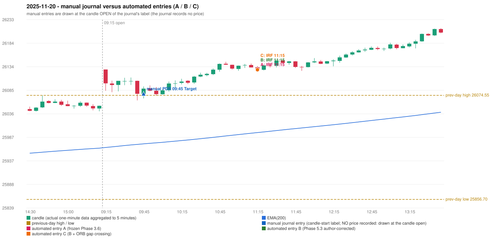

# 2025-11-20 (Thursday) - manual journal versus the automated configurations

> SYNTHETIC index-point P&L; no real option P&L; costs illustrative (Rs 70 per trade + slippage scenarios). Configurations A / B / C are never combined.

## Session

* Open 26128.7; previous official close 26052.65; gap +76.05; previous-day high / low 26074.55 / 25856.7
* First 5-minute candle (09:15-09:20): O26128.7 H26128.7 L26084.15 C26099.7, RED, body 65.1%; EMA(200) at the first candle 25965.42; previous session's last close 26052.7 vs its EMA 25964.07

## Manual journal

row 40: PDR labelled 09:45, outcome Target

## Configuration A

Candidate signals (confirmed): 11:20 IRF/Method 1 SHORT [EXECUTED: trade 1: INITIAL_FULL_STOP]; 11:40 IRF/Method 2B SHORT [IGNORED: POSITION_ACTIVE (signal kept for diagnostics only; never reused)]; 14:30 IRF/Method 2A SHORT [REJECTED: SECOND_TRADE_RESTRICTED_TO_PDR_PDS]

Strategies with no confirmed signal: ORB: Method 1 INVALIDATED CANDLE_QUALITY(not a strong body / wick too large); Method 2 INVALIDATED CANDLE_QUALITY | PDR: no setup record (the strategy's trigger event never occurred) | PDS: no setup record (the strategy's trigger event never occurred) | RF: RF INVALIDATED GAP_UP_OUTSIDE_YESTERDAYS_RANGE

| trade | strategy / method | dir | signal -> fill | entry | stop / T1 / T2 | leg 1 | leg 2 | outcome | gross Rs | net Rs (70, 0) | net Rs (70, 1.0) |
|---|---|---|---|---|---|---|---|---|---|---|---|
| 1 | IRF/Method 1 | SHORT | 11:20 -> 11:20 | 26128.2 | 26163.2 / 26101.2 / 26068.2 | 12:32 @ 26163.2 | 12:32 @ 26163.2 | INITIAL_FULL_STOP | -13,650 | -13,720 | -14,500 |

Selection: This IRF Method 1 signal was the earliest executable signal of the day: 0 confirmed signal(s) earlier, 0 other in the same minute. 2 later confirmed signal(s) (IRF x2) are logged as ignored or rejected. State of the other four engines at that moment: [ORB: Method 1 invalidated at 09:15: CANDLE_QUALITY(not a strong body / wick too large); Method 2 invalidated at 09:15: CANDLE_QUALITY] [PDR: no setup record before this time (a base condition was not met, or nothing triggered)] [PDS: no setup record before this time (a base condition was not met, or nothing triggered)] [RF: RF invalidated at 09:45: GAP_UP_OUTSIDE_YESTERDAYS_RANGE]

* Journal row 40 (PDR 09:45): **UNMATCHED_MANUAL**; earliest cause LEVEL_CONSTRUCTION_MISMATCH: price never retested the previous-day body-based zone [26058.6, 26062.65] after the gap up
* Automated IRF 11:15 has no strict / time-tolerant journal counterpart: DIFFERENT_STRATEGY_SELECTED - the journal traded PDR 09:45; the automated controller took IRF Method 1 (candle 11:15) as the first valid signal

## Configuration B

Candidate signals (confirmed): 11:20 IRF/Method 1 SHORT [EXECUTED: trade 1: INITIAL_FULL_STOP]; 11:20 IRF/Method 2A SHORT [MERGED_SAME_STRATEGY_METHOD: traded as another method of the same strategy/direction in the same minute]; 11:50 IRF/Method 2A SHORT [IGNORED: POSITION_ACTIVE (signal kept for diagnostics only; never reused)]

Strategies with no confirmed signal: ORB: Method 1 INVALIDATED CANDLE_QUALITY(not a strong body / wick too large); Method 2 INVALIDATED CANDLE_QUALITY | PDR: no setup record (the strategy's trigger event never occurred) | PDS: no setup record (the strategy's trigger event never occurred) | RF: RF INVALIDATED GAP_UP_OUTSIDE_YESTERDAYS_RANGE

| trade | strategy / method | dir | signal -> fill | entry | stop / T1 / T2 | leg 1 | leg 2 | outcome | gross Rs | net Rs (70, 0) | net Rs (70, 1.0) |
|---|---|---|---|---|---|---|---|---|---|---|---|
| 1 | IRF/Method 1 | SHORT | 11:20 -> 11:20 | 26128.2 | 26163.2 / 26101.2 / 26068.2 | 12:32 @ 26163.2 | 12:32 @ 26163.2 | INITIAL_FULL_STOP | -13,650 | -13,720 | -14,500 |

Selection: This IRF Method 1 signal was the earliest executable signal of the day: 0 confirmed signal(s) earlier, 1 other in the same minute. 1 later confirmed signal(s) (IRF x1) are logged as ignored or rejected. State of the other four engines at that moment: [ORB: Method 1 invalidated at 09:15: CANDLE_QUALITY(not a strong body / wick too large); Method 2 invalidated at 09:15: CANDLE_QUALITY] [PDR: no setup record before this time (a base condition was not met, or nothing triggered)] [PDS: no setup record before this time (a base condition was not met, or nothing triggered)] [RF: RF invalidated at 09:45: GAP_UP_OUTSIDE_YESTERDAYS_RANGE]

* Journal row 40 (PDR 09:45): **UNMATCHED_MANUAL**; earliest cause LEVEL_CONSTRUCTION_MISMATCH: price never retested the previous-day body-based zone [26058.6, 26062.65] after the gap up
* Automated IRF 11:15 has no strict / time-tolerant journal counterpart: DIFFERENT_STRATEGY_SELECTED - the journal traded PDR 09:45; the automated controller took IRF Method 1 (candle 11:15) as the first valid signal

## Configuration C

Candidate signals (confirmed): 11:20 IRF/Method 1 SHORT [EXECUTED: trade 1: INITIAL_FULL_STOP]; 11:20 IRF/Method 2A SHORT [MERGED_SAME_STRATEGY_METHOD: traded as another method of the same strategy/direction in the same minute]; 11:50 IRF/Method 2A SHORT [IGNORED: POSITION_ACTIVE (signal kept for diagnostics only; never reused)]

Strategies with no confirmed signal: ORB: Method 1 INVALIDATED CANDLE_QUALITY(not a strong body / wick too large); Method 2 INVALIDATED CANDLE_QUALITY | PDR: no setup record (the strategy's trigger event never occurred) | PDS: no setup record (the strategy's trigger event never occurred) | RF: RF INVALIDATED GAP_UP_OUTSIDE_YESTERDAYS_RANGE

| trade | strategy / method | dir | signal -> fill | entry | stop / T1 / T2 | leg 1 | leg 2 | outcome | gross Rs | net Rs (70, 0) | net Rs (70, 1.0) |
|---|---|---|---|---|---|---|---|---|---|---|---|
| 1 | IRF/Method 1 | SHORT | 11:20 -> 11:20 | 26128.2 | 26163.2 / 26101.2 / 26068.2 | 12:32 @ 26163.2 | 12:32 @ 26163.2 | INITIAL_FULL_STOP | -13,650 | -13,720 | -14,500 |

Selection: This IRF Method 1 signal was the earliest executable signal of the day: 0 confirmed signal(s) earlier, 1 other in the same minute. 1 later confirmed signal(s) (IRF x1) are logged as ignored or rejected. State of the other four engines at that moment: [ORB: Method 1 invalidated at 09:15: CANDLE_QUALITY(not a strong body / wick too large); Method 2 invalidated at 09:15: CANDLE_QUALITY] [PDR: no setup record before this time (a base condition was not met, or nothing triggered)] [PDS: no setup record before this time (a base condition was not met, or nothing triggered)] [RF: RF invalidated at 09:45: GAP_UP_OUTSIDE_YESTERDAYS_RANGE]

* Journal row 40 (PDR 09:45): **UNMATCHED_MANUAL**; earliest cause LEVEL_CONSTRUCTION_MISMATCH: price never retested the previous-day body-based zone [26058.6, 26062.65] after the gap up
* Automated IRF 11:15 has no strict / time-tolerant journal counterpart: DIFFERENT_STRATEGY_SELECTED - the journal traded PDR 09:45; the automated controller took IRF Method 1 (candle 11:15) as the first valid signal

## Handwritten author corrections for this date

* AC23 (page 4): "[crossed out:] RF should be activated + Or PDR should be activated as it Sab[?]" - status A / B / C: NOT_ADDRESSED_BY_THE_CONFIGURATIONS / NOT_ADDRESSED_BY_THE_CONFIGURATIONS / NOT_ADDRESSED_BY_THE_CONFIGURATIONS

## Chart

