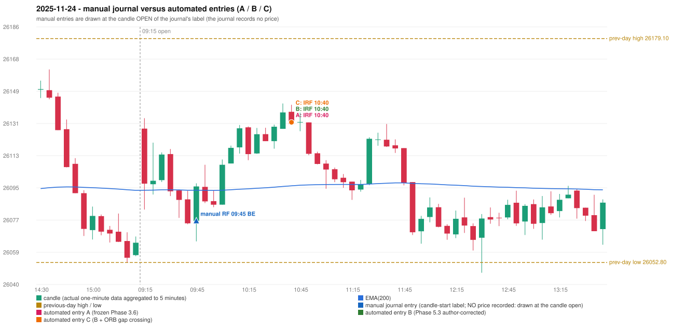

# 2025-11-24 (Monday) - manual journal versus the automated configurations

> SYNTHETIC index-point P&L; no real option P&L; costs illustrative (Rs 70 per trade + slippage scenarios). Configurations A / B / C are never combined.

## Session

* Open 26128.3; previous official close 26068.15; gap +60.15; previous-day high / low 26179.1 / 26052.8
* First 5-minute candle (09:15-09:20): O26128.3 H26134.2 L26082.65 C26097.25, RED, body 60.2%; EMA(200) at the first candle 26093.55; previous session's last close 26063.95 vs its EMA 26093.51

## Manual journal

row 42: RF labelled 09:45, outcome BE

## Configuration A

Candidate signals (confirmed): 10:45 IRF/Method 1 SHORT [EXECUTED: trade 1: TARGET]

Strategies with no confirmed signal: ORB: Gap/200DMA INVALIDATED CANDLE_QUALITY_OR_REJECTION_WICK; Method 2 INVALIDATED TREND:EMA_PREV_SESSION_CLOSE wrong side; Method 2 INVALIDATED TRENDLINE_NOT_SUPPOR | PDR: PDR INVALIDATED OPEN_NOT_STRICTLY_ABOVE_ZONE | PDS: no setup record (the strategy's trigger event never occurred) | RF: RF INVALIDATED TREND:EMA_PREV_SESSION_CLOSE wrong side

| trade | strategy / method | dir | signal -> fill | entry | stop / T1 / T2 | leg 1 | leg 2 | outcome | gross Rs | net Rs (70, 0) | net Rs (70, 1.0) |
|---|---|---|---|---|---|---|---|---|---|---|---|
| 1 | IRF/Method 1 | SHORT | 10:45 -> 10:45 | 26131.9 | 26166.9 / 26104.9 / 26071.9 | 11:01 @ 26104.9 | 11:54 @ 26071.9 | TARGET | 16,965 | 16,895 | 16,115 |

Selection: This IRF Method 1 signal was the earliest executable signal of the day: 0 confirmed signal(s) earlier, 0 other in the same minute. No later signal was generated. State of the other four engines at that moment: [ORB: Method 2 invalidated at 09:15: TREND:EMA_PREV_SESSION_CLOSE wrong side; Gap/200DMA invalidated at 09:15: CANDLE_QUALITY_OR_REJECTION_WICK] [PDR: PDR invalidated at 09:15: OPEN_NOT_STRICTLY_ABOVE_ZONE] [PDS: no setup record before this time (a base condition was not met, or nothing triggered)] [RF: RF invalidated at 09:45: TREND:EMA_PREV_SESSION_CLOSE wrong side]

* Journal row 42 (RF 09:45): **UNMATCHED_MANUAL**; earliest cause EMA_FILTER_MISMATCH: RF setup rejected by the trend / EMA condition (TREND:EMA_PREV_SESSION_CLOSE wrong side)
* Automated IRF 10:40 has no strict / time-tolerant journal counterpart: DIFFERENT_STRATEGY_SELECTED - the journal traded RF 09:45; the automated controller took IRF Method 1 (candle 10:40) as the first valid signal

## Configuration B

Candidate signals (confirmed): 10:45 IRF/Method 1 SHORT [EXECUTED: trade 1: TARGET]

Strategies with no confirmed signal: ORB: Gap/200DMA INVALIDATED CANDLE_QUALITY_OR_REJECTION_WICK; Method 2 INVALIDATED TREND:EMA_PREV_SESSION_CLOSE wrong side; Method 2 INVALIDATED TRENDLINE_NOT_SUPPOR | PDR: PDR INVALIDATED OPEN_NOT_STRICTLY_ABOVE_ZONE | PDS: no setup record (the strategy's trigger event never occurred) | RF: RF INVALIDATED TREND:EMA_PREV_SESSION_CLOSE wrong side

| trade | strategy / method | dir | signal -> fill | entry | stop / T1 / T2 | leg 1 | leg 2 | outcome | gross Rs | net Rs (70, 0) | net Rs (70, 1.0) |
|---|---|---|---|---|---|---|---|---|---|---|---|
| 1 | IRF/Method 1 | SHORT | 10:45 -> 10:45 | 26131.9 | 26166.9 / 26104.9 / 26071.9 | 11:01 @ 26104.9 | 11:54 @ 26071.9 | TARGET | 16,965 | 16,895 | 16,115 |

Selection: This IRF Method 1 signal was the earliest executable signal of the day: 0 confirmed signal(s) earlier, 0 other in the same minute. No later signal was generated. State of the other four engines at that moment: [ORB: Method 2 invalidated at 09:15: TREND:EMA_PREV_SESSION_CLOSE wrong side; Gap/200DMA invalidated at 09:15: CANDLE_QUALITY_OR_REJECTION_WICK] [PDR: PDR invalidated at 09:15: OPEN_NOT_STRICTLY_ABOVE_ZONE] [PDS: no setup record before this time (a base condition was not met, or nothing triggered)] [RF: RF invalidated at 09:45: TREND:EMA_PREV_SESSION_CLOSE wrong side]

* Journal row 42 (RF 09:45): **UNMATCHED_MANUAL**; earliest cause EMA_FILTER_MISMATCH: RF setup rejected by the trend / EMA condition (TREND:EMA_PREV_SESSION_CLOSE wrong side)
* Automated IRF 10:40 has no strict / time-tolerant journal counterpart: DIFFERENT_STRATEGY_SELECTED - the journal traded RF 09:45; the automated controller took IRF Method 1 (candle 10:40) as the first valid signal

## Configuration C

Candidate signals (confirmed): 10:45 IRF/Method 1 SHORT [EXECUTED: trade 1: TARGET]

Strategies with no confirmed signal: ORB: Gap/200DMA INVALIDATED CANDLE_QUALITY_OR_REJECTION_WICK; Method 2 INVALIDATED TREND:EMA_PREV_SESSION_CLOSE wrong side; Method 2 INVALIDATED TRENDLINE_NOT_SUPPOR | PDR: PDR INVALIDATED OPEN_NOT_STRICTLY_ABOVE_ZONE | PDS: no setup record (the strategy's trigger event never occurred) | RF: RF INVALIDATED TREND:EMA_PREV_SESSION_CLOSE wrong side

| trade | strategy / method | dir | signal -> fill | entry | stop / T1 / T2 | leg 1 | leg 2 | outcome | gross Rs | net Rs (70, 0) | net Rs (70, 1.0) |
|---|---|---|---|---|---|---|---|---|---|---|---|
| 1 | IRF/Method 1 | SHORT | 10:45 -> 10:45 | 26131.9 | 26166.9 / 26104.9 / 26071.9 | 11:01 @ 26104.9 | 11:54 @ 26071.9 | TARGET | 16,965 | 16,895 | 16,115 |

Selection: This IRF Method 1 signal was the earliest executable signal of the day: 0 confirmed signal(s) earlier, 0 other in the same minute. No later signal was generated. State of the other four engines at that moment: [ORB: Method 2 invalidated at 09:15: TREND:EMA_PREV_SESSION_CLOSE wrong side; Gap/200DMA invalidated at 09:15: CANDLE_QUALITY_OR_REJECTION_WICK] [PDR: PDR invalidated at 09:15: OPEN_NOT_STRICTLY_ABOVE_ZONE] [PDS: no setup record before this time (a base condition was not met, or nothing triggered)] [RF: RF invalidated at 09:45: TREND:EMA_PREV_SESSION_CLOSE wrong side]

* Journal row 42 (RF 09:45): **UNMATCHED_MANUAL**; earliest cause EMA_FILTER_MISMATCH: RF setup rejected by the trend / EMA condition (TREND:EMA_PREV_SESSION_CLOSE wrong side)
* Automated IRF 10:40 has no strict / time-tolerant journal counterpart: DIFFERENT_STRATEGY_SELECTED - the journal traded RF 09:45; the automated controller took IRF Method 1 (candle 10:40) as the first valid signal

## Handwritten author corrections for this date

* AC25 (page 5): "RF should be activated, but IRF is entered" - status A / B / C: NOT_ADDRESSED_BY_THE_CONFIGURATIONS / NOT_ADDRESSED_BY_THE_CONFIGURATIONS / NOT_ADDRESSED_BY_THE_CONFIGURATIONS

## Chart

