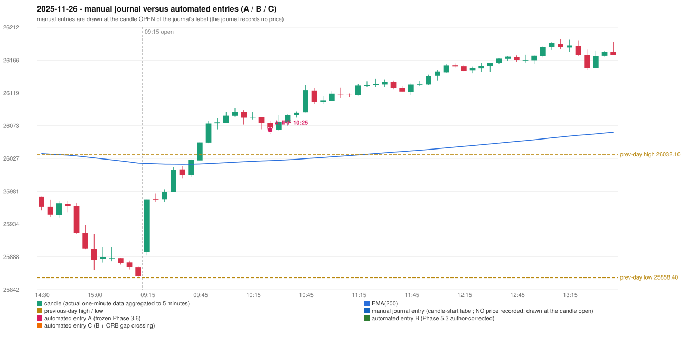

# 2025-11-26 (Wednesday) - manual journal versus the automated configurations

> SYNTHETIC index-point P&L; no real option P&L; costs illustrative (Rs 70 per trade + slippage scenarios). Configurations A / B / C are never combined.

## Session

* Open 25894.6; previous official close 25884.8; gap +9.80; previous-day high / low 26032.1 / 25858.4
* First 5-minute candle (09:15-09:20): O25894.6 H25969.05 L25889.75 C25969.05, GREEN, body 93.9%; EMA(200) at the first candle 26019.79; previous session's last close 25860.3 vs its EMA 26020.30

## Manual journal

no manual trade recorded

## Configuration A

Candidate signals (confirmed): 10:30 IRF/Method 2A SHORT [EXECUTED: trade 1: INITIAL_FULL_STOP]; 11:40 IRF/Method 2B SHORT [REJECTED: SECOND_TRADE_RESTRICTED_TO_PDR_PDS]; 13:30 IRF/Method 2A SHORT [REJECTED: SECOND_TRADE_RESTRICTED_TO_PDR_PDS]; 13:30 IRF/Method 2B SHORT [REJECTED: SECOND_TRADE_RESTRICTED_TO_PDR_PDS]; 14:20 IRF/Method 2B SHORT [REJECTED: SECOND_TRADE_RESTRICTED_TO_PDR_PDS]

Strategies with no confirmed signal: ORB: no setup record (the strategy's trigger event never occurred) | PDR: PDR INVALIDATED OPEN_NOT_STRICTLY_ABOVE_ZONE | PDS: no setup record (the strategy's trigger event never occurred) | RF: no setup record (the strategy's trigger event never occurred)

| trade | strategy / method | dir | signal -> fill | entry | stop / T1 / T2 | leg 1 | leg 2 | outcome | gross Rs | net Rs (70, 0) | net Rs (70, 1.0) |
|---|---|---|---|---|---|---|---|---|---|---|---|
| 1 | IRF/Method 2A | SHORT | 10:30 -> 10:30 | 26067.3 | 26102.3 / 26040.3 / 26007.3 | 10:45 @ 26102.3 | 10:45 @ 26102.3 | INITIAL_FULL_STOP | -13,650 | -13,720 | -14,500 |

Selection: This IRF Method 2A signal was the earliest executable signal of the day: 0 confirmed signal(s) earlier, 0 other in the same minute. 4 later confirmed signal(s) (IRF x4) are logged as ignored or rejected. State of the other four engines at that moment: [ORB: no setup record before this time (a base condition was not met, or nothing triggered)] [PDR: PDR invalidated at 09:15: OPEN_NOT_STRICTLY_ABOVE_ZONE] [PDS: no setup record before this time (a base condition was not met, or nothing triggered)] [RF: no setup record before this time (a base condition was not met, or nothing triggered)]

* Automated IRF 10:25 has no strict / time-tolerant journal counterpart: UNRESOLVED_DISCRETIONARY_SELECTION - the journal records no trade this day; the automated system took IRF Method 2A SHORT (candle 10:25) mechanically

## Configuration B

Candidate signals (confirmed): none

Strategies with no confirmed signal: IRF: Method 1/2 INCOMPLETE_AT_EOD SESSION_ENDED_BEFORE_CONFIRMATION | ORB: no setup record (the strategy's trigger event never occurred) | PDR: PDR INVALIDATED OPEN_NOT_STRICTLY_ABOVE_ZONE | PDS: no setup record (the strategy's trigger event never occurred) | RF: no setup record (the strategy's trigger event never occurred)

No trade: final day state READY_FOR_FIRST_TRADE. No strategy qualified.

## Configuration C

Candidate signals (confirmed): none

Strategies with no confirmed signal: IRF: Method 1/2 INCOMPLETE_AT_EOD SESSION_ENDED_BEFORE_CONFIRMATION | ORB: Gap/200DMA INVALIDATED CLOSE_NOT_BEYOND_MA | PDR: PDR INVALIDATED OPEN_NOT_STRICTLY_ABOVE_ZONE | PDS: no setup record (the strategy's trigger event never occurred) | RF: no setup record (the strategy's trigger event never occurred)

No trade: final day state READY_FOR_FIRST_TRADE. No strategy qualified.

## Handwritten author corrections for this date

* AC26 (page 5): "First red candle should be considered" - status A / B / C: IRF_TRADE_UNCHANGED / IRF_TRADE_CHANGED / IRF_TRADE_CHANGED

## Chart

