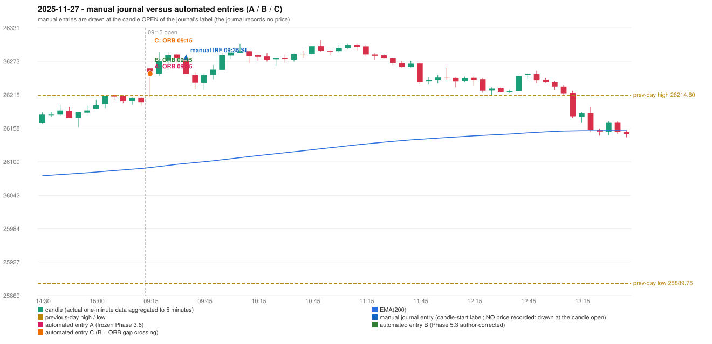

# 2025-11-27 (Thursday) - manual journal versus the automated configurations

> SYNTHETIC index-point P&L; no real option P&L; costs illustrative (Rs 70 per trade + slippage scenarios). Configurations A / B / C are never combined.

## Session

* Open 26261.25; previous official close 26205.3; gap +55.95; previous-day high / low 26214.8 / 25889.75
* First 5-minute candle (09:15-09:20): O26261.25 H26261.25 L26210.85 C26253.6, RED, body 15.2%; EMA(200) at the first candle 26089.96; previous session's last close 26202.7 vs its EMA 26088.31

## Manual journal

row 44: IRF labelled 09:35, outcome SL

## Configuration A

Candidate signals (confirmed): 09:20 ORB/Method 1 LONG [EXECUTED: trade 1: T1_THEN_BUFFER_STOP]; 09:40 IRF/Method 1 SHORT [IGNORED: POSITION_ACTIVE (signal kept for diagnostics only; never reused)]; 10:00 PDR/PDR LONG [IGNORED: DAY_FINISHED]; 10:15 IRF/Method 2B SHORT [IGNORED: DAY_FINISHED]; 10:45 IRF/Method 2B SHORT [IGNORED: DAY_FINISHED]; 11:25 IRF/Method 2A SHORT [IGNORED: DAY_FINISHED]; 11:50 IRF/Method 1 SHORT [IGNORED: DAY_FINISHED]

Strategies with no confirmed signal: PDS: no setup record (the strategy's trigger event never occurred) | RF: RF INVALIDATED GAP_UP_OUTSIDE_YESTERDAYS_RANGE

| trade | strategy / method | dir | signal -> fill | entry | stop / T1 / T2 | leg 1 | leg 2 | outcome | gross Rs | net Rs (70, 0) | net Rs (70, 1.0) |
|---|---|---|---|---|---|---|---|---|---|---|---|
| 1 | ORB/Method 1 | LONG | 09:20 -> 09:20 | 26251.95 | 26221.95 / 26278.95 / 26311.95 | 09:22 @ 26278.95 | 09:40 @ 26245.95 | T1_THEN_BUFFER_STOP | 4,095 | 4,025 | 3,245 |

Selection: This ORB Method 1 signal was the earliest executable signal of the day: 0 confirmed signal(s) earlier, 0 other in the same minute. 6 later confirmed signal(s) (IRF x5, PDR x1) are logged as ignored or rejected. State of the other four engines at that moment: [IRF: no setup record before this time (a base condition was not met, or nothing triggered)] [PDR: no setup record before this time (a base condition was not met, or nothing triggered)] [PDS: no setup record before this time (a base condition was not met, or nothing triggered)] [RF: no setup record before this time (a base condition was not met, or nothing triggered)]

* Journal row 44 (IRF 09:35): **UNMATCHED_MANUAL**; earliest cause DIFFERENT_STRATEGY_SELECTED (+ PORTFOLIO_CONTROLLER_CONSTRAINT): the controller took ORB Method 1 (signal 09:20) first; the IRF signal at 09:40 was IGNORED: POSITION_ACTIVE (signal kept for diagnostics only; never reused)
* Automated ORB 09:15 has no strict / time-tolerant journal counterpart: DIFFERENT_STRATEGY_SELECTED - the journal traded IRF 09:35; the automated controller took ORB Method 1 (candle 09:15) as the first valid signal

## Configuration B

Candidate signals (confirmed): 09:20 ORB/Method 1 LONG [EXECUTED: trade 1: T1_THEN_BUFFER_STOP]; 09:25 PDR/PDR LONG [IGNORED: POSITION_ACTIVE (signal kept for diagnostics only; never reused)]; 09:40 IRF/Method 1 SHORT [IGNORED: POSITION_ACTIVE (signal kept for diagnostics only; never reused)]; 10:15 IRF/Method 2B SHORT [IGNORED: DAY_FINISHED]; 10:45 IRF/Method 2B SHORT [IGNORED: DAY_FINISHED]; 11:20 IRF/Method 2A SHORT [IGNORED: DAY_FINISHED]; 11:50 IRF/Method 1 SHORT [IGNORED: DAY_FINISHED]; 14:40 PDR/PDR LONG [IGNORED: DAY_FINISHED]; 15:20 PDR/PDR LONG [IGNORED: DAY_FINISHED]; 15:30 PDR/PDR LONG [IGNORED: DAY_FINISHED]

Strategies with no confirmed signal: PDS: no setup record (the strategy's trigger event never occurred) | RF: RF INVALIDATED GAP_UP_OUTSIDE_YESTERDAYS_RANGE

| trade | strategy / method | dir | signal -> fill | entry | stop / T1 / T2 | leg 1 | leg 2 | outcome | gross Rs | net Rs (70, 0) | net Rs (70, 1.0) |
|---|---|---|---|---|---|---|---|---|---|---|---|
| 1 | ORB/Method 1 | LONG | 09:20 -> 09:20 | 26251.95 | 26221.95 / 26278.95 / 26311.95 | 09:22 @ 26278.95 | 09:40 @ 26245.95 | T1_THEN_BUFFER_STOP | 4,095 | 4,025 | 3,245 |

Selection: This ORB Method 1 signal was the earliest executable signal of the day: 0 confirmed signal(s) earlier, 0 other in the same minute. 9 later confirmed signal(s) (IRF x5, PDR x4) are logged as ignored or rejected. State of the other four engines at that moment: [IRF: no setup record before this time (a base condition was not met, or nothing triggered)] [PDR: no setup record before this time (a base condition was not met, or nothing triggered)] [PDS: no setup record before this time (a base condition was not met, or nothing triggered)] [RF: no setup record before this time (a base condition was not met, or nothing triggered)]

* Journal row 44 (IRF 09:35): **UNMATCHED_MANUAL**; earliest cause DIFFERENT_STRATEGY_SELECTED (+ PORTFOLIO_CONTROLLER_CONSTRAINT): the controller took ORB Method 1 (signal 09:20) first; the IRF signal at 09:40 was IGNORED: POSITION_ACTIVE (signal kept for diagnostics only; never reused)
* Automated ORB 09:15 has no strict / time-tolerant journal counterpart: DIFFERENT_STRATEGY_SELECTED - the journal traded IRF 09:35; the automated controller took ORB Method 1 (candle 09:15) as the first valid signal

## Configuration C

Candidate signals (confirmed): 09:20 ORB/Method 1 LONG [EXECUTED: trade 1: T1_THEN_BUFFER_STOP]; 09:25 PDR/PDR LONG [IGNORED: POSITION_ACTIVE (signal kept for diagnostics only; never reused)]; 09:40 IRF/Method 1 SHORT [IGNORED: POSITION_ACTIVE (signal kept for diagnostics only; never reused)]; 10:15 IRF/Method 2B SHORT [IGNORED: DAY_FINISHED]; 10:45 IRF/Method 2B SHORT [IGNORED: DAY_FINISHED]; 11:20 IRF/Method 2A SHORT [IGNORED: DAY_FINISHED]; 11:50 IRF/Method 1 SHORT [IGNORED: DAY_FINISHED]; 14:40 PDR/PDR LONG [IGNORED: DAY_FINISHED]; 15:20 PDR/PDR LONG [IGNORED: DAY_FINISHED]; 15:30 PDR/PDR LONG [IGNORED: DAY_FINISHED]

Strategies with no confirmed signal: PDS: no setup record (the strategy's trigger event never occurred) | RF: RF INVALIDATED GAP_UP_OUTSIDE_YESTERDAYS_RANGE

| trade | strategy / method | dir | signal -> fill | entry | stop / T1 / T2 | leg 1 | leg 2 | outcome | gross Rs | net Rs (70, 0) | net Rs (70, 1.0) |
|---|---|---|---|---|---|---|---|---|---|---|---|
| 1 | ORB/Method 1 | LONG | 09:20 -> 09:20 | 26251.95 | 26221.95 / 26278.95 / 26311.95 | 09:22 @ 26278.95 | 09:40 @ 26245.95 | T1_THEN_BUFFER_STOP | 4,095 | 4,025 | 3,245 |

Selection: This ORB Method 1 signal was the earliest executable signal of the day: 0 confirmed signal(s) earlier, 0 other in the same minute. 9 later confirmed signal(s) (IRF x5, PDR x4) are logged as ignored or rejected. State of the other four engines at that moment: [IRF: no setup record before this time (a base condition was not met, or nothing triggered)] [PDR: no setup record before this time (a base condition was not met, or nothing triggered)] [PDS: no setup record before this time (a base condition was not met, or nothing triggered)] [RF: no setup record before this time (a base condition was not met, or nothing triggered)]

* Journal row 44 (IRF 09:35): **UNMATCHED_MANUAL**; earliest cause DIFFERENT_STRATEGY_SELECTED (+ PORTFOLIO_CONTROLLER_CONSTRAINT): the controller took ORB Method 1 (signal 09:20) first; the IRF signal at 09:40 was IGNORED: POSITION_ACTIVE (signal kept for diagnostics only; never reused)
* Automated ORB 09:15 has no strict / time-tolerant journal counterpart: DIFFERENT_STRATEGY_SELECTED - the journal traded IRF 09:35; the automated controller took ORB Method 1 (candle 09:15) as the first valid signal

## Handwritten author corrections for this date

* AC27 (page 5): "ORB is activated on a red candle for long side, which is wrong. ORB for long should be in green closing." - status A / B / C: STILL_TRADED_RED_CANDLE_LONG / STILL_TRADED_RED_CANDLE_LONG / STILL_TRADED_RED_CANDLE_LONG

## Chart

