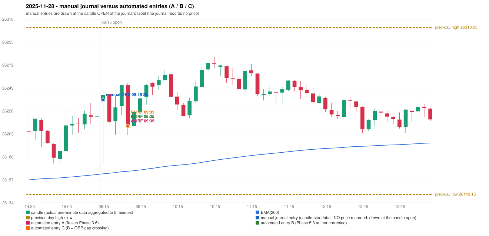

# 2025-11-28 (Friday) - manual journal versus the automated configurations

> SYNTHETIC index-point P&L; no real option P&L; costs illustrative (Rs 70 per trade + slippage scenarios). Configurations A / B / C are never combined.

## Session

* Open 26237.45; previous official close 26215.55; gap +21.90; previous-day high / low 26310.05 / 26142.15
* First 5-minute candle (09:15-09:20): O26237.45 H26246.9 L26172.9 C26242.15, GREEN, body 6.4%; EMA(200) at the first candle 26162.97; previous session's last close 26220.8 vs its EMA 26162.18

## Manual journal

row 45: ORB labelled 09:15, outcome SL

## Configuration A

Candidate signals (confirmed): 09:40 IRF/Method 1 SHORT [EXECUTED: trade 1: INITIAL_FULL_STOP]; 10:15 IRF/Method 1 SHORT [REJECTED: SECOND_TRADE_RESTRICTED_TO_PDR_PDS]; 11:00 IRF/Method 2B SHORT [REJECTED: SECOND_TRADE_RESTRICTED_TO_PDR_PDS]; 11:25 IRF/Method 1 SHORT [REJECTED: SECOND_TRADE_RESTRICTED_TO_PDR_PDS]; 11:30 IRF/Method 2A SHORT [REJECTED: SECOND_TRADE_RESTRICTED_TO_PDR_PDS]; 12:05 IRF/Method 1 SHORT [REJECTED: SECOND_TRADE_RESTRICTED_TO_PDR_PDS]; 12:10 IRF/Method 2A SHORT [REJECTED: SECOND_TRADE_RESTRICTED_TO_PDR_PDS]

Strategies with no confirmed signal: ORB: Method 2 INVALIDATED TRENDLINE_NOT_SUPPORTIVE | PDR: PDR INVALIDATED OPEN_NOT_STRICTLY_ABOVE_ZONE | PDS: no setup record (the strategy's trigger event never occurred) | RF: no setup record (the strategy's trigger event never occurred)

| trade | strategy / method | dir | signal -> fill | entry | stop / T1 / T2 | leg 1 | leg 2 | outcome | gross Rs | net Rs (70, 0) | net Rs (70, 1.0) |
|---|---|---|---|---|---|---|---|---|---|---|---|
| 1 | IRF/Method 1 | SHORT | 09:40 -> 09:40 | 26211.0 | 26246.0 / 26184.0 / 26151.0 | 09:50 @ 26246.0 | 09:50 @ 26246.0 | INITIAL_FULL_STOP | -13,650 | -13,720 | -14,500 |

Selection: This IRF Method 1 signal was the earliest executable signal of the day: 0 confirmed signal(s) earlier, 0 other in the same minute. 6 later confirmed signal(s) (IRF x6) are logged as ignored or rejected. State of the other four engines at that moment: [ORB: Method 2 invalidated at 09:15: TRENDLINE_NOT_SUPPORTIVE] [PDR: PDR invalidated at 09:15: OPEN_NOT_STRICTLY_ABOVE_ZONE] [PDS: no setup record before this time (a base condition was not met, or nothing triggered)] [RF: no setup record before this time (a base condition was not met, or nothing triggered)]

* Journal row 45 (ORB 09:15): **UNMATCHED_MANUAL**; earliest cause LEVEL_CONSTRUCTION_MISMATCH (+ TRENDLINE_MISMATCH): first candle GREEN O26237.45 H26246.9 L26172.9 C26242.15 (body 6.4%); direction ASSUMED from the colour (the journal has no direction); TIE-BROKEN BY METHOD ORDER: 3 methods tie at 1 failing predicate(s) (Method 1: level_broken; Method 2: trendline; Gap/200DMA: gap_crosses_200_average) - the evidence does not single out one cause, the secondary cause is the other tied one; closest method Method 1 (1 failing predicate(s)): first failing 'level_broken' - previous-day high 26310.05; candle high/low 26246.9, close 26242.15; all methods: Method 1: 1 fail (level_broken); Method 2: 1 fail (trendline); Gap/200DMA: 1 fail (gap_crosses_200_average)
* Automated IRF 09:35 has no strict / time-tolerant journal counterpart: DIFFERENT_STRATEGY_SELECTED - the journal traded ORB 09:15; the automated controller took IRF Method 1 (candle 09:35) as the first valid signal

## Configuration B

Candidate signals (confirmed): 09:40 IRF/Method 1 SHORT [EXECUTED: trade 1: INITIAL_FULL_STOP]; 10:15 IRF/Method 1 SHORT [REJECTED: SECOND_TRADE_RESTRICTED_TO_PDR_PDS]; 10:20 IRF/Method 2A SHORT [REJECTED: SECOND_TRADE_RESTRICTED_TO_PDR_PDS]; 11:00 IRF/Method 2A SHORT [REJECTED: SECOND_TRADE_RESTRICTED_TO_PDR_PDS]; 11:25 IRF/Method 1 SHORT [REJECTED: SECOND_TRADE_RESTRICTED_TO_PDR_PDS]; 12:05 IRF/Method 1 SHORT [REJECTED: SECOND_TRADE_RESTRICTED_TO_PDR_PDS]; 12:10 IRF/Method 2A SHORT [REJECTED: SECOND_TRADE_RESTRICTED_TO_PDR_PDS]

Strategies with no confirmed signal: ORB: Method 2 INVALIDATED TRENDLINE_NOT_SUPPORTIVE | PDR: PDR INVALIDATED OPEN_NOT_STRICTLY_ABOVE_ZONE | PDS: no setup record (the strategy's trigger event never occurred) | RF: no setup record (the strategy's trigger event never occurred)

| trade | strategy / method | dir | signal -> fill | entry | stop / T1 / T2 | leg 1 | leg 2 | outcome | gross Rs | net Rs (70, 0) | net Rs (70, 1.0) |
|---|---|---|---|---|---|---|---|---|---|---|---|
| 1 | IRF/Method 1 | SHORT | 09:40 -> 09:40 | 26211.0 | 26246.0 / 26184.0 / 26151.0 | 09:50 @ 26246.0 | 09:50 @ 26246.0 | INITIAL_FULL_STOP | -13,650 | -13,720 | -14,500 |

Selection: This IRF Method 1 signal was the earliest executable signal of the day: 0 confirmed signal(s) earlier, 0 other in the same minute. 6 later confirmed signal(s) (IRF x6) are logged as ignored or rejected. State of the other four engines at that moment: [ORB: Method 2 invalidated at 09:15: TRENDLINE_NOT_SUPPORTIVE] [PDR: PDR invalidated at 09:15: OPEN_NOT_STRICTLY_ABOVE_ZONE] [PDS: no setup record before this time (a base condition was not met, or nothing triggered)] [RF: no setup record before this time (a base condition was not met, or nothing triggered)]

* Journal row 45 (ORB 09:15): **UNMATCHED_MANUAL**; earliest cause LEVEL_CONSTRUCTION_MISMATCH (+ TRENDLINE_MISMATCH): first candle GREEN O26237.45 H26246.9 L26172.9 C26242.15 (body 6.4%); direction ASSUMED from the colour (the journal has no direction); TIE-BROKEN BY METHOD ORDER: 3 methods tie at 1 failing predicate(s) (Method 1: level_broken; Method 2: trendline; Gap/200DMA: gap_crosses_200_average) - the evidence does not single out one cause, the secondary cause is the other tied one; closest method Method 1 (1 failing predicate(s)): first failing 'level_broken' - previous-day high 26310.05; candle high/low 26246.9, close 26242.15; all methods: Method 1: 1 fail (level_broken); Method 2: 1 fail (trendline); Gap/200DMA: 1 fail (gap_crosses_200_average)
* Automated IRF 09:35 has no strict / time-tolerant journal counterpart: DIFFERENT_STRATEGY_SELECTED - the journal traded ORB 09:15; the automated controller took IRF Method 1 (candle 09:35) as the first valid signal

## Configuration C

Candidate signals (confirmed): 09:40 IRF/Method 1 SHORT [EXECUTED: trade 1: INITIAL_FULL_STOP]; 10:15 IRF/Method 1 SHORT [REJECTED: SECOND_TRADE_RESTRICTED_TO_PDR_PDS]; 10:20 IRF/Method 2A SHORT [REJECTED: SECOND_TRADE_RESTRICTED_TO_PDR_PDS]; 11:00 IRF/Method 2A SHORT [REJECTED: SECOND_TRADE_RESTRICTED_TO_PDR_PDS]; 11:25 IRF/Method 1 SHORT [REJECTED: SECOND_TRADE_RESTRICTED_TO_PDR_PDS]; 12:05 IRF/Method 1 SHORT [REJECTED: SECOND_TRADE_RESTRICTED_TO_PDR_PDS]; 12:10 IRF/Method 2A SHORT [REJECTED: SECOND_TRADE_RESTRICTED_TO_PDR_PDS]

Strategies with no confirmed signal: ORB: Method 2 INVALIDATED TRENDLINE_NOT_SUPPORTIVE | PDR: PDR INVALIDATED OPEN_NOT_STRICTLY_ABOVE_ZONE | PDS: no setup record (the strategy's trigger event never occurred) | RF: no setup record (the strategy's trigger event never occurred)

| trade | strategy / method | dir | signal -> fill | entry | stop / T1 / T2 | leg 1 | leg 2 | outcome | gross Rs | net Rs (70, 0) | net Rs (70, 1.0) |
|---|---|---|---|---|---|---|---|---|---|---|---|
| 1 | IRF/Method 1 | SHORT | 09:40 -> 09:40 | 26211.0 | 26246.0 / 26184.0 / 26151.0 | 09:50 @ 26246.0 | 09:50 @ 26246.0 | INITIAL_FULL_STOP | -13,650 | -13,720 | -14,500 |

Selection: This IRF Method 1 signal was the earliest executable signal of the day: 0 confirmed signal(s) earlier, 0 other in the same minute. 6 later confirmed signal(s) (IRF x6) are logged as ignored or rejected. State of the other four engines at that moment: [ORB: Method 2 invalidated at 09:15: TRENDLINE_NOT_SUPPORTIVE] [PDR: PDR invalidated at 09:15: OPEN_NOT_STRICTLY_ABOVE_ZONE] [PDS: no setup record before this time (a base condition was not met, or nothing triggered)] [RF: no setup record before this time (a base condition was not met, or nothing triggered)]

* Journal row 45 (ORB 09:15): **UNMATCHED_MANUAL**; earliest cause LEVEL_CONSTRUCTION_MISMATCH (+ TRENDLINE_MISMATCH): first candle GREEN O26237.45 H26246.9 L26172.9 C26242.15 (body 6.4%); direction ASSUMED from the colour (the journal has no direction); TIE-BROKEN BY METHOD ORDER: 3 methods tie at 1 failing predicate(s) (Method 1: level_broken; Method 2: trendline; Gap/200DMA: gap_crosses_200_average) - the evidence does not single out one cause, the secondary cause is the other tied one; closest method Method 1 (1 failing predicate(s)): first failing 'level_broken' - previous-day high 26310.05; candle high/low 26246.9, close 26242.15; all methods: Method 1: 1 fail (level_broken); Method 2: 1 fail (trendline); Gap/200DMA: 1 fail (gap_crosses_200_average)
* Automated IRF 09:35 has no strict / time-tolerant journal counterpart: DIFFERENT_STRATEGY_SELECTED - the journal traded ORB 09:15; the automated controller took IRF Method 1 (candle 09:35) as the first valid signal

## Handwritten author corrections for this date

* AC28 (page 5): "ORB should be activated instead of IRF" - status A / B / C: ORB_STILL_NOT_TRADED / ORB_STILL_NOT_TRADED / ORB_STILL_NOT_TRADED

## Chart

