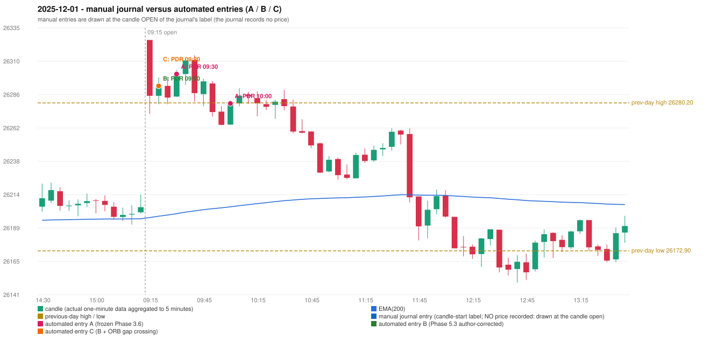

# 2025-12-01 (Monday) - manual journal versus the automated configurations

> SYNTHETIC index-point P&L; no real option P&L; costs illustrative (Rs 70 per trade + slippage scenarios). Configurations A / B / C are never combined.

## Session

* Open 26325.8; previous official close 26202.95; gap +122.85; previous-day high / low 26280.2 / 26172.9
* First 5-minute candle (09:15-09:20): O26325.8 H26325.8 L26272.25 C26285.3, RED, body 75.6%; EMA(200) at the first candle 26197.06; previous session's last close 26204.55 vs its EMA 26196.17

## Manual journal

no manual trade recorded

## Configuration A

Candidate signals (confirmed): 09:35 PDR/PDR LONG [EXECUTED: trade 1: INITIAL_FULL_STOP]; 10:05 PDR/PDR LONG [EXECUTED: trade 2: INITIAL_FULL_STOP]; 10:30 PDR/PDR LONG [IGNORED: POSITION_ACTIVE (signal kept for diagnostics only; never reused)]

Strategies with no confirmed signal: IRF: no setup record (the strategy's trigger event never occurred) | ORB: Method 1 INVALIDATED CANDLE_QUALITY(not a strong body / wick too large); Method 2 INVALIDATED CANDLE_QUALITY | PDS: no setup record (the strategy's trigger event never occurred) | RF: RF INVALIDATED GAP_UP_OUTSIDE_YESTERDAYS_RANGE

| trade | strategy / method | dir | signal -> fill | entry | stop / T1 / T2 | leg 1 | leg 2 | outcome | gross Rs | net Rs (70, 0) | net Rs (70, 1.0) |
|---|---|---|---|---|---|---|---|---|---|---|---|
| 1 | PDR/PDR | LONG | 09:35 -> 09:35 | 26301.1 | 26266.1 / 26328.1 / 26371.1 | 09:59 @ 26266.1 | 09:59 @ 26266.1 | INITIAL_FULL_STOP | -13,650 | -13,720 | -14,500 |
| 2 | PDR/PDR | LONG | 10:05 -> 10:05 | 26279.75 | 26244.75 / 26306.75 / 26349.75 | 10:51 @ 26244.75 | 10:51 @ 26244.75 | INITIAL_FULL_STOP | -13,650 | -13,720 | -14,500 |

Selection: This PDR signal was the earliest executable signal of the day: 0 confirmed signal(s) earlier, 0 other in the same minute. 2 later confirmed signal(s) (PDR x2) are logged as ignored or rejected. State of the other four engines at that moment: [IRF: no setup record before this time (a base condition was not met, or nothing triggered)] [ORB: Method 1 invalidated at 09:15: CANDLE_QUALITY(not a strong body / wick too large); Method 2 invalidated at 09:15: CANDLE_QUALITY] [PDS: no setup record before this time (a base condition was not met, or nothing triggered)] [RF: no setup record before this time (a base condition was not met, or nothing triggered)]

* Automated PDR 09:30 has no strict / time-tolerant journal counterpart: UNRESOLVED_DISCRETIONARY_SELECTION - the journal records no trade this day; the automated system took PDR PDR LONG (candle 09:30) mechanically
* Automated PDR 10:00 has no strict / time-tolerant journal counterpart: PORTFOLIO_CONTROLLER_CONSTRAINT - second trade of the day: the controller allows a PDR / PDS re-entry after the original full stop of trade 1 (PDR PDR, signal candle 09:30); the journal has no unmatched row that day

## Configuration B

Candidate signals (confirmed): 09:25 PDR/PDR LONG [EXECUTED: trade 1: INITIAL_FULL_STOP]; 10:05 PDR/PDR LONG [IGNORED: POSITION_ACTIVE (signal kept for diagnostics only; never reused)]; 10:30 PDR/PDR LONG [IGNORED: POSITION_ACTIVE (signal kept for diagnostics only; never reused)]

Strategies with no confirmed signal: IRF: no setup record (the strategy's trigger event never occurred) | ORB: Method 1 INVALIDATED CANDLE_QUALITY(not a strong body / wick too large); Method 2 INVALIDATED CANDLE_QUALITY | PDS: no setup record (the strategy's trigger event never occurred) | RF: RF INVALIDATED GAP_UP_OUTSIDE_YESTERDAYS_RANGE

| trade | strategy / method | dir | signal -> fill | entry | stop / T1 / T2 | leg 1 | leg 2 | outcome | gross Rs | net Rs (70, 0) | net Rs (70, 1.0) |
|---|---|---|---|---|---|---|---|---|---|---|---|
| 1 | PDR/PDR | LONG | 09:25 -> 09:25 | 26292.5 | 26257.5 / 26319.5 / 26362.5 | 10:45 @ 26257.5 | 10:45 @ 26257.5 | INITIAL_FULL_STOP | -13,650 | -13,720 | -14,500 |

Selection: This PDR signal was the earliest executable signal of the day: 0 confirmed signal(s) earlier, 0 other in the same minute. 2 later confirmed signal(s) (PDR x2) are logged as ignored or rejected. State of the other four engines at that moment: [IRF: no setup record before this time (a base condition was not met, or nothing triggered)] [ORB: Method 1 invalidated at 09:15: CANDLE_QUALITY(not a strong body / wick too large); Method 2 invalidated at 09:15: CANDLE_QUALITY] [PDS: no setup record before this time (a base condition was not met, or nothing triggered)] [RF: no setup record before this time (a base condition was not met, or nothing triggered)]

* Automated PDR 09:20 has no strict / time-tolerant journal counterpart: UNRESOLVED_DISCRETIONARY_SELECTION - the journal records no trade this day; the automated system took PDR PDR LONG (candle 09:20) mechanically

## Configuration C

Candidate signals (confirmed): 09:25 PDR/PDR LONG [EXECUTED: trade 1: INITIAL_FULL_STOP]; 10:05 PDR/PDR LONG [IGNORED: POSITION_ACTIVE (signal kept for diagnostics only; never reused)]; 10:30 PDR/PDR LONG [IGNORED: POSITION_ACTIVE (signal kept for diagnostics only; never reused)]

Strategies with no confirmed signal: IRF: no setup record (the strategy's trigger event never occurred) | ORB: Method 1 INVALIDATED CANDLE_QUALITY(not a strong body / wick too large); Method 2 INVALIDATED CANDLE_QUALITY | PDS: no setup record (the strategy's trigger event never occurred) | RF: RF INVALIDATED GAP_UP_OUTSIDE_YESTERDAYS_RANGE

| trade | strategy / method | dir | signal -> fill | entry | stop / T1 / T2 | leg 1 | leg 2 | outcome | gross Rs | net Rs (70, 0) | net Rs (70, 1.0) |
|---|---|---|---|---|---|---|---|---|---|---|---|
| 1 | PDR/PDR | LONG | 09:25 -> 09:25 | 26292.5 | 26257.5 / 26319.5 / 26362.5 | 10:45 @ 26257.5 | 10:45 @ 26257.5 | INITIAL_FULL_STOP | -13,650 | -13,720 | -14,500 |

Selection: This PDR signal was the earliest executable signal of the day: 0 confirmed signal(s) earlier, 0 other in the same minute. 2 later confirmed signal(s) (PDR x2) are logged as ignored or rejected. State of the other four engines at that moment: [IRF: no setup record before this time (a base condition was not met, or nothing triggered)] [ORB: Method 1 invalidated at 09:15: CANDLE_QUALITY(not a strong body / wick too large); Method 2 invalidated at 09:15: CANDLE_QUALITY] [PDS: no setup record before this time (a base condition was not met, or nothing triggered)] [RF: no setup record before this time (a base condition was not met, or nothing triggered)]

* Automated PDR 09:20 has no strict / time-tolerant journal counterpart: UNRESOLVED_DISCRETIONARY_SELECTION - the journal records no trade this day; the automated system took PDR PDR LONG (candle 09:20) mechanically

## Handwritten author corrections for this date

* AC29 (page 5): "Early entry should take place in 1st green candle" - status A / B / C: ENTRY_UNCHANGED / ENTRY_EARLIER_THAN_A / ENTRY_EARLIER_THAN_A
* AC30 (page 5): "2nd entry should be ignored." - status A / B / C: NOT_ADDRESSED_BY_THE_CONFIGURATIONS / NOT_ADDRESSED_BY_THE_CONFIGURATIONS / NOT_ADDRESSED_BY_THE_CONFIGURATIONS

## Chart

