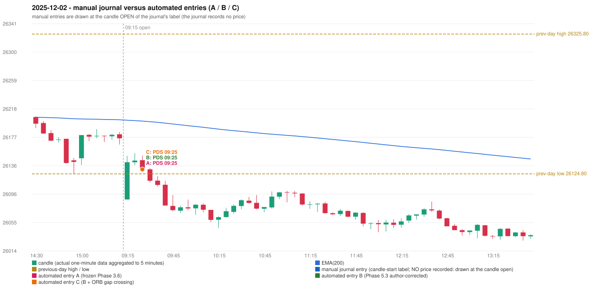

# 2025-12-02 (Tuesday) - manual journal versus the automated configurations

> SYNTHETIC index-point P&L; no real option P&L; costs illustrative (Rs 70 per trade + slippage scenarios). Configurations A / B / C are never combined.

## Session

* Open 26087.95; previous official close 26175.75; gap -87.80; previous-day high / low 26325.8 / 26124.8
* First 5-minute candle (09:15-09:20): O26087.95 H26150.65 L26087.95 C26141.5, GREEN, body 85.4%; EMA(200) at the first candle 26201.94; previous session's last close 26175.95 vs its EMA 26202.55

## Manual journal

no manual trade recorded

## Configuration A

Candidate signals (confirmed): 09:30 PDS/Method 1 SHORT [EXECUTED: trade 1: TARGET]; 09:35 PDS/Method 1 SHORT [IGNORED: POSITION_ACTIVE (signal kept for diagnostics only; never reused)]

Strategies with no confirmed signal: IRF: no setup record (the strategy's trigger event never occurred) | ORB: Method 2 INVALIDATED CANDLE_QUALITY | PDR: no setup record (the strategy's trigger event never occurred) | RF: RF INVALIDATED TREND:EMA_PREV_SESSION_CLOSE wrong side

| trade | strategy / method | dir | signal -> fill | entry | stop / T1 / T2 | leg 1 | leg 2 | outcome | gross Rs | net Rs (70, 0) | net Rs (70, 1.0) |
|---|---|---|---|---|---|---|---|---|---|---|---|
| 1 | PDS/Method 1 | SHORT | 09:30 -> 09:30 | 26131.25 | 26166.25 / 26104.25 / 26061.25 | 09:41 @ 26104.25 | 10:11 @ 26061.25 | TARGET | 18,915 | 18,845 | 18,065 |

Selection: This PDS Method 1 signal was the earliest executable signal of the day: 0 confirmed signal(s) earlier, 0 other in the same minute. 1 later confirmed signal(s) (PDS x1) are logged as ignored or rejected. State of the other four engines at that moment: [IRF: no setup record before this time (a base condition was not met, or nothing triggered)] [ORB: Method 2 invalidated at 09:15: CANDLE_QUALITY] [PDR: no setup record before this time (a base condition was not met, or nothing triggered)] [RF: no setup record before this time (a base condition was not met, or nothing triggered)]

* Automated PDS 09:25 has no strict / time-tolerant journal counterpart: UNRESOLVED_DISCRETIONARY_SELECTION - the journal records no trade this day; the automated system took PDS Method 1 SHORT (candle 09:25) mechanically

## Configuration B

Candidate signals (confirmed): 09:30 PDS/Method 1 SHORT [EXECUTED: trade 1: TARGET]; 09:35 PDS/Method 1 SHORT [IGNORED: POSITION_ACTIVE (signal kept for diagnostics only; never reused)]

Strategies with no confirmed signal: IRF: no setup record (the strategy's trigger event never occurred) | ORB: Method 2 INVALIDATED CANDLE_QUALITY | PDR: no setup record (the strategy's trigger event never occurred) | RF: RF INVALIDATED TREND:EMA_PREV_SESSION_CLOSE wrong side

| trade | strategy / method | dir | signal -> fill | entry | stop / T1 / T2 | leg 1 | leg 2 | outcome | gross Rs | net Rs (70, 0) | net Rs (70, 1.0) |
|---|---|---|---|---|---|---|---|---|---|---|---|
| 1 | PDS/Method 1 | SHORT | 09:30 -> 09:30 | 26131.25 | 26166.25 / 26104.25 / 26061.25 | 09:41 @ 26104.25 | 10:11 @ 26061.25 | TARGET | 18,915 | 18,845 | 18,065 |

Selection: This PDS Method 1 signal was the earliest executable signal of the day: 0 confirmed signal(s) earlier, 0 other in the same minute. 1 later confirmed signal(s) (PDS x1) are logged as ignored or rejected. State of the other four engines at that moment: [IRF: no setup record before this time (a base condition was not met, or nothing triggered)] [ORB: Method 2 invalidated at 09:15: CANDLE_QUALITY] [PDR: no setup record before this time (a base condition was not met, or nothing triggered)] [RF: no setup record before this time (a base condition was not met, or nothing triggered)]

* Automated PDS 09:25 has no strict / time-tolerant journal counterpart: UNRESOLVED_DISCRETIONARY_SELECTION - the journal records no trade this day; the automated system took PDS Method 1 SHORT (candle 09:25) mechanically

## Configuration C

Candidate signals (confirmed): 09:30 PDS/Method 1 SHORT [EXECUTED: trade 1: TARGET]; 09:35 PDS/Method 1 SHORT [IGNORED: POSITION_ACTIVE (signal kept for diagnostics only; never reused)]

Strategies with no confirmed signal: IRF: no setup record (the strategy's trigger event never occurred) | ORB: Method 2 INVALIDATED CANDLE_QUALITY | PDR: no setup record (the strategy's trigger event never occurred) | RF: RF INVALIDATED TREND:EMA_PREV_SESSION_CLOSE wrong side

| trade | strategy / method | dir | signal -> fill | entry | stop / T1 / T2 | leg 1 | leg 2 | outcome | gross Rs | net Rs (70, 0) | net Rs (70, 1.0) |
|---|---|---|---|---|---|---|---|---|---|---|---|
| 1 | PDS/Method 1 | SHORT | 09:30 -> 09:30 | 26131.25 | 26166.25 / 26104.25 / 26061.25 | 09:41 @ 26104.25 | 10:11 @ 26061.25 | TARGET | 18,915 | 18,845 | 18,065 |

Selection: This PDS Method 1 signal was the earliest executable signal of the day: 0 confirmed signal(s) earlier, 0 other in the same minute. 1 later confirmed signal(s) (PDS x1) are logged as ignored or rejected. State of the other four engines at that moment: [IRF: no setup record before this time (a base condition was not met, or nothing triggered)] [ORB: Method 2 invalidated at 09:15: CANDLE_QUALITY] [PDR: no setup record before this time (a base condition was not met, or nothing triggered)] [RF: no setup record before this time (a base condition was not met, or nothing triggered)]

* Automated PDS 09:25 has no strict / time-tolerant journal counterpart: UNRESOLVED_DISCRETIONARY_SELECTION - the journal records no trade this day; the automated system took PDS Method 1 SHORT (candle 09:25) mechanically

## Chart

