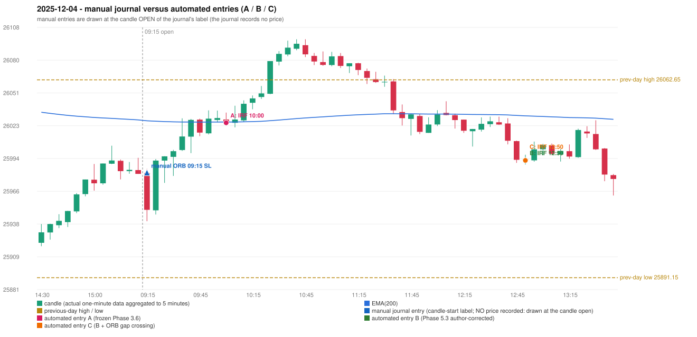

# 2025-12-04 (Thursday) - manual journal versus the automated configurations

> SYNTHETIC index-point P&L; no real option P&L; costs illustrative (Rs 70 per trade + slippage scenarios). Configurations A / B / C are never combined.

## Session

* Open 25981.85; previous official close 25986.0; gap -4.15; previous-day high / low 26062.65 / 25891.15
* First 5-minute candle (09:15-09:20): O25981.85 H25985.5 L25940.1 C25950.0, RED, body 70.2%; EMA(200) at the first candle 26027.14; previous session's last close 25981.15 vs its EMA 26027.91

## Manual journal

row 46: ORB labelled 09:15, outcome SL

## Configuration A

Candidate signals (confirmed): 10:05 IRF/Method 2B SHORT [EXECUTED: trade 1: INITIAL_FULL_STOP]; 11:40 IRF/Method 2A SHORT [REJECTED: SECOND_TRADE_RESTRICTED_TO_PDR_PDS]; 13:40 IRF/Method 1 SHORT [REJECTED: SECOND_TRADE_RESTRICTED_TO_PDR_PDS]; 15:15 IRF/Method 2B SHORT [REJECTED: SECOND_TRADE_RESTRICTED_TO_PDR_PDS]

Strategies with no confirmed signal: ORB: no setup record (the strategy's trigger event never occurred) | PDR: no setup record (the strategy's trigger event never occurred) | PDS: Method 1/2/3 INVALIDATED GAP_DOWN_OPEN_NOT_BELOW_ZONE | RF: no setup record (the strategy's trigger event never occurred)

| trade | strategy / method | dir | signal -> fill | entry | stop / T1 / T2 | leg 1 | leg 2 | outcome | gross Rs | net Rs (70, 0) | net Rs (70, 1.0) |
|---|---|---|---|---|---|---|---|---|---|---|---|
| 1 | IRF/Method 2B | SHORT | 10:05 -> 10:05 | 26025.4 | 26060.4 / 25998.4 / 25965.4 | 10:26 @ 26060.4 | 10:26 @ 26060.4 | INITIAL_FULL_STOP | -13,650 | -13,720 | -14,500 |

Selection: This IRF Method 2B signal was the earliest executable signal of the day: 0 confirmed signal(s) earlier, 0 other in the same minute. 3 later confirmed signal(s) (IRF x3) are logged as ignored or rejected. State of the other four engines at that moment: [ORB: no setup record before this time (a base condition was not met, or nothing triggered)] [PDR: no setup record before this time (a base condition was not met, or nothing triggered)] [PDS: Method 1/2/3 invalidated at 09:15: GAP_DOWN_OPEN_NOT_BELOW_ZONE] [RF: no setup record before this time (a base condition was not met, or nothing triggered)]

* Journal row 46 (ORB 09:15): **UNMATCHED_MANUAL**; earliest cause LEVEL_CONSTRUCTION_MISMATCH (+ OPENING_GAP_MISMATCH): first candle RED O25981.85 H25985.5 L25940.1 C25950.0 (body 70.2%); direction ASSUMED from the colour (the journal has no direction); TIE-BROKEN BY METHOD ORDER: 2 methods tie at 2 failing predicate(s) (Method 1: level_broken; Gap/200DMA: gap_crosses_200_average) - the evidence does not single out one cause, the secondary cause is the other tied one; closest method Method 1 (2 failing predicate(s)): first failing 'level_broken' - previous-day low 25891.15; candle high/low 25940.1, close 25950.0; all methods: Method 1: 2 fail (level_broken); Method 2: 3 fail (inner_level_broken); Gap/200DMA: 2 fail (gap_crosses_200_average)
* Automated IRF 10:00 has no strict / time-tolerant journal counterpart: DIFFERENT_STRATEGY_SELECTED - the journal traded ORB 09:15; the automated controller took IRF Method 2B (candle 10:00) as the first valid signal

## Configuration B

Candidate signals (confirmed): 12:55 IRF/Method 2A SHORT [EXECUTED: trade 1: T1_THEN_BUFFER_STOP]; 13:45 IRF/Method 2A SHORT [IGNORED: POSITION_ACTIVE (signal kept for diagnostics only; never reused)]; 13:45 IRF/Method 2B SHORT [IGNORED: POSITION_ACTIVE (signal kept for diagnostics only; never reused)]

Strategies with no confirmed signal: ORB: no setup record (the strategy's trigger event never occurred) | PDR: no setup record (the strategy's trigger event never occurred) | PDS: Method 1/2/3 INVALIDATED GAP_DOWN_OPEN_NOT_BELOW_ZONE | RF: no setup record (the strategy's trigger event never occurred)

| trade | strategy / method | dir | signal -> fill | entry | stop / T1 / T2 | leg 1 | leg 2 | outcome | gross Rs | net Rs (70, 0) | net Rs (70, 1.0) |
|---|---|---|---|---|---|---|---|---|---|---|---|
| 1 | IRF/Method 2A | SHORT | 12:55 -> 12:55 | 25992.85 | 26027.85 / 25965.85 / 25932.85 | 13:41 @ 25965.85 | 14:07 @ 25998.85 | T1_THEN_BUFFER_STOP | 4,095 | 4,025 | 3,245 |

Selection: This IRF Method 2A signal was the earliest executable signal of the day: 0 confirmed signal(s) earlier, 0 other in the same minute. 2 later confirmed signal(s) (IRF x2) are logged as ignored or rejected. State of the other four engines at that moment: [ORB: no setup record before this time (a base condition was not met, or nothing triggered)] [PDR: no setup record before this time (a base condition was not met, or nothing triggered)] [PDS: Method 1/2/3 invalidated at 09:15: GAP_DOWN_OPEN_NOT_BELOW_ZONE] [RF: no setup record before this time (a base condition was not met, or nothing triggered)]

* Journal row 46 (ORB 09:15): **UNMATCHED_MANUAL**; earliest cause LEVEL_CONSTRUCTION_MISMATCH (+ OPENING_GAP_MISMATCH): first candle RED O25981.85 H25985.5 L25940.1 C25950.0 (body 70.2%); direction ASSUMED from the colour (the journal has no direction); TIE-BROKEN BY METHOD ORDER: 2 methods tie at 2 failing predicate(s) (Method 1: level_broken; Gap/200DMA: gap_crosses_200_average) - the evidence does not single out one cause, the secondary cause is the other tied one; closest method Method 1 (2 failing predicate(s)): first failing 'level_broken' - previous-day low 25891.15; candle high/low 25940.1, close 25950.0; all methods: Method 1: 2 fail (level_broken); Method 2: 3 fail (inner_level_broken); Gap/200DMA: 2 fail (gap_crosses_200_average)
* Automated IRF 12:50 has no strict / time-tolerant journal counterpart: DIFFERENT_STRATEGY_SELECTED - the journal traded ORB 09:15; the automated controller took IRF Method 2A (candle 12:50) as the first valid signal

## Configuration C

Candidate signals (confirmed): 12:55 IRF/Method 2A SHORT [EXECUTED: trade 1: T1_THEN_BUFFER_STOP]; 13:45 IRF/Method 2A SHORT [IGNORED: POSITION_ACTIVE (signal kept for diagnostics only; never reused)]; 13:45 IRF/Method 2B SHORT [IGNORED: POSITION_ACTIVE (signal kept for diagnostics only; never reused)]

Strategies with no confirmed signal: ORB: no setup record (the strategy's trigger event never occurred) | PDR: no setup record (the strategy's trigger event never occurred) | PDS: Method 1/2/3 INVALIDATED GAP_DOWN_OPEN_NOT_BELOW_ZONE | RF: no setup record (the strategy's trigger event never occurred)

| trade | strategy / method | dir | signal -> fill | entry | stop / T1 / T2 | leg 1 | leg 2 | outcome | gross Rs | net Rs (70, 0) | net Rs (70, 1.0) |
|---|---|---|---|---|---|---|---|---|---|---|---|
| 1 | IRF/Method 2A | SHORT | 12:55 -> 12:55 | 25992.85 | 26027.85 / 25965.85 / 25932.85 | 13:41 @ 25965.85 | 14:07 @ 25998.85 | T1_THEN_BUFFER_STOP | 4,095 | 4,025 | 3,245 |

Selection: This IRF Method 2A signal was the earliest executable signal of the day: 0 confirmed signal(s) earlier, 0 other in the same minute. 2 later confirmed signal(s) (IRF x2) are logged as ignored or rejected. State of the other four engines at that moment: [ORB: no setup record before this time (a base condition was not met, or nothing triggered)] [PDR: no setup record before this time (a base condition was not met, or nothing triggered)] [PDS: Method 1/2/3 invalidated at 09:15: GAP_DOWN_OPEN_NOT_BELOW_ZONE] [RF: no setup record before this time (a base condition was not met, or nothing triggered)]

* Journal row 46 (ORB 09:15): **UNMATCHED_MANUAL**; earliest cause LEVEL_CONSTRUCTION_MISMATCH (+ OPENING_GAP_MISMATCH): first candle RED O25981.85 H25985.5 L25940.1 C25950.0 (body 70.2%); direction ASSUMED from the colour (the journal has no direction); TIE-BROKEN BY METHOD ORDER: 2 methods tie at 2 failing predicate(s) (Method 1: level_broken; Gap/200DMA: gap_crosses_200_average) - the evidence does not single out one cause, the secondary cause is the other tied one; closest method Method 1 (2 failing predicate(s)): first failing 'level_broken' - previous-day low 25891.15; candle high/low 25940.1, close 25950.0; all methods: Method 1: 2 fail (level_broken); Method 2: 3 fail (inner_level_broken); Gap/200DMA: 2 fail (gap_crosses_200_average)
* Automated IRF 12:50 has no strict / time-tolerant journal counterpart: DIFFERENT_STRATEGY_SELECTED - the journal traded ORB 09:15; the automated controller took IRF Method 2A (candle 12:50) as the first valid signal

## Chart

