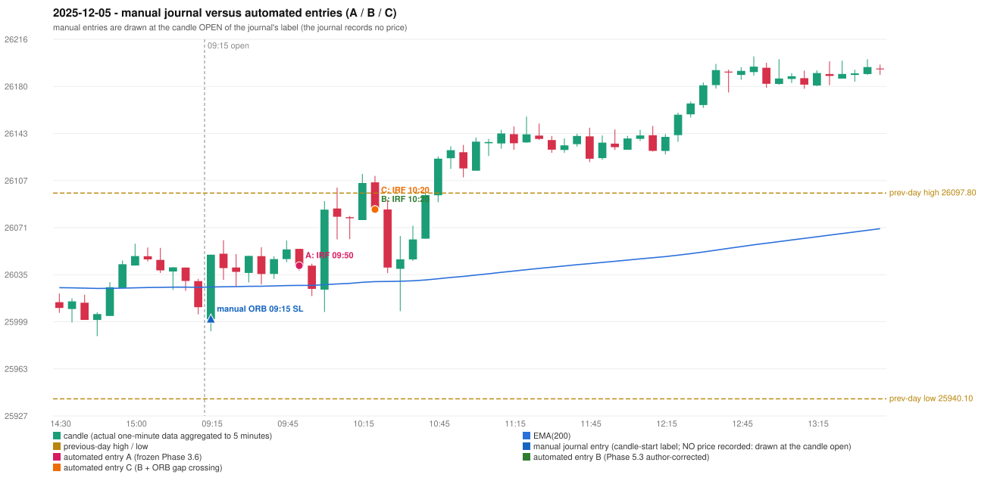

# 2025-12-05 (Friday) - manual journal versus the automated configurations

> SYNTHETIC index-point P&L; no real option P&L; costs illustrative (Rs 70 per trade + slippage scenarios). Configurations A / B / C are never combined.

## Session

* Open 26001.15; previous official close 26033.75; gap -32.60; previous-day high / low 26097.8 / 25940.1
* First 5-minute candle (09:15-09:20): O26001.15 H26050.6 L25991.85 C26050.6, GREEN, body 84.2%; EMA(200) at the first candle 26025.83; previous session's last close 26010.35 vs its EMA 26025.58

## Manual journal

row 47: ORB labelled 09:15, outcome SL

## Configuration A

Candidate signals (confirmed): 09:55 IRF/Method 1 SHORT [EXECUTED: trade 1: T1_THEN_BUFFER_STOP]; 10:25 IRF/Method 2B SHORT [IGNORED: DAY_FINISHED]; 10:30 IRF/Method 1 SHORT [IGNORED: DAY_FINISHED]; 11:20 IRF/Method 2B SHORT [IGNORED: DAY_FINISHED]; 11:50 IRF/Method 2A SHORT [IGNORED: DAY_FINISHED]; 12:15 IRF/Method 2B SHORT [IGNORED: DAY_FINISHED]; 13:50 IRF/Method 2A SHORT [IGNORED: DAY_FINISHED]; 15:30 IRF/Method 2B SHORT [IGNORED: DAY_FINISHED]

Strategies with no confirmed signal: ORB: Gap/200DMA INVALIDATED CLOSE_NOT_BEYOND_MA | PDR: no setup record (the strategy's trigger event never occurred) | PDS: Method 1/2/3 INVALIDATED GAP_DOWN_OPEN_NOT_BELOW_ZONE | RF: no setup record (the strategy's trigger event never occurred)

| trade | strategy / method | dir | signal -> fill | entry | stop / T1 / T2 | leg 1 | leg 2 | outcome | gross Rs | net Rs (70, 0) | net Rs (70, 1.0) |
|---|---|---|---|---|---|---|---|---|---|---|---|
| 1 | IRF/Method 1 | SHORT | 09:55 -> 09:55 | 26042.15 | 26077.15 / 26015.15 / 25982.15 | 10:00 @ 26015.15 | 10:03 @ 26048.15 | T1_THEN_BUFFER_STOP | 4,095 | 4,025 | 3,245 |

Selection: This IRF Method 1 signal was the earliest executable signal of the day: 0 confirmed signal(s) earlier, 0 other in the same minute. 7 later confirmed signal(s) (IRF x7) are logged as ignored or rejected. State of the other four engines at that moment: [ORB: Gap/200DMA invalidated at 09:15: CLOSE_NOT_BEYOND_MA] [PDR: no setup record before this time (a base condition was not met, or nothing triggered)] [PDS: Method 1/2/3 invalidated at 09:15: GAP_DOWN_OPEN_NOT_BELOW_ZONE] [RF: no setup record before this time (a base condition was not met, or nothing triggered)]

* Journal row 47 (ORB 09:15): **UNMATCHED_MANUAL**; earliest cause LEVEL_CONSTRUCTION_MISMATCH (+ OPENING_GAP_MISMATCH): first candle GREEN O26001.15 H26050.6 L25991.85 C26050.6 (body 84.2%); direction ASSUMED from the colour (the journal has no direction); TIE-BROKEN BY METHOD ORDER: 2 methods tie at 2 failing predicate(s) (Method 1: level_broken; Gap/200DMA: gap_in_direction) - the evidence does not single out one cause, the secondary cause is the other tied one; closest method Method 1 (2 failing predicate(s)): first failing 'level_broken' - previous-day high 26097.8; candle high/low 26050.6, close 26050.6; all methods: Method 1: 2 fail (level_broken); Method 2: 3 fail (inner_level_broken); Gap/200DMA: 2 fail (gap_in_direction)
* Automated IRF 09:50 has no strict / time-tolerant journal counterpart: DIFFERENT_STRATEGY_SELECTED - the journal traded ORB 09:15; the automated controller took IRF Method 1 (candle 09:50) as the first valid signal

## Configuration B

Candidate signals (confirmed): 10:25 IRF/Method 2B SHORT [EXECUTED: trade 1: TARGET]; 11:20 IRF/Method 2B SHORT [IGNORED: DAY_FINISHED]; 11:35 IRF/Method 2A SHORT [IGNORED: DAY_FINISHED]; 12:15 IRF/Method 2B SHORT [IGNORED: DAY_FINISHED]; 13:55 IRF/Method 2A SHORT [IGNORED: DAY_FINISHED]; 15:30 IRF/Method 2A SHORT [IGNORED: DAY_FINISHED]; 15:30 IRF/Method 2B SHORT [IGNORED: DAY_FINISHED]

Strategies with no confirmed signal: ORB: Gap/200DMA INVALIDATED CLOSE_NOT_BEYOND_MA | PDR: no setup record (the strategy's trigger event never occurred) | PDS: Method 1/2/3 INVALIDATED GAP_DOWN_OPEN_NOT_BELOW_ZONE | RF: no setup record (the strategy's trigger event never occurred)

| trade | strategy / method | dir | signal -> fill | entry | stop / T1 / T2 | leg 1 | leg 2 | outcome | gross Rs | net Rs (70, 0) | net Rs (70, 1.0) |
|---|---|---|---|---|---|---|---|---|---|---|---|
| 1 | IRF/Method 2B | SHORT | 10:25 -> 10:25 | 26085.25 | 26120.25 / 26058.25 / 26025.25 | 10:29 @ 26058.25 | 10:30 @ 26025.25 | TARGET | 16,965 | 16,895 | 16,115 |

Selection: This IRF Method 2B signal was the earliest executable signal of the day: 0 confirmed signal(s) earlier, 0 other in the same minute. 6 later confirmed signal(s) (IRF x6) are logged as ignored or rejected. State of the other four engines at that moment: [ORB: Gap/200DMA invalidated at 09:15: CLOSE_NOT_BEYOND_MA] [PDR: no setup record before this time (a base condition was not met, or nothing triggered)] [PDS: Method 1/2/3 invalidated at 09:15: GAP_DOWN_OPEN_NOT_BELOW_ZONE] [RF: no setup record before this time (a base condition was not met, or nothing triggered)]

* Journal row 47 (ORB 09:15): **UNMATCHED_MANUAL**; earliest cause LEVEL_CONSTRUCTION_MISMATCH (+ OPENING_GAP_MISMATCH): first candle GREEN O26001.15 H26050.6 L25991.85 C26050.6 (body 84.2%); direction ASSUMED from the colour (the journal has no direction); TIE-BROKEN BY METHOD ORDER: 2 methods tie at 2 failing predicate(s) (Method 1: level_broken; Gap/200DMA: gap_in_direction) - the evidence does not single out one cause, the secondary cause is the other tied one; closest method Method 1 (2 failing predicate(s)): first failing 'level_broken' - previous-day high 26097.8; candle high/low 26050.6, close 26050.6; all methods: Method 1: 2 fail (level_broken); Method 2: 3 fail (inner_level_broken); Gap/200DMA: 2 fail (gap_in_direction)
* Automated IRF 10:20 has no strict / time-tolerant journal counterpart: DIFFERENT_STRATEGY_SELECTED - the journal traded ORB 09:15; the automated controller took IRF Method 2B (candle 10:20) as the first valid signal

## Configuration C

Candidate signals (confirmed): 10:25 IRF/Method 2B SHORT [EXECUTED: trade 1: TARGET]; 11:20 IRF/Method 2B SHORT [IGNORED: DAY_FINISHED]; 11:35 IRF/Method 2A SHORT [IGNORED: DAY_FINISHED]; 12:15 IRF/Method 2B SHORT [IGNORED: DAY_FINISHED]; 13:55 IRF/Method 2A SHORT [IGNORED: DAY_FINISHED]; 15:30 IRF/Method 2A SHORT [IGNORED: DAY_FINISHED]; 15:30 IRF/Method 2B SHORT [IGNORED: DAY_FINISHED]

Strategies with no confirmed signal: ORB: Gap/200DMA INVALIDATED CLOSE_NOT_BEYOND_MA | PDR: no setup record (the strategy's trigger event never occurred) | PDS: Method 1/2/3 INVALIDATED GAP_DOWN_OPEN_NOT_BELOW_ZONE | RF: no setup record (the strategy's trigger event never occurred)

| trade | strategy / method | dir | signal -> fill | entry | stop / T1 / T2 | leg 1 | leg 2 | outcome | gross Rs | net Rs (70, 0) | net Rs (70, 1.0) |
|---|---|---|---|---|---|---|---|---|---|---|---|
| 1 | IRF/Method 2B | SHORT | 10:25 -> 10:25 | 26085.25 | 26120.25 / 26058.25 / 26025.25 | 10:29 @ 26058.25 | 10:30 @ 26025.25 | TARGET | 16,965 | 16,895 | 16,115 |

Selection: This IRF Method 2B signal was the earliest executable signal of the day: 0 confirmed signal(s) earlier, 0 other in the same minute. 6 later confirmed signal(s) (IRF x6) are logged as ignored or rejected. State of the other four engines at that moment: [ORB: Gap/200DMA invalidated at 09:15: CLOSE_NOT_BEYOND_MA] [PDR: no setup record before this time (a base condition was not met, or nothing triggered)] [PDS: Method 1/2/3 invalidated at 09:15: GAP_DOWN_OPEN_NOT_BELOW_ZONE] [RF: no setup record before this time (a base condition was not met, or nothing triggered)]

* Journal row 47 (ORB 09:15): **UNMATCHED_MANUAL**; earliest cause LEVEL_CONSTRUCTION_MISMATCH (+ OPENING_GAP_MISMATCH): first candle GREEN O26001.15 H26050.6 L25991.85 C26050.6 (body 84.2%); direction ASSUMED from the colour (the journal has no direction); TIE-BROKEN BY METHOD ORDER: 2 methods tie at 2 failing predicate(s) (Method 1: level_broken; Gap/200DMA: gap_in_direction) - the evidence does not single out one cause, the secondary cause is the other tied one; closest method Method 1 (2 failing predicate(s)): first failing 'level_broken' - previous-day high 26097.8; candle high/low 26050.6, close 26050.6; all methods: Method 1: 2 fail (level_broken); Method 2: 3 fail (inner_level_broken); Gap/200DMA: 2 fail (gap_in_direction)
* Automated IRF 10:20 has no strict / time-tolerant journal counterpart: DIFFERENT_STRATEGY_SELECTED - the journal traded ORB 09:15; the automated controller took IRF Method 2B (candle 10:20) as the first valid signal

## Handwritten author corrections for this date

* AC31 (page 5): "ORB should activate instead of IRF." - status A / B / C: ORB_STILL_NOT_TRADED / ORB_STILL_NOT_TRADED / ORB_STILL_NOT_TRADED

## Chart

