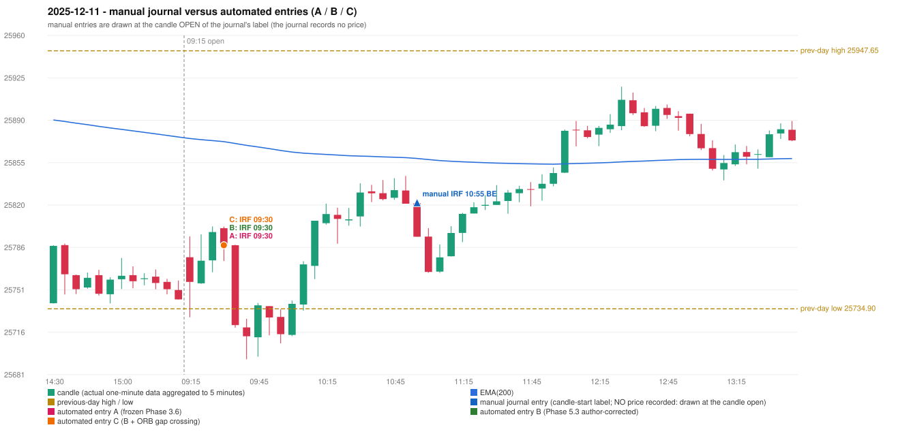

# 2025-12-11 (Thursday) - manual journal versus the automated configurations

> SYNTHETIC index-point P&L; no real option P&L; costs illustrative (Rs 70 per trade + slippage scenarios). Configurations A / B / C are never combined.

## Session

* Open 25777.45; previous official close 25758.0; gap +19.45; previous-day high / low 25947.65 / 25734.9
* First 5-minute candle (09:15-09:20): O25777.45 H25794.65 L25727.9 C25757.1, RED, body 30.5%; EMA(200) at the first candle 25875.39; previous session's last close 25742.65 vs its EMA 25876.57

## Manual journal

row 50: IRF labelled 10:55, outcome BE

## Configuration A

Candidate signals (confirmed): 09:35 IRF/Method 1 SHORT [EXECUTED: trade 1: TARGET]; 11:00 IRF/Method 1 SHORT [IGNORED: DAY_FINISHED]; 11:00 IRF/Method 2A SHORT [IGNORED: DAY_FINISHED]; 11:00 IRF/Method 2B SHORT [IGNORED: DAY_FINISHED]; 11:50 IRF/Method 2B SHORT [IGNORED: DAY_FINISHED]; 12:40 IRF/Method 2B SHORT [IGNORED: DAY_FINISHED]; 13:00 IRF/Method 2A SHORT [IGNORED: DAY_FINISHED]; 14:05 IRF/Method 2B SHORT [IGNORED: DAY_FINISHED]; 14:45 IRF/Method 2B SHORT [IGNORED: DAY_FINISHED]

Strategies with no confirmed signal: ORB: no setup record (the strategy's trigger event never occurred) | PDR: PDR INVALIDATED OPEN_NOT_STRICTLY_ABOVE_ZONE | PDS: no setup record (the strategy's trigger event never occurred) | RF: RF INVALIDATED TREND:EMA_PREV_SESSION_CLOSE wrong side

| trade | strategy / method | dir | signal -> fill | entry | stop / T1 / T2 | leg 1 | leg 2 | outcome | gross Rs | net Rs (70, 0) | net Rs (70, 1.0) |
|---|---|---|---|---|---|---|---|---|---|---|---|
| 1 | IRF/Method 1 | SHORT | 09:35 -> 09:35 | 25787.3 | 25822.3 / 25760.3 / 25727.3 | 09:37 @ 25760.3 | 09:39 @ 25727.3 | TARGET | 16,965 | 16,895 | 16,115 |

Selection: This IRF Method 1 signal was the earliest executable signal of the day: 0 confirmed signal(s) earlier, 0 other in the same minute. 8 later confirmed signal(s) (IRF x8) are logged as ignored or rejected. State of the other four engines at that moment: [ORB: no setup record before this time (a base condition was not met, or nothing triggered)] [PDR: PDR invalidated at 09:15: OPEN_NOT_STRICTLY_ABOVE_ZONE] [PDS: no setup record before this time (a base condition was not met, or nothing triggered)] [RF: no setup record before this time (a base condition was not met, or nothing triggered)]

* Journal row 50 (IRF 10:55): **DATE_STRATEGY_ONLY**; earliest cause EARLIER_SIGNAL (+ ENTRY_TIME_MISMATCH): the automated IRF trade has its signal candle at 09:30 versus the manual label 10:55 (-85 minutes; outside the 15-minute tolerance)
* Automated IRF 09:30 has no strict / time-tolerant journal counterpart: EARLIER_SIGNAL - the journal has IRF at 10:55; the automated trade's signal candle is 09:30

## Configuration B

Candidate signals (confirmed): 09:35 IRF/Method 1 SHORT [EXECUTED: trade 1: TARGET]; 11:00 IRF/Method 1 SHORT [IGNORED: DAY_FINISHED]; 11:00 IRF/Method 2B SHORT [IGNORED: DAY_FINISHED]

Strategies with no confirmed signal: ORB: no setup record (the strategy's trigger event never occurred) | PDR: PDR INVALIDATED OPEN_NOT_STRICTLY_ABOVE_ZONE | PDS: no setup record (the strategy's trigger event never occurred) | RF: RF INVALIDATED TREND:EMA_PREV_SESSION_CLOSE wrong side

| trade | strategy / method | dir | signal -> fill | entry | stop / T1 / T2 | leg 1 | leg 2 | outcome | gross Rs | net Rs (70, 0) | net Rs (70, 1.0) |
|---|---|---|---|---|---|---|---|---|---|---|---|
| 1 | IRF/Method 1 | SHORT | 09:35 -> 09:35 | 25787.3 | 25822.3 / 25760.3 / 25727.3 | 09:37 @ 25760.3 | 09:39 @ 25727.3 | TARGET | 16,965 | 16,895 | 16,115 |

Selection: This IRF Method 1 signal was the earliest executable signal of the day: 0 confirmed signal(s) earlier, 0 other in the same minute. 2 later confirmed signal(s) (IRF x2) are logged as ignored or rejected. State of the other four engines at that moment: [ORB: no setup record before this time (a base condition was not met, or nothing triggered)] [PDR: PDR invalidated at 09:15: OPEN_NOT_STRICTLY_ABOVE_ZONE] [PDS: no setup record before this time (a base condition was not met, or nothing triggered)] [RF: no setup record before this time (a base condition was not met, or nothing triggered)]

* Journal row 50 (IRF 10:55): **DATE_STRATEGY_ONLY**; earliest cause EARLIER_SIGNAL (+ ENTRY_TIME_MISMATCH): the automated IRF trade has its signal candle at 09:30 versus the manual label 10:55 (-85 minutes; outside the 15-minute tolerance)
* Automated IRF 09:30 has no strict / time-tolerant journal counterpart: EARLIER_SIGNAL - the journal has IRF at 10:55; the automated trade's signal candle is 09:30

## Configuration C

Candidate signals (confirmed): 09:35 IRF/Method 1 SHORT [EXECUTED: trade 1: TARGET]; 11:00 IRF/Method 1 SHORT [IGNORED: DAY_FINISHED]; 11:00 IRF/Method 2B SHORT [IGNORED: DAY_FINISHED]

Strategies with no confirmed signal: ORB: Gap/200DMA INVALIDATED CLOSE_NOT_BEYOND_MA | PDR: PDR INVALIDATED OPEN_NOT_STRICTLY_ABOVE_ZONE | PDS: no setup record (the strategy's trigger event never occurred) | RF: RF INVALIDATED TREND:EMA_PREV_SESSION_CLOSE wrong side

| trade | strategy / method | dir | signal -> fill | entry | stop / T1 / T2 | leg 1 | leg 2 | outcome | gross Rs | net Rs (70, 0) | net Rs (70, 1.0) |
|---|---|---|---|---|---|---|---|---|---|---|---|
| 1 | IRF/Method 1 | SHORT | 09:35 -> 09:35 | 25787.3 | 25822.3 / 25760.3 / 25727.3 | 09:37 @ 25760.3 | 09:39 @ 25727.3 | TARGET | 16,965 | 16,895 | 16,115 |

Selection: This IRF Method 1 signal was the earliest executable signal of the day: 0 confirmed signal(s) earlier, 0 other in the same minute. 2 later confirmed signal(s) (IRF x2) are logged as ignored or rejected. State of the other four engines at that moment: [ORB: Gap/200DMA invalidated at 09:15: CLOSE_NOT_BEYOND_MA] [PDR: PDR invalidated at 09:15: OPEN_NOT_STRICTLY_ABOVE_ZONE] [PDS: no setup record before this time (a base condition was not met, or nothing triggered)] [RF: no setup record before this time (a base condition was not met, or nothing triggered)]

* Journal row 50 (IRF 10:55): **DATE_STRATEGY_ONLY**; earliest cause EARLIER_SIGNAL (+ ENTRY_TIME_MISMATCH): the automated IRF trade has its signal candle at 09:30 versus the manual label 10:55 (-85 minutes; outside the 15-minute tolerance)
* Automated IRF 09:30 has no strict / time-tolerant journal counterpart: EARLIER_SIGNAL - the journal has IRF at 10:55; the automated trade's signal candle is 09:30

## Handwritten author corrections for this date

* AC32 (page 5): "Should be ignored as candle body is less than 50%. | 2nd candle should also be ignores as it is at day's low." - status A / B / C: PENDING_OWNER_DEFINITION / PENDING_OWNER_DEFINITION / PENDING_OWNER_DEFINITION

## Chart

