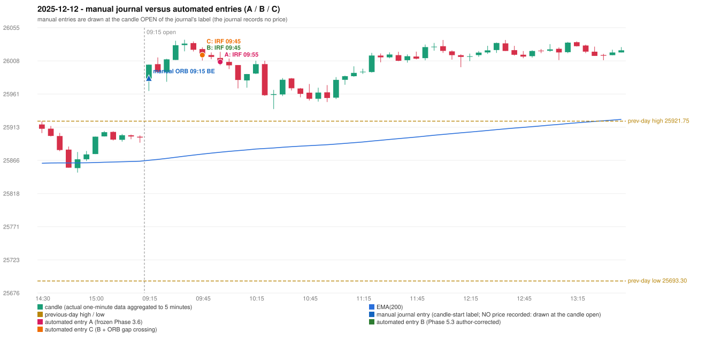

# 2025-12-12 (Friday) - manual journal versus the automated configurations

> SYNTHETIC index-point P&L; no real option P&L; costs illustrative (Rs 70 per trade + slippage scenarios). Configurations A / B / C are never combined.

## Session

* Open 25982.75; previous official close 25898.55; gap +84.20; previous-day high / low 25921.75 / 25693.3
* First 5-minute candle (09:15-09:20): O25982.75 H26002.8 L25964.9 C26002.55, GREEN, body 52.2%; EMA(200) at the first candle 25865.85; previous session's last close 25898.4 vs its EMA 25864.47

## Manual journal

row 51: ORB labelled 09:15, outcome BE

## Configuration A

Candidate signals (confirmed): 10:00 IRF/Method 2A SHORT [EXECUTED: trade 1: TARGET]; 10:05 IRF/Method 1 SHORT [IGNORED: POSITION_ACTIVE (signal kept for diagnostics only; never reused)]; 11:40 IRF/Method 2B SHORT [IGNORED: DAY_FINISHED]; 11:50 IRF/Method 2B SHORT [IGNORED: DAY_FINISHED]; 14:30 IRF/Method 2A SHORT [IGNORED: DAY_FINISHED]; 14:30 IRF/Method 2B SHORT [IGNORED: DAY_FINISHED]

Strategies with no confirmed signal: ORB: Method 1 INVALIDATED CANDLE_QUALITY(not a strong body / wick too large); Method 2 INVALIDATED TRENDLINE_NOT_SUPPORTIVE | PDR: no setup record (the strategy's trigger event never occurred) | PDS: no setup record (the strategy's trigger event never occurred) | RF: RF INVALIDATED GAP_UP_OUTSIDE_YESTERDAYS_RANGE

| trade | strategy / method | dir | signal -> fill | entry | stop / T1 / T2 | leg 1 | leg 2 | outcome | gross Rs | net Rs (70, 0) | net Rs (70, 1.0) |
|---|---|---|---|---|---|---|---|---|---|---|---|
| 1 | IRF/Method 2A | SHORT | 10:00 -> 10:00 | 26006.5 | 26041.5 / 25979.5 / 25946.5 | 10:08 @ 25979.5 | 10:26 @ 25946.5 | TARGET | 16,965 | 16,895 | 16,115 |

Selection: This IRF Method 2A signal was the earliest executable signal of the day: 0 confirmed signal(s) earlier, 0 other in the same minute. 5 later confirmed signal(s) (IRF x5) are logged as ignored or rejected. State of the other four engines at that moment: [ORB: Method 1 invalidated at 09:15: CANDLE_QUALITY(not a strong body / wick too large); Method 2 invalidated at 09:15: TRENDLINE_NOT_SUPPORTIVE] [PDR: no setup record before this time (a base condition was not met, or nothing triggered)] [PDS: no setup record before this time (a base condition was not met, or nothing triggered)] [RF: no setup record before this time (a base condition was not met, or nothing triggered)]

* Journal row 51 (ORB 09:15): **UNMATCHED_MANUAL**; earliest cause CANDLE_STRENGTH_MISMATCH: first candle GREEN O25982.75 H26002.8 L25964.9 C26002.55 (body 52.2%); direction ASSUMED from the colour (the journal has no direction); closest method Method 1 (1 failing predicate(s)): first failing 'candle_quality' - body 52.2% opposite wick 0.7% close location 99.3%; all methods: Method 1: 1 fail (candle_quality); Method 2: 2 fail (trendline); Gap/200DMA: 2 fail (gap_crosses_200_average)
* Automated IRF 09:55 has no strict / time-tolerant journal counterpart: DIFFERENT_STRATEGY_SELECTED - the journal traded ORB 09:15; the automated controller took IRF Method 2A (candle 09:55) as the first valid signal

## Configuration B

Candidate signals (confirmed): 09:50 IRF/Method 2A SHORT [EXECUTED: trade 1: TARGET]; 10:05 IRF/Method 1 SHORT [IGNORED: POSITION_ACTIVE (signal kept for diagnostics only; never reused)]; 11:40 IRF/Method 2B SHORT [IGNORED: DAY_FINISHED]; 11:50 IRF/Method 2B SHORT [IGNORED: DAY_FINISHED]; 12:10 IRF/Method 2A SHORT [IGNORED: DAY_FINISHED]; 12:45 IRF/Method 2A SHORT [IGNORED: DAY_FINISHED]; 13:20 IRF/Method 2B SHORT [IGNORED: DAY_FINISHED]; 14:25 IRF/Method 2A SHORT [IGNORED: DAY_FINISHED]; 15:30 IRF/Method 2A SHORT [IGNORED: DAY_FINISHED]; 15:30 IRF/Method 2B SHORT [IGNORED: DAY_FINISHED]

Strategies with no confirmed signal: ORB: Method 1 INVALIDATED CANDLE_QUALITY(not a strong body / wick too large); Method 2 INVALIDATED TRENDLINE_NOT_SUPPORTIVE | PDR: no setup record (the strategy's trigger event never occurred) | PDS: no setup record (the strategy's trigger event never occurred) | RF: RF INVALIDATED GAP_UP_OUTSIDE_YESTERDAYS_RANGE

| trade | strategy / method | dir | signal -> fill | entry | stop / T1 / T2 | leg 1 | leg 2 | outcome | gross Rs | net Rs (70, 0) | net Rs (70, 1.0) |
|---|---|---|---|---|---|---|---|---|---|---|---|
| 1 | IRF/Method 2A | SHORT | 09:50 -> 09:50 | 26016.3 | 26051.3 / 25989.3 / 25956.3 | 10:08 @ 25989.3 | 10:25 @ 25956.3 | TARGET | 16,965 | 16,895 | 16,115 |

Selection: This IRF Method 2A signal was the earliest executable signal of the day: 0 confirmed signal(s) earlier, 0 other in the same minute. 9 later confirmed signal(s) (IRF x9) are logged as ignored or rejected. State of the other four engines at that moment: [ORB: Method 1 invalidated at 09:15: CANDLE_QUALITY(not a strong body / wick too large); Method 2 invalidated at 09:15: TRENDLINE_NOT_SUPPORTIVE] [PDR: no setup record before this time (a base condition was not met, or nothing triggered)] [PDS: no setup record before this time (a base condition was not met, or nothing triggered)] [RF: no setup record before this time (a base condition was not met, or nothing triggered)]

* Journal row 51 (ORB 09:15): **UNMATCHED_MANUAL**; earliest cause CANDLE_STRENGTH_MISMATCH: first candle GREEN O25982.75 H26002.8 L25964.9 C26002.55 (body 52.2%); direction ASSUMED from the colour (the journal has no direction); closest method Method 1 (1 failing predicate(s)): first failing 'candle_quality' - body 52.2% opposite wick 0.7% close location 99.3%; all methods: Method 1: 1 fail (candle_quality); Method 2: 2 fail (trendline); Gap/200DMA: 2 fail (gap_crosses_200_average)
* Automated IRF 09:45 has no strict / time-tolerant journal counterpart: DIFFERENT_STRATEGY_SELECTED - the journal traded ORB 09:15; the automated controller took IRF Method 2A (candle 09:45) as the first valid signal

## Configuration C

Candidate signals (confirmed): 09:50 IRF/Method 2A SHORT [EXECUTED: trade 1: TARGET]; 10:05 IRF/Method 1 SHORT [IGNORED: POSITION_ACTIVE (signal kept for diagnostics only; never reused)]; 11:40 IRF/Method 2B SHORT [IGNORED: DAY_FINISHED]; 11:50 IRF/Method 2B SHORT [IGNORED: DAY_FINISHED]; 12:10 IRF/Method 2A SHORT [IGNORED: DAY_FINISHED]; 12:45 IRF/Method 2A SHORT [IGNORED: DAY_FINISHED]; 13:20 IRF/Method 2B SHORT [IGNORED: DAY_FINISHED]; 14:25 IRF/Method 2A SHORT [IGNORED: DAY_FINISHED]; 15:30 IRF/Method 2A SHORT [IGNORED: DAY_FINISHED]; 15:30 IRF/Method 2B SHORT [IGNORED: DAY_FINISHED]

Strategies with no confirmed signal: ORB: Method 1 INVALIDATED CANDLE_QUALITY(not a strong body / wick too large); Method 2 INVALIDATED TRENDLINE_NOT_SUPPORTIVE | PDR: no setup record (the strategy's trigger event never occurred) | PDS: no setup record (the strategy's trigger event never occurred) | RF: RF INVALIDATED GAP_UP_OUTSIDE_YESTERDAYS_RANGE

| trade | strategy / method | dir | signal -> fill | entry | stop / T1 / T2 | leg 1 | leg 2 | outcome | gross Rs | net Rs (70, 0) | net Rs (70, 1.0) |
|---|---|---|---|---|---|---|---|---|---|---|---|
| 1 | IRF/Method 2A | SHORT | 09:50 -> 09:50 | 26016.3 | 26051.3 / 25989.3 / 25956.3 | 10:08 @ 25989.3 | 10:25 @ 25956.3 | TARGET | 16,965 | 16,895 | 16,115 |

Selection: This IRF Method 2A signal was the earliest executable signal of the day: 0 confirmed signal(s) earlier, 0 other in the same minute. 9 later confirmed signal(s) (IRF x9) are logged as ignored or rejected. State of the other four engines at that moment: [ORB: Method 1 invalidated at 09:15: CANDLE_QUALITY(not a strong body / wick too large); Method 2 invalidated at 09:15: TRENDLINE_NOT_SUPPORTIVE] [PDR: no setup record before this time (a base condition was not met, or nothing triggered)] [PDS: no setup record before this time (a base condition was not met, or nothing triggered)] [RF: no setup record before this time (a base condition was not met, or nothing triggered)]

* Journal row 51 (ORB 09:15): **UNMATCHED_MANUAL**; earliest cause CANDLE_STRENGTH_MISMATCH: first candle GREEN O25982.75 H26002.8 L25964.9 C26002.55 (body 52.2%); direction ASSUMED from the colour (the journal has no direction); closest method Method 1 (1 failing predicate(s)): first failing 'candle_quality' - body 52.2% opposite wick 0.7% close location 99.3%; all methods: Method 1: 1 fail (candle_quality); Method 2: 2 fail (trendline); Gap/200DMA: 2 fail (gap_crosses_200_average)
* Automated IRF 09:45 has no strict / time-tolerant journal counterpart: DIFFERENT_STRATEGY_SELECTED - the journal traded ORB 09:15; the automated controller took IRF Method 2A (candle 09:45) as the first valid signal

## Handwritten author corrections for this date

* AC33 (page 5): "Should be ORB, But IRF is activated." - status A / B / C: ORB_STILL_NOT_TRADED / ORB_STILL_NOT_TRADED / ORB_STILL_NOT_TRADED

## Chart

