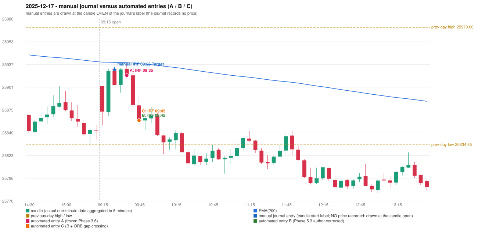

# 2025-12-17 (Wednesday) - manual journal versus the automated configurations

> SYNTHETIC index-point P&L; no real option P&L; costs illustrative (Rs 70 per trade + slippage scenarios). Configurations A / B / C are never combined.

## Session

* Open 25902.4; previous official close 25860.1; gap +42.30; previous-day high / low 25970.0 / 25834.85
* First 5-minute candle (09:15-09:20): O25902.4 H25902.4 L25857.2 C25873.05, RED, body 64.9%; EMA(200) at the first candle 25929.97; previous session's last close 25851.35 vs its EMA 25930.54

## Manual journal

row 53: IRF labelled 09:25, outcome Target

## Configuration A

Candidate signals (confirmed): 09:40 IRF/Method 2B SHORT [EXECUTED: trade 1: TARGET]; 09:45 IRF/Method 1 SHORT [IGNORED: POSITION_ACTIVE (signal kept for diagnostics only; never reused)]

Strategies with no confirmed signal: ORB: no setup record (the strategy's trigger event never occurred) | PDR: PDR INVALIDATED OPEN_NOT_STRICTLY_ABOVE_ZONE | PDS: no setup record (the strategy's trigger event never occurred) | RF: RF INCOMPLETE_AT_EOD NO_RETURN_INSIDE_BEFORE_SESSION_END

| trade | strategy / method | dir | signal -> fill | entry | stop / T1 / T2 | leg 1 | leg 2 | outcome | gross Rs | net Rs (70, 0) | net Rs (70, 1.0) |
|---|---|---|---|---|---|---|---|---|---|---|---|
| 1 | IRF/Method 2B | SHORT | 09:40 -> 09:40 | 25914.7 | 25949.7 / 25887.7 / 25854.7 | 09:44 @ 25887.7 | 09:52 @ 25854.7 | TARGET | 16,965 | 16,895 | 16,115 |

Selection: This IRF Method 2B signal was the earliest executable signal of the day: 0 confirmed signal(s) earlier, 0 other in the same minute. 1 later confirmed signal(s) (IRF x1) are logged as ignored or rejected. State of the other four engines at that moment: [ORB: no setup record before this time (a base condition was not met, or nothing triggered)] [PDR: PDR invalidated at 09:15: OPEN_NOT_STRICTLY_ABOVE_ZONE] [PDS: no setup record before this time (a base condition was not met, or nothing triggered)] [RF: no setup record before this time (a base condition was not met, or nothing triggered)]

* Journal row 53 (IRF 09:25): **TIME_TOLERANT** match with 20251217-1-IRF (delta +10 min); outcome Target vs automated TARGET (same class)

## Configuration B

Candidate signals (confirmed): 09:50 IRF/Method 2A SHORT [EXECUTED: trade 1: TARGET]; 09:50 IRF/Method 2B SHORT [MERGED_SAME_STRATEGY_METHOD: traded as another method of the same strategy/direction in the same minute]

Strategies with no confirmed signal: ORB: no setup record (the strategy's trigger event never occurred) | PDR: PDR INVALIDATED OPEN_NOT_STRICTLY_ABOVE_ZONE | PDS: no setup record (the strategy's trigger event never occurred) | RF: RF INCOMPLETE_AT_EOD NO_RETURN_INSIDE_BEFORE_SESSION_END

| trade | strategy / method | dir | signal -> fill | entry | stop / T1 / T2 | leg 1 | leg 2 | outcome | gross Rs | net Rs (70, 0) | net Rs (70, 1.0) |
|---|---|---|---|---|---|---|---|---|---|---|---|
| 1 | IRF/Method 2A | SHORT | 09:50 -> 09:50 | 25862.9 | 25897.9 / 25835.9 / 25802.9 | 10:06 @ 25835.9 | 10:57 @ 25802.9 | TARGET | 16,965 | 16,895 | 16,115 |

Selection: This IRF Method 2A signal was the earliest executable signal of the day: 0 confirmed signal(s) earlier, 1 other in the same minute. No later signal was generated. State of the other four engines at that moment: [ORB: no setup record before this time (a base condition was not met, or nothing triggered)] [PDR: PDR invalidated at 09:15: OPEN_NOT_STRICTLY_ABOVE_ZONE] [PDS: no setup record before this time (a base condition was not met, or nothing triggered)] [RF: no setup record before this time (a base condition was not met, or nothing triggered)]

* Journal row 53 (IRF 09:25): **DATE_STRATEGY_ONLY**; earliest cause LATER_SIGNAL (+ ENTRY_TIME_MISMATCH): the automated IRF trade has its signal candle at 09:45 versus the manual label 09:25 (+20 minutes; outside the 15-minute tolerance)
* Automated IRF 09:45 has no strict / time-tolerant journal counterpart: LATER_SIGNAL - the journal has IRF at 09:25; the automated trade's signal candle is 09:45

## Configuration C

Candidate signals (confirmed): 09:50 IRF/Method 2A SHORT [EXECUTED: trade 1: TARGET]; 09:50 IRF/Method 2B SHORT [MERGED_SAME_STRATEGY_METHOD: traded as another method of the same strategy/direction in the same minute]

Strategies with no confirmed signal: ORB: Gap/200DMA INVALIDATED CLOSE_NOT_BEYOND_MA | PDR: PDR INVALIDATED OPEN_NOT_STRICTLY_ABOVE_ZONE | PDS: no setup record (the strategy's trigger event never occurred) | RF: RF INCOMPLETE_AT_EOD NO_RETURN_INSIDE_BEFORE_SESSION_END

| trade | strategy / method | dir | signal -> fill | entry | stop / T1 / T2 | leg 1 | leg 2 | outcome | gross Rs | net Rs (70, 0) | net Rs (70, 1.0) |
|---|---|---|---|---|---|---|---|---|---|---|---|
| 1 | IRF/Method 2A | SHORT | 09:50 -> 09:50 | 25862.9 | 25897.9 / 25835.9 / 25802.9 | 10:06 @ 25835.9 | 10:57 @ 25802.9 | TARGET | 16,965 | 16,895 | 16,115 |

Selection: This IRF Method 2A signal was the earliest executable signal of the day: 0 confirmed signal(s) earlier, 1 other in the same minute. No later signal was generated. State of the other four engines at that moment: [ORB: Gap/200DMA invalidated at 09:15: CLOSE_NOT_BEYOND_MA] [PDR: PDR invalidated at 09:15: OPEN_NOT_STRICTLY_ABOVE_ZONE] [PDS: no setup record before this time (a base condition was not met, or nothing triggered)] [RF: no setup record before this time (a base condition was not met, or nothing triggered)]

* Journal row 53 (IRF 09:25): **DATE_STRATEGY_ONLY**; earliest cause LATER_SIGNAL (+ ENTRY_TIME_MISMATCH): the automated IRF trade has its signal candle at 09:45 versus the manual label 09:25 (+20 minutes; outside the 15-minute tolerance)
* Automated IRF 09:45 has no strict / time-tolerant journal counterpart: LATER_SIGNAL - the journal has IRF at 09:25; the automated trade's signal candle is 09:45

## Chart

