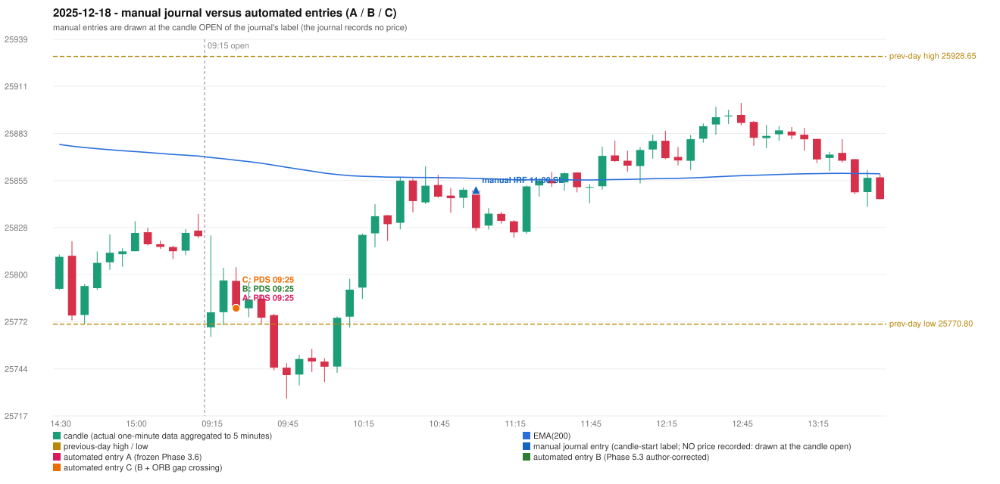

# 2025-12-18 (Thursday) - manual journal versus the automated configurations

> SYNTHETIC index-point P&L; no real option P&L; costs illustrative (Rs 70 per trade + slippage scenarios). Configurations A / B / C are never combined.

## Session

* Open 25768.9; previous official close 25818.55; gap -49.65; previous-day high / low 25928.65 / 25770.8
* First 5-minute candle (09:15-09:20): O25768.9 H25823.2 L25763.15 C25777.75, GREEN, body 14.7%; EMA(200) at the first candle 25869.04; previous session's last close 25822.65 vs its EMA 25869.95

## Manual journal

row 54: IRF labelled 11:00, outcome SL

## Configuration A

Candidate signals (confirmed): 09:30 PDS/Method 1 SHORT [EXECUTED: trade 1: T1_THEN_BUFFER_STOP]; 11:05 IRF/Method 2A SHORT [IGNORED: DAY_FINISHED]; 11:05 IRF/Method 2B SHORT [IGNORED: DAY_FINISHED]; 13:20 IRF/Method 2A SHORT [IGNORED: DAY_FINISHED]; 14:10 IRF/Method 1 SHORT [IGNORED: DAY_FINISHED]; 15:10 IRF/Method 1 SHORT [IGNORED: DAY_FINISHED]

Strategies with no confirmed signal: ORB: Method 2 INVALIDATED TRENDLINE_NOT_SUPPORTIVE | PDR: no setup record (the strategy's trigger event never occurred) | RF: RF INVALIDATED TREND:EMA_PREV_SESSION_CLOSE wrong side

| trade | strategy / method | dir | signal -> fill | entry | stop / T1 / T2 | leg 1 | leg 2 | outcome | gross Rs | net Rs (70, 0) | net Rs (70, 1.0) |
|---|---|---|---|---|---|---|---|---|---|---|---|
| 1 | PDS/Method 1 | SHORT | 09:30 -> 09:30 | 25780.15 | 25815.15 / 25753.15 / 25710.15 | 09:42 @ 25753.15 | 10:12 @ 25786.15 | T1_THEN_BUFFER_STOP | 4,095 | 4,025 | 3,245 |

Selection: This PDS Method 1 signal was the earliest executable signal of the day: 0 confirmed signal(s) earlier, 0 other in the same minute. 5 later confirmed signal(s) (IRF x5) are logged as ignored or rejected. State of the other four engines at that moment: [IRF: no setup record before this time (a base condition was not met, or nothing triggered)] [ORB: Method 2 invalidated at 09:15: TRENDLINE_NOT_SUPPORTIVE] [PDR: no setup record before this time (a base condition was not met, or nothing triggered)] [RF: no setup record before this time (a base condition was not met, or nothing triggered)]

* Journal row 54 (IRF 11:00): **UNMATCHED_MANUAL**; earliest cause DIFFERENT_STRATEGY_SELECTED (+ PORTFOLIO_CONTROLLER_CONSTRAINT): the controller took PDS Method 1 (signal 09:30) first; the IRF signal at 11:05 was IGNORED: DAY_FINISHED
* Automated PDS 09:25 has no strict / time-tolerant journal counterpart: DIFFERENT_STRATEGY_SELECTED - the journal traded IRF 11:00; the automated controller took PDS Method 1 (candle 09:25) as the first valid signal

## Configuration B

Candidate signals (confirmed): 09:30 PDS/Method 1 SHORT [EXECUTED: trade 1: T1_THEN_BUFFER_STOP]; 09:40 PDS/Method 1 SHORT [IGNORED: POSITION_ACTIVE (signal kept for diagnostics only; never reused)]; 09:45 PDS/Method 1 SHORT [IGNORED: POSITION_ACTIVE (signal kept for diagnostics only; never reused)]; 14:15 IRF/Method 2A SHORT [IGNORED: DAY_FINISHED]; 14:15 IRF/Method 2B SHORT [IGNORED: DAY_FINISHED]; 14:25 PDS/Method 1 SHORT [IGNORED: DAY_FINISHED]; 14:40 PDS/Method 1 SHORT [IGNORED: DAY_FINISHED]

Strategies with no confirmed signal: ORB: Method 2 INVALIDATED TRENDLINE_NOT_SUPPORTIVE | PDR: no setup record (the strategy's trigger event never occurred) | RF: RF INVALIDATED TREND:EMA_PREV_SESSION_CLOSE wrong side

| trade | strategy / method | dir | signal -> fill | entry | stop / T1 / T2 | leg 1 | leg 2 | outcome | gross Rs | net Rs (70, 0) | net Rs (70, 1.0) |
|---|---|---|---|---|---|---|---|---|---|---|---|
| 1 | PDS/Method 1 | SHORT | 09:30 -> 09:30 | 25780.15 | 25815.15 / 25753.15 / 25710.15 | 09:42 @ 25753.15 | 10:12 @ 25786.15 | T1_THEN_BUFFER_STOP | 4,095 | 4,025 | 3,245 |

Selection: This PDS Method 1 signal was the earliest executable signal of the day: 0 confirmed signal(s) earlier, 0 other in the same minute. 6 later confirmed signal(s) (IRF x2, PDS x4) are logged as ignored or rejected. State of the other four engines at that moment: [IRF: no setup record before this time (a base condition was not met, or nothing triggered)] [ORB: Method 2 invalidated at 09:15: TRENDLINE_NOT_SUPPORTIVE] [PDR: no setup record before this time (a base condition was not met, or nothing triggered)] [RF: no setup record before this time (a base condition was not met, or nothing triggered)]

* Journal row 54 (IRF 11:00): **UNMATCHED_MANUAL**; earliest cause EMA_FILTER_MISMATCH: no automated IRF signal within 60 minutes of the manual label 11:00 (nearest: 14:15, candle 14:10, 190 minutes later); an IRF Method 2B candidate at 11:05 was REJECTED by the 28-point EMA clearance (range distance 5.6, EMA EMA_ABOVE_CANDLE) - PROVISIONAL_EMA_RANGE_DISTANCE
* Automated PDS 09:25 has no strict / time-tolerant journal counterpart: DIFFERENT_STRATEGY_SELECTED - the journal traded IRF 11:00; the automated controller took PDS Method 1 (candle 09:25) as the first valid signal

## Configuration C

Candidate signals (confirmed): 09:30 PDS/Method 1 SHORT [EXECUTED: trade 1: T1_THEN_BUFFER_STOP]; 09:40 PDS/Method 1 SHORT [IGNORED: POSITION_ACTIVE (signal kept for diagnostics only; never reused)]; 09:45 PDS/Method 1 SHORT [IGNORED: POSITION_ACTIVE (signal kept for diagnostics only; never reused)]; 14:15 IRF/Method 2A SHORT [IGNORED: DAY_FINISHED]; 14:15 IRF/Method 2B SHORT [IGNORED: DAY_FINISHED]; 14:25 PDS/Method 1 SHORT [IGNORED: DAY_FINISHED]; 14:40 PDS/Method 1 SHORT [IGNORED: DAY_FINISHED]

Strategies with no confirmed signal: ORB: Method 2 INVALIDATED TRENDLINE_NOT_SUPPORTIVE | PDR: no setup record (the strategy's trigger event never occurred) | RF: RF INVALIDATED TREND:EMA_PREV_SESSION_CLOSE wrong side

| trade | strategy / method | dir | signal -> fill | entry | stop / T1 / T2 | leg 1 | leg 2 | outcome | gross Rs | net Rs (70, 0) | net Rs (70, 1.0) |
|---|---|---|---|---|---|---|---|---|---|---|---|
| 1 | PDS/Method 1 | SHORT | 09:30 -> 09:30 | 25780.15 | 25815.15 / 25753.15 / 25710.15 | 09:42 @ 25753.15 | 10:12 @ 25786.15 | T1_THEN_BUFFER_STOP | 4,095 | 4,025 | 3,245 |

Selection: This PDS Method 1 signal was the earliest executable signal of the day: 0 confirmed signal(s) earlier, 0 other in the same minute. 6 later confirmed signal(s) (IRF x2, PDS x4) are logged as ignored or rejected. State of the other four engines at that moment: [IRF: no setup record before this time (a base condition was not met, or nothing triggered)] [ORB: Method 2 invalidated at 09:15: TRENDLINE_NOT_SUPPORTIVE] [PDR: no setup record before this time (a base condition was not met, or nothing triggered)] [RF: no setup record before this time (a base condition was not met, or nothing triggered)]

* Journal row 54 (IRF 11:00): **UNMATCHED_MANUAL**; earliest cause EMA_FILTER_MISMATCH: no automated IRF signal within 60 minutes of the manual label 11:00 (nearest: 14:15, candle 14:10, 190 minutes later); an IRF Method 2B candidate at 11:05 was REJECTED by the 28-point EMA clearance (range distance 5.6, EMA EMA_ABOVE_CANDLE) - PROVISIONAL_EMA_RANGE_DISTANCE
* Automated PDS 09:25 has no strict / time-tolerant journal counterpart: DIFFERENT_STRATEGY_SELECTED - the journal traded IRF 11:00; the automated controller took PDS Method 1 (candle 09:25) as the first valid signal

## Handwritten author corrections for this date

* AC35 (page 6): "Should take resistance in the zone, breakout of zone Ep trap is not conside[red]" - status A / B / C: NOT_ADDRESSED_BY_THE_CONFIGURATIONS / NOT_ADDRESSED_BY_THE_CONFIGURATIONS / NOT_ADDRESSED_BY_THE_CONFIGURATIONS

## Chart

