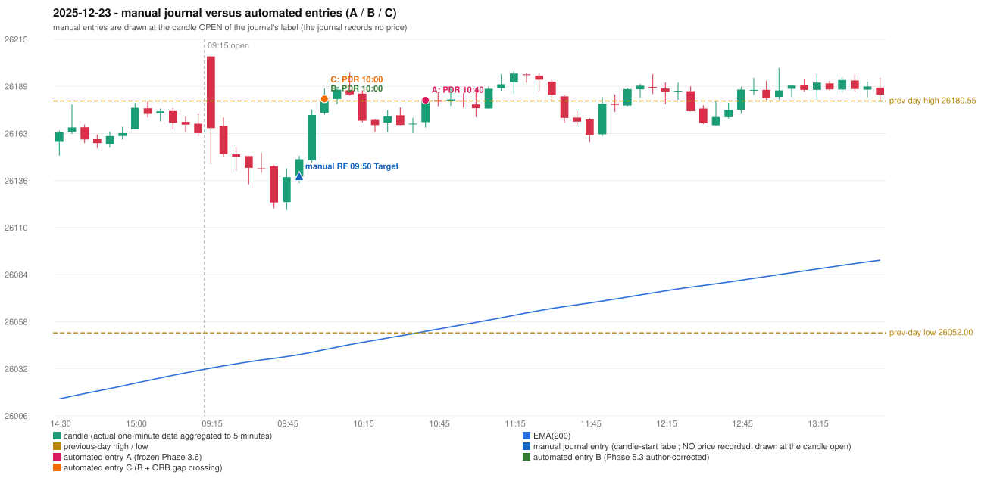

# 2025-12-23 (Tuesday) - manual journal versus the automated configurations

> SYNTHETIC index-point P&L; no real option P&L; costs illustrative (Rs 70 per trade + slippage scenarios). Configurations A / B / C are never combined.

## Session

* Open 26205.2; previous official close 26172.4; gap +32.80; previous-day high / low 26180.55 / 26052.0
* First 5-minute candle (09:15-09:20): O26205.2 H26205.2 L26145.75 C26165.5, RED, body 66.8%; EMA(200) at the first candle 26032.54; previous session's last close 26162.75 vs its EMA 26031.20

## Manual journal

row 57: RF labelled 09:50, outcome Target

## Configuration A

Candidate signals (confirmed): 10:45 PDR/PDR LONG [EXECUTED: trade 1: T1_THEN_BUFFER_STOP]; 11:10 PDR/PDR LONG [IGNORED: POSITION_ACTIVE (signal kept for diagnostics only; never reused)]; 11:55 PDR/PDR LONG [IGNORED: POSITION_ACTIVE (signal kept for diagnostics only; never reused)]; 12:05 PDR/PDR LONG [IGNORED: POSITION_ACTIVE (signal kept for diagnostics only; never reused)]; 12:50 PDR/PDR LONG [IGNORED: POSITION_ACTIVE (signal kept for diagnostics only; never reused)]; 14:35 IRF/Method 1 SHORT [IGNORED: POSITION_ACTIVE (signal kept for diagnostics only; never reused)]; 14:45 IRF/Method 1 SHORT [IGNORED: DAY_FINISHED]; 15:15 PDR/PDR LONG [IGNORED: DAY_FINISHED]

Strategies with no confirmed signal: ORB: no setup record (the strategy's trigger event never occurred) | PDS: no setup record (the strategy's trigger event never occurred) | RF: RF INVALIDATED GAP_UP_OUTSIDE_YESTERDAYS_RANGE

| trade | strategy / method | dir | signal -> fill | entry | stop / T1 / T2 | leg 1 | leg 2 | outcome | gross Rs | net Rs (70, 0) | net Rs (70, 1.0) |
|---|---|---|---|---|---|---|---|---|---|---|---|
| 1 | PDR/PDR | LONG | 10:45 -> 10:45 | 26180.95 | 26145.95 / 26207.95 / 26250.95 | 14:15 @ 26207.95 | 14:44 @ 26174.95 | T1_THEN_BUFFER_STOP | 4,095 | 4,025 | 3,245 |

Selection: This PDR signal was the earliest executable signal of the day: 0 confirmed signal(s) earlier, 0 other in the same minute. 7 later confirmed signal(s) (IRF x2, PDR x5) are logged as ignored or rejected. State of the other four engines at that moment: [IRF: no setup record before this time (a base condition was not met, or nothing triggered)] [ORB: no setup record before this time (a base condition was not met, or nothing triggered)] [PDS: no setup record before this time (a base condition was not met, or nothing triggered)] [RF: RF invalidated at 09:50: GAP_UP_OUTSIDE_YESTERDAYS_RANGE]

* Journal row 57 (RF 09:50): **UNMATCHED_MANUAL**; earliest cause OPENING_GAP_MISMATCH: RF setup rejected by the opening-gap condition (RF-004) (GAP_UP_OUTSIDE_YESTERDAYS_RANGE)
* Automated PDR 10:40 has no strict / time-tolerant journal counterpart: DIFFERENT_STRATEGY_SELECTED - the journal traded RF 09:50; the automated controller took PDR PDR (candle 10:40) as the first valid signal

## Configuration B

Candidate signals (confirmed): 10:05 PDR/PDR LONG [EXECUTED: trade 1: T1_THEN_BUFFER_STOP]; 10:45 PDR/PDR LONG [IGNORED: POSITION_ACTIVE (signal kept for diagnostics only; never reused)]; 11:10 PDR/PDR LONG [IGNORED: POSITION_ACTIVE (signal kept for diagnostics only; never reused)]; 11:55 PDR/PDR LONG [IGNORED: POSITION_ACTIVE (signal kept for diagnostics only; never reused)]; 12:05 PDR/PDR LONG [IGNORED: POSITION_ACTIVE (signal kept for diagnostics only; never reused)]; 12:50 PDR/PDR LONG [IGNORED: POSITION_ACTIVE (signal kept for diagnostics only; never reused)]; 14:35 IRF/Method 1 SHORT [IGNORED: POSITION_ACTIVE (signal kept for diagnostics only; never reused)]; 14:45 IRF/Method 1 SHORT [IGNORED: DAY_FINISHED]; 14:50 PDR/PDR LONG [IGNORED: DAY_FINISHED]; 15:00 PDR/PDR LONG [IGNORED: DAY_FINISHED]; 15:15 PDR/PDR LONG [IGNORED: DAY_FINISHED]

Strategies with no confirmed signal: ORB: no setup record (the strategy's trigger event never occurred) | PDS: no setup record (the strategy's trigger event never occurred) | RF: RF INVALIDATED GAP_UP_OUTSIDE_YESTERDAYS_RANGE

| trade | strategy / method | dir | signal -> fill | entry | stop / T1 / T2 | leg 1 | leg 2 | outcome | gross Rs | net Rs (70, 0) | net Rs (70, 1.0) |
|---|---|---|---|---|---|---|---|---|---|---|---|
| 1 | PDR/PDR | LONG | 10:05 -> 10:05 | 26181.65 | 26146.65 / 26208.65 / 26251.65 | 14:15 @ 26208.65 | 14:43 @ 26175.65 | T1_THEN_BUFFER_STOP | 4,095 | 4,025 | 3,245 |

Selection: This PDR signal was the earliest executable signal of the day: 0 confirmed signal(s) earlier, 0 other in the same minute. 10 later confirmed signal(s) (IRF x2, PDR x8) are logged as ignored or rejected. State of the other four engines at that moment: [IRF: no setup record before this time (a base condition was not met, or nothing triggered)] [ORB: no setup record before this time (a base condition was not met, or nothing triggered)] [PDS: no setup record before this time (a base condition was not met, or nothing triggered)] [RF: RF invalidated at 09:50: GAP_UP_OUTSIDE_YESTERDAYS_RANGE]

* Journal row 57 (RF 09:50): **UNMATCHED_MANUAL**; earliest cause OPENING_GAP_MISMATCH: RF setup rejected by the opening-gap condition (RF-004) (GAP_UP_OUTSIDE_YESTERDAYS_RANGE)
* Automated PDR 10:00 has no strict / time-tolerant journal counterpart: DIFFERENT_STRATEGY_SELECTED - the journal traded RF 09:50; the automated controller took PDR PDR (candle 10:00) as the first valid signal

## Configuration C

Candidate signals (confirmed): 10:05 PDR/PDR LONG [EXECUTED: trade 1: T1_THEN_BUFFER_STOP]; 10:45 PDR/PDR LONG [IGNORED: POSITION_ACTIVE (signal kept for diagnostics only; never reused)]; 11:10 PDR/PDR LONG [IGNORED: POSITION_ACTIVE (signal kept for diagnostics only; never reused)]; 11:55 PDR/PDR LONG [IGNORED: POSITION_ACTIVE (signal kept for diagnostics only; never reused)]; 12:05 PDR/PDR LONG [IGNORED: POSITION_ACTIVE (signal kept for diagnostics only; never reused)]; 12:50 PDR/PDR LONG [IGNORED: POSITION_ACTIVE (signal kept for diagnostics only; never reused)]; 14:35 IRF/Method 1 SHORT [IGNORED: POSITION_ACTIVE (signal kept for diagnostics only; never reused)]; 14:45 IRF/Method 1 SHORT [IGNORED: DAY_FINISHED]; 14:50 PDR/PDR LONG [IGNORED: DAY_FINISHED]; 15:00 PDR/PDR LONG [IGNORED: DAY_FINISHED]; 15:15 PDR/PDR LONG [IGNORED: DAY_FINISHED]

Strategies with no confirmed signal: ORB: no setup record (the strategy's trigger event never occurred) | PDS: no setup record (the strategy's trigger event never occurred) | RF: RF INVALIDATED GAP_UP_OUTSIDE_YESTERDAYS_RANGE

| trade | strategy / method | dir | signal -> fill | entry | stop / T1 / T2 | leg 1 | leg 2 | outcome | gross Rs | net Rs (70, 0) | net Rs (70, 1.0) |
|---|---|---|---|---|---|---|---|---|---|---|---|
| 1 | PDR/PDR | LONG | 10:05 -> 10:05 | 26181.65 | 26146.65 / 26208.65 / 26251.65 | 14:15 @ 26208.65 | 14:43 @ 26175.65 | T1_THEN_BUFFER_STOP | 4,095 | 4,025 | 3,245 |

Selection: This PDR signal was the earliest executable signal of the day: 0 confirmed signal(s) earlier, 0 other in the same minute. 10 later confirmed signal(s) (IRF x2, PDR x8) are logged as ignored or rejected. State of the other four engines at that moment: [IRF: no setup record before this time (a base condition was not met, or nothing triggered)] [ORB: no setup record before this time (a base condition was not met, or nothing triggered)] [PDS: no setup record before this time (a base condition was not met, or nothing triggered)] [RF: RF invalidated at 09:50: GAP_UP_OUTSIDE_YESTERDAYS_RANGE]

* Journal row 57 (RF 09:50): **UNMATCHED_MANUAL**; earliest cause OPENING_GAP_MISMATCH: RF setup rejected by the opening-gap condition (RF-004) (GAP_UP_OUTSIDE_YESTERDAYS_RANGE)
* Automated PDR 10:00 has no strict / time-tolerant journal counterpart: DIFFERENT_STRATEGY_SELECTED - the journal traded RF 09:50; the automated controller took PDR PDR (candle 10:00) as the first valid signal

## Handwritten author corrections for this date

* AC36 (page 6): "RF should be activated instead of PDR. | PDR is also wrong." - status A / B / C: NOT_ADDRESSED_BY_THE_CONFIGURATIONS / NOT_ADDRESSED_BY_THE_CONFIGURATIONS / NOT_ADDRESSED_BY_THE_CONFIGURATIONS

## Chart

