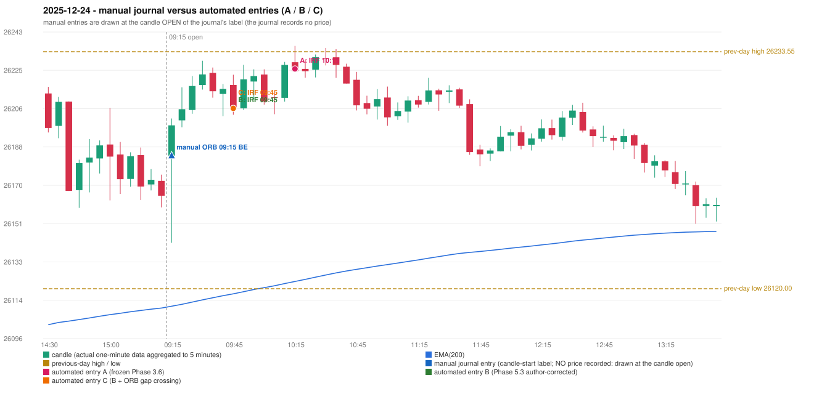

# 2025-12-24 (Wednesday) - manual journal versus the automated configurations

> SYNTHETIC index-point P&L; no real option P&L; costs illustrative (Rs 70 per trade + slippage scenarios). Configurations A / B / C are never combined.

## Session

* Open 26183.75; previous official close 26177.15; gap +6.60; previous-day high / low 26233.55 / 26120.0
* First 5-minute candle (09:15-09:20): O26183.75 H26201.55 L26142.0 C26198.25, GREEN, body 24.3%; EMA(200) at the first candle 26111.60; previous session's last close 26164.55 vs its EMA 26110.73

## Manual journal

row 58: ORB labelled 09:15, outcome BE

## Configuration A

Candidate signals (confirmed): 10:20 IRF/Method 2B SHORT [EXECUTED: trade 1: TARGET]; 11:45 IRF/Method 1 SHORT [IGNORED: POSITION_ACTIVE (signal kept for diagnostics only; never reused)]; 12:40 IRF/Method 1 SHORT [IGNORED: POSITION_ACTIVE (signal kept for diagnostics only; never reused)]; 15:00 RF/RF LONG [IGNORED: DAY_FINISHED]

Strategies with no confirmed signal: ORB: no setup record (the strategy's trigger event never occurred) | PDR: PDR INVALIDATED OPEN_NOT_STRICTLY_ABOVE_ZONE | PDS: no setup record (the strategy's trigger event never occurred)

| trade | strategy / method | dir | signal -> fill | entry | stop / T1 / T2 | leg 1 | leg 2 | outcome | gross Rs | net Rs (70, 0) | net Rs (70, 1.0) |
|---|---|---|---|---|---|---|---|---|---|---|---|
| 1 | IRF/Method 2B | SHORT | 10:20 -> 10:20 | 26225.3 | 26260.3 / 26198.3 / 26165.3 | 11:03 @ 26198.3 | 13:25 @ 26165.3 | TARGET | 16,965 | 16,895 | 16,115 |

Selection: This IRF Method 2B signal was the earliest executable signal of the day: 0 confirmed signal(s) earlier, 0 other in the same minute. 3 later confirmed signal(s) (IRF x2, RF x1) are logged as ignored or rejected. State of the other four engines at that moment: [ORB: no setup record before this time (a base condition was not met, or nothing triggered)] [PDR: PDR invalidated at 09:15: OPEN_NOT_STRICTLY_ABOVE_ZONE] [PDS: no setup record before this time (a base condition was not met, or nothing triggered)] [RF: no setup record before this time (a base condition was not met, or nothing triggered)]

* Journal row 58 (ORB 09:15): **UNMATCHED_MANUAL**; earliest cause LEVEL_CONSTRUCTION_MISMATCH (+ OPENING_GAP_MISMATCH): first candle GREEN O26183.75 H26201.55 L26142.0 C26198.25 (body 24.3%); direction ASSUMED from the colour (the journal has no direction); TIE-BROKEN BY METHOD ORDER: 3 methods tie at 1 failing predicate(s) (Method 1: level_broken; Method 2: inner_level_broken; Gap/200DMA: gap_crosses_200_average) - the evidence does not single out one cause, the secondary cause is the other tied one; closest method Method 1 (1 failing predicate(s)): first failing 'level_broken' - previous-day high 26233.55; candle high/low 26201.55, close 26198.25; all methods: Method 1: 1 fail (level_broken); Method 2: 1 fail (inner_level_broken); Gap/200DMA: 1 fail (gap_crosses_200_average)
* Automated IRF 10:15 has no strict / time-tolerant journal counterpart: DIFFERENT_STRATEGY_SELECTED - the journal traded ORB 09:15; the automated controller took IRF Method 2B (candle 10:15) as the first valid signal

## Configuration B

Candidate signals (confirmed): 09:50 IRF/Method 2A SHORT [EXECUTED: trade 1: TARGET]; 10:20 IRF/Method 2B SHORT [IGNORED: POSITION_ACTIVE (signal kept for diagnostics only; never reused)]; 11:45 IRF/Method 1 SHORT [IGNORED: POSITION_ACTIVE (signal kept for diagnostics only; never reused)]; 12:40 IRF/Method 1 SHORT [IGNORED: POSITION_ACTIVE (signal kept for diagnostics only; never reused)]; 15:00 RF/RF LONG [IGNORED: DAY_FINISHED]

Strategies with no confirmed signal: ORB: no setup record (the strategy's trigger event never occurred) | PDR: PDR INVALIDATED OPEN_NOT_STRICTLY_ABOVE_ZONE | PDS: no setup record (the strategy's trigger event never occurred)

| trade | strategy / method | dir | signal -> fill | entry | stop / T1 / T2 | leg 1 | leg 2 | outcome | gross Rs | net Rs (70, 0) | net Rs (70, 1.0) |
|---|---|---|---|---|---|---|---|---|---|---|---|
| 1 | IRF/Method 2A | SHORT | 09:50 -> 09:50 | 26206.4 | 26241.4 / 26179.4 / 26146.4 | 11:47 @ 26179.4 | 14:01 @ 26146.4 | TARGET | 16,965 | 16,895 | 16,115 |

Selection: This IRF Method 2A signal was the earliest executable signal of the day: 0 confirmed signal(s) earlier, 0 other in the same minute. 4 later confirmed signal(s) (IRF x3, RF x1) are logged as ignored or rejected. State of the other four engines at that moment: [ORB: no setup record before this time (a base condition was not met, or nothing triggered)] [PDR: PDR invalidated at 09:15: OPEN_NOT_STRICTLY_ABOVE_ZONE] [PDS: no setup record before this time (a base condition was not met, or nothing triggered)] [RF: no setup record before this time (a base condition was not met, or nothing triggered)]

* Journal row 58 (ORB 09:15): **UNMATCHED_MANUAL**; earliest cause LEVEL_CONSTRUCTION_MISMATCH (+ OPENING_GAP_MISMATCH): first candle GREEN O26183.75 H26201.55 L26142.0 C26198.25 (body 24.3%); direction ASSUMED from the colour (the journal has no direction); TIE-BROKEN BY METHOD ORDER: 3 methods tie at 1 failing predicate(s) (Method 1: level_broken; Method 2: inner_level_broken; Gap/200DMA: gap_crosses_200_average) - the evidence does not single out one cause, the secondary cause is the other tied one; closest method Method 1 (1 failing predicate(s)): first failing 'level_broken' - previous-day high 26233.55; candle high/low 26201.55, close 26198.25; all methods: Method 1: 1 fail (level_broken); Method 2: 1 fail (inner_level_broken); Gap/200DMA: 1 fail (gap_crosses_200_average)
* Automated IRF 09:45 has no strict / time-tolerant journal counterpart: DIFFERENT_STRATEGY_SELECTED - the journal traded ORB 09:15; the automated controller took IRF Method 2A (candle 09:45) as the first valid signal

## Configuration C

Candidate signals (confirmed): 09:50 IRF/Method 2A SHORT [EXECUTED: trade 1: TARGET]; 10:20 IRF/Method 2B SHORT [IGNORED: POSITION_ACTIVE (signal kept for diagnostics only; never reused)]; 11:45 IRF/Method 1 SHORT [IGNORED: POSITION_ACTIVE (signal kept for diagnostics only; never reused)]; 12:40 IRF/Method 1 SHORT [IGNORED: POSITION_ACTIVE (signal kept for diagnostics only; never reused)]; 15:00 RF/RF LONG [IGNORED: DAY_FINISHED]

Strategies with no confirmed signal: ORB: no setup record (the strategy's trigger event never occurred) | PDR: PDR INVALIDATED OPEN_NOT_STRICTLY_ABOVE_ZONE | PDS: no setup record (the strategy's trigger event never occurred)

| trade | strategy / method | dir | signal -> fill | entry | stop / T1 / T2 | leg 1 | leg 2 | outcome | gross Rs | net Rs (70, 0) | net Rs (70, 1.0) |
|---|---|---|---|---|---|---|---|---|---|---|---|
| 1 | IRF/Method 2A | SHORT | 09:50 -> 09:50 | 26206.4 | 26241.4 / 26179.4 / 26146.4 | 11:47 @ 26179.4 | 14:01 @ 26146.4 | TARGET | 16,965 | 16,895 | 16,115 |

Selection: This IRF Method 2A signal was the earliest executable signal of the day: 0 confirmed signal(s) earlier, 0 other in the same minute. 4 later confirmed signal(s) (IRF x3, RF x1) are logged as ignored or rejected. State of the other four engines at that moment: [ORB: no setup record before this time (a base condition was not met, or nothing triggered)] [PDR: PDR invalidated at 09:15: OPEN_NOT_STRICTLY_ABOVE_ZONE] [PDS: no setup record before this time (a base condition was not met, or nothing triggered)] [RF: no setup record before this time (a base condition was not met, or nothing triggered)]

* Journal row 58 (ORB 09:15): **UNMATCHED_MANUAL**; earliest cause LEVEL_CONSTRUCTION_MISMATCH (+ OPENING_GAP_MISMATCH): first candle GREEN O26183.75 H26201.55 L26142.0 C26198.25 (body 24.3%); direction ASSUMED from the colour (the journal has no direction); TIE-BROKEN BY METHOD ORDER: 3 methods tie at 1 failing predicate(s) (Method 1: level_broken; Method 2: inner_level_broken; Gap/200DMA: gap_crosses_200_average) - the evidence does not single out one cause, the secondary cause is the other tied one; closest method Method 1 (1 failing predicate(s)): first failing 'level_broken' - previous-day high 26233.55; candle high/low 26201.55, close 26198.25; all methods: Method 1: 1 fail (level_broken); Method 2: 1 fail (inner_level_broken); Gap/200DMA: 1 fail (gap_crosses_200_average)
* Automated IRF 09:45 has no strict / time-tolerant journal counterpart: DIFFERENT_STRATEGY_SELECTED - the journal traded ORB 09:15; the automated controller took IRF Method 2A (candle 09:45) as the first valid signal

## Handwritten author corrections for this date

* AC37 (page 6): "ORB should be activated instead of IRF" - status A / B / C: ORB_STILL_NOT_TRADED / ORB_STILL_NOT_TRADED / ORB_STILL_NOT_TRADED

## Chart

