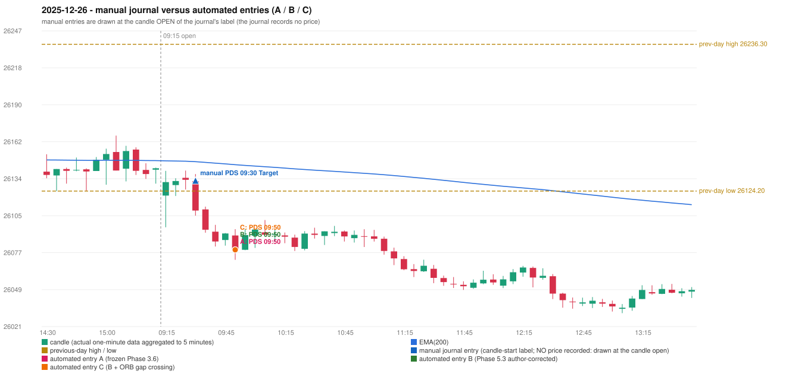

# 2025-12-26 (Friday) - manual journal versus the automated configurations

> SYNTHETIC index-point P&L; no real option P&L; costs illustrative (Rs 70 per trade + slippage scenarios). Configurations A / B / C are never combined.

## Session

* Open 26120.75; previous official close 26142.1; gap -21.35; previous-day high / low 26236.3 / 26124.2
* First 5-minute candle (09:15-09:20): O26120.75 H26139.65 L26096.55 C26131.05, GREEN, body 23.9%; EMA(200) at the first candle 26147.32; previous session's last close 26141.65 vs its EMA 26147.48

## Manual journal

row 59: PDS labelled 09:30, outcome Target

## Configuration A

Candidate signals (confirmed): 09:55 PDS/Method 3 SHORT [EXECUTED: trade 1: TARGET]

Strategies with no confirmed signal: IRF: no setup record (the strategy's trigger event never occurred) | ORB: no setup record (the strategy's trigger event never occurred) | PDR: no setup record (the strategy's trigger event never occurred) | RF: RF INCOMPLETE_AT_EOD NO_RETURN_INSIDE_BEFORE_SESSION_END

| trade | strategy / method | dir | signal -> fill | entry | stop / T1 / T2 | leg 1 | leg 2 | outcome | gross Rs | net Rs (70, 0) | net Rs (70, 1.0) |
|---|---|---|---|---|---|---|---|---|---|---|---|
| 1 | PDS/Method 3 | SHORT | 09:55 -> 09:55 | 26079.35 | 26114.35 / 26052.35 / 26009.35 | 11:36 @ 26052.35 | 14:50 @ 26009.35 | TARGET | 18,915 | 18,845 | 18,065 |

Selection: This PDS Method 3 signal was the earliest executable signal of the day: 0 confirmed signal(s) earlier, 0 other in the same minute. No later signal was generated. State of the other four engines at that moment: [IRF: no setup record before this time (a base condition was not met, or nothing triggered)] [ORB: no setup record before this time (a base condition was not met, or nothing triggered)] [PDR: no setup record before this time (a base condition was not met, or nothing triggered)] [RF: no setup record before this time (a base condition was not met, or nothing triggered)]

* Journal row 59 (PDS 09:30): **DATE_STRATEGY_ONLY**; earliest cause LATER_SIGNAL (+ ENTRY_TIME_MISMATCH): the automated PDS trade has its signal candle at 09:50 versus the manual label 09:30 (+20 minutes; outside the 15-minute tolerance)
* Automated PDS 09:50 has no strict / time-tolerant journal counterpart: LATER_SIGNAL - the journal has PDS at 09:30; the automated trade's signal candle is 09:50

## Configuration B

Candidate signals (confirmed): 09:55 PDS/Method 3 SHORT [EXECUTED: trade 1: TARGET]

Strategies with no confirmed signal: IRF: no setup record (the strategy's trigger event never occurred) | ORB: no setup record (the strategy's trigger event never occurred) | PDR: no setup record (the strategy's trigger event never occurred) | RF: RF INCOMPLETE_AT_EOD NO_RETURN_INSIDE_BEFORE_SESSION_END

| trade | strategy / method | dir | signal -> fill | entry | stop / T1 / T2 | leg 1 | leg 2 | outcome | gross Rs | net Rs (70, 0) | net Rs (70, 1.0) |
|---|---|---|---|---|---|---|---|---|---|---|---|
| 1 | PDS/Method 3 | SHORT | 09:55 -> 09:55 | 26079.35 | 26114.35 / 26052.35 / 26009.35 | 11:36 @ 26052.35 | 14:50 @ 26009.35 | TARGET | 18,915 | 18,845 | 18,065 |

Selection: This PDS Method 3 signal was the earliest executable signal of the day: 0 confirmed signal(s) earlier, 0 other in the same minute. No later signal was generated. State of the other four engines at that moment: [IRF: no setup record before this time (a base condition was not met, or nothing triggered)] [ORB: no setup record before this time (a base condition was not met, or nothing triggered)] [PDR: no setup record before this time (a base condition was not met, or nothing triggered)] [RF: no setup record before this time (a base condition was not met, or nothing triggered)]

* Journal row 59 (PDS 09:30): **DATE_STRATEGY_ONLY**; earliest cause LATER_SIGNAL (+ ENTRY_TIME_MISMATCH): the automated PDS trade has its signal candle at 09:50 versus the manual label 09:30 (+20 minutes; outside the 15-minute tolerance)
* Automated PDS 09:50 has no strict / time-tolerant journal counterpart: LATER_SIGNAL - the journal has PDS at 09:30; the automated trade's signal candle is 09:50

## Configuration C

Candidate signals (confirmed): 09:55 PDS/Method 3 SHORT [EXECUTED: trade 1: TARGET]

Strategies with no confirmed signal: IRF: no setup record (the strategy's trigger event never occurred) | ORB: no setup record (the strategy's trigger event never occurred) | PDR: no setup record (the strategy's trigger event never occurred) | RF: RF INCOMPLETE_AT_EOD NO_RETURN_INSIDE_BEFORE_SESSION_END

| trade | strategy / method | dir | signal -> fill | entry | stop / T1 / T2 | leg 1 | leg 2 | outcome | gross Rs | net Rs (70, 0) | net Rs (70, 1.0) |
|---|---|---|---|---|---|---|---|---|---|---|---|
| 1 | PDS/Method 3 | SHORT | 09:55 -> 09:55 | 26079.35 | 26114.35 / 26052.35 / 26009.35 | 11:36 @ 26052.35 | 14:50 @ 26009.35 | TARGET | 18,915 | 18,845 | 18,065 |

Selection: This PDS Method 3 signal was the earliest executable signal of the day: 0 confirmed signal(s) earlier, 0 other in the same minute. No later signal was generated. State of the other four engines at that moment: [IRF: no setup record before this time (a base condition was not met, or nothing triggered)] [ORB: no setup record before this time (a base condition was not met, or nothing triggered)] [PDR: no setup record before this time (a base condition was not met, or nothing triggered)] [RF: no setup record before this time (a base condition was not met, or nothing triggered)]

* Journal row 59 (PDS 09:30): **DATE_STRATEGY_ONLY**; earliest cause LATER_SIGNAL (+ ENTRY_TIME_MISMATCH): the automated PDS trade has its signal candle at 09:50 versus the manual label 09:30 (+20 minutes; outside the 15-minute tolerance)
* Automated PDS 09:50 has no strict / time-tolerant journal counterpart: LATER_SIGNAL - the journal has PDS at 09:30; the automated trade's signal candle is 09:50

## Handwritten author corrections for this date

* AC38 (page 6): "First candle entry." - status A / B / C: ENTRY_UNCHANGED / ENTRY_UNCHANGED / ENTRY_UNCHANGED

## Chart

