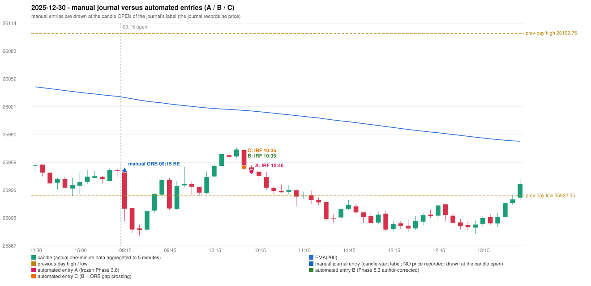

# 2025-12-30 (Tuesday) - manual journal versus the automated configurations

> SYNTHETIC index-point P&L; no real option P&L; costs illustrative (Rs 70 per trade + slippage scenarios). Configurations A / B / C are never combined.

## Session

* Open 25951.0; previous official close 25942.1; gap +8.90; previous-day high / low 26102.75 / 25922.25
* First 5-minute candle (09:15-09:20): O25951.0 H25951.0 L25894.6 C25908.05, RED, body 76.2%; EMA(200) at the first candle 26031.51; previous session's last close 25949.8 vs its EMA 26032.75

## Manual journal

row 60: ORB labelled 09:15, outcome BE

## Configuration A

Candidate signals (confirmed): 10:45 IRF/Method 1 SHORT [EXECUTED: trade 1: TARGET]; 11:15 IRF/Method 2A SHORT [IGNORED: POSITION_ACTIVE (signal kept for diagnostics only; never reused)]; 13:55 IRF/Method 1 SHORT [IGNORED: DAY_FINISHED]

Strategies with no confirmed signal: ORB: Method 1 INVALIDATED CANDLE_QUALITY(not a strong body / wick too large); Method 2 INVALIDATED CANDLE_QUALITY | PDR: PDR INVALIDATED OPEN_NOT_STRICTLY_ABOVE_ZONE | PDS: no setup record (the strategy's trigger event never occurred) | RF: RF INVALIDATED TREND:EMA_PREV_SESSION_CLOSE wrong side

| trade | strategy / method | dir | signal -> fill | entry | stop / T1 / T2 | leg 1 | leg 2 | outcome | gross Rs | net Rs (70, 0) | net Rs (70, 1.0) |
|---|---|---|---|---|---|---|---|---|---|---|---|
| 1 | IRF/Method 1 | SHORT | 10:45 -> 10:45 | 25949.1 | 25984.1 / 25922.1 / 25889.1 | 11:10 @ 25922.1 | 12:13 @ 25889.1 | TARGET | 16,965 | 16,895 | 16,115 |

Selection: This IRF Method 1 signal was the earliest executable signal of the day: 0 confirmed signal(s) earlier, 0 other in the same minute. 2 later confirmed signal(s) (IRF x2) are logged as ignored or rejected. State of the other four engines at that moment: [ORB: Method 1 invalidated at 09:15: CANDLE_QUALITY(not a strong body / wick too large); Method 2 invalidated at 09:15: CANDLE_QUALITY] [PDR: PDR invalidated at 09:15: OPEN_NOT_STRICTLY_ABOVE_ZONE] [PDS: no setup record before this time (a base condition was not met, or nothing triggered)] [RF: RF invalidated at 09:30: TREND:EMA_PREV_SESSION_CLOSE wrong side]

* Journal row 60 (ORB 09:15): **UNMATCHED_MANUAL**; earliest cause CANDLE_STRENGTH_MISMATCH: first candle RED O25951.0 H25951.0 L25894.6 C25908.05 (body 76.2%); direction ASSUMED from the colour (the journal has no direction); TIE-BROKEN BY METHOD ORDER: 2 methods tie at 1 failing predicate(s) (Method 1: candle_quality; Method 2: candle_quality) - the evidence does not single out one cause, the secondary cause is the other tied one; closest method Method 1 (1 failing predicate(s)): first failing 'candle_quality' - body 76.2% opposite wick 23.8% close location 23.8%; all methods: Method 1: 1 fail (candle_quality); Method 2: 1 fail (candle_quality); Gap/200DMA: 3 fail (gap_in_direction)
* Automated IRF 10:40 has no strict / time-tolerant journal counterpart: DIFFERENT_STRATEGY_SELECTED - the journal traded ORB 09:15; the automated controller took IRF Method 1 (candle 10:40) as the first valid signal

## Configuration B

Candidate signals (confirmed): 10:40 IRF/Method 2A SHORT [EXECUTED: trade 1: TARGET]; 10:45 IRF/Method 1 SHORT [IGNORED: POSITION_ACTIVE (signal kept for diagnostics only; never reused)]

Strategies with no confirmed signal: ORB: Method 1 INVALIDATED CANDLE_QUALITY(not a strong body / wick too large); Method 2 INVALIDATED CANDLE_QUALITY | PDR: PDR INVALIDATED OPEN_NOT_STRICTLY_ABOVE_ZONE | PDS: no setup record (the strategy's trigger event never occurred) | RF: RF INVALIDATED TREND:EMA_PREV_SESSION_CLOSE wrong side

| trade | strategy / method | dir | signal -> fill | entry | stop / T1 / T2 | leg 1 | leg 2 | outcome | gross Rs | net Rs (70, 0) | net Rs (70, 1.0) |
|---|---|---|---|---|---|---|---|---|---|---|---|
| 1 | IRF/Method 2A | SHORT | 10:40 -> 10:40 | 25953.9 | 25988.9 / 25926.9 / 25893.9 | 10:55 @ 25926.9 | 11:35 @ 25893.9 | TARGET | 16,965 | 16,895 | 16,115 |

Selection: This IRF Method 2A signal was the earliest executable signal of the day: 0 confirmed signal(s) earlier, 0 other in the same minute. 1 later confirmed signal(s) (IRF x1) are logged as ignored or rejected. State of the other four engines at that moment: [ORB: Method 1 invalidated at 09:15: CANDLE_QUALITY(not a strong body / wick too large); Method 2 invalidated at 09:15: CANDLE_QUALITY] [PDR: PDR invalidated at 09:15: OPEN_NOT_STRICTLY_ABOVE_ZONE] [PDS: no setup record before this time (a base condition was not met, or nothing triggered)] [RF: RF invalidated at 09:30: TREND:EMA_PREV_SESSION_CLOSE wrong side]

* Journal row 60 (ORB 09:15): **UNMATCHED_MANUAL**; earliest cause CANDLE_STRENGTH_MISMATCH: first candle RED O25951.0 H25951.0 L25894.6 C25908.05 (body 76.2%); direction ASSUMED from the colour (the journal has no direction); TIE-BROKEN BY METHOD ORDER: 2 methods tie at 1 failing predicate(s) (Method 1: candle_quality; Method 2: candle_quality) - the evidence does not single out one cause, the secondary cause is the other tied one; closest method Method 1 (1 failing predicate(s)): first failing 'candle_quality' - body 76.2% opposite wick 23.8% close location 23.8%; all methods: Method 1: 1 fail (candle_quality); Method 2: 1 fail (candle_quality); Gap/200DMA: 3 fail (gap_in_direction)
* Automated IRF 10:35 has no strict / time-tolerant journal counterpart: DIFFERENT_STRATEGY_SELECTED - the journal traded ORB 09:15; the automated controller took IRF Method 2A (candle 10:35) as the first valid signal

## Configuration C

Candidate signals (confirmed): 10:40 IRF/Method 2A SHORT [EXECUTED: trade 1: TARGET]; 10:45 IRF/Method 1 SHORT [IGNORED: POSITION_ACTIVE (signal kept for diagnostics only; never reused)]

Strategies with no confirmed signal: ORB: Gap/200DMA INVALIDATED CLOSE_NOT_BEYOND_MA; Method 1 INVALIDATED CANDLE_QUALITY(not a strong body / wick too large); Method 2 INVALIDATED CANDLE_QUALITY | PDR: PDR INVALIDATED OPEN_NOT_STRICTLY_ABOVE_ZONE | PDS: no setup record (the strategy's trigger event never occurred) | RF: RF INVALIDATED TREND:EMA_PREV_SESSION_CLOSE wrong side

| trade | strategy / method | dir | signal -> fill | entry | stop / T1 / T2 | leg 1 | leg 2 | outcome | gross Rs | net Rs (70, 0) | net Rs (70, 1.0) |
|---|---|---|---|---|---|---|---|---|---|---|---|
| 1 | IRF/Method 2A | SHORT | 10:40 -> 10:40 | 25953.9 | 25988.9 / 25926.9 / 25893.9 | 10:55 @ 25926.9 | 11:35 @ 25893.9 | TARGET | 16,965 | 16,895 | 16,115 |

Selection: This IRF Method 2A signal was the earliest executable signal of the day: 0 confirmed signal(s) earlier, 0 other in the same minute. 1 later confirmed signal(s) (IRF x1) are logged as ignored or rejected. State of the other four engines at that moment: [ORB: Gap/200DMA invalidated at 09:15: CLOSE_NOT_BEYOND_MA; Method 1 invalidated at 09:15: CANDLE_QUALITY(not a strong body / wick too large)] [PDR: PDR invalidated at 09:15: OPEN_NOT_STRICTLY_ABOVE_ZONE] [PDS: no setup record before this time (a base condition was not met, or nothing triggered)] [RF: RF invalidated at 09:30: TREND:EMA_PREV_SESSION_CLOSE wrong side]

* Journal row 60 (ORB 09:15): **UNMATCHED_MANUAL**; earliest cause CANDLE_STRENGTH_MISMATCH: first candle RED O25951.0 H25951.0 L25894.6 C25908.05 (body 76.2%); direction ASSUMED from the colour (the journal has no direction); TIE-BROKEN BY METHOD ORDER: 2 methods tie at 1 failing predicate(s) (Method 1: candle_quality; Method 2: candle_quality) - the evidence does not single out one cause, the secondary cause is the other tied one; closest method Method 1 (1 failing predicate(s)): first failing 'candle_quality' - body 76.2% opposite wick 23.8% close location 23.8%; all methods: Method 1: 1 fail (candle_quality); Method 2: 1 fail (candle_quality); Gap/200DMA: 3 fail (gap_in_direction)
* Automated IRF 10:35 has no strict / time-tolerant journal counterpart: DIFFERENT_STRATEGY_SELECTED - the journal traded ORB 09:15; the automated controller took IRF Method 2A (candle 10:35) as the first valid signal

## Handwritten author corrections for this date

* AC39 (page 6): "ORB should be activated instead of IRF." - status A / B / C: ORB_STILL_NOT_TRADED / ORB_STILL_NOT_TRADED / ORB_STILL_NOT_TRADED

## Chart

