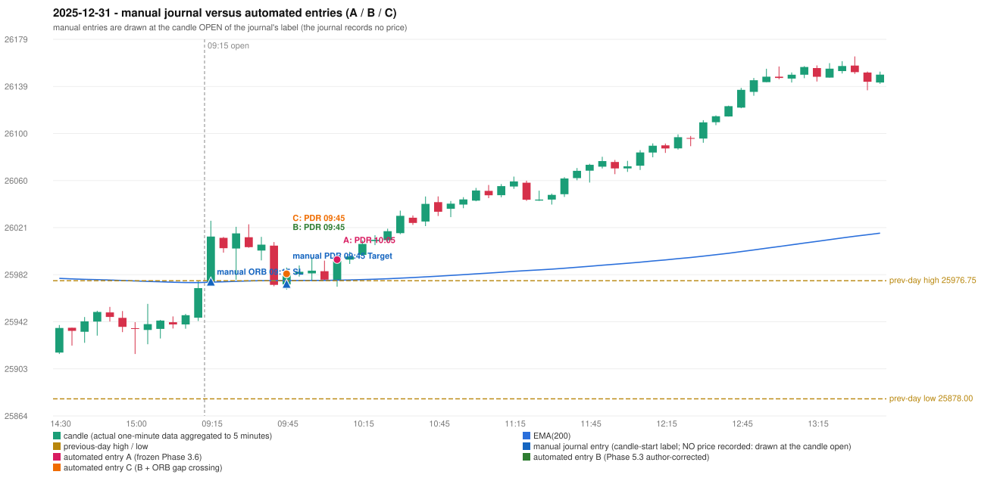

# 2025-12-31 (Wednesday) - manual journal versus the automated configurations

> SYNTHETIC index-point P&L; no real option P&L; costs illustrative (Rs 70 per trade + slippage scenarios). Configurations A / B / C are never combined.

## Session

* Open 25975.45; previous official close 25938.85; gap +36.60; previous-day high / low 25976.75 / 25878.0
* First 5-minute candle (09:15-09:20): O25975.45 H26026.85 L25975.45 C26013.65, GREEN, body 74.3%; EMA(200) at the first candle 25975.53; previous session's last close 25970.55 vs its EMA 25975.15

## Manual journal

row 61: ORB labelled 09:15, outcome SL; row 62: PDR labelled 09:45, outcome Target

## Configuration A

Candidate signals (confirmed): 10:10 PDR/PDR LONG [EXECUTED: trade 1: TARGET]; 10:40 IRF/Method 1 SHORT [IGNORED: POSITION_ACTIVE (signal kept for diagnostics only; never reused)]; 11:25 IRF/Method 2B SHORT [IGNORED: POSITION_ACTIVE (signal kept for diagnostics only; never reused)]; 13:40 IRF/Method 2A SHORT [IGNORED: DAY_FINISHED]; 14:25 IRF/Method 2A SHORT [IGNORED: DAY_FINISHED]; 15:05 IRF/Method 2A SHORT [IGNORED: DAY_FINISHED]

Strategies with no confirmed signal: ORB: Method 1 INVALIDATED TREND:EMA_PREV_SESSION_CLOSE wrong side; Method 2 INVALIDATED TREND:EMA_PREV_SESSION_CLOSE wrong side | PDS: no setup record (the strategy's trigger event never occurred) | RF: RF INVALIDATED TREND:EMA_PREV_SESSION_CLOSE wrong side

| trade | strategy / method | dir | signal -> fill | entry | stop / T1 / T2 | leg 1 | leg 2 | outcome | gross Rs | net Rs (70, 0) | net Rs (70, 1.0) |
|---|---|---|---|---|---|---|---|---|---|---|---|
| 1 | PDR/PDR | LONG | 10:10 -> 10:10 | 25994.35 | 25959.35 / 26021.35 / 26064.35 | 10:31 @ 26021.35 | 11:40 @ 26064.35 | TARGET | 18,915 | 18,845 | 18,065 |

Selection: This PDR signal was the earliest executable signal of the day: 0 confirmed signal(s) earlier, 0 other in the same minute. 5 later confirmed signal(s) (IRF x5) are logged as ignored or rejected. State of the other four engines at that moment: [IRF: no setup record before this time (a base condition was not met, or nothing triggered)] [ORB: Method 1 invalidated at 09:15: TREND:EMA_PREV_SESSION_CLOSE wrong side; Method 2 invalidated at 09:15: TREND:EMA_PREV_SESSION_CLOSE wrong side] [PDS: no setup record before this time (a base condition was not met, or nothing triggered)] [RF: RF invalidated at 09:45: TREND:EMA_PREV_SESSION_CLOSE wrong side]

* Journal row 61 (ORB 09:15): **UNMATCHED_MANUAL**; earliest cause EMA_FILTER_MISMATCH (+ OPENING_GAP_MISMATCH): first candle GREEN O25975.45 H26026.85 L25975.45 C26013.65 (body 74.3%); direction ASSUMED from the colour (the journal has no direction); TIE-BROKEN BY METHOD ORDER: 2 methods tie at 2 failing predicate(s) (Method 1: trend; Gap/200DMA: gap_crosses_200_average) - the evidence does not single out one cause, the secondary cause is the other tied one; closest method Method 1 (2 failing predicate(s)): first failing 'trend' - EMA_PREV_SESSION_CLOSE wrong side; all methods: Method 1: 2 fail (trend); Method 2: 3 fail (trend); Gap/200DMA: 2 fail (gap_crosses_200_average)
* Journal row 62 (PDR 09:45): **DATE_STRATEGY_ONLY**; earliest cause LATER_SIGNAL (+ ENTRY_TIME_MISMATCH): the automated PDR trade has its signal candle at 10:05 versus the manual label 09:45 (+20 minutes; outside the 15-minute tolerance)
* Automated PDR 10:05 has no strict / time-tolerant journal counterpart: LATER_SIGNAL - the journal has PDR at 09:45; the automated trade's signal candle is 10:05

## Configuration B

Candidate signals (confirmed): 09:50 PDR/PDR LONG [EXECUTED: trade 1: TARGET]; 10:15 PDR/PDR LONG [IGNORED: POSITION_ACTIVE (signal kept for diagnostics only; never reused)]; 10:40 IRF/Method 1 SHORT [IGNORED: POSITION_ACTIVE (signal kept for diagnostics only; never reused)]; 11:25 IRF/Method 2A SHORT [IGNORED: DAY_FINISHED]; 11:25 IRF/Method 2B SHORT [IGNORED: DAY_FINISHED]

Strategies with no confirmed signal: ORB: Method 1 INVALIDATED TREND:EMA_PREV_SESSION_CLOSE wrong side; Method 2 INVALIDATED TREND:EMA_PREV_SESSION_CLOSE wrong side | PDS: no setup record (the strategy's trigger event never occurred) | RF: RF INVALIDATED TREND:EMA_PREV_SESSION_CLOSE wrong side

| trade | strategy / method | dir | signal -> fill | entry | stop / T1 / T2 | leg 1 | leg 2 | outcome | gross Rs | net Rs (70, 0) | net Rs (70, 1.0) |
|---|---|---|---|---|---|---|---|---|---|---|---|
| 1 | PDR/PDR | LONG | 09:50 -> 09:50 | 25982.5 | 25947.5 / 26009.5 / 26052.5 | 10:19 @ 26009.5 | 11:03 @ 26052.5 | TARGET | 18,915 | 18,845 | 18,065 |

Selection: This PDR signal was the earliest executable signal of the day: 0 confirmed signal(s) earlier, 0 other in the same minute. 4 later confirmed signal(s) (IRF x3, PDR x1) are logged as ignored or rejected. State of the other four engines at that moment: [IRF: no setup record before this time (a base condition was not met, or nothing triggered)] [ORB: Method 1 invalidated at 09:15: TREND:EMA_PREV_SESSION_CLOSE wrong side; Method 2 invalidated at 09:15: TREND:EMA_PREV_SESSION_CLOSE wrong side] [PDS: no setup record before this time (a base condition was not met, or nothing triggered)] [RF: RF invalidated at 09:45: TREND:EMA_PREV_SESSION_CLOSE wrong side]

* Journal row 61 (ORB 09:15): **UNMATCHED_MANUAL**; earliest cause EMA_FILTER_MISMATCH (+ OPENING_GAP_MISMATCH): first candle GREEN O25975.45 H26026.85 L25975.45 C26013.65 (body 74.3%); direction ASSUMED from the colour (the journal has no direction); TIE-BROKEN BY METHOD ORDER: 2 methods tie at 2 failing predicate(s) (Method 1: trend; Gap/200DMA: gap_crosses_200_average) - the evidence does not single out one cause, the secondary cause is the other tied one; closest method Method 1 (2 failing predicate(s)): first failing 'trend' - EMA_PREV_SESSION_CLOSE wrong side; all methods: Method 1: 2 fail (trend); Method 2: 3 fail (trend); Gap/200DMA: 2 fail (gap_crosses_200_average)
* Journal row 62 (PDR 09:45): **STRICT** match with 20251231-1-PDR (delta +0 min); outcome Target vs automated TARGET (same class)

## Configuration C

Candidate signals (confirmed): 09:50 PDR/PDR LONG [EXECUTED: trade 1: TARGET]; 10:15 PDR/PDR LONG [IGNORED: POSITION_ACTIVE (signal kept for diagnostics only; never reused)]; 10:40 IRF/Method 1 SHORT [IGNORED: POSITION_ACTIVE (signal kept for diagnostics only; never reused)]; 11:25 IRF/Method 2A SHORT [IGNORED: DAY_FINISHED]; 11:25 IRF/Method 2B SHORT [IGNORED: DAY_FINISHED]

Strategies with no confirmed signal: ORB: Gap/200DMA INVALIDATED CANDLE_QUALITY_OR_REJECTION_WICK; Method 1 INVALIDATED TREND:EMA_PREV_SESSION_CLOSE wrong side; Method 2 INVALIDATED TREND:EMA_PREV_SESSI | PDS: no setup record (the strategy's trigger event never occurred) | RF: RF INVALIDATED TREND:EMA_PREV_SESSION_CLOSE wrong side

| trade | strategy / method | dir | signal -> fill | entry | stop / T1 / T2 | leg 1 | leg 2 | outcome | gross Rs | net Rs (70, 0) | net Rs (70, 1.0) |
|---|---|---|---|---|---|---|---|---|---|---|---|
| 1 | PDR/PDR | LONG | 09:50 -> 09:50 | 25982.5 | 25947.5 / 26009.5 / 26052.5 | 10:19 @ 26009.5 | 11:03 @ 26052.5 | TARGET | 18,915 | 18,845 | 18,065 |

Selection: This PDR signal was the earliest executable signal of the day: 0 confirmed signal(s) earlier, 0 other in the same minute. 4 later confirmed signal(s) (IRF x3, PDR x1) are logged as ignored or rejected. State of the other four engines at that moment: [IRF: no setup record before this time (a base condition was not met, or nothing triggered)] [ORB: Method 1 invalidated at 09:15: TREND:EMA_PREV_SESSION_CLOSE wrong side; Method 2 invalidated at 09:15: TREND:EMA_PREV_SESSION_CLOSE wrong side] [PDS: no setup record before this time (a base condition was not met, or nothing triggered)] [RF: RF invalidated at 09:45: TREND:EMA_PREV_SESSION_CLOSE wrong side]

* Journal row 61 (ORB 09:15): **UNMATCHED_MANUAL**; earliest cause CANDLE_STRENGTH_MISMATCH: first candle GREEN O25975.45 H26026.85 L25975.45 C26013.65 (body 74.3%); direction ASSUMED from the colour (the journal has no direction); closest method Gap/200DMA (1 failing predicate(s)): first failing 'candle_shape' - body 74.3% opposite wick 25.7% close location 74.3%; rejection wick flag False; all methods: Method 1: 2 fail (trend); Method 2: 3 fail (trend); Gap/200DMA: 1 fail (candle_shape)
* Journal row 62 (PDR 09:45): **STRICT** match with 20251231-1-PDR (delta +0 min); outcome Target vs automated TARGET (same class)

## Handwritten author corrections for this date

* AC40 (page 6): "ORB should activate first, Which hits SL Ep then PDR. | PDR 1st candle entry." - status A / B / C: ENTRY_UNCHANGED / ENTRY_EARLIER_THAN_A / ENTRY_EARLIER_THAN_A

## Chart

