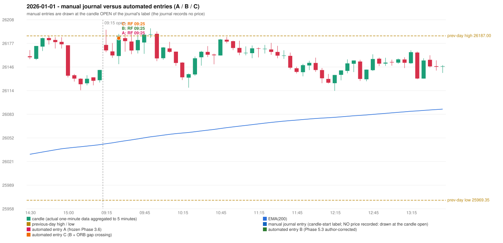

# 2026-01-01 (Thursday) - manual journal versus the automated configurations

> SYNTHETIC index-point P&L; no real option P&L; costs illustrative (Rs 70 per trade + slippage scenarios). Configurations A / B / C are never combined.

## Session

* Open 26175.05; previous official close 26129.6; gap +45.45; previous-day high / low 26187.0 / 25969.35
* First 5-minute candle (09:15-09:20): O26175.05 H26195.15 L26165.45 C26167.8, RED, body 24.4%; EMA(200) at the first candle 26044.20; previous session's last close 26141.85 vs its EMA 26042.95

## Manual journal

no manual trade recorded

## Configuration A

Candidate signals (confirmed): 09:30 RF/RF LONG [EXECUTED: trade 1: INITIAL_FULL_STOP]

Strategies with no confirmed signal: IRF: no setup record (the strategy's trigger event never occurred) | ORB: no setup record (the strategy's trigger event never occurred) | PDR: PDR INVALIDATED OPEN_NOT_STRICTLY_ABOVE_ZONE | PDS: no setup record (the strategy's trigger event never occurred)

| trade | strategy / method | dir | signal -> fill | entry | stop / T1 / T2 | leg 1 | leg 2 | outcome | gross Rs | net Rs (70, 0) | net Rs (70, 1.0) |
|---|---|---|---|---|---|---|---|---|---|---|---|
| 1 | RF/RF | LONG | 09:30 -> 09:30 | 26184.0 | 26149.0 / 26211.0 / 26244.0 | 10:12 @ 26149.0 | 10:12 @ 26149.0 | INITIAL_FULL_STOP | -13,650 | -13,720 | -14,500 |

Selection: This RF signal was the earliest executable signal of the day: 0 confirmed signal(s) earlier, 0 other in the same minute. No later signal was generated. State of the other four engines at that moment: [IRF: no setup record before this time (a base condition was not met, or nothing triggered)] [ORB: no setup record before this time (a base condition was not met, or nothing triggered)] [PDR: PDR invalidated at 09:15: OPEN_NOT_STRICTLY_ABOVE_ZONE] [PDS: no setup record before this time (a base condition was not met, or nothing triggered)]

* Automated RF 09:25 has no strict / time-tolerant journal counterpart: UNRESOLVED_DISCRETIONARY_SELECTION - the journal records no trade this day; the automated system took RF RF LONG (candle 09:25) mechanically

## Configuration B

Candidate signals (confirmed): 09:30 RF/RF LONG [EXECUTED: trade 1: INITIAL_FULL_STOP]

Strategies with no confirmed signal: IRF: no setup record (the strategy's trigger event never occurred) | ORB: no setup record (the strategy's trigger event never occurred) | PDR: PDR INVALIDATED OPEN_NOT_STRICTLY_ABOVE_ZONE | PDS: no setup record (the strategy's trigger event never occurred)

| trade | strategy / method | dir | signal -> fill | entry | stop / T1 / T2 | leg 1 | leg 2 | outcome | gross Rs | net Rs (70, 0) | net Rs (70, 1.0) |
|---|---|---|---|---|---|---|---|---|---|---|---|
| 1 | RF/RF | LONG | 09:30 -> 09:30 | 26184.0 | 26149.0 / 26211.0 / 26244.0 | 10:12 @ 26149.0 | 10:12 @ 26149.0 | INITIAL_FULL_STOP | -13,650 | -13,720 | -14,500 |

Selection: This RF signal was the earliest executable signal of the day: 0 confirmed signal(s) earlier, 0 other in the same minute. No later signal was generated. State of the other four engines at that moment: [IRF: no setup record before this time (a base condition was not met, or nothing triggered)] [ORB: no setup record before this time (a base condition was not met, or nothing triggered)] [PDR: PDR invalidated at 09:15: OPEN_NOT_STRICTLY_ABOVE_ZONE] [PDS: no setup record before this time (a base condition was not met, or nothing triggered)]

* Automated RF 09:25 has no strict / time-tolerant journal counterpart: UNRESOLVED_DISCRETIONARY_SELECTION - the journal records no trade this day; the automated system took RF RF LONG (candle 09:25) mechanically

## Configuration C

Candidate signals (confirmed): 09:30 RF/RF LONG [EXECUTED: trade 1: INITIAL_FULL_STOP]

Strategies with no confirmed signal: IRF: no setup record (the strategy's trigger event never occurred) | ORB: no setup record (the strategy's trigger event never occurred) | PDR: PDR INVALIDATED OPEN_NOT_STRICTLY_ABOVE_ZONE | PDS: no setup record (the strategy's trigger event never occurred)

| trade | strategy / method | dir | signal -> fill | entry | stop / T1 / T2 | leg 1 | leg 2 | outcome | gross Rs | net Rs (70, 0) | net Rs (70, 1.0) |
|---|---|---|---|---|---|---|---|---|---|---|---|
| 1 | RF/RF | LONG | 09:30 -> 09:30 | 26184.0 | 26149.0 / 26211.0 / 26244.0 | 10:12 @ 26149.0 | 10:12 @ 26149.0 | INITIAL_FULL_STOP | -13,650 | -13,720 | -14,500 |

Selection: This RF signal was the earliest executable signal of the day: 0 confirmed signal(s) earlier, 0 other in the same minute. No later signal was generated. State of the other four engines at that moment: [IRF: no setup record before this time (a base condition was not met, or nothing triggered)] [ORB: no setup record before this time (a base condition was not met, or nothing triggered)] [PDR: PDR invalidated at 09:15: OPEN_NOT_STRICTLY_ABOVE_ZONE] [PDS: no setup record before this time (a base condition was not met, or nothing triggered)]

* Automated RF 09:25 has no strict / time-tolerant journal counterpart: UNRESOLVED_DISCRETIONARY_SELECTION - the journal records no trade this day; the automated system took RF RF LONG (candle 09:25) mechanically

## Chart

