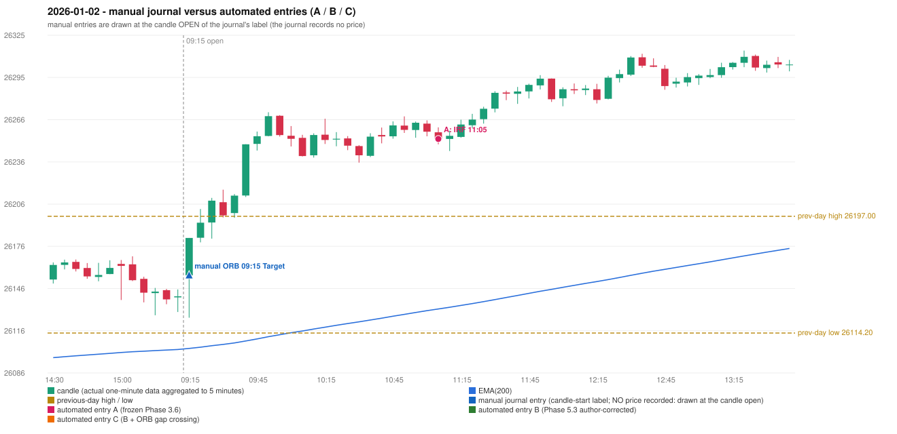

# 2026-01-02 (Friday) - manual journal versus the automated configurations

> SYNTHETIC index-point P&L; no real option P&L; costs illustrative (Rs 70 per trade + slippage scenarios). Configurations A / B / C are never combined.

## Session

* Open 26155.1; previous official close 26146.55; gap +8.55; previous-day high / low 26197.0 / 26114.2
* First 5-minute candle (09:15-09:20): O26155.1 H26181.65 L26125.1 C26181.65, GREEN, body 46.9%; EMA(200) at the first candle 26103.29; previous session's last close 26140.25 vs its EMA 26102.50

## Manual journal

row 63: ORB labelled 09:15, outcome Target

## Configuration A

Candidate signals (confirmed): 11:10 IRF/Method 2A SHORT [EXECUTED: trade 1: INITIAL_FULL_STOP]; 12:50 IRF/Method 2B SHORT [REJECTED: SECOND_TRADE_RESTRICTED_TO_PDR_PDS]; 14:00 IRF/Method 2B SHORT [REJECTED: SECOND_TRADE_RESTRICTED_TO_PDR_PDS]; 14:35 IRF/Method 2A SHORT [REJECTED: SECOND_TRADE_RESTRICTED_TO_PDR_PDS]

Strategies with no confirmed signal: ORB: Method 2 INVALIDATED TRENDLINE_NOT_SUPPORTIVE | PDR: PDR INVALIDATED OPEN_NOT_STRICTLY_ABOVE_ZONE | PDS: no setup record (the strategy's trigger event never occurred) | RF: no setup record (the strategy's trigger event never occurred)

| trade | strategy / method | dir | signal -> fill | entry | stop / T1 / T2 | leg 1 | leg 2 | outcome | gross Rs | net Rs (70, 0) | net Rs (70, 1.0) |
|---|---|---|---|---|---|---|---|---|---|---|---|
| 1 | IRF/Method 2A | SHORT | 11:10 -> 11:10 | 26251.85 | 26286.85 / 26224.85 / 26191.85 | 11:42 @ 26286.85 | 11:42 @ 26286.85 | INITIAL_FULL_STOP | -13,650 | -13,720 | -14,500 |

Selection: This IRF Method 2A signal was the earliest executable signal of the day: 0 confirmed signal(s) earlier, 0 other in the same minute. 3 later confirmed signal(s) (IRF x3) are logged as ignored or rejected. State of the other four engines at that moment: [ORB: Method 2 invalidated at 09:15: TRENDLINE_NOT_SUPPORTIVE] [PDR: PDR invalidated at 09:15: OPEN_NOT_STRICTLY_ABOVE_ZONE] [PDS: no setup record before this time (a base condition was not met, or nothing triggered)] [RF: no setup record before this time (a base condition was not met, or nothing triggered)]

* Journal row 63 (ORB 09:15): **UNMATCHED_MANUAL**; earliest cause LEVEL_CONSTRUCTION_MISMATCH (+ TRENDLINE_MISMATCH): first candle GREEN O26155.1 H26181.65 L26125.1 C26181.65 (body 46.9%); direction ASSUMED from the colour (the journal has no direction); TIE-BROKEN BY METHOD ORDER: 3 methods tie at 2 failing predicate(s) (Method 1: level_broken; Method 2: trendline; Gap/200DMA: gap_crosses_200_average) - the evidence does not single out one cause, the secondary cause is the other tied one; closest method Method 1 (2 failing predicate(s)): first failing 'level_broken' - previous-day high 26197.0; candle high/low 26181.65, close 26181.65; all methods: Method 1: 2 fail (level_broken); Method 2: 2 fail (trendline); Gap/200DMA: 2 fail (gap_crosses_200_average)
* Automated IRF 11:05 has no strict / time-tolerant journal counterpart: DIFFERENT_STRATEGY_SELECTED - the journal traded ORB 09:15; the automated controller took IRF Method 2A (candle 11:05) as the first valid signal

## Configuration B

Candidate signals (confirmed): none

Strategies with no confirmed signal: IRF: Method 1/2 INCOMPLETE_AT_EOD SESSION_ENDED_BEFORE_CONFIRMATION | ORB: Method 2 INVALIDATED TRENDLINE_NOT_SUPPORTIVE | PDR: PDR INVALIDATED OPEN_NOT_STRICTLY_ABOVE_ZONE | PDS: no setup record (the strategy's trigger event never occurred) | RF: no setup record (the strategy's trigger event never occurred)

No trade: final day state READY_FOR_FIRST_TRADE. No strategy qualified.

* Journal row 63 (ORB 09:15): **UNMATCHED_MANUAL**; earliest cause LEVEL_CONSTRUCTION_MISMATCH (+ TRENDLINE_MISMATCH): first candle GREEN O26155.1 H26181.65 L26125.1 C26181.65 (body 46.9%); direction ASSUMED from the colour (the journal has no direction); TIE-BROKEN BY METHOD ORDER: 3 methods tie at 2 failing predicate(s) (Method 1: level_broken; Method 2: trendline; Gap/200DMA: gap_crosses_200_average) - the evidence does not single out one cause, the secondary cause is the other tied one; closest method Method 1 (2 failing predicate(s)): first failing 'level_broken' - previous-day high 26197.0; candle high/low 26181.65, close 26181.65; all methods: Method 1: 2 fail (level_broken); Method 2: 2 fail (trendline); Gap/200DMA: 2 fail (gap_crosses_200_average)

## Configuration C

Candidate signals (confirmed): none

Strategies with no confirmed signal: IRF: Method 1/2 INCOMPLETE_AT_EOD SESSION_ENDED_BEFORE_CONFIRMATION | ORB: Method 2 INVALIDATED TRENDLINE_NOT_SUPPORTIVE | PDR: PDR INVALIDATED OPEN_NOT_STRICTLY_ABOVE_ZONE | PDS: no setup record (the strategy's trigger event never occurred) | RF: no setup record (the strategy's trigger event never occurred)

No trade: final day state READY_FOR_FIRST_TRADE. No strategy qualified.

* Journal row 63 (ORB 09:15): **UNMATCHED_MANUAL**; earliest cause LEVEL_CONSTRUCTION_MISMATCH (+ TRENDLINE_MISMATCH): first candle GREEN O26155.1 H26181.65 L26125.1 C26181.65 (body 46.9%); direction ASSUMED from the colour (the journal has no direction); TIE-BROKEN BY METHOD ORDER: 3 methods tie at 2 failing predicate(s) (Method 1: level_broken; Method 2: trendline; Gap/200DMA: gap_crosses_200_average) - the evidence does not single out one cause, the secondary cause is the other tied one; closest method Method 1 (2 failing predicate(s)): first failing 'level_broken' - previous-day high 26197.0; candle high/low 26181.65, close 26181.65; all methods: Method 1: 2 fail (level_broken); Method 2: 2 fail (trendline); Gap/200DMA: 2 fail (gap_crosses_200_average)

## Chart

