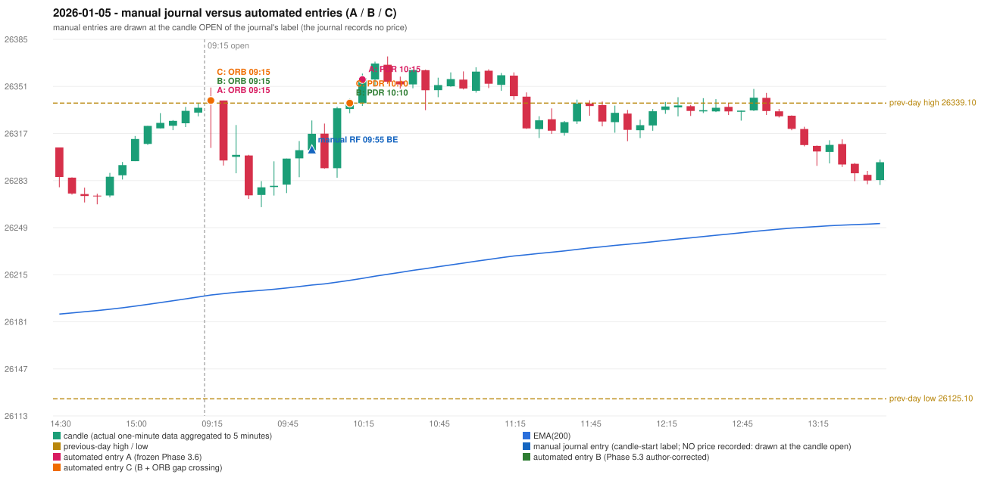

# 2026-01-05 (Monday) - manual journal versus the automated configurations

> SYNTHETIC index-point P&L; no real option P&L; costs illustrative (Rs 70 per trade + slippage scenarios). Configurations A / B / C are never combined.

## Session

* Open 26341.9; previous official close 26328.55; gap +13.35; previous-day high / low 26339.1 / 26125.1
* First 5-minute candle (09:15-09:20): O26341.9 H26350.4 L26306.65 C26340.25, RED, body 3.8%; EMA(200) at the first candle 26200.22; previous session's last close 26335.7 vs its EMA 26198.81

## Manual journal

row 64: RF labelled 09:55, outcome BE

## Configuration A

Candidate signals (confirmed): 09:20 ORB/Method 1 LONG [EXECUTED: trade 1: INITIAL_FULL_STOP]; 10:20 PDR/PDR LONG [EXECUTED: trade 2: INITIAL_FULL_STOP]; 10:45 IRF/Method 1 SHORT [IGNORED: POSITION_ACTIVE (signal kept for diagnostics only; never reused)]; 10:45 IRF/Method 2A SHORT [IGNORED: POSITION_ACTIVE (signal kept for diagnostics only; never reused)]; 11:00 IRF/Method 1 SHORT [IGNORED: POSITION_ACTIVE (signal kept for diagnostics only; never reused)]; 11:05 PDR/PDR LONG [IGNORED: POSITION_ACTIVE (signal kept for diagnostics only; never reused)]; 11:20 IRF/Method 1 SHORT [IGNORED: POSITION_ACTIVE (signal kept for diagnostics only; never reused)]; 11:20 IRF/Method 2A SHORT [IGNORED: POSITION_ACTIVE (signal kept for diagnostics only; never reused)]; 11:45 PDR/PDR LONG [IGNORED: DAY_FINISHED]

Strategies with no confirmed signal: PDS: no setup record (the strategy's trigger event never occurred) | RF: RF INVALIDATED GAP_UP_OUTSIDE_YESTERDAYS_RANGE

| trade | strategy / method | dir | signal -> fill | entry | stop / T1 / T2 | leg 1 | leg 2 | outcome | gross Rs | net Rs (70, 0) | net Rs (70, 1.0) |
|---|---|---|---|---|---|---|---|---|---|---|---|
| 1 | ORB/Method 1 | LONG | 09:20 -> 09:20 | 26340.95 | 26310.95 / 26367.95 / 26400.95 | 09:23 @ 26310.95 | 09:23 @ 26310.95 | INITIAL_FULL_STOP | -11,700 | -11,770 | -12,550 |
| 2 | PDR/PDR | LONG | 10:20 -> 10:20 | 26356.15 | 26321.15 / 26383.15 / 26426.15 | 11:24 @ 26321.15 | 11:24 @ 26321.15 | INITIAL_FULL_STOP | -13,650 | -13,720 | -14,500 |

Selection: This ORB Method 1 signal was the earliest executable signal of the day: 0 confirmed signal(s) earlier, 0 other in the same minute. 8 later confirmed signal(s) (IRF x5, PDR x3) are logged as ignored or rejected. State of the other four engines at that moment: [IRF: no setup record before this time (a base condition was not met, or nothing triggered)] [PDR: no setup record before this time (a base condition was not met, or nothing triggered)] [PDS: no setup record before this time (a base condition was not met, or nothing triggered)] [RF: no setup record before this time (a base condition was not met, or nothing triggered)]

* Journal row 64 (RF 09:55): **UNMATCHED_MANUAL**; earliest cause OPENING_GAP_MISMATCH: RF setup rejected by the opening-gap condition (RF-004) (GAP_UP_OUTSIDE_YESTERDAYS_RANGE)
* Automated ORB 09:15 has no strict / time-tolerant journal counterpart: DIFFERENT_STRATEGY_SELECTED - the journal traded RF 09:55; the automated controller took ORB Method 1 (candle 09:15) as the first valid signal
* Automated PDR 10:15 has no strict / time-tolerant journal counterpart: PORTFOLIO_CONTROLLER_CONSTRAINT - second trade of the day: the controller allows a PDR / PDS re-entry after the original full stop of trade 1 (ORB Method 1, signal candle 09:15); the journal rows of the day not matched to another trade: RF 09:55

## Configuration B

Candidate signals (confirmed): 09:20 ORB/Method 1 LONG [EXECUTED: trade 1: INITIAL_FULL_STOP]; 10:15 PDR/PDR LONG [EXECUTED: trade 2: T1_THEN_BUFFER_STOP]; 10:35 IRF/Method 2A SHORT [IGNORED: POSITION_ACTIVE (signal kept for diagnostics only; never reused)]; 10:45 IRF/Method 1 SHORT [IGNORED: POSITION_ACTIVE (signal kept for diagnostics only; never reused)]; 10:50 PDR/PDR LONG [IGNORED: POSITION_ACTIVE (signal kept for diagnostics only; never reused)]; 11:00 IRF/Method 1 SHORT [IGNORED: POSITION_ACTIVE (signal kept for diagnostics only; never reused)]; 11:10 IRF/Method 2B SHORT [IGNORED: POSITION_ACTIVE (signal kept for diagnostics only; never reused)]; 11:20 IRF/Method 1 SHORT [IGNORED: POSITION_ACTIVE (signal kept for diagnostics only; never reused)]; 11:45 PDR/PDR LONG [IGNORED: DAY_FINISHED]; 12:20 PDR/PDR LONG [IGNORED: DAY_FINISHED]; 12:55 PDR/PDR LONG [IGNORED: DAY_FINISHED]

Strategies with no confirmed signal: PDS: no setup record (the strategy's trigger event never occurred) | RF: RF INVALIDATED GAP_UP_OUTSIDE_YESTERDAYS_RANGE

| trade | strategy / method | dir | signal -> fill | entry | stop / T1 / T2 | leg 1 | leg 2 | outcome | gross Rs | net Rs (70, 0) | net Rs (70, 1.0) |
|---|---|---|---|---|---|---|---|---|---|---|---|
| 1 | ORB/Method 1 | LONG | 09:20 -> 09:20 | 26340.95 | 26310.95 / 26367.95 / 26400.95 | 09:23 @ 26310.95 | 09:23 @ 26310.95 | INITIAL_FULL_STOP | -11,700 | -11,770 | -12,550 |
| 2 | PDR/PDR | LONG | 10:15 -> 10:15 | 26339.1 | 26304.1 / 26366.1 / 26409.1 | 10:24 @ 26366.1 | 11:23 @ 26333.1 | T1_THEN_BUFFER_STOP | 4,095 | 4,025 | 3,245 |

Selection: This ORB Method 1 signal was the earliest executable signal of the day: 0 confirmed signal(s) earlier, 0 other in the same minute. 10 later confirmed signal(s) (IRF x5, PDR x5) are logged as ignored or rejected. State of the other four engines at that moment: [IRF: no setup record before this time (a base condition was not met, or nothing triggered)] [PDR: no setup record before this time (a base condition was not met, or nothing triggered)] [PDS: no setup record before this time (a base condition was not met, or nothing triggered)] [RF: no setup record before this time (a base condition was not met, or nothing triggered)]

* Journal row 64 (RF 09:55): **UNMATCHED_MANUAL**; earliest cause OPENING_GAP_MISMATCH: RF setup rejected by the opening-gap condition (RF-004) (GAP_UP_OUTSIDE_YESTERDAYS_RANGE)
* Automated ORB 09:15 has no strict / time-tolerant journal counterpart: DIFFERENT_STRATEGY_SELECTED - the journal traded RF 09:55; the automated controller took ORB Method 1 (candle 09:15) as the first valid signal
* Automated PDR 10:10 has no strict / time-tolerant journal counterpart: PORTFOLIO_CONTROLLER_CONSTRAINT - second trade of the day: the controller allows a PDR / PDS re-entry after the original full stop of trade 1 (ORB Method 1, signal candle 09:15); the journal rows of the day not matched to another trade: RF 09:55

## Configuration C

Candidate signals (confirmed): 09:20 ORB/Method 1 LONG [EXECUTED: trade 1: INITIAL_FULL_STOP]; 10:15 PDR/PDR LONG [EXECUTED: trade 2: T1_THEN_BUFFER_STOP]; 10:35 IRF/Method 2A SHORT [IGNORED: POSITION_ACTIVE (signal kept for diagnostics only; never reused)]; 10:45 IRF/Method 1 SHORT [IGNORED: POSITION_ACTIVE (signal kept for diagnostics only; never reused)]; 10:50 PDR/PDR LONG [IGNORED: POSITION_ACTIVE (signal kept for diagnostics only; never reused)]; 11:00 IRF/Method 1 SHORT [IGNORED: POSITION_ACTIVE (signal kept for diagnostics only; never reused)]; 11:10 IRF/Method 2B SHORT [IGNORED: POSITION_ACTIVE (signal kept for diagnostics only; never reused)]; 11:20 IRF/Method 1 SHORT [IGNORED: POSITION_ACTIVE (signal kept for diagnostics only; never reused)]; 11:45 PDR/PDR LONG [IGNORED: DAY_FINISHED]; 12:20 PDR/PDR LONG [IGNORED: DAY_FINISHED]; 12:55 PDR/PDR LONG [IGNORED: DAY_FINISHED]

Strategies with no confirmed signal: PDS: no setup record (the strategy's trigger event never occurred) | RF: RF INVALIDATED GAP_UP_OUTSIDE_YESTERDAYS_RANGE

| trade | strategy / method | dir | signal -> fill | entry | stop / T1 / T2 | leg 1 | leg 2 | outcome | gross Rs | net Rs (70, 0) | net Rs (70, 1.0) |
|---|---|---|---|---|---|---|---|---|---|---|---|
| 1 | ORB/Method 1 | LONG | 09:20 -> 09:20 | 26340.95 | 26310.95 / 26367.95 / 26400.95 | 09:23 @ 26310.95 | 09:23 @ 26310.95 | INITIAL_FULL_STOP | -11,700 | -11,770 | -12,550 |
| 2 | PDR/PDR | LONG | 10:15 -> 10:15 | 26339.1 | 26304.1 / 26366.1 / 26409.1 | 10:24 @ 26366.1 | 11:23 @ 26333.1 | T1_THEN_BUFFER_STOP | 4,095 | 4,025 | 3,245 |

Selection: This ORB Method 1 signal was the earliest executable signal of the day: 0 confirmed signal(s) earlier, 0 other in the same minute. 10 later confirmed signal(s) (IRF x5, PDR x5) are logged as ignored or rejected. State of the other four engines at that moment: [IRF: no setup record before this time (a base condition was not met, or nothing triggered)] [PDR: no setup record before this time (a base condition was not met, or nothing triggered)] [PDS: no setup record before this time (a base condition was not met, or nothing triggered)] [RF: no setup record before this time (a base condition was not met, or nothing triggered)]

* Journal row 64 (RF 09:55): **UNMATCHED_MANUAL**; earliest cause OPENING_GAP_MISMATCH: RF setup rejected by the opening-gap condition (RF-004) (GAP_UP_OUTSIDE_YESTERDAYS_RANGE)
* Automated ORB 09:15 has no strict / time-tolerant journal counterpart: DIFFERENT_STRATEGY_SELECTED - the journal traded RF 09:55; the automated controller took ORB Method 1 (candle 09:15) as the first valid signal
* Automated PDR 10:10 has no strict / time-tolerant journal counterpart: PORTFOLIO_CONTROLLER_CONSTRAINT - second trade of the day: the controller allows a PDR / PDS re-entry after the original full stop of trade 1 (ORB Method 1, signal candle 09:15); the journal rows of the day not matched to another trade: RF 09:55

## Chart

