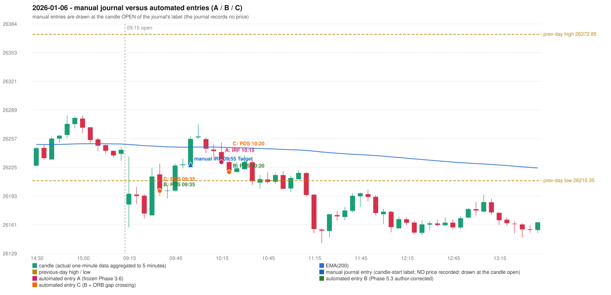

# 2026-01-06 (Tuesday) - manual journal versus the automated configurations

> SYNTHETIC index-point P&L; no real option P&L; costs illustrative (Rs 70 per trade + slippage scenarios). Configurations A / B / C are never combined.

## Session

* Open 26183.9; previous official close 26250.3; gap -66.40; previous-day high / low 26372.85 / 26210.35
* First 5-minute candle (09:15-09:20): O26183.9 H26237.3 L26158.35 C26195.8, GREEN, body 15.1%; EMA(200) at the first candle 26250.56; previous session's last close 26244.65 vs its EMA 26251.11

## Manual journal

row 65: IRF labelled 09:55, outcome Target

## Configuration A

Candidate signals (confirmed): 10:20 IRF/Method 1 SHORT [EXECUTED: trade 1: TARGET]; 10:40 IRF/Method 2A SHORT [IGNORED: POSITION_ACTIVE (signal kept for diagnostics only; never reused)]; 10:40 PDS/Method 3 SHORT [IGNORED: POSITION_ACTIVE (signal kept for diagnostics only; never reused)]; 10:50 PDS/Method 2 SHORT [IGNORED: POSITION_ACTIVE (signal kept for diagnostics only; never reused)]; 11:00 PDS/Method 1 SHORT [IGNORED: POSITION_ACTIVE (signal kept for diagnostics only; never reused)]; 11:15 PDS/Method 1 SHORT [IGNORED: POSITION_ACTIVE (signal kept for diagnostics only; never reused)]

Strategies with no confirmed signal: ORB: Method 1 INVALIDATED CANDLE_QUALITY(not a strong body / wick too large); Method 2 INVALIDATED CANDLE_QUALITY | PDR: no setup record (the strategy's trigger event never occurred) | RF: RF INVALIDATED TREND:EMA_PREV_SESSION_CLOSE wrong side

| trade | strategy / method | dir | signal -> fill | entry | stop / T1 / T2 | leg 1 | leg 2 | outcome | gross Rs | net Rs (70, 0) | net Rs (70, 1.0) |
|---|---|---|---|---|---|---|---|---|---|---|---|
| 1 | IRF/Method 1 | SHORT | 10:20 -> 10:20 | 26231.05 | 26266.05 / 26204.05 / 26171.05 | 10:40 @ 26204.05 | 11:16 @ 26171.05 | TARGET | 16,965 | 16,895 | 16,115 |

Selection: This IRF Method 1 signal was the earliest executable signal of the day: 0 confirmed signal(s) earlier, 0 other in the same minute. 5 later confirmed signal(s) (IRF x1, PDS x4) are logged as ignored or rejected. State of the other four engines at that moment: [ORB: Method 1 invalidated at 09:15: CANDLE_QUALITY(not a strong body / wick too large); Method 2 invalidated at 09:15: CANDLE_QUALITY] [PDR: no setup record before this time (a base condition was not met, or nothing triggered)] [PDS: no setup record before this time (a base condition was not met, or nothing triggered)] [RF: no setup record before this time (a base condition was not met, or nothing triggered)]

* Journal row 65 (IRF 09:55): **DATE_STRATEGY_ONLY**; earliest cause LATER_SIGNAL (+ ENTRY_TIME_MISMATCH): the automated IRF trade has its signal candle at 10:15 versus the manual label 09:55 (+20 minutes; outside the 15-minute tolerance)
* Automated IRF 10:15 has no strict / time-tolerant journal counterpart: LATER_SIGNAL - the journal has IRF at 09:55; the automated trade's signal candle is 10:15

## Configuration B

Candidate signals (confirmed): 09:40 PDS/Method 1 SHORT [EXECUTED: trade 1: INITIAL_FULL_STOP]; 10:25 PDS/Method 1 SHORT [EXECUTED: trade 2: TARGET]; 10:40 PDS/Method 1 SHORT [IGNORED: POSITION_ACTIVE (signal kept for diagnostics only; never reused)]; 10:45 IRF/Method 2A SHORT [IGNORED: POSITION_ACTIVE (signal kept for diagnostics only; never reused)]; 10:50 PDS/Method 2 SHORT [IGNORED: POSITION_ACTIVE (signal kept for diagnostics only; never reused)]; 11:00 PDS/Method 1 SHORT [IGNORED: POSITION_ACTIVE (signal kept for diagnostics only; never reused)]; 11:15 PDS/Method 1 SHORT [IGNORED: POSITION_ACTIVE (signal kept for diagnostics only; never reused)]

Strategies with no confirmed signal: ORB: Method 1 INVALIDATED CANDLE_QUALITY(not a strong body / wick too large); Method 2 INVALIDATED CANDLE_QUALITY | PDR: no setup record (the strategy's trigger event never occurred) | RF: RF INVALIDATED TREND:EMA_PREV_SESSION_CLOSE wrong side

| trade | strategy / method | dir | signal -> fill | entry | stop / T1 / T2 | leg 1 | leg 2 | outcome | gross Rs | net Rs (70, 0) | net Rs (70, 1.0) |
|---|---|---|---|---|---|---|---|---|---|---|---|
| 1 | PDS/Method 1 | SHORT | 09:40 -> 09:40 | 26199.1 | 26234.1 / 26172.1 / 26129.1 | 09:53 @ 26234.1 | 09:53 @ 26234.1 | INITIAL_FULL_STOP | -13,650 | -13,720 | -14,500 |
| 2 | PDS/Method 1 | SHORT | 10:25 -> 10:25 | 26219.95 | 26254.95 / 26192.95 / 26149.95 | 11:13 @ 26192.95 | 11:20 @ 26149.95 | TARGET | 18,915 | 18,845 | 18,065 |

Selection: This PDS Method 1 signal was the earliest executable signal of the day: 0 confirmed signal(s) earlier, 0 other in the same minute. 6 later confirmed signal(s) (IRF x1, PDS x5) are logged as ignored or rejected. State of the other four engines at that moment: [IRF: no setup record before this time (a base condition was not met, or nothing triggered)] [ORB: Method 1 invalidated at 09:15: CANDLE_QUALITY(not a strong body / wick too large); Method 2 invalidated at 09:15: CANDLE_QUALITY] [PDR: no setup record before this time (a base condition was not met, or nothing triggered)] [RF: no setup record before this time (a base condition was not met, or nothing triggered)]

* Journal row 65 (IRF 09:55): **UNMATCHED_MANUAL**; earliest cause LATER_SIGNAL (+ ENTRY_TIME_MISMATCH): the nearest automated IRF signal is at 10:45 (candle 10:40) versus the manual label 09:55; it was IGNORED: POSITION_ACTIVE (signal kept for diagnostics only; never reused)
* Automated PDS 09:35 has no strict / time-tolerant journal counterpart: DIFFERENT_STRATEGY_SELECTED - the journal traded IRF 09:55; the automated controller took PDS Method 1 (candle 09:35) as the first valid signal
* Automated PDS 10:20 has no strict / time-tolerant journal counterpart: PORTFOLIO_CONTROLLER_CONSTRAINT - second trade of the day: the controller allows a PDR / PDS re-entry after the original full stop of trade 1 (PDS Method 1, signal candle 09:35); the journal rows of the day not matched to another trade: IRF 09:55

## Configuration C

Candidate signals (confirmed): 09:40 PDS/Method 1 SHORT [EXECUTED: trade 1: INITIAL_FULL_STOP]; 10:25 PDS/Method 1 SHORT [EXECUTED: trade 2: TARGET]; 10:40 PDS/Method 1 SHORT [IGNORED: POSITION_ACTIVE (signal kept for diagnostics only; never reused)]; 10:45 IRF/Method 2A SHORT [IGNORED: POSITION_ACTIVE (signal kept for diagnostics only; never reused)]; 10:50 PDS/Method 2 SHORT [IGNORED: POSITION_ACTIVE (signal kept for diagnostics only; never reused)]; 11:00 PDS/Method 1 SHORT [IGNORED: POSITION_ACTIVE (signal kept for diagnostics only; never reused)]; 11:15 PDS/Method 1 SHORT [IGNORED: POSITION_ACTIVE (signal kept for diagnostics only; never reused)]

Strategies with no confirmed signal: ORB: Method 1 INVALIDATED CANDLE_QUALITY(not a strong body / wick too large); Method 2 INVALIDATED CANDLE_QUALITY | PDR: no setup record (the strategy's trigger event never occurred) | RF: RF INVALIDATED TREND:EMA_PREV_SESSION_CLOSE wrong side

| trade | strategy / method | dir | signal -> fill | entry | stop / T1 / T2 | leg 1 | leg 2 | outcome | gross Rs | net Rs (70, 0) | net Rs (70, 1.0) |
|---|---|---|---|---|---|---|---|---|---|---|---|
| 1 | PDS/Method 1 | SHORT | 09:40 -> 09:40 | 26199.1 | 26234.1 / 26172.1 / 26129.1 | 09:53 @ 26234.1 | 09:53 @ 26234.1 | INITIAL_FULL_STOP | -13,650 | -13,720 | -14,500 |
| 2 | PDS/Method 1 | SHORT | 10:25 -> 10:25 | 26219.95 | 26254.95 / 26192.95 / 26149.95 | 11:13 @ 26192.95 | 11:20 @ 26149.95 | TARGET | 18,915 | 18,845 | 18,065 |

Selection: This PDS Method 1 signal was the earliest executable signal of the day: 0 confirmed signal(s) earlier, 0 other in the same minute. 6 later confirmed signal(s) (IRF x1, PDS x5) are logged as ignored or rejected. State of the other four engines at that moment: [IRF: no setup record before this time (a base condition was not met, or nothing triggered)] [ORB: Method 1 invalidated at 09:15: CANDLE_QUALITY(not a strong body / wick too large); Method 2 invalidated at 09:15: CANDLE_QUALITY] [PDR: no setup record before this time (a base condition was not met, or nothing triggered)] [RF: no setup record before this time (a base condition was not met, or nothing triggered)]

* Journal row 65 (IRF 09:55): **UNMATCHED_MANUAL**; earliest cause LATER_SIGNAL (+ ENTRY_TIME_MISMATCH): the nearest automated IRF signal is at 10:45 (candle 10:40) versus the manual label 09:55; it was IGNORED: POSITION_ACTIVE (signal kept for diagnostics only; never reused)
* Automated PDS 09:35 has no strict / time-tolerant journal counterpart: DIFFERENT_STRATEGY_SELECTED - the journal traded IRF 09:55; the automated controller took PDS Method 1 (candle 09:35) as the first valid signal
* Automated PDS 10:20 has no strict / time-tolerant journal counterpart: PORTFOLIO_CONTROLLER_CONSTRAINT - second trade of the day: the controller allows a PDR / PDS re-entry after the original full stop of trade 1 (PDS Method 1, signal candle 09:35); the journal rows of the day not matched to another trade: IRF 09:55

## Chart

