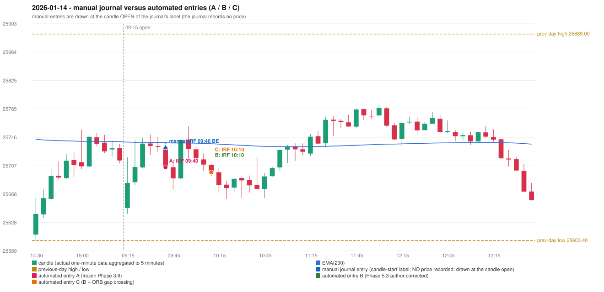

# 2026-01-14 (Wednesday) - manual journal versus the automated configurations

> SYNTHETIC index-point P&L; no real option P&L; costs illustrative (Rs 70 per trade + slippage scenarios). Configurations A / B / C are never combined.

## Session

* Open 25648.55; previous official close 25732.3; gap -83.75; previous-day high / low 25889.0 / 25603.4
* First 5-minute candle (09:15-09:20): O25648.55 H25718.85 L25640.4 C25683.25, GREEN, body 44.2%; EMA(200) at the first candle 25739.63; previous session's last close 25714.2 vs its EMA 25740.20

## Manual journal

row 68: IRF labelled 09:40, outcome BE

## Configuration A

Candidate signals (confirmed): 09:45 IRF/Method 1 SHORT [EXECUTED: trade 1: T1_THEN_BUFFER_STOP]; 10:00 IRF/Method 2B SHORT [IGNORED: DAY_FINISHED]; 10:05 IRF/Method 1 SHORT [IGNORED: DAY_FINISHED]; 11:25 IRF/Method 2B SHORT [IGNORED: DAY_FINISHED]; 11:45 IRF/Method 2B SHORT [IGNORED: DAY_FINISHED]; 12:10 IRF/Method 2B SHORT [IGNORED: DAY_FINISHED]; 12:45 IRF/Method 2B SHORT [IGNORED: DAY_FINISHED]; 13:15 IRF/Method 2B SHORT [IGNORED: DAY_FINISHED]; 13:25 IRF/Method 1 SHORT [IGNORED: DAY_FINISHED]

Strategies with no confirmed signal: ORB: no setup record (the strategy's trigger event never occurred) | PDR: no setup record (the strategy's trigger event never occurred) | PDS: Method 1/2/3 INVALIDATED GAP_DOWN_OPEN_NOT_BELOW_ZONE | RF: RF INVALIDATED TREND:EMA_PREV_SESSION_CLOSE wrong side

| trade | strategy / method | dir | signal -> fill | entry | stop / T1 / T2 | leg 1 | leg 2 | outcome | gross Rs | net Rs (70, 0) | net Rs (70, 1.0) |
|---|---|---|---|---|---|---|---|---|---|---|---|
| 1 | IRF/Method 1 | SHORT | 09:45 -> 09:45 | 25704.9 | 25739.9 / 25677.9 / 25644.9 | 09:48 @ 25677.9 | 09:51 @ 25710.9 | T1_THEN_BUFFER_STOP | 4,095 | 4,025 | 3,245 |

Selection: This IRF Method 1 signal was the earliest executable signal of the day: 0 confirmed signal(s) earlier, 0 other in the same minute. 8 later confirmed signal(s) (IRF x8) are logged as ignored or rejected. State of the other four engines at that moment: [ORB: no setup record before this time (a base condition was not met, or nothing triggered)] [PDR: no setup record before this time (a base condition was not met, or nothing triggered)] [PDS: Method 1/2/3 invalidated at 09:15: GAP_DOWN_OPEN_NOT_BELOW_ZONE] [RF: no setup record before this time (a base condition was not met, or nothing triggered)]

* Journal row 68 (IRF 09:40): **STRICT** match with 20260114-1-IRF (delta +0 min); outcome BE vs automated T1_THEN_BUFFER_STOP (same class)

## Configuration B

Candidate signals (confirmed): 10:15 IRF/Method 2A SHORT [EXECUTED: trade 1: T1_THEN_BUFFER_STOP]; 10:15 IRF/Method 2B SHORT [MERGED_SAME_STRATEGY_METHOD: traded as another method of the same strategy/direction in the same minute]; 13:40 IRF/Method 2A SHORT [IGNORED: DAY_FINISHED]; 13:40 IRF/Method 2B SHORT [IGNORED: DAY_FINISHED]

Strategies with no confirmed signal: ORB: no setup record (the strategy's trigger event never occurred) | PDR: no setup record (the strategy's trigger event never occurred) | PDS: Method 1/2/3 INVALIDATED GAP_DOWN_OPEN_NOT_BELOW_ZONE | RF: RF INVALIDATED TREND:EMA_PREV_SESSION_CLOSE wrong side

| trade | strategy / method | dir | signal -> fill | entry | stop / T1 / T2 | leg 1 | leg 2 | outcome | gross Rs | net Rs (70, 0) | net Rs (70, 1.0) |
|---|---|---|---|---|---|---|---|---|---|---|---|
| 1 | IRF/Method 2A | SHORT | 10:15 -> 10:15 | 25697.9 | 25732.9 / 25670.9 / 25637.9 | 10:18 @ 25670.9 | 10:41 @ 25703.9 | T1_THEN_BUFFER_STOP | 4,095 | 4,025 | 3,245 |

Selection: This IRF Method 2A signal was the earliest executable signal of the day: 0 confirmed signal(s) earlier, 1 other in the same minute. 2 later confirmed signal(s) (IRF x2) are logged as ignored or rejected. State of the other four engines at that moment: [ORB: no setup record before this time (a base condition was not met, or nothing triggered)] [PDR: no setup record before this time (a base condition was not met, or nothing triggered)] [PDS: Method 1/2/3 invalidated at 09:15: GAP_DOWN_OPEN_NOT_BELOW_ZONE] [RF: no setup record before this time (a base condition was not met, or nothing triggered)]

* Journal row 68 (IRF 09:40): **DATE_STRATEGY_ONLY**; earliest cause LATER_SIGNAL (+ ENTRY_TIME_MISMATCH): the automated IRF trade has its signal candle at 10:10 versus the manual label 09:40 (+30 minutes; outside the 15-minute tolerance)
* Automated IRF 10:10 has no strict / time-tolerant journal counterpart: LATER_SIGNAL - the journal has IRF at 09:40; the automated trade's signal candle is 10:10

## Configuration C

Candidate signals (confirmed): 10:15 IRF/Method 2A SHORT [EXECUTED: trade 1: T1_THEN_BUFFER_STOP]; 10:15 IRF/Method 2B SHORT [MERGED_SAME_STRATEGY_METHOD: traded as another method of the same strategy/direction in the same minute]; 13:40 IRF/Method 2A SHORT [IGNORED: DAY_FINISHED]; 13:40 IRF/Method 2B SHORT [IGNORED: DAY_FINISHED]

Strategies with no confirmed signal: ORB: no setup record (the strategy's trigger event never occurred) | PDR: no setup record (the strategy's trigger event never occurred) | PDS: Method 1/2/3 INVALIDATED GAP_DOWN_OPEN_NOT_BELOW_ZONE | RF: RF INVALIDATED TREND:EMA_PREV_SESSION_CLOSE wrong side

| trade | strategy / method | dir | signal -> fill | entry | stop / T1 / T2 | leg 1 | leg 2 | outcome | gross Rs | net Rs (70, 0) | net Rs (70, 1.0) |
|---|---|---|---|---|---|---|---|---|---|---|---|
| 1 | IRF/Method 2A | SHORT | 10:15 -> 10:15 | 25697.9 | 25732.9 / 25670.9 / 25637.9 | 10:18 @ 25670.9 | 10:41 @ 25703.9 | T1_THEN_BUFFER_STOP | 4,095 | 4,025 | 3,245 |

Selection: This IRF Method 2A signal was the earliest executable signal of the day: 0 confirmed signal(s) earlier, 1 other in the same minute. 2 later confirmed signal(s) (IRF x2) are logged as ignored or rejected. State of the other four engines at that moment: [ORB: no setup record before this time (a base condition was not met, or nothing triggered)] [PDR: no setup record before this time (a base condition was not met, or nothing triggered)] [PDS: Method 1/2/3 invalidated at 09:15: GAP_DOWN_OPEN_NOT_BELOW_ZONE] [RF: no setup record before this time (a base condition was not met, or nothing triggered)]

* Journal row 68 (IRF 09:40): **DATE_STRATEGY_ONLY**; earliest cause LATER_SIGNAL (+ ENTRY_TIME_MISMATCH): the automated IRF trade has its signal candle at 10:10 versus the manual label 09:40 (+30 minutes; outside the 15-minute tolerance)
* Automated IRF 10:10 has no strict / time-tolerant journal counterpart: LATER_SIGNAL - the journal has IRF at 09:40; the automated trade's signal candle is 10:10

## Chart

