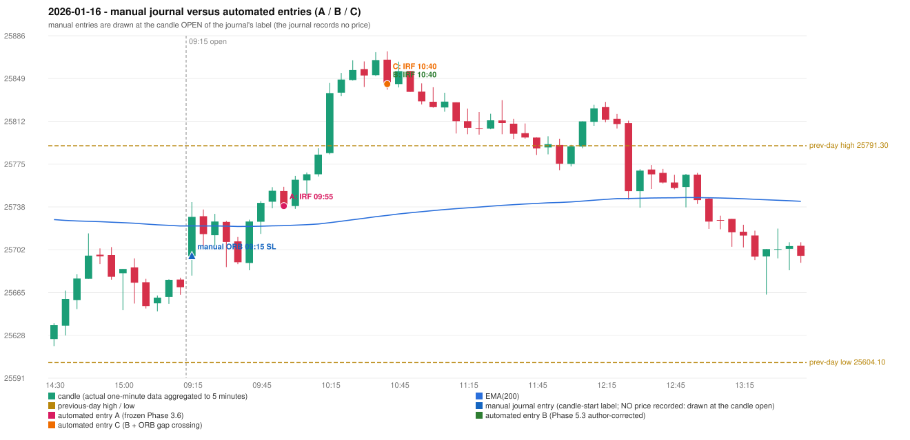

# 2026-01-16 (Friday) - manual journal versus the automated configurations

> SYNTHETIC index-point P&L; no real option P&L; costs illustrative (Rs 70 per trade + slippage scenarios). Configurations A / B / C are never combined.

## Session

* Open 25696.05; previous official close 25665.6; gap +30.45; previous-day high / low 25791.3 / 25604.1
* First 5-minute candle (09:15-09:20): O25696.05 H25742.65 L25679.2 C25729.85, GREEN, body 53.3%; EMA(200) at the first candle 25722.11; previous session's last close 25669.1 vs its EMA 25722.03

## Manual journal

row 69: ORB labelled 09:15, outcome SL

## Configuration A

Candidate signals (confirmed): 10:00 IRF/Method 1 SHORT [EXECUTED: trade 1: INITIAL_FULL_STOP]; 10:45 IRF/Method 2B SHORT [REJECTED: SECOND_TRADE_RESTRICTED_TO_PDR_PDS]; 13:05 IRF/Method 1 SHORT [REJECTED: SECOND_TRADE_RESTRICTED_TO_PDR_PDS]

Strategies with no confirmed signal: ORB: Method 2 INVALIDATED TREND:EMA_PREV_SESSION_CLOSE wrong side | PDR: PDR INVALIDATED OPEN_NOT_STRICTLY_ABOVE_ZONE | PDS: no setup record (the strategy's trigger event never occurred) | RF: RF INVALIDATED TREND:EMA_PREV_SESSION_CLOSE wrong side

| trade | strategy / method | dir | signal -> fill | entry | stop / T1 / T2 | leg 1 | leg 2 | outcome | gross Rs | net Rs (70, 0) | net Rs (70, 1.0) |
|---|---|---|---|---|---|---|---|---|---|---|---|
| 1 | IRF/Method 1 | SHORT | 10:00 -> 10:00 | 25739.25 | 25774.25 / 25712.25 / 25679.25 | 10:11 @ 25774.25 | 10:11 @ 25774.25 | INITIAL_FULL_STOP | -13,650 | -13,720 | -14,500 |

Selection: This IRF Method 1 signal was the earliest executable signal of the day: 0 confirmed signal(s) earlier, 0 other in the same minute. 2 later confirmed signal(s) (IRF x2) are logged as ignored or rejected. State of the other four engines at that moment: [ORB: Method 2 invalidated at 09:15: TREND:EMA_PREV_SESSION_CLOSE wrong side] [PDR: PDR invalidated at 09:15: OPEN_NOT_STRICTLY_ABOVE_ZONE] [PDS: no setup record before this time (a base condition was not met, or nothing triggered)] [RF: no setup record before this time (a base condition was not met, or nothing triggered)]

* Journal row 69 (ORB 09:15): **UNMATCHED_MANUAL**; earliest cause OPENING_GAP_MISMATCH: first candle GREEN O25696.05 H25742.65 L25679.2 C25729.85 (body 53.3%); direction ASSUMED from the colour (the journal has no direction); closest method Gap/200DMA (2 failing predicate(s)): first failing 'gap_crosses_200_average' - previous close 25665.6 vs previous EMA 25722.03; open 25696.05 vs EMA 25722.11; all methods: Method 1: 3 fail (level_broken); Method 2: 3 fail (trend); Gap/200DMA: 2 fail (gap_crosses_200_average)
* Automated IRF 09:55 has no strict / time-tolerant journal counterpart: DIFFERENT_STRATEGY_SELECTED - the journal traded ORB 09:15; the automated controller took IRF Method 1 (candle 09:55) as the first valid signal

## Configuration B

Candidate signals (confirmed): 10:45 IRF/Method 2B SHORT [EXECUTED: trade 1: TARGET]

Strategies with no confirmed signal: ORB: Method 2 INVALIDATED TREND:EMA_PREV_SESSION_CLOSE wrong side | PDR: PDR INVALIDATED OPEN_NOT_STRICTLY_ABOVE_ZONE | PDS: no setup record (the strategy's trigger event never occurred) | RF: RF INVALIDATED TREND:EMA_PREV_SESSION_CLOSE wrong side

| trade | strategy / method | dir | signal -> fill | entry | stop / T1 / T2 | leg 1 | leg 2 | outcome | gross Rs | net Rs (70, 0) | net Rs (70, 1.0) |
|---|---|---|---|---|---|---|---|---|---|---|---|
| 1 | IRF/Method 2B | SHORT | 10:45 -> 10:45 | 25844.55 | 25879.55 / 25817.55 / 25784.55 | 11:13 @ 25817.55 | 11:47 @ 25784.55 | TARGET | 16,965 | 16,895 | 16,115 |

Selection: This IRF Method 2B signal was the earliest executable signal of the day: 0 confirmed signal(s) earlier, 0 other in the same minute. No later signal was generated. State of the other four engines at that moment: [ORB: Method 2 invalidated at 09:15: TREND:EMA_PREV_SESSION_CLOSE wrong side] [PDR: PDR invalidated at 09:15: OPEN_NOT_STRICTLY_ABOVE_ZONE] [PDS: no setup record before this time (a base condition was not met, or nothing triggered)] [RF: no setup record before this time (a base condition was not met, or nothing triggered)]

* Journal row 69 (ORB 09:15): **UNMATCHED_MANUAL**; earliest cause OPENING_GAP_MISMATCH: first candle GREEN O25696.05 H25742.65 L25679.2 C25729.85 (body 53.3%); direction ASSUMED from the colour (the journal has no direction); closest method Gap/200DMA (2 failing predicate(s)): first failing 'gap_crosses_200_average' - previous close 25665.6 vs previous EMA 25722.03; open 25696.05 vs EMA 25722.11; all methods: Method 1: 3 fail (level_broken); Method 2: 3 fail (trend); Gap/200DMA: 2 fail (gap_crosses_200_average)
* Automated IRF 10:40 has no strict / time-tolerant journal counterpart: DIFFERENT_STRATEGY_SELECTED - the journal traded ORB 09:15; the automated controller took IRF Method 2B (candle 10:40) as the first valid signal

## Configuration C

Candidate signals (confirmed): 10:45 IRF/Method 2B SHORT [EXECUTED: trade 1: TARGET]

Strategies with no confirmed signal: ORB: Gap/200DMA INVALIDATED CANDLE_QUALITY_OR_REJECTION_WICK; Method 2 INVALIDATED TREND:EMA_PREV_SESSION_CLOSE wrong side | PDR: PDR INVALIDATED OPEN_NOT_STRICTLY_ABOVE_ZONE | PDS: no setup record (the strategy's trigger event never occurred) | RF: RF INVALIDATED TREND:EMA_PREV_SESSION_CLOSE wrong side

| trade | strategy / method | dir | signal -> fill | entry | stop / T1 / T2 | leg 1 | leg 2 | outcome | gross Rs | net Rs (70, 0) | net Rs (70, 1.0) |
|---|---|---|---|---|---|---|---|---|---|---|---|
| 1 | IRF/Method 2B | SHORT | 10:45 -> 10:45 | 25844.55 | 25879.55 / 25817.55 / 25784.55 | 11:13 @ 25817.55 | 11:47 @ 25784.55 | TARGET | 16,965 | 16,895 | 16,115 |

Selection: This IRF Method 2B signal was the earliest executable signal of the day: 0 confirmed signal(s) earlier, 0 other in the same minute. No later signal was generated. State of the other four engines at that moment: [ORB: Method 2 invalidated at 09:15: TREND:EMA_PREV_SESSION_CLOSE wrong side; Gap/200DMA invalidated at 09:15: CANDLE_QUALITY_OR_REJECTION_WICK] [PDR: PDR invalidated at 09:15: OPEN_NOT_STRICTLY_ABOVE_ZONE] [PDS: no setup record before this time (a base condition was not met, or nothing triggered)] [RF: no setup record before this time (a base condition was not met, or nothing triggered)]

* Journal row 69 (ORB 09:15): **UNMATCHED_MANUAL**; earliest cause CANDLE_STRENGTH_MISMATCH: first candle GREEN O25696.05 H25742.65 L25679.2 C25729.85 (body 53.3%); direction ASSUMED from the colour (the journal has no direction); closest method Gap/200DMA (1 failing predicate(s)): first failing 'candle_shape' - body 53.3% opposite wick 20.2% close location 79.8%; rejection wick flag False; all methods: Method 1: 3 fail (level_broken); Method 2: 3 fail (trend); Gap/200DMA: 1 fail (candle_shape)
* Automated IRF 10:40 has no strict / time-tolerant journal counterpart: DIFFERENT_STRATEGY_SELECTED - the journal traded ORB 09:15; the automated controller took IRF Method 2B (candle 10:40) as the first valid signal

## Chart

