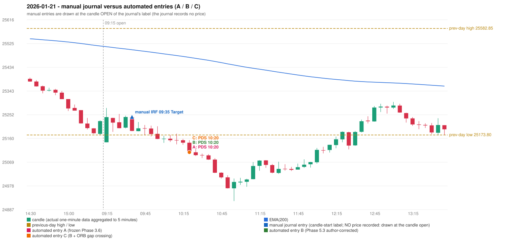

# 2026-01-21 (Wednesday) - manual journal versus the automated configurations

> SYNTHETIC index-point P&L; no real option P&L; costs illustrative (Rs 70 per trade + slippage scenarios). Configurations A / B / C are never combined.

## Session

* Open 25145.75; previous official close 25232.5; gap -86.75; previous-day high / low 25582.85 / 25173.8
* First 5-minute candle (09:15-09:20): O25145.75 H25277.65 L25145.75 C25242.4, GREEN, body 73.3%; EMA(200) at the first candle 25512.81; previous session's last close 25227.3 vs its EMA 25515.53

## Manual journal

row 70: IRF labelled 09:35, outcome Target

## Configuration A

Candidate signals (confirmed): 10:25 PDS/Method 3 SHORT [EXECUTED: trade 1: TARGET]; 13:10 IRF/Method 1 SHORT [IGNORED: DAY_FINISHED]; 13:10 IRF/Method 2B SHORT [IGNORED: DAY_FINISHED]; 13:35 PDS/Method 3 SHORT [IGNORED: DAY_FINISHED]; 13:55 PDS/Method 3 SHORT [IGNORED: DAY_FINISHED]

Strategies with no confirmed signal: ORB: Method 2 INVALIDATED TRENDLINE_NOT_SUPPORTIVE | PDR: no setup record (the strategy's trigger event never occurred) | RF: RF INVALIDATED TREND:EMA_PREV_SESSION_CLOSE wrong side

| trade | strategy / method | dir | signal -> fill | entry | stop / T1 / T2 | leg 1 | leg 2 | outcome | gross Rs | net Rs (70, 0) | net Rs (70, 1.0) |
|---|---|---|---|---|---|---|---|---|---|---|---|
| 1 | PDS/Method 3 | SHORT | 10:25 -> 10:25 | 25107.5 | 25142.5 / 25080.5 / 25037.5 | 10:39 @ 25080.5 | 10:42 @ 25037.5 | TARGET | 18,915 | 18,845 | 18,065 |

Selection: This PDS Method 3 signal was the earliest executable signal of the day: 0 confirmed signal(s) earlier, 0 other in the same minute. 4 later confirmed signal(s) (IRF x2, PDS x2) are logged as ignored or rejected. State of the other four engines at that moment: [IRF: no setup record before this time (a base condition was not met, or nothing triggered)] [ORB: Method 2 invalidated at 09:15: TRENDLINE_NOT_SUPPORTIVE] [PDR: no setup record before this time (a base condition was not met, or nothing triggered)] [RF: no setup record before this time (a base condition was not met, or nothing triggered)]

* Journal row 70 (IRF 09:35): **UNMATCHED_MANUAL**; earliest cause UNRESOLVED_DISCRETIONARY_SELECTION: no automated IRF signal within 60 minutes of the manual label 09:35 (nearest: 13:10, candle 13:05, 210 minutes later); the engine produced no IRF signal near the manual entry (no IRF breakout / failure setup was seen); the journal gives no reason for the manual entry (rule points that are discretionary or unresolved: IRF Method 1 boundary IRF-M1-003, Method 3 wick share, the day's-low rule)
* Automated PDS 10:20 has no strict / time-tolerant journal counterpart: DIFFERENT_STRATEGY_SELECTED - the journal traded IRF 09:35; the automated controller took PDS Method 3 (candle 10:20) as the first valid signal

## Configuration B

Candidate signals (confirmed): 10:25 PDS/Method 3 SHORT [EXECUTED: trade 1: TARGET]; 12:30 PDS/Method 1 SHORT [IGNORED: DAY_FINISHED]; 12:45 PDS/Method 2 SHORT [IGNORED: DAY_FINISHED]; 13:10 IRF/Method 1 SHORT [IGNORED: DAY_FINISHED]; 13:10 IRF/Method 2B SHORT [IGNORED: DAY_FINISHED]; 13:15 PDS/Method 1 SHORT [IGNORED: DAY_FINISHED]; 13:20 PDS/Method 1 SHORT [IGNORED: DAY_FINISHED]; 13:35 PDS/Method 3 SHORT [IGNORED: DAY_FINISHED]; 13:55 PDS/Method 3 SHORT [IGNORED: DAY_FINISHED]; 14:25 PDS/Method 1 SHORT [IGNORED: DAY_FINISHED]; 15:10 PDS/Method 1 SHORT [IGNORED: DAY_FINISHED]

Strategies with no confirmed signal: ORB: Method 2 INVALIDATED TRENDLINE_NOT_SUPPORTIVE | PDR: no setup record (the strategy's trigger event never occurred) | RF: RF INVALIDATED TREND:EMA_PREV_SESSION_CLOSE wrong side

| trade | strategy / method | dir | signal -> fill | entry | stop / T1 / T2 | leg 1 | leg 2 | outcome | gross Rs | net Rs (70, 0) | net Rs (70, 1.0) |
|---|---|---|---|---|---|---|---|---|---|---|---|
| 1 | PDS/Method 3 | SHORT | 10:25 -> 10:25 | 25107.5 | 25142.5 / 25080.5 / 25037.5 | 10:39 @ 25080.5 | 10:42 @ 25037.5 | TARGET | 18,915 | 18,845 | 18,065 |

Selection: This PDS Method 3 signal was the earliest executable signal of the day: 0 confirmed signal(s) earlier, 0 other in the same minute. 10 later confirmed signal(s) (IRF x2, PDS x8) are logged as ignored or rejected. State of the other four engines at that moment: [IRF: no setup record before this time (a base condition was not met, or nothing triggered)] [ORB: Method 2 invalidated at 09:15: TRENDLINE_NOT_SUPPORTIVE] [PDR: no setup record before this time (a base condition was not met, or nothing triggered)] [RF: no setup record before this time (a base condition was not met, or nothing triggered)]

* Journal row 70 (IRF 09:35): **UNMATCHED_MANUAL**; earliest cause UNRESOLVED_DISCRETIONARY_SELECTION: no automated IRF signal within 60 minutes of the manual label 09:35 (nearest: 13:10, candle 13:05, 210 minutes later); the engine produced no IRF signal near the manual entry (no IRF breakout / failure setup was seen); the journal gives no reason for the manual entry (rule points that are discretionary or unresolved: IRF Method 1 boundary IRF-M1-003, Method 3 wick share, the day's-low rule)
* Automated PDS 10:20 has no strict / time-tolerant journal counterpart: DIFFERENT_STRATEGY_SELECTED - the journal traded IRF 09:35; the automated controller took PDS Method 3 (candle 10:20) as the first valid signal

## Configuration C

Candidate signals (confirmed): 10:25 PDS/Method 3 SHORT [EXECUTED: trade 1: TARGET]; 12:30 PDS/Method 1 SHORT [IGNORED: DAY_FINISHED]; 12:45 PDS/Method 2 SHORT [IGNORED: DAY_FINISHED]; 13:10 IRF/Method 1 SHORT [IGNORED: DAY_FINISHED]; 13:10 IRF/Method 2B SHORT [IGNORED: DAY_FINISHED]; 13:15 PDS/Method 1 SHORT [IGNORED: DAY_FINISHED]; 13:20 PDS/Method 1 SHORT [IGNORED: DAY_FINISHED]; 13:35 PDS/Method 3 SHORT [IGNORED: DAY_FINISHED]; 13:55 PDS/Method 3 SHORT [IGNORED: DAY_FINISHED]; 14:25 PDS/Method 1 SHORT [IGNORED: DAY_FINISHED]; 15:10 PDS/Method 1 SHORT [IGNORED: DAY_FINISHED]

Strategies with no confirmed signal: ORB: Method 2 INVALIDATED TRENDLINE_NOT_SUPPORTIVE | PDR: no setup record (the strategy's trigger event never occurred) | RF: RF INVALIDATED TREND:EMA_PREV_SESSION_CLOSE wrong side

| trade | strategy / method | dir | signal -> fill | entry | stop / T1 / T2 | leg 1 | leg 2 | outcome | gross Rs | net Rs (70, 0) | net Rs (70, 1.0) |
|---|---|---|---|---|---|---|---|---|---|---|---|
| 1 | PDS/Method 3 | SHORT | 10:25 -> 10:25 | 25107.5 | 25142.5 / 25080.5 / 25037.5 | 10:39 @ 25080.5 | 10:42 @ 25037.5 | TARGET | 18,915 | 18,845 | 18,065 |

Selection: This PDS Method 3 signal was the earliest executable signal of the day: 0 confirmed signal(s) earlier, 0 other in the same minute. 10 later confirmed signal(s) (IRF x2, PDS x8) are logged as ignored or rejected. State of the other four engines at that moment: [IRF: no setup record before this time (a base condition was not met, or nothing triggered)] [ORB: Method 2 invalidated at 09:15: TRENDLINE_NOT_SUPPORTIVE] [PDR: no setup record before this time (a base condition was not met, or nothing triggered)] [RF: no setup record before this time (a base condition was not met, or nothing triggered)]

* Journal row 70 (IRF 09:35): **UNMATCHED_MANUAL**; earliest cause UNRESOLVED_DISCRETIONARY_SELECTION: no automated IRF signal within 60 minutes of the manual label 09:35 (nearest: 13:10, candle 13:05, 210 minutes later); the engine produced no IRF signal near the manual entry (no IRF breakout / failure setup was seen); the journal gives no reason for the manual entry (rule points that are discretionary or unresolved: IRF Method 1 boundary IRF-M1-003, Method 3 wick share, the day's-low rule)
* Automated PDS 10:20 has no strict / time-tolerant journal counterpart: DIFFERENT_STRATEGY_SELECTED - the journal traded IRF 09:35; the automated controller took PDS Method 3 (candle 10:20) as the first valid signal

## Chart

