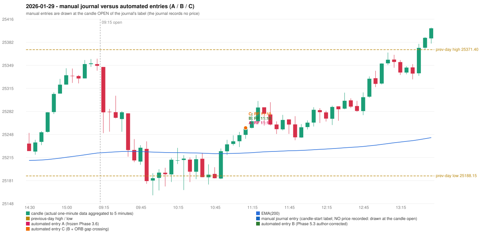

# 2026-01-29 (Thursday) - manual journal versus the automated configurations

> SYNTHETIC index-point P&L; no real option P&L; costs illustrative (Rs 70 per trade + slippage scenarios). Configurations A / B / C are never combined.

## Session

* Open 25346.4; previous official close 25342.75; gap +3.65; previous-day high / low 25371.4 / 25188.15
* First 5-minute candle (09:15-09:20): O25346.4 H25346.4 L25250.3 C25280.55, RED, body 68.5%; EMA(200) at the first candle 25221.99; previous session's last close 25348.05 vs its EMA 25221.40

## Manual journal

no manual trade recorded

## Configuration A

Candidate signals (confirmed): 11:15 RF/RF LONG [EXECUTED: trade 1: T1_THEN_BUFFER_STOP]; 13:20 IRF/Method 1 SHORT [IGNORED: DAY_FINISHED]; 15:05 IRF/Method 2A SHORT [IGNORED: DAY_FINISHED]

Strategies with no confirmed signal: ORB: no setup record (the strategy's trigger event never occurred) | PDR: PDR INVALIDATED OPEN_NOT_STRICTLY_ABOVE_ZONE | PDS: no setup record (the strategy's trigger event never occurred)

| trade | strategy / method | dir | signal -> fill | entry | stop / T1 / T2 | leg 1 | leg 2 | outcome | gross Rs | net Rs (70, 0) | net Rs (70, 1.0) |
|---|---|---|---|---|---|---|---|---|---|---|---|
| 1 | RF/RF | LONG | 11:15 -> 11:15 | 25257.95 | 25222.95 / 25284.95 / 25317.95 | 11:22 @ 25284.95 | 11:38 @ 25251.95 | T1_THEN_BUFFER_STOP | 4,095 | 4,025 | 3,245 |

Selection: This RF signal was the earliest executable signal of the day: 0 confirmed signal(s) earlier, 0 other in the same minute. 2 later confirmed signal(s) (IRF x2) are logged as ignored or rejected. State of the other four engines at that moment: [IRF: no setup record before this time (a base condition was not met, or nothing triggered)] [ORB: no setup record before this time (a base condition was not met, or nothing triggered)] [PDR: PDR invalidated at 09:15: OPEN_NOT_STRICTLY_ABOVE_ZONE] [PDS: no setup record before this time (a base condition was not met, or nothing triggered)]

* Automated RF 11:10 has no strict / time-tolerant journal counterpart: UNRESOLVED_DISCRETIONARY_SELECTION - the journal records no trade this day; the automated system took RF RF LONG (candle 11:10) mechanically

## Configuration B

Candidate signals (confirmed): 11:15 RF/RF LONG [EXECUTED: trade 1: T1_THEN_BUFFER_STOP]; 13:20 IRF/Method 1 SHORT [IGNORED: DAY_FINISHED]; 13:20 IRF/Method 2A SHORT [IGNORED: DAY_FINISHED]; 14:05 IRF/Method 2B SHORT [IGNORED: DAY_FINISHED]; 15:00 IRF/Method 2A SHORT [IGNORED: DAY_FINISHED]; 15:00 IRF/Method 2B SHORT [IGNORED: DAY_FINISHED]

Strategies with no confirmed signal: ORB: no setup record (the strategy's trigger event never occurred) | PDR: PDR INVALIDATED OPEN_NOT_STRICTLY_ABOVE_ZONE | PDS: no setup record (the strategy's trigger event never occurred)

| trade | strategy / method | dir | signal -> fill | entry | stop / T1 / T2 | leg 1 | leg 2 | outcome | gross Rs | net Rs (70, 0) | net Rs (70, 1.0) |
|---|---|---|---|---|---|---|---|---|---|---|---|
| 1 | RF/RF | LONG | 11:15 -> 11:15 | 25257.95 | 25222.95 / 25284.95 / 25317.95 | 11:22 @ 25284.95 | 11:38 @ 25251.95 | T1_THEN_BUFFER_STOP | 4,095 | 4,025 | 3,245 |

Selection: This RF signal was the earliest executable signal of the day: 0 confirmed signal(s) earlier, 0 other in the same minute. 5 later confirmed signal(s) (IRF x5) are logged as ignored or rejected. State of the other four engines at that moment: [IRF: no setup record before this time (a base condition was not met, or nothing triggered)] [ORB: no setup record before this time (a base condition was not met, or nothing triggered)] [PDR: PDR invalidated at 09:15: OPEN_NOT_STRICTLY_ABOVE_ZONE] [PDS: no setup record before this time (a base condition was not met, or nothing triggered)]

* Automated RF 11:10 has no strict / time-tolerant journal counterpart: UNRESOLVED_DISCRETIONARY_SELECTION - the journal records no trade this day; the automated system took RF RF LONG (candle 11:10) mechanically

## Configuration C

Candidate signals (confirmed): 11:15 RF/RF LONG [EXECUTED: trade 1: T1_THEN_BUFFER_STOP]; 13:20 IRF/Method 1 SHORT [IGNORED: DAY_FINISHED]; 13:20 IRF/Method 2A SHORT [IGNORED: DAY_FINISHED]; 14:05 IRF/Method 2B SHORT [IGNORED: DAY_FINISHED]; 15:00 IRF/Method 2A SHORT [IGNORED: DAY_FINISHED]; 15:00 IRF/Method 2B SHORT [IGNORED: DAY_FINISHED]

Strategies with no confirmed signal: ORB: no setup record (the strategy's trigger event never occurred) | PDR: PDR INVALIDATED OPEN_NOT_STRICTLY_ABOVE_ZONE | PDS: no setup record (the strategy's trigger event never occurred)

| trade | strategy / method | dir | signal -> fill | entry | stop / T1 / T2 | leg 1 | leg 2 | outcome | gross Rs | net Rs (70, 0) | net Rs (70, 1.0) |
|---|---|---|---|---|---|---|---|---|---|---|---|
| 1 | RF/RF | LONG | 11:15 -> 11:15 | 25257.95 | 25222.95 / 25284.95 / 25317.95 | 11:22 @ 25284.95 | 11:38 @ 25251.95 | T1_THEN_BUFFER_STOP | 4,095 | 4,025 | 3,245 |

Selection: This RF signal was the earliest executable signal of the day: 0 confirmed signal(s) earlier, 0 other in the same minute. 5 later confirmed signal(s) (IRF x5) are logged as ignored or rejected. State of the other four engines at that moment: [IRF: no setup record before this time (a base condition was not met, or nothing triggered)] [ORB: no setup record before this time (a base condition was not met, or nothing triggered)] [PDR: PDR invalidated at 09:15: OPEN_NOT_STRICTLY_ABOVE_ZONE] [PDS: no setup record before this time (a base condition was not met, or nothing triggered)]

* Automated RF 11:10 has no strict / time-tolerant journal counterpart: UNRESOLVED_DISCRETIONARY_SELECTION - the journal records no trade this day; the automated system took RF RF LONG (candle 11:10) mechanically

## Chart

