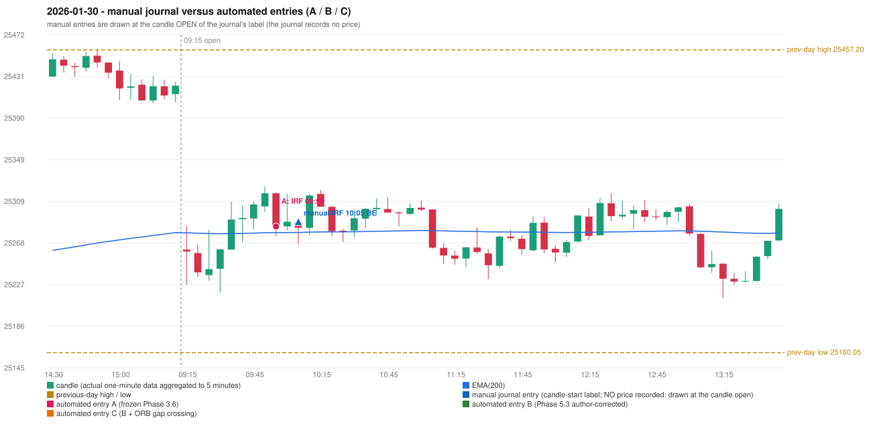

# 2026-01-30 (Friday) - manual journal versus the automated configurations

> SYNTHETIC index-point P&L; no real option P&L; costs illustrative (Rs 70 per trade + slippage scenarios). Configurations A / B / C are never combined.

## Session

* Open 25261.25; previous official close 25418.9; gap -157.65; previous-day high / low 25457.2 / 25160.05
* First 5-minute candle (09:15-09:20): O25261.25 H25284.4 L25226.75 C25259.3, RED, body 3.4%; EMA(200) at the first candle 25277.70; previous session's last close 25422.1 vs its EMA 25277.89

## Manual journal

row 74: IRF labelled 10:05, outcome BE

## Configuration A

Candidate signals (confirmed): 10:00 IRF/Method 1 SHORT [EXECUTED: trade 1: INITIAL_FULL_STOP]; 10:00 IRF/Method 2B SHORT [MERGED_SAME_STRATEGY_METHOD: traded as another method of the same strategy/direction in the same minute]; 10:10 IRF/Method 1 SHORT [IGNORED: POSITION_ACTIVE (signal kept for diagnostics only; never reused)]; 10:25 IRF/Method 1 SHORT [REJECTED: SECOND_TRADE_RESTRICTED_TO_PDR_PDS]; 11:10 IRF/Method 1 SHORT [REJECTED: SECOND_TRADE_RESTRICTED_TO_PDR_PDS]; 11:10 IRF/Method 2A SHORT [REJECTED: SECOND_TRADE_RESTRICTED_TO_PDR_PDS]; 12:00 IRF/Method 1 SHORT [REJECTED: SECOND_TRADE_RESTRICTED_TO_PDR_PDS]; 12:20 IRF/Method 1 SHORT [REJECTED: SECOND_TRADE_RESTRICTED_TO_PDR_PDS]; 13:05 IRF/Method 1 SHORT [REJECTED: SECOND_TRADE_RESTRICTED_TO_PDR_PDS]; 13:05 IRF/Method 2A SHORT [REJECTED: SECOND_TRADE_RESTRICTED_TO_PDR_PDS]

Strategies with no confirmed signal: ORB: Gap/200DMA INVALIDATED CANDLE_QUALITY_OR_REJECTION_WICK; Method 2 INVALIDATED TREND:EMA_PREV_SESSION_CLOSE wrong side | PDR: no setup record (the strategy's trigger event never occurred) | PDS: Method 1/2/3 INVALIDATED GAP_DOWN_OPEN_NOT_BELOW_ZONE | RF: no setup record (the strategy's trigger event never occurred)

| trade | strategy / method | dir | signal -> fill | entry | stop / T1 / T2 | leg 1 | leg 2 | outcome | gross Rs | net Rs (70, 0) | net Rs (70, 1.0) |
|---|---|---|---|---|---|---|---|---|---|---|---|
| 1 | IRF/Method 1 | SHORT | 10:00 -> 10:00 | 25283.95 | 25318.95 / 25256.95 / 25223.95 | 10:15 @ 25318.95 | 10:15 @ 25318.95 | INITIAL_FULL_STOP | -13,650 | -13,720 | -14,500 |

Selection: This IRF Method 1 signal was the earliest executable signal of the day: 0 confirmed signal(s) earlier, 1 other in the same minute. 8 later confirmed signal(s) (IRF x8) are logged as ignored or rejected. State of the other four engines at that moment: [ORB: Method 2 invalidated at 09:15: TREND:EMA_PREV_SESSION_CLOSE wrong side; Gap/200DMA invalidated at 09:15: CANDLE_QUALITY_OR_REJECTION_WICK] [PDR: no setup record before this time (a base condition was not met, or nothing triggered)] [PDS: Method 1/2/3 invalidated at 09:15: GAP_DOWN_OPEN_NOT_BELOW_ZONE] [RF: no setup record before this time (a base condition was not met, or nothing triggered)]

* Journal row 74 (IRF 10:05): **TIME_TOLERANT** match with 20260130-1-IRF (delta -10 min); outcome BE vs automated INITIAL_FULL_STOP (different class: EXIT_MANAGEMENT_MISMATCH; the journal has no exit price / time)

## Configuration B

Candidate signals (confirmed): 13:20 IRF/Method 2A SHORT [REJECTED: ENTRY_CUTOFF_EXCEEDED(fill 13:20 IST > 13:00)]; 13:20 IRF/Method 2B SHORT [REJECTED: ENTRY_CUTOFF_EXCEEDED(fill 13:20 IST > 13:00)]; 14:35 IRF/Method 2A SHORT [REJECTED: ENTRY_CUTOFF_EXCEEDED(fill 14:35 IST > 13:00)]

Strategies with no confirmed signal: ORB: Gap/200DMA INVALIDATED CANDLE_QUALITY_OR_REJECTION_WICK; Method 2 INVALIDATED TREND:EMA_PREV_SESSION_CLOSE wrong side | PDR: no setup record (the strategy's trigger event never occurred) | PDS: Method 1/2/3 INVALIDATED GAP_DOWN_OPEN_NOT_BELOW_ZONE | RF: no setup record (the strategy's trigger event never occurred)

No trade: final day state READY_FOR_FIRST_TRADE. Signals existed but none became a trade (see the dispositions above).

* Journal row 74 (IRF 10:05): **UNMATCHED_MANUAL**; earliest cause EMA_FILTER_MISMATCH: no automated IRF signal within 60 minutes of the manual label 10:05 (nearest: 13:20, candle 13:15, 190 minutes later); an IRF Method 2B candidate at 10:00 was REJECTED by the 28-point EMA clearance (range distance 0.0, EMA EMA_INSIDE_CANDLE) - PROVISIONAL_EMA_RANGE_DISTANCE

## Configuration C

Candidate signals (confirmed): 13:20 IRF/Method 2A SHORT [REJECTED: ENTRY_CUTOFF_EXCEEDED(fill 13:20 IST > 13:00)]; 13:20 IRF/Method 2B SHORT [REJECTED: ENTRY_CUTOFF_EXCEEDED(fill 13:20 IST > 13:00)]; 14:35 IRF/Method 2A SHORT [REJECTED: ENTRY_CUTOFF_EXCEEDED(fill 14:35 IST > 13:00)]

Strategies with no confirmed signal: ORB: Gap/200DMA INVALIDATED CANDLE_QUALITY_OR_REJECTION_WICK; Method 2 INVALIDATED TREND:EMA_PREV_SESSION_CLOSE wrong side | PDR: no setup record (the strategy's trigger event never occurred) | PDS: Method 1/2/3 INVALIDATED GAP_DOWN_OPEN_NOT_BELOW_ZONE | RF: no setup record (the strategy's trigger event never occurred)

No trade: final day state READY_FOR_FIRST_TRADE. Signals existed but none became a trade (see the dispositions above).

* Journal row 74 (IRF 10:05): **UNMATCHED_MANUAL**; earliest cause EMA_FILTER_MISMATCH: no automated IRF signal within 60 minutes of the manual label 10:05 (nearest: 13:20, candle 13:15, 190 minutes later); an IRF Method 2B candidate at 10:00 was REJECTED by the 28-point EMA clearance (range distance 0.0, EMA EMA_INSIDE_CANDLE) - PROVISIONAL_EMA_RANGE_DISTANCE

## Chart

