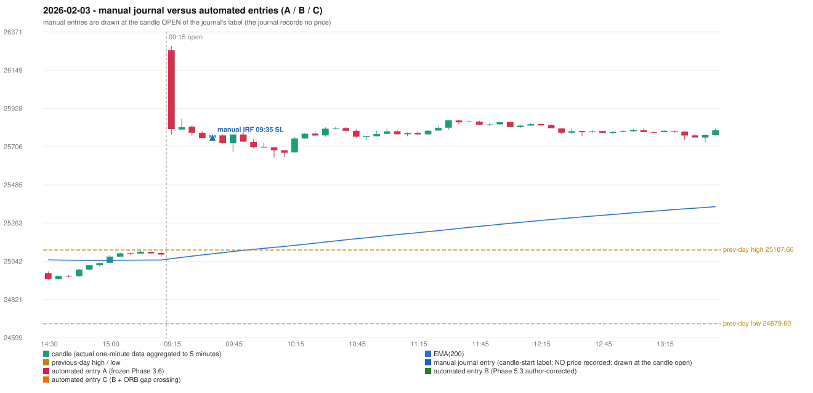

# 2026-02-03 (Tuesday) - manual journal versus the automated configurations

> SYNTHETIC index-point P&L; no real option P&L; costs illustrative (Rs 70 per trade + slippage scenarios). Configurations A / B / C are never combined.

## Session

* Open 26264.9; previous official close 25088.4; gap +1176.50; previous-day high / low 25107.6 / 24679.6
* First 5-minute candle (09:15-09:20): O26264.9 H26290.2 L25776.1 C25808.35, RED, body 88.8%; EMA(200) at the first candle 25057.09; previous session's last close 25081.3 vs its EMA 25049.54

## Manual journal

row 76: IRF labelled 09:35, outcome SL

## Configuration A

Candidate signals (confirmed): none

Strategies with no confirmed signal: IRF: no setup record (the strategy's trigger event never occurred) | ORB: Method 1 INVALIDATED CANDLE_QUALITY(not a strong body / wick too large); Method 2 INVALIDATED CANDLE_QUALITY | PDR: no setup record (the strategy's trigger event never occurred) | PDS: no setup record (the strategy's trigger event never occurred) | RF: RF INVALIDATED GAP_UP_OUTSIDE_YESTERDAYS_RANGE

No trade: final day state READY_FOR_FIRST_TRADE. No strategy qualified.

* Journal row 76 (IRF 09:35): **UNMATCHED_MANUAL**; earliest cause UNRESOLVED_DISCRETIONARY_SELECTION: the engine produced no IRF signal near the manual entry (no IRF breakout / failure setup was seen); the journal gives no reason for the manual entry (rule points that are discretionary or unresolved: IRF Method 1 boundary IRF-M1-003, Method 3 wick share, the day's-low rule)

## Configuration B

Candidate signals (confirmed): none

Strategies with no confirmed signal: IRF: no setup record (the strategy's trigger event never occurred) | ORB: Method 1 INVALIDATED CANDLE_QUALITY(not a strong body / wick too large); Method 2 INVALIDATED CANDLE_QUALITY | PDR: no setup record (the strategy's trigger event never occurred) | PDS: no setup record (the strategy's trigger event never occurred) | RF: RF INVALIDATED GAP_UP_OUTSIDE_YESTERDAYS_RANGE

No trade: final day state READY_FOR_FIRST_TRADE. No strategy qualified.

* Journal row 76 (IRF 09:35): **UNMATCHED_MANUAL**; earliest cause UNRESOLVED_DISCRETIONARY_SELECTION: the engine produced no IRF signal near the manual entry (no IRF breakout / failure setup was seen); the journal gives no reason for the manual entry (rule points that are discretionary or unresolved: IRF Method 1 boundary IRF-M1-003, Method 3 wick share, the day's-low rule)

## Configuration C

Candidate signals (confirmed): none

Strategies with no confirmed signal: IRF: no setup record (the strategy's trigger event never occurred) | ORB: Method 1 INVALIDATED CANDLE_QUALITY(not a strong body / wick too large); Method 2 INVALIDATED CANDLE_QUALITY | PDR: no setup record (the strategy's trigger event never occurred) | PDS: no setup record (the strategy's trigger event never occurred) | RF: RF INVALIDATED GAP_UP_OUTSIDE_YESTERDAYS_RANGE

No trade: final day state READY_FOR_FIRST_TRADE. No strategy qualified.

* Journal row 76 (IRF 09:35): **UNMATCHED_MANUAL**; earliest cause UNRESOLVED_DISCRETIONARY_SELECTION: the engine produced no IRF signal near the manual entry (no IRF breakout / failure setup was seen); the journal gives no reason for the manual entry (rule points that are discretionary or unresolved: IRF Method 1 boundary IRF-M1-003, Method 3 wick share, the day's-low rule)

## Chart

