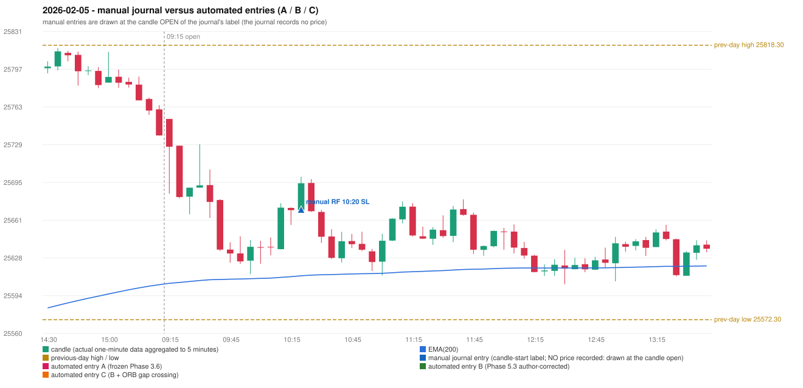

# 2026-02-05 (Thursday) - manual journal versus the automated configurations

> SYNTHETIC index-point P&L; no real option P&L; costs illustrative (Rs 70 per trade + slippage scenarios). Configurations A / B / C are never combined.

## Session

* Open 25752.25; previous official close 25776.0; gap -23.75; previous-day high / low 25818.3 / 25572.3
* First 5-minute candle (09:15-09:20): O25752.25 H25752.25 L25685.25 C25727.35, RED, body 37.2%; EMA(200) at the first candle 25604.94; previous session's last close 25737.5 vs its EMA 25603.71

## Manual journal

row 77: RF labelled 10:20, outcome SL

## Configuration A

Candidate signals (confirmed): none

Strategies with no confirmed signal: IRF: no setup record (the strategy's trigger event never occurred) | ORB: Method 2 INVALIDATED TREND:EMA_PREV_SESSION_CLOSE wrong side | PDR: no setup record (the strategy's trigger event never occurred) | PDS: Method 1/2/3 INVALIDATED GAP_DOWN_OPEN_NOT_BELOW_ZONE | RF: RF INVALIDATED GAP_NOT_UP(DOWN)

No trade: final day state READY_FOR_FIRST_TRADE. No strategy qualified.

* Journal row 77 (RF 10:20): **UNMATCHED_MANUAL**; earliest cause OPENING_GAP_MISMATCH: RF setup rejected by the opening-gap condition (RF-004) (GAP_NOT_UP(DOWN))

## Configuration B

Candidate signals (confirmed): none

Strategies with no confirmed signal: IRF: no setup record (the strategy's trigger event never occurred) | ORB: Method 2 INVALIDATED TREND:EMA_PREV_SESSION_CLOSE wrong side | PDR: no setup record (the strategy's trigger event never occurred) | PDS: Method 1/2/3 INVALIDATED GAP_DOWN_OPEN_NOT_BELOW_ZONE | RF: RF INVALIDATED GAP_NOT_UP(DOWN)

No trade: final day state READY_FOR_FIRST_TRADE. No strategy qualified.

* Journal row 77 (RF 10:20): **UNMATCHED_MANUAL**; earliest cause OPENING_GAP_MISMATCH: RF setup rejected by the opening-gap condition (RF-004) (GAP_NOT_UP(DOWN))

## Configuration C

Candidate signals (confirmed): none

Strategies with no confirmed signal: IRF: no setup record (the strategy's trigger event never occurred) | ORB: Gap/200DMA INVALIDATED CLOSE_NOT_BEYOND_MA; Method 2 INVALIDATED TREND:EMA_PREV_SESSION_CLOSE wrong side | PDR: no setup record (the strategy's trigger event never occurred) | PDS: Method 1/2/3 INVALIDATED GAP_DOWN_OPEN_NOT_BELOW_ZONE | RF: RF INVALIDATED GAP_NOT_UP(DOWN)

No trade: final day state READY_FOR_FIRST_TRADE. No strategy qualified.

* Journal row 77 (RF 10:20): **UNMATCHED_MANUAL**; earliest cause OPENING_GAP_MISMATCH: RF setup rejected by the opening-gap condition (RF-004) (GAP_NOT_UP(DOWN))

## Chart

