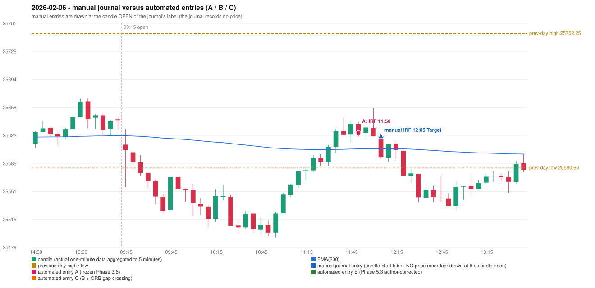

# 2026-02-06 (Friday) - manual journal versus the automated configurations

> SYNTHETIC index-point P&L; no real option P&L; costs illustrative (Rs 70 per trade + slippage scenarios). Configurations A / B / C are never combined.

## Session

* Open 25610.5; previous official close 25642.8; gap -32.30; previous-day high / low 25752.25 / 25580.6
* First 5-minute candle (09:15-09:20): O25610.5 H25630.45 L25555.95 C25603.5, RED, body 9.4%; EMA(200) at the first candle 25621.80; previous session's last close 25641.6 vs its EMA 25621.98

## Manual journal

row 78: IRF labelled 12:05, outcome Target

## Configuration A

Candidate signals (confirmed): 11:55 IRF/Method 1 SHORT [EXECUTED: trade 1: TARGET]; 12:05 IRF/Method 1 SHORT [IGNORED: POSITION_ACTIVE (signal kept for diagnostics only; never reused)]

Strategies with no confirmed signal: ORB: Gap/200DMA INVALIDATED CANDLE_QUALITY_OR_REJECTION_WICK; Method 2 INVALIDATED TREND:EMA_PREV_SESSION_CLOSE wrong side | PDR: no setup record (the strategy's trigger event never occurred) | PDS: Method 1/2/3 INVALIDATED GAP_DOWN_OPEN_NOT_BELOW_ZONE | RF: RF INVALIDATED GAP_NOT_UP(DOWN)

| trade | strategy / method | dir | signal -> fill | entry | stop / T1 / T2 | leg 1 | leg 2 | outcome | gross Rs | net Rs (70, 0) | net Rs (70, 1.0) |
|---|---|---|---|---|---|---|---|---|---|---|---|
| 1 | IRF/Method 1 | SHORT | 11:55 -> 11:55 | 25625.5 | 25660.5 / 25598.5 / 25565.5 | 12:06 @ 25598.5 | 12:26 @ 25565.5 | TARGET | 16,965 | 16,895 | 16,115 |

Selection: This IRF Method 1 signal was the earliest executable signal of the day: 0 confirmed signal(s) earlier, 0 other in the same minute. 1 later confirmed signal(s) (IRF x1) are logged as ignored or rejected. State of the other four engines at that moment: [ORB: Method 2 invalidated at 09:15: TREND:EMA_PREV_SESSION_CLOSE wrong side; Gap/200DMA invalidated at 09:15: CANDLE_QUALITY_OR_REJECTION_WICK] [PDR: no setup record before this time (a base condition was not met, or nothing triggered)] [PDS: Method 1/2/3 invalidated at 09:15: GAP_DOWN_OPEN_NOT_BELOW_ZONE] [RF: RF invalidated at 09:45: GAP_NOT_UP(DOWN)]

* Journal row 78 (IRF 12:05): **TIME_TOLERANT** match with 20260206-1-IRF (delta -15 min); outcome Target vs automated TARGET (same class)

## Configuration B

Candidate signals (confirmed): none

Strategies with no confirmed signal: IRF: Method 1/2 INCOMPLETE_AT_EOD SESSION_ENDED_BEFORE_CONFIRMATION; Method 3 INVALIDATED WICK_SHARE_OUT_OF_BAND | ORB: Gap/200DMA INVALIDATED CANDLE_QUALITY_OR_REJECTION_WICK; Method 2 INVALIDATED TREND:EMA_PREV_SESSION_CLOSE wrong side | PDR: no setup record (the strategy's trigger event never occurred) | PDS: Method 1/2/3 INVALIDATED GAP_DOWN_OPEN_NOT_BELOW_ZONE | RF: RF INVALIDATED GAP_NOT_UP(DOWN)

No trade: final day state READY_FOR_FIRST_TRADE. No strategy qualified.

* Journal row 78 (IRF 12:05): **UNMATCHED_MANUAL**; earliest cause EMA_FILTER_MISMATCH: an IRF Method 1 candidate at 11:55 was REJECTED by the 28-point EMA clearance (range distance 15.7, EMA EMA_BELOW_CANDLE) - PROVISIONAL_EMA_RANGE_DISTANCE

## Configuration C

Candidate signals (confirmed): none

Strategies with no confirmed signal: IRF: Method 1/2 INCOMPLETE_AT_EOD SESSION_ENDED_BEFORE_CONFIRMATION; Method 3 INVALIDATED WICK_SHARE_OUT_OF_BAND | ORB: Gap/200DMA INVALIDATED CANDLE_QUALITY_OR_REJECTION_WICK; Method 2 INVALIDATED TREND:EMA_PREV_SESSION_CLOSE wrong side | PDR: no setup record (the strategy's trigger event never occurred) | PDS: Method 1/2/3 INVALIDATED GAP_DOWN_OPEN_NOT_BELOW_ZONE | RF: RF INVALIDATED GAP_NOT_UP(DOWN)

No trade: final day state READY_FOR_FIRST_TRADE. No strategy qualified.

* Journal row 78 (IRF 12:05): **UNMATCHED_MANUAL**; earliest cause EMA_FILTER_MISMATCH: an IRF Method 1 candidate at 11:55 was REJECTED by the 28-point EMA clearance (range distance 15.7, EMA EMA_BELOW_CANDLE) - PROVISIONAL_EMA_RANGE_DISTANCE

## Chart

