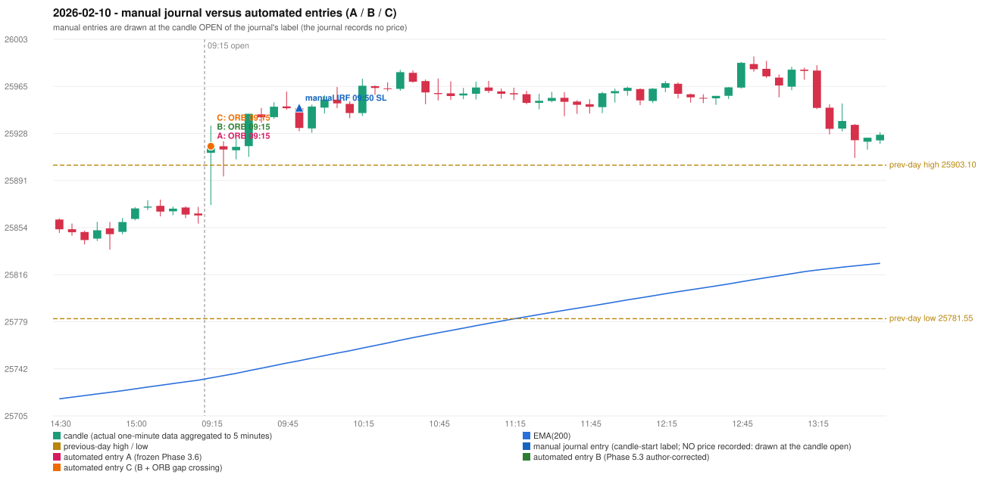

# 2026-02-10 (Tuesday) - manual journal versus the automated configurations

> SYNTHETIC index-point P&L; no real option P&L; costs illustrative (Rs 70 per trade + slippage scenarios). Configurations A / B / C are never combined.

## Session

* Open 25912.85; previous official close 25867.3; gap +45.55; previous-day high / low 25903.1 / 25781.55
* First 5-minute candle (09:15-09:20): O25912.85 H25934.45 L25871.45 C25918.05, GREEN, body 8.3%; EMA(200) at the first candle 25734.65; previous session's last close 25863.3 vs its EMA 25732.80

## Manual journal

row 79: IRF labelled 09:50, outcome SL

## Configuration A

Candidate signals (confirmed): 09:20 ORB/Method 1 LONG [EXECUTED: trade 1: TARGET]; 09:20 ORB/Method 2 LONG [MERGED_SAME_STRATEGY_METHOD: traded as another method of the same strategy/direction in the same minute]; 09:25 PDR/PDR LONG [IGNORED: POSITION_ACTIVE (signal kept for diagnostics only; never reused)]; 09:55 IRF/Method 1 SHORT [IGNORED: POSITION_ACTIVE (signal kept for diagnostics only; never reused)]; 10:10 IRF/Method 2B SHORT [IGNORED: POSITION_ACTIVE (signal kept for diagnostics only; never reused)]; 10:25 IRF/Method 2B SHORT [IGNORED: POSITION_ACTIVE (signal kept for diagnostics only; never reused)]; 11:25 IRF/Method 2A SHORT [IGNORED: DAY_FINISHED]; 12:10 IRF/Method 2B SHORT [IGNORED: DAY_FINISHED]; 13:05 IRF/Method 2B SHORT [IGNORED: DAY_FINISHED]; 13:20 IRF/Method 2B SHORT [IGNORED: DAY_FINISHED]; 13:25 IRF/Method 1 SHORT [IGNORED: DAY_FINISHED]; 13:35 IRF/Method 1 SHORT [IGNORED: DAY_FINISHED]; 14:20 PDR/PDR LONG [IGNORED: DAY_FINISHED]; 14:25 IRF/Method 1 SHORT [IGNORED: DAY_FINISHED]; 15:15 IRF/Method 1 SHORT [IGNORED: DAY_FINISHED]; 15:20 IRF/Method 2A SHORT [IGNORED: DAY_FINISHED]

Strategies with no confirmed signal: PDS: no setup record (the strategy's trigger event never occurred) | RF: no setup record (the strategy's trigger event never occurred)

| trade | strategy / method | dir | signal -> fill | entry | stop / T1 / T2 | leg 1 | leg 2 | outcome | gross Rs | net Rs (70, 0) | net Rs (70, 1.0) |
|---|---|---|---|---|---|---|---|---|---|---|---|
| 1 | ORB/Method 1 | LONG | 09:20 -> 09:20 | 25918.1 | 25888.1 / 25945.1 / 25978.1 | 09:35 @ 25945.1 | 10:34 @ 25978.1 | TARGET | 16,965 | 16,895 | 16,115 |

Selection: This ORB Method 1 signal was the earliest executable signal of the day: 0 confirmed signal(s) earlier, 1 other in the same minute. 14 later confirmed signal(s) (IRF x12, PDR x2) are logged as ignored or rejected. State of the other four engines at that moment: [IRF: no setup record before this time (a base condition was not met, or nothing triggered)] [PDR: no setup record before this time (a base condition was not met, or nothing triggered)] [PDS: no setup record before this time (a base condition was not met, or nothing triggered)] [RF: no setup record before this time (a base condition was not met, or nothing triggered)]

* Journal row 79 (IRF 09:50): **UNMATCHED_MANUAL**; earliest cause DIFFERENT_STRATEGY_SELECTED (+ PORTFOLIO_CONTROLLER_CONSTRAINT): the controller took ORB Method 1 (signal 09:20) first; the IRF signal at 09:55 was IGNORED: POSITION_ACTIVE (signal kept for diagnostics only; never reused)
* Automated ORB 09:15 has no strict / time-tolerant journal counterpart: DIFFERENT_STRATEGY_SELECTED - the journal traded IRF 09:50; the automated controller took ORB Method 1 (candle 09:15) as the first valid signal

## Configuration B

Candidate signals (confirmed): 09:20 ORB/Method 1 LONG [EXECUTED: trade 1: TARGET]; 09:20 ORB/Method 2 LONG [MERGED_SAME_STRATEGY_METHOD: traded as another method of the same strategy/direction in the same minute]; 09:25 PDR/PDR LONG [IGNORED: POSITION_ACTIVE (signal kept for diagnostics only; never reused)]; 09:55 IRF/Method 1 SHORT [IGNORED: POSITION_ACTIVE (signal kept for diagnostics only; never reused)]; 09:55 IRF/Method 2A SHORT [IGNORED: POSITION_ACTIVE (signal kept for diagnostics only; never reused)]; 10:15 IRF/Method 2A SHORT [IGNORED: POSITION_ACTIVE (signal kept for diagnostics only; never reused)]; 10:40 IRF/Method 2B SHORT [IGNORED: DAY_FINISHED]; 13:00 IRF/Method 2A SHORT [IGNORED: DAY_FINISHED]; 13:20 IRF/Method 2B SHORT [IGNORED: DAY_FINISHED]; 13:25 IRF/Method 1 SHORT [IGNORED: DAY_FINISHED]; 13:35 IRF/Method 1 SHORT [IGNORED: DAY_FINISHED]; 14:10 PDR/PDR LONG [IGNORED: DAY_FINISHED]; 14:20 PDR/PDR LONG [IGNORED: DAY_FINISHED]; 14:25 IRF/Method 1 SHORT [IGNORED: DAY_FINISHED]; 15:15 IRF/Method 1 SHORT [IGNORED: DAY_FINISHED]; 15:20 IRF/Method 2A SHORT [IGNORED: DAY_FINISHED]

Strategies with no confirmed signal: PDS: no setup record (the strategy's trigger event never occurred) | RF: no setup record (the strategy's trigger event never occurred)

| trade | strategy / method | dir | signal -> fill | entry | stop / T1 / T2 | leg 1 | leg 2 | outcome | gross Rs | net Rs (70, 0) | net Rs (70, 1.0) |
|---|---|---|---|---|---|---|---|---|---|---|---|
| 1 | ORB/Method 1 | LONG | 09:20 -> 09:20 | 25918.1 | 25888.1 / 25945.1 / 25978.1 | 09:35 @ 25945.1 | 10:34 @ 25978.1 | TARGET | 16,965 | 16,895 | 16,115 |

Selection: This ORB Method 1 signal was the earliest executable signal of the day: 0 confirmed signal(s) earlier, 1 other in the same minute. 14 later confirmed signal(s) (IRF x11, PDR x3) are logged as ignored or rejected. State of the other four engines at that moment: [IRF: no setup record before this time (a base condition was not met, or nothing triggered)] [PDR: no setup record before this time (a base condition was not met, or nothing triggered)] [PDS: no setup record before this time (a base condition was not met, or nothing triggered)] [RF: no setup record before this time (a base condition was not met, or nothing triggered)]

* Journal row 79 (IRF 09:50): **UNMATCHED_MANUAL**; earliest cause DIFFERENT_STRATEGY_SELECTED (+ PORTFOLIO_CONTROLLER_CONSTRAINT): the controller took ORB Method 1 (signal 09:20) first; the IRF signal at 09:55 was IGNORED: POSITION_ACTIVE (signal kept for diagnostics only; never reused)
* Automated ORB 09:15 has no strict / time-tolerant journal counterpart: DIFFERENT_STRATEGY_SELECTED - the journal traded IRF 09:50; the automated controller took ORB Method 1 (candle 09:15) as the first valid signal

## Configuration C

Candidate signals (confirmed): 09:20 ORB/Method 1 LONG [EXECUTED: trade 1: TARGET]; 09:20 ORB/Method 2 LONG [MERGED_SAME_STRATEGY_METHOD: traded as another method of the same strategy/direction in the same minute]; 09:25 PDR/PDR LONG [IGNORED: POSITION_ACTIVE (signal kept for diagnostics only; never reused)]; 09:55 IRF/Method 1 SHORT [IGNORED: POSITION_ACTIVE (signal kept for diagnostics only; never reused)]; 09:55 IRF/Method 2A SHORT [IGNORED: POSITION_ACTIVE (signal kept for diagnostics only; never reused)]; 10:15 IRF/Method 2A SHORT [IGNORED: POSITION_ACTIVE (signal kept for diagnostics only; never reused)]; 10:40 IRF/Method 2B SHORT [IGNORED: DAY_FINISHED]; 13:00 IRF/Method 2A SHORT [IGNORED: DAY_FINISHED]; 13:20 IRF/Method 2B SHORT [IGNORED: DAY_FINISHED]; 13:25 IRF/Method 1 SHORT [IGNORED: DAY_FINISHED]; 13:35 IRF/Method 1 SHORT [IGNORED: DAY_FINISHED]; 14:10 PDR/PDR LONG [IGNORED: DAY_FINISHED]; 14:20 PDR/PDR LONG [IGNORED: DAY_FINISHED]; 14:25 IRF/Method 1 SHORT [IGNORED: DAY_FINISHED]; 15:15 IRF/Method 1 SHORT [IGNORED: DAY_FINISHED]; 15:20 IRF/Method 2A SHORT [IGNORED: DAY_FINISHED]

Strategies with no confirmed signal: PDS: no setup record (the strategy's trigger event never occurred) | RF: no setup record (the strategy's trigger event never occurred)

| trade | strategy / method | dir | signal -> fill | entry | stop / T1 / T2 | leg 1 | leg 2 | outcome | gross Rs | net Rs (70, 0) | net Rs (70, 1.0) |
|---|---|---|---|---|---|---|---|---|---|---|---|
| 1 | ORB/Method 1 | LONG | 09:20 -> 09:20 | 25918.1 | 25888.1 / 25945.1 / 25978.1 | 09:35 @ 25945.1 | 10:34 @ 25978.1 | TARGET | 16,965 | 16,895 | 16,115 |

Selection: This ORB Method 1 signal was the earliest executable signal of the day: 0 confirmed signal(s) earlier, 1 other in the same minute. 14 later confirmed signal(s) (IRF x11, PDR x3) are logged as ignored or rejected. State of the other four engines at that moment: [IRF: no setup record before this time (a base condition was not met, or nothing triggered)] [PDR: no setup record before this time (a base condition was not met, or nothing triggered)] [PDS: no setup record before this time (a base condition was not met, or nothing triggered)] [RF: no setup record before this time (a base condition was not met, or nothing triggered)]

* Journal row 79 (IRF 09:50): **UNMATCHED_MANUAL**; earliest cause DIFFERENT_STRATEGY_SELECTED (+ PORTFOLIO_CONTROLLER_CONSTRAINT): the controller took ORB Method 1 (signal 09:20) first; the IRF signal at 09:55 was IGNORED: POSITION_ACTIVE (signal kept for diagnostics only; never reused)
* Automated ORB 09:15 has no strict / time-tolerant journal counterpart: DIFFERENT_STRATEGY_SELECTED - the journal traded IRF 09:50; the automated controller took ORB Method 1 (candle 09:15) as the first valid signal

## Chart

