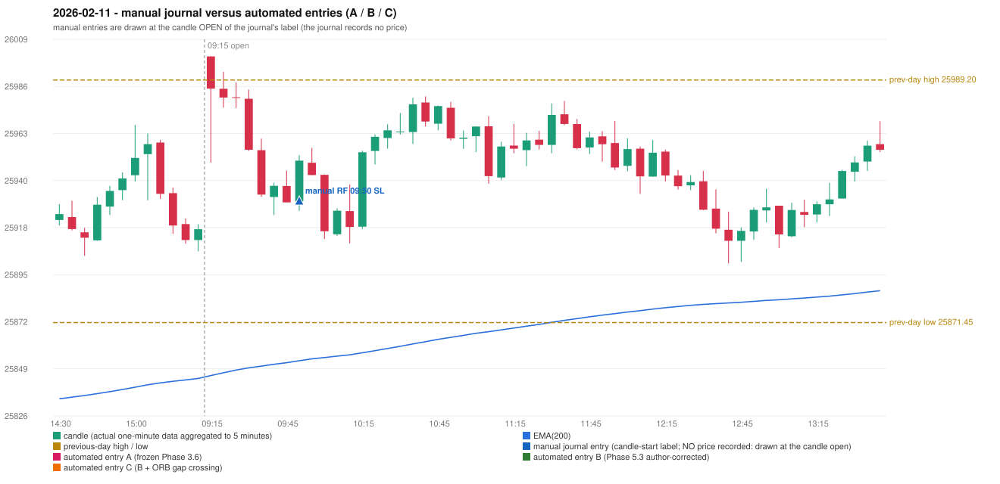

# 2026-02-11 (Wednesday) - manual journal versus the automated configurations

> SYNTHETIC index-point P&L; no real option P&L; costs illustrative (Rs 70 per trade + slippage scenarios). Configurations A / B / C are never combined.

## Session

* Open 26000.65; previous official close 25935.15; gap +65.50; previous-day high / low 25989.2 / 25871.45
* First 5-minute candle (09:15-09:20): O26000.65 H26000.65 L25949.1 C25985.0, RED, body 30.4%; EMA(200) at the first candle 25845.78; previous session's last close 25916.8 vs its EMA 25844.38

## Manual journal

row 80: RF labelled 09:50, outcome SL

## Configuration A

Candidate signals (confirmed): none

Strategies with no confirmed signal: IRF: no setup record (the strategy's trigger event never occurred) | ORB: Method 2 INVALIDATED TRENDLINE_NOT_SUPPORTIVE | PDR: PDR INCOMPLETE_AT_EOD NO_QUALIFYING_CONFIRMATION_BEFORE_SESSION_END | PDS: no setup record (the strategy's trigger event never occurred) | RF: RF INVALIDATED GAP_UP_OUTSIDE_YESTERDAYS_RANGE

No trade: final day state READY_FOR_FIRST_TRADE. No strategy qualified.

* Journal row 80 (RF 09:50): **UNMATCHED_MANUAL**; earliest cause OPENING_GAP_MISMATCH: RF setup rejected by the opening-gap condition (RF-004) (GAP_UP_OUTSIDE_YESTERDAYS_RANGE)

## Configuration B

Candidate signals (confirmed): none

Strategies with no confirmed signal: IRF: no setup record (the strategy's trigger event never occurred) | ORB: Method 2 INVALIDATED TRENDLINE_NOT_SUPPORTIVE | PDR: PDR INCOMPLETE_AT_EOD NO_QUALIFYING_CONFIRMATION_BEFORE_SESSION_END | PDS: no setup record (the strategy's trigger event never occurred) | RF: RF INVALIDATED GAP_UP_OUTSIDE_YESTERDAYS_RANGE

No trade: final day state READY_FOR_FIRST_TRADE. No strategy qualified.

* Journal row 80 (RF 09:50): **UNMATCHED_MANUAL**; earliest cause OPENING_GAP_MISMATCH: RF setup rejected by the opening-gap condition (RF-004) (GAP_UP_OUTSIDE_YESTERDAYS_RANGE)

## Configuration C

Candidate signals (confirmed): none

Strategies with no confirmed signal: IRF: no setup record (the strategy's trigger event never occurred) | ORB: Method 2 INVALIDATED TRENDLINE_NOT_SUPPORTIVE | PDR: PDR INCOMPLETE_AT_EOD NO_QUALIFYING_CONFIRMATION_BEFORE_SESSION_END | PDS: no setup record (the strategy's trigger event never occurred) | RF: RF INVALIDATED GAP_UP_OUTSIDE_YESTERDAYS_RANGE

No trade: final day state READY_FOR_FIRST_TRADE. No strategy qualified.

* Journal row 80 (RF 09:50): **UNMATCHED_MANUAL**; earliest cause OPENING_GAP_MISMATCH: RF setup rejected by the opening-gap condition (RF-004) (GAP_UP_OUTSIDE_YESTERDAYS_RANGE)

## Chart

