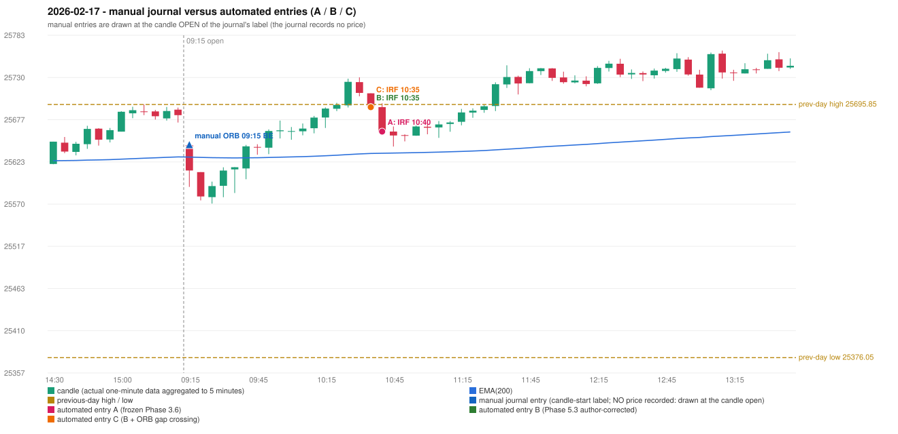

# 2026-02-17 (Tuesday) - manual journal versus the automated configurations

> SYNTHETIC index-point P&L; no real option P&L; costs illustrative (Rs 70 per trade + slippage scenarios). Configurations A / B / C are never combined.

## Session

* Open 25644.5; previous official close 25682.75; gap -38.25; previous-day high / low 25695.85 / 25376.05
* First 5-minute candle (09:15-09:20): O25644.5 H25644.5 L25591.7 C25612.45, RED, body 60.7%; EMA(200) at the first candle 25629.47; previous session's last close 25682.45 vs its EMA 25629.64

## Manual journal

row 83: ORB labelled 09:15, outcome BE

## Configuration A

Candidate signals (confirmed): 10:45 IRF/Method 2B SHORT [EXECUTED: trade 1: INITIAL_FULL_STOP]; 12:15 IRF/Method 2A SHORT [REJECTED: SECOND_TRADE_RESTRICTED_TO_PDR_PDS]; 13:00 IRF/Method 2B SHORT [REJECTED: SECOND_TRADE_RESTRICTED_TO_PDR_PDS]; 13:50 IRF/Method 2A SHORT [REJECTED: SECOND_TRADE_RESTRICTED_TO_PDR_PDS]; 15:05 IRF/Method 2B SHORT [REJECTED: SECOND_TRADE_RESTRICTED_TO_PDR_PDS]

Strategies with no confirmed signal: ORB: no setup record (the strategy's trigger event never occurred) | PDR: no setup record (the strategy's trigger event never occurred) | PDS: Method 1/2/3 INVALIDATED GAP_DOWN_OPEN_NOT_BELOW_ZONE | RF: RF INVALIDATED GAP_NOT_UP(DOWN)

| trade | strategy / method | dir | signal -> fill | entry | stop / T1 / T2 | leg 1 | leg 2 | outcome | gross Rs | net Rs (70, 0) | net Rs (70, 1.0) |
|---|---|---|---|---|---|---|---|---|---|---|---|
| 1 | IRF/Method 2B | SHORT | 10:45 -> 10:45 | 25661.6 | 25696.6 / 25634.6 / 25601.6 | 11:32 @ 25696.6 | 11:32 @ 25696.6 | INITIAL_FULL_STOP | -13,650 | -13,720 | -14,500 |

Selection: This IRF Method 2B signal was the earliest executable signal of the day: 0 confirmed signal(s) earlier, 0 other in the same minute. 4 later confirmed signal(s) (IRF x4) are logged as ignored or rejected. State of the other four engines at that moment: [ORB: no setup record before this time (a base condition was not met, or nothing triggered)] [PDR: no setup record before this time (a base condition was not met, or nothing triggered)] [PDS: Method 1/2/3 invalidated at 09:15: GAP_DOWN_OPEN_NOT_BELOW_ZONE] [RF: RF invalidated at 09:25: GAP_NOT_UP(DOWN)]

* Journal row 83 (ORB 09:15): **UNMATCHED_MANUAL**; earliest cause OPENING_GAP_MISMATCH: first candle RED O25644.5 H25644.5 L25591.7 C25612.45 (body 60.7%); direction ASSUMED from the colour (the journal has no direction); closest method Gap/200DMA (2 failing predicate(s)): first failing 'gap_crosses_200_average' - previous close 25682.75 vs previous EMA 25629.64; open 25644.5 vs EMA 25629.47; all methods: Method 1: 3 fail (level_broken); Method 2: 4 fail (inner_level_broken); Gap/200DMA: 2 fail (gap_crosses_200_average)
* Automated IRF 10:40 has no strict / time-tolerant journal counterpart: DIFFERENT_STRATEGY_SELECTED - the journal traded ORB 09:15; the automated controller took IRF Method 2B (candle 10:40) as the first valid signal

## Configuration B

Candidate signals (confirmed): 10:40 IRF/Method 2A SHORT [EXECUTED: trade 1: T1_THEN_BUFFER_STOP]; 14:00 IRF/Method 2A SHORT [IGNORED: DAY_FINISHED]; 14:25 IRF/Method 2A SHORT [IGNORED: DAY_FINISHED]; 14:50 IRF/Method 2A SHORT [IGNORED: DAY_FINISHED]

Strategies with no confirmed signal: ORB: no setup record (the strategy's trigger event never occurred) | PDR: no setup record (the strategy's trigger event never occurred) | PDS: Method 1/2/3 INVALIDATED GAP_DOWN_OPEN_NOT_BELOW_ZONE | RF: RF INVALIDATED GAP_NOT_UP(DOWN)

| trade | strategy / method | dir | signal -> fill | entry | stop / T1 / T2 | leg 1 | leg 2 | outcome | gross Rs | net Rs (70, 0) | net Rs (70, 1.0) |
|---|---|---|---|---|---|---|---|---|---|---|---|
| 1 | IRF/Method 2A | SHORT | 10:40 -> 10:40 | 25692.45 | 25727.45 / 25665.45 / 25632.45 | 10:44 @ 25665.45 | 11:32 @ 25698.45 | T1_THEN_BUFFER_STOP | 4,095 | 4,025 | 3,245 |

Selection: This IRF Method 2A signal was the earliest executable signal of the day: 0 confirmed signal(s) earlier, 0 other in the same minute. 3 later confirmed signal(s) (IRF x3) are logged as ignored or rejected. State of the other four engines at that moment: [ORB: no setup record before this time (a base condition was not met, or nothing triggered)] [PDR: no setup record before this time (a base condition was not met, or nothing triggered)] [PDS: Method 1/2/3 invalidated at 09:15: GAP_DOWN_OPEN_NOT_BELOW_ZONE] [RF: RF invalidated at 09:25: GAP_NOT_UP(DOWN)]

* Journal row 83 (ORB 09:15): **UNMATCHED_MANUAL**; earliest cause OPENING_GAP_MISMATCH: first candle RED O25644.5 H25644.5 L25591.7 C25612.45 (body 60.7%); direction ASSUMED from the colour (the journal has no direction); closest method Gap/200DMA (2 failing predicate(s)): first failing 'gap_crosses_200_average' - previous close 25682.75 vs previous EMA 25629.64; open 25644.5 vs EMA 25629.47; all methods: Method 1: 3 fail (level_broken); Method 2: 4 fail (inner_level_broken); Gap/200DMA: 2 fail (gap_crosses_200_average)
* Automated IRF 10:35 has no strict / time-tolerant journal counterpart: DIFFERENT_STRATEGY_SELECTED - the journal traded ORB 09:15; the automated controller took IRF Method 2A (candle 10:35) as the first valid signal

## Configuration C

Candidate signals (confirmed): 10:40 IRF/Method 2A SHORT [EXECUTED: trade 1: T1_THEN_BUFFER_STOP]; 14:00 IRF/Method 2A SHORT [IGNORED: DAY_FINISHED]; 14:25 IRF/Method 2A SHORT [IGNORED: DAY_FINISHED]; 14:50 IRF/Method 2A SHORT [IGNORED: DAY_FINISHED]

Strategies with no confirmed signal: ORB: Gap/200DMA INVALIDATED CANDLE_QUALITY_OR_REJECTION_WICK | PDR: no setup record (the strategy's trigger event never occurred) | PDS: Method 1/2/3 INVALIDATED GAP_DOWN_OPEN_NOT_BELOW_ZONE | RF: RF INVALIDATED GAP_NOT_UP(DOWN)

| trade | strategy / method | dir | signal -> fill | entry | stop / T1 / T2 | leg 1 | leg 2 | outcome | gross Rs | net Rs (70, 0) | net Rs (70, 1.0) |
|---|---|---|---|---|---|---|---|---|---|---|---|
| 1 | IRF/Method 2A | SHORT | 10:40 -> 10:40 | 25692.45 | 25727.45 / 25665.45 / 25632.45 | 10:44 @ 25665.45 | 11:32 @ 25698.45 | T1_THEN_BUFFER_STOP | 4,095 | 4,025 | 3,245 |

Selection: This IRF Method 2A signal was the earliest executable signal of the day: 0 confirmed signal(s) earlier, 0 other in the same minute. 3 later confirmed signal(s) (IRF x3) are logged as ignored or rejected. State of the other four engines at that moment: [ORB: Gap/200DMA invalidated at 09:15: CANDLE_QUALITY_OR_REJECTION_WICK] [PDR: no setup record before this time (a base condition was not met, or nothing triggered)] [PDS: Method 1/2/3 invalidated at 09:15: GAP_DOWN_OPEN_NOT_BELOW_ZONE] [RF: RF invalidated at 09:25: GAP_NOT_UP(DOWN)]

* Journal row 83 (ORB 09:15): **UNMATCHED_MANUAL**; earliest cause CANDLE_STRENGTH_MISMATCH: first candle RED O25644.5 H25644.5 L25591.7 C25612.45 (body 60.7%); direction ASSUMED from the colour (the journal has no direction); closest method Gap/200DMA (1 failing predicate(s)): first failing 'candle_shape' - body 60.7% opposite wick 39.3% close location 39.3%; rejection wick flag True; all methods: Method 1: 3 fail (level_broken); Method 2: 4 fail (inner_level_broken); Gap/200DMA: 1 fail (candle_shape)
* Automated IRF 10:35 has no strict / time-tolerant journal counterpart: DIFFERENT_STRATEGY_SELECTED - the journal traded ORB 09:15; the automated controller took IRF Method 2A (candle 10:35) as the first valid signal

## Chart

