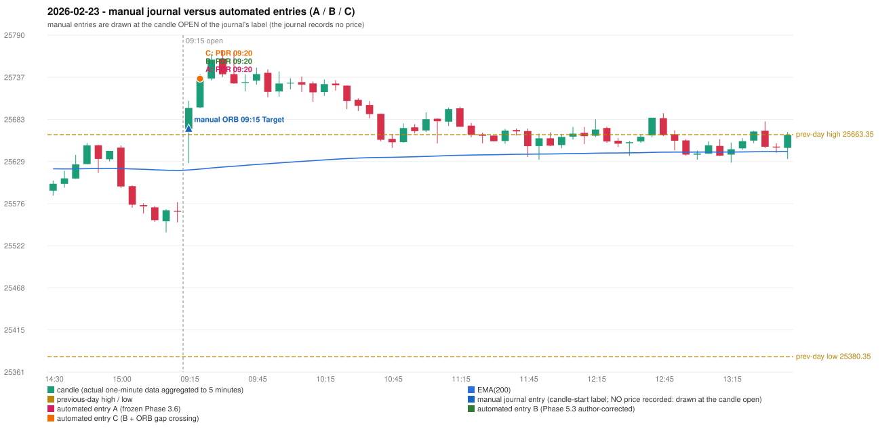

# 2026-02-23 (Monday) - manual journal versus the automated configurations

> SYNTHETIC index-point P&L; no real option P&L; costs illustrative (Rs 70 per trade + slippage scenarios). Configurations A / B / C are never combined.

## Session

* Open 25670.85; previous official close 25571.25; gap +99.60; previous-day high / low 25663.35 / 25380.35
* First 5-minute candle (09:15-09:20): O25670.85 H25706.65 L25627.15 C25697.4, GREEN, body 33.4%; EMA(200) at the first candle 25618.43; previous session's last close 25565.9 vs its EMA 25617.64

## Manual journal

row 86: ORB labelled 09:15, outcome Target

## Configuration A

Candidate signals (confirmed): 09:25 PDR/PDR LONG [EXECUTED: trade 1: T1_THEN_BUFFER_STOP]; 09:55 IRF/Method 2A SHORT [IGNORED: DAY_FINISHED]; 10:30 IRF/Method 1 SHORT [IGNORED: DAY_FINISHED]; 11:10 PDR/PDR LONG [IGNORED: DAY_FINISHED]; 11:40 PDR/PDR LONG [IGNORED: DAY_FINISHED]; 12:35 PDR/PDR LONG [IGNORED: DAY_FINISHED]; 12:45 PDR/PDR LONG [IGNORED: DAY_FINISHED]; 13:30 PDR/PDR LONG [IGNORED: DAY_FINISHED]; 14:30 PDR/PDR LONG [IGNORED: DAY_FINISHED]; 15:30 IRF/Method 1 SHORT [IGNORED: DAY_FINISHED]

Strategies with no confirmed signal: ORB: Gap/200DMA INVALIDATED CANDLE_QUALITY_OR_REJECTION_WICK; Method 1 INVALIDATED TREND:EMA_PREV_SESSION_CLOSE wrong side; Method 2 INVALIDATED TREND:EMA_PREV_SESSI | PDS: no setup record (the strategy's trigger event never occurred) | RF: RF INVALIDATED TREND:EMA_PREV_SESSION_CLOSE wrong side

| trade | strategy / method | dir | signal -> fill | entry | stop / T1 / T2 | leg 1 | leg 2 | outcome | gross Rs | net Rs (70, 0) | net Rs (70, 1.0) |
|---|---|---|---|---|---|---|---|---|---|---|---|
| 1 | PDR/PDR | LONG | 09:25 -> 09:25 | 25734.8 | 25699.8 / 25761.8 / 25804.8 | 09:28 @ 25761.8 | 09:39 @ 25728.8 | T1_THEN_BUFFER_STOP | 4,095 | 4,025 | 3,245 |

Selection: This PDR signal was the earliest executable signal of the day: 0 confirmed signal(s) earlier, 0 other in the same minute. 9 later confirmed signal(s) (IRF x3, PDR x6) are logged as ignored or rejected. State of the other four engines at that moment: [IRF: no setup record before this time (a base condition was not met, or nothing triggered)] [ORB: Method 1 invalidated at 09:15: TREND:EMA_PREV_SESSION_CLOSE wrong side; Method 2 invalidated at 09:15: TREND:EMA_PREV_SESSION_CLOSE wrong side] [PDS: no setup record before this time (a base condition was not met, or nothing triggered)] [RF: no setup record before this time (a base condition was not met, or nothing triggered)]

* Journal row 86 (ORB 09:15): **UNMATCHED_MANUAL**; earliest cause CANDLE_STRENGTH_MISMATCH: first candle GREEN O25670.85 H25706.65 L25627.15 C25697.4 (body 33.4%); direction ASSUMED from the colour (the journal has no direction); closest method Gap/200DMA (1 failing predicate(s)): first failing 'candle_shape' - body 33.4% opposite wick 11.6% close location 88.4%; rejection wick flag False; all methods: Method 1: 2 fail (trend); Method 2: 2 fail (trend); Gap/200DMA: 1 fail (candle_shape)
* Automated PDR 09:20 has no strict / time-tolerant journal counterpart: DIFFERENT_STRATEGY_SELECTED - the journal traded ORB 09:15; the automated controller took PDR PDR (candle 09:20) as the first valid signal

## Configuration B

Candidate signals (confirmed): 09:25 PDR/PDR LONG [EXECUTED: trade 1: T1_THEN_BUFFER_STOP]; 09:40 IRF/Method 2A SHORT [IGNORED: DAY_FINISHED]; 10:30 IRF/Method 1 SHORT [IGNORED: DAY_FINISHED]; 10:55 PDR/PDR LONG [IGNORED: DAY_FINISHED]; 11:15 PDR/PDR LONG [IGNORED: DAY_FINISHED]; 11:40 PDR/PDR LONG [IGNORED: DAY_FINISHED]; 11:55 PDR/PDR LONG [IGNORED: DAY_FINISHED]; 12:05 PDR/PDR LONG [IGNORED: DAY_FINISHED]; 12:20 PDR/PDR LONG [IGNORED: DAY_FINISHED]; 12:35 PDR/PDR LONG [IGNORED: DAY_FINISHED]; 12:45 PDR/PDR LONG [IGNORED: DAY_FINISHED]; 13:25 PDR/PDR LONG [IGNORED: DAY_FINISHED]; 13:45 PDR/PDR LONG [IGNORED: DAY_FINISHED]; 14:30 PDR/PDR LONG [IGNORED: DAY_FINISHED]; 15:30 IRF/Method 1 SHORT [IGNORED: DAY_FINISHED]

Strategies with no confirmed signal: ORB: Gap/200DMA INVALIDATED CANDLE_QUALITY_OR_REJECTION_WICK; Method 1 INVALIDATED TREND:EMA_PREV_SESSION_CLOSE wrong side; Method 2 INVALIDATED TREND:EMA_PREV_SESSI | PDS: no setup record (the strategy's trigger event never occurred) | RF: RF INVALIDATED TREND:EMA_PREV_SESSION_CLOSE wrong side

| trade | strategy / method | dir | signal -> fill | entry | stop / T1 / T2 | leg 1 | leg 2 | outcome | gross Rs | net Rs (70, 0) | net Rs (70, 1.0) |
|---|---|---|---|---|---|---|---|---|---|---|---|
| 1 | PDR/PDR | LONG | 09:25 -> 09:25 | 25734.8 | 25699.8 / 25761.8 / 25804.8 | 09:28 @ 25761.8 | 09:39 @ 25728.8 | T1_THEN_BUFFER_STOP | 4,095 | 4,025 | 3,245 |

Selection: This PDR signal was the earliest executable signal of the day: 0 confirmed signal(s) earlier, 0 other in the same minute. 14 later confirmed signal(s) (IRF x3, PDR x11) are logged as ignored or rejected. State of the other four engines at that moment: [IRF: no setup record before this time (a base condition was not met, or nothing triggered)] [ORB: Method 1 invalidated at 09:15: TREND:EMA_PREV_SESSION_CLOSE wrong side; Method 2 invalidated at 09:15: TREND:EMA_PREV_SESSION_CLOSE wrong side] [PDS: no setup record before this time (a base condition was not met, or nothing triggered)] [RF: no setup record before this time (a base condition was not met, or nothing triggered)]

* Journal row 86 (ORB 09:15): **UNMATCHED_MANUAL**; earliest cause CANDLE_STRENGTH_MISMATCH: first candle GREEN O25670.85 H25706.65 L25627.15 C25697.4 (body 33.4%); direction ASSUMED from the colour (the journal has no direction); closest method Gap/200DMA (1 failing predicate(s)): first failing 'candle_shape' - body 33.4% opposite wick 11.6% close location 88.4%; rejection wick flag False; all methods: Method 1: 2 fail (trend); Method 2: 2 fail (trend); Gap/200DMA: 1 fail (candle_shape)
* Automated PDR 09:20 has no strict / time-tolerant journal counterpart: DIFFERENT_STRATEGY_SELECTED - the journal traded ORB 09:15; the automated controller took PDR PDR (candle 09:20) as the first valid signal

## Configuration C

Candidate signals (confirmed): 09:25 PDR/PDR LONG [EXECUTED: trade 1: T1_THEN_BUFFER_STOP]; 09:40 IRF/Method 2A SHORT [IGNORED: DAY_FINISHED]; 10:30 IRF/Method 1 SHORT [IGNORED: DAY_FINISHED]; 10:55 PDR/PDR LONG [IGNORED: DAY_FINISHED]; 11:15 PDR/PDR LONG [IGNORED: DAY_FINISHED]; 11:40 PDR/PDR LONG [IGNORED: DAY_FINISHED]; 11:55 PDR/PDR LONG [IGNORED: DAY_FINISHED]; 12:05 PDR/PDR LONG [IGNORED: DAY_FINISHED]; 12:20 PDR/PDR LONG [IGNORED: DAY_FINISHED]; 12:35 PDR/PDR LONG [IGNORED: DAY_FINISHED]; 12:45 PDR/PDR LONG [IGNORED: DAY_FINISHED]; 13:25 PDR/PDR LONG [IGNORED: DAY_FINISHED]; 13:45 PDR/PDR LONG [IGNORED: DAY_FINISHED]; 14:30 PDR/PDR LONG [IGNORED: DAY_FINISHED]; 15:30 IRF/Method 1 SHORT [IGNORED: DAY_FINISHED]

Strategies with no confirmed signal: ORB: Gap/200DMA INVALIDATED CANDLE_QUALITY_OR_REJECTION_WICK; Method 1 INVALIDATED TREND:EMA_PREV_SESSION_CLOSE wrong side; Method 2 INVALIDATED TREND:EMA_PREV_SESSI | PDS: no setup record (the strategy's trigger event never occurred) | RF: RF INVALIDATED TREND:EMA_PREV_SESSION_CLOSE wrong side

| trade | strategy / method | dir | signal -> fill | entry | stop / T1 / T2 | leg 1 | leg 2 | outcome | gross Rs | net Rs (70, 0) | net Rs (70, 1.0) |
|---|---|---|---|---|---|---|---|---|---|---|---|
| 1 | PDR/PDR | LONG | 09:25 -> 09:25 | 25734.8 | 25699.8 / 25761.8 / 25804.8 | 09:28 @ 25761.8 | 09:39 @ 25728.8 | T1_THEN_BUFFER_STOP | 4,095 | 4,025 | 3,245 |

Selection: This PDR signal was the earliest executable signal of the day: 0 confirmed signal(s) earlier, 0 other in the same minute. 14 later confirmed signal(s) (IRF x3, PDR x11) are logged as ignored or rejected. State of the other four engines at that moment: [IRF: no setup record before this time (a base condition was not met, or nothing triggered)] [ORB: Method 1 invalidated at 09:15: TREND:EMA_PREV_SESSION_CLOSE wrong side; Method 2 invalidated at 09:15: TREND:EMA_PREV_SESSION_CLOSE wrong side] [PDS: no setup record before this time (a base condition was not met, or nothing triggered)] [RF: no setup record before this time (a base condition was not met, or nothing triggered)]

* Journal row 86 (ORB 09:15): **UNMATCHED_MANUAL**; earliest cause CANDLE_STRENGTH_MISMATCH: first candle GREEN O25670.85 H25706.65 L25627.15 C25697.4 (body 33.4%); direction ASSUMED from the colour (the journal has no direction); closest method Gap/200DMA (1 failing predicate(s)): first failing 'candle_shape' - body 33.4% opposite wick 11.6% close location 88.4%; rejection wick flag False; all methods: Method 1: 2 fail (trend); Method 2: 2 fail (trend); Gap/200DMA: 1 fail (candle_shape)
* Automated PDR 09:20 has no strict / time-tolerant journal counterpart: DIFFERENT_STRATEGY_SELECTED - the journal traded ORB 09:15; the automated controller took PDR PDR (candle 09:20) as the first valid signal

## Chart

