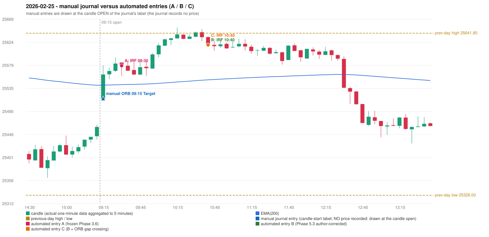

# 2026-02-25 (Wednesday) - manual journal versus the automated configurations

> SYNTHETIC index-point P&L; no real option P&L; costs illustrative (Rs 70 per trade + slippage scenarios). Configurations A / B / C are never combined.

## Session

* Open 25515.05; previous official close 25424.65; gap +90.40; previous-day high / low 25641.8 / 25328.0
* First 5-minute candle (09:15-09:20): O25515.05 H25579.85 L25512.9 C25561.8, GREEN, body 69.8%; EMA(200) at the first candle 25541.20; previous session's last close 25460.25 vs its EMA 25540.99

## Manual journal

row 88: ORB labelled 09:15, outcome Target

## Configuration A

Candidate signals (confirmed): 09:35 IRF/Method 1 SHORT [EXECUTED: trade 1: INITIAL_FULL_STOP]; 10:45 IRF/Method 2A SHORT [REJECTED: SECOND_TRADE_RESTRICTED_TO_PDR_PDS]; 11:15 IRF/Method 2B SHORT [REJECTED: SECOND_TRADE_RESTRICTED_TO_PDR_PDS]; 11:55 IRF/Method 2B SHORT [REJECTED: SECOND_TRADE_RESTRICTED_TO_PDR_PDS]; 12:35 IRF/Method 1 SHORT [REJECTED: SECOND_TRADE_RESTRICTED_TO_PDR_PDS]

Strategies with no confirmed signal: ORB: Method 2 INVALIDATED TREND:EMA_PREV_SESSION_CLOSE wrong side | PDR: PDR INVALIDATED OPEN_NOT_STRICTLY_ABOVE_ZONE | PDS: no setup record (the strategy's trigger event never occurred) | RF: RF INCOMPLETE_AT_EOD NO_RETURN_INSIDE_BEFORE_SESSION_END

| trade | strategy / method | dir | signal -> fill | entry | stop / T1 / T2 | leg 1 | leg 2 | outcome | gross Rs | net Rs (70, 0) | net Rs (70, 1.0) |
|---|---|---|---|---|---|---|---|---|---|---|---|
| 1 | IRF/Method 1 | SHORT | 09:35 -> 09:35 | 25578.8 | 25613.8 / 25551.8 / 25518.8 | 10:03 @ 25613.8 | 10:03 @ 25613.8 | INITIAL_FULL_STOP | -13,650 | -13,720 | -14,500 |

Selection: This IRF Method 1 signal was the earliest executable signal of the day: 0 confirmed signal(s) earlier, 0 other in the same minute. 4 later confirmed signal(s) (IRF x4) are logged as ignored or rejected. State of the other four engines at that moment: [ORB: Method 2 invalidated at 09:15: TREND:EMA_PREV_SESSION_CLOSE wrong side] [PDR: PDR invalidated at 09:15: OPEN_NOT_STRICTLY_ABOVE_ZONE] [PDS: no setup record before this time (a base condition was not met, or nothing triggered)] [RF: no setup record before this time (a base condition was not met, or nothing triggered)]

* Journal row 88 (ORB 09:15): **UNMATCHED_MANUAL**; earliest cause EMA_FILTER_MISMATCH (+ OPENING_GAP_MISMATCH): first candle GREEN O25515.05 H25579.85 L25512.9 C25561.8 (body 69.8%); direction ASSUMED from the colour (the journal has no direction); TIE-BROKEN BY METHOD ORDER: 2 methods tie at 2 failing predicate(s) (Method 2: trend; Gap/200DMA: gap_crosses_200_average) - the evidence does not single out one cause, the secondary cause is the other tied one; closest method Method 2 (2 failing predicate(s)): first failing 'trend' - EMA_PREV_SESSION_CLOSE wrong side; all methods: Method 1: 3 fail (level_broken); Method 2: 2 fail (trend); Gap/200DMA: 2 fail (gap_crosses_200_average)
* Automated IRF 09:30 has no strict / time-tolerant journal counterpart: DIFFERENT_STRATEGY_SELECTED - the journal traded ORB 09:15; the automated controller took IRF Method 1 (candle 09:30) as the first valid signal

## Configuration B

Candidate signals (confirmed): 10:45 IRF/Method 2A SHORT [EXECUTED: trade 1: TARGET]; 11:15 IRF/Method 2B SHORT [IGNORED: POSITION_ACTIVE (signal kept for diagnostics only; never reused)]; 11:55 IRF/Method 2B SHORT [IGNORED: POSITION_ACTIVE (signal kept for diagnostics only; never reused)]

Strategies with no confirmed signal: ORB: Method 2 INVALIDATED TREND:EMA_PREV_SESSION_CLOSE wrong side | PDR: PDR INVALIDATED OPEN_NOT_STRICTLY_ABOVE_ZONE | PDS: no setup record (the strategy's trigger event never occurred) | RF: RF INCOMPLETE_AT_EOD NO_RETURN_INSIDE_BEFORE_SESSION_END

| trade | strategy / method | dir | signal -> fill | entry | stop / T1 / T2 | leg 1 | leg 2 | outcome | gross Rs | net Rs (70, 0) | net Rs (70, 1.0) |
|---|---|---|---|---|---|---|---|---|---|---|---|
| 1 | IRF/Method 2A | SHORT | 10:45 -> 10:45 | 25619.05 | 25654.05 / 25592.05 / 25559.05 | 11:40 @ 25592.05 | 12:33 @ 25559.05 | TARGET | 16,965 | 16,895 | 16,115 |

Selection: This IRF Method 2A signal was the earliest executable signal of the day: 0 confirmed signal(s) earlier, 0 other in the same minute. 2 later confirmed signal(s) (IRF x2) are logged as ignored or rejected. State of the other four engines at that moment: [ORB: Method 2 invalidated at 09:15: TREND:EMA_PREV_SESSION_CLOSE wrong side] [PDR: PDR invalidated at 09:15: OPEN_NOT_STRICTLY_ABOVE_ZONE] [PDS: no setup record before this time (a base condition was not met, or nothing triggered)] [RF: no setup record before this time (a base condition was not met, or nothing triggered)]

* Journal row 88 (ORB 09:15): **UNMATCHED_MANUAL**; earliest cause EMA_FILTER_MISMATCH (+ OPENING_GAP_MISMATCH): first candle GREEN O25515.05 H25579.85 L25512.9 C25561.8 (body 69.8%); direction ASSUMED from the colour (the journal has no direction); TIE-BROKEN BY METHOD ORDER: 2 methods tie at 2 failing predicate(s) (Method 2: trend; Gap/200DMA: gap_crosses_200_average) - the evidence does not single out one cause, the secondary cause is the other tied one; closest method Method 2 (2 failing predicate(s)): first failing 'trend' - EMA_PREV_SESSION_CLOSE wrong side; all methods: Method 1: 3 fail (level_broken); Method 2: 2 fail (trend); Gap/200DMA: 2 fail (gap_crosses_200_average)
* Automated IRF 10:40 has no strict / time-tolerant journal counterpart: DIFFERENT_STRATEGY_SELECTED - the journal traded ORB 09:15; the automated controller took IRF Method 2A (candle 10:40) as the first valid signal

## Configuration C

Candidate signals (confirmed): 10:45 IRF/Method 2A SHORT [EXECUTED: trade 1: TARGET]; 11:15 IRF/Method 2B SHORT [IGNORED: POSITION_ACTIVE (signal kept for diagnostics only; never reused)]; 11:55 IRF/Method 2B SHORT [IGNORED: POSITION_ACTIVE (signal kept for diagnostics only; never reused)]

Strategies with no confirmed signal: ORB: Gap/200DMA INVALIDATED CANDLE_QUALITY_OR_REJECTION_WICK; Method 2 INVALIDATED TREND:EMA_PREV_SESSION_CLOSE wrong side | PDR: PDR INVALIDATED OPEN_NOT_STRICTLY_ABOVE_ZONE | PDS: no setup record (the strategy's trigger event never occurred) | RF: RF INCOMPLETE_AT_EOD NO_RETURN_INSIDE_BEFORE_SESSION_END

| trade | strategy / method | dir | signal -> fill | entry | stop / T1 / T2 | leg 1 | leg 2 | outcome | gross Rs | net Rs (70, 0) | net Rs (70, 1.0) |
|---|---|---|---|---|---|---|---|---|---|---|---|
| 1 | IRF/Method 2A | SHORT | 10:45 -> 10:45 | 25619.05 | 25654.05 / 25592.05 / 25559.05 | 11:40 @ 25592.05 | 12:33 @ 25559.05 | TARGET | 16,965 | 16,895 | 16,115 |

Selection: This IRF Method 2A signal was the earliest executable signal of the day: 0 confirmed signal(s) earlier, 0 other in the same minute. 2 later confirmed signal(s) (IRF x2) are logged as ignored or rejected. State of the other four engines at that moment: [ORB: Method 2 invalidated at 09:15: TREND:EMA_PREV_SESSION_CLOSE wrong side; Gap/200DMA invalidated at 09:15: CANDLE_QUALITY_OR_REJECTION_WICK] [PDR: PDR invalidated at 09:15: OPEN_NOT_STRICTLY_ABOVE_ZONE] [PDS: no setup record before this time (a base condition was not met, or nothing triggered)] [RF: no setup record before this time (a base condition was not met, or nothing triggered)]

* Journal row 88 (ORB 09:15): **UNMATCHED_MANUAL**; earliest cause CANDLE_STRENGTH_MISMATCH: first candle GREEN O25515.05 H25579.85 L25512.9 C25561.8 (body 69.8%); direction ASSUMED from the colour (the journal has no direction); closest method Gap/200DMA (1 failing predicate(s)): first failing 'candle_shape' - body 69.8% opposite wick 27.0% close location 73.0%; rejection wick flag False; all methods: Method 1: 3 fail (level_broken); Method 2: 2 fail (trend); Gap/200DMA: 1 fail (candle_shape)
* Automated IRF 10:40 has no strict / time-tolerant journal counterpart: DIFFERENT_STRATEGY_SELECTED - the journal traded ORB 09:15; the automated controller took IRF Method 2A (candle 10:40) as the first valid signal

## Chart

