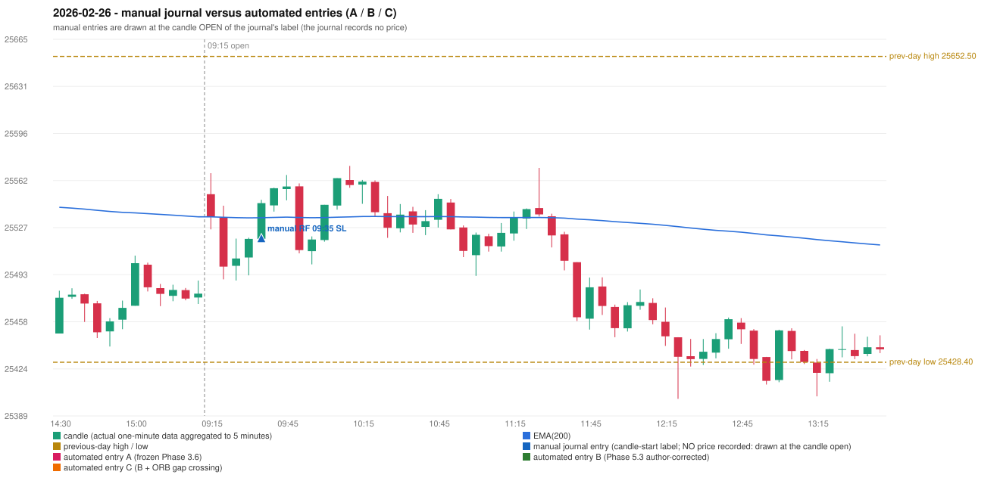

# 2026-02-26 (Thursday) - manual journal versus the automated configurations

> SYNTHETIC index-point P&L; no real option P&L; costs illustrative (Rs 70 per trade + slippage scenarios). Configurations A / B / C are never combined.

## Session

* Open 25551.55; previous official close 25482.5; gap +69.05; previous-day high / low 25652.5 / 25428.4
* First 5-minute candle (09:15-09:20): O25551.55 H25566.95 L25525.8 C25535.1, RED, body 40.0%; EMA(200) at the first candle 25535.00; previous session's last close 25478.65 vs its EMA 25535.00

## Manual journal

row 89: RF labelled 09:35, outcome SL

## Configuration A

Candidate signals (confirmed): none

Strategies with no confirmed signal: IRF: no setup record (the strategy's trigger event never occurred) | ORB: Gap/200DMA INVALIDATED CANDLE_QUALITY_OR_REJECTION_WICK; Method 2 INVALIDATED TREND:EMA_PREV_SESSION_CLOSE wrong side | PDR: PDR INVALIDATED OPEN_NOT_STRICTLY_ABOVE_ZONE | PDS: no setup record (the strategy's trigger event never occurred) | RF: RF INVALIDATED TREND:EMA_PREV_SESSION_CLOSE wrong side

No trade: final day state READY_FOR_FIRST_TRADE. No strategy qualified.

* Journal row 89 (RF 09:35): **UNMATCHED_MANUAL**; earliest cause EMA_FILTER_MISMATCH: RF setup rejected by the trend / EMA condition (TREND:EMA_PREV_SESSION_CLOSE wrong side)

## Configuration B

Candidate signals (confirmed): none

Strategies with no confirmed signal: IRF: no setup record (the strategy's trigger event never occurred) | ORB: Gap/200DMA INVALIDATED CANDLE_QUALITY_OR_REJECTION_WICK; Method 2 INVALIDATED TREND:EMA_PREV_SESSION_CLOSE wrong side | PDR: PDR INVALIDATED OPEN_NOT_STRICTLY_ABOVE_ZONE | PDS: no setup record (the strategy's trigger event never occurred) | RF: RF INVALIDATED TREND:EMA_PREV_SESSION_CLOSE wrong side

No trade: final day state READY_FOR_FIRST_TRADE. No strategy qualified.

* Journal row 89 (RF 09:35): **UNMATCHED_MANUAL**; earliest cause EMA_FILTER_MISMATCH: RF setup rejected by the trend / EMA condition (TREND:EMA_PREV_SESSION_CLOSE wrong side)

## Configuration C

Candidate signals (confirmed): none

Strategies with no confirmed signal: IRF: no setup record (the strategy's trigger event never occurred) | ORB: Gap/200DMA INVALIDATED CANDLE_QUALITY_OR_REJECTION_WICK; Method 2 INVALIDATED TREND:EMA_PREV_SESSION_CLOSE wrong side | PDR: PDR INVALIDATED OPEN_NOT_STRICTLY_ABOVE_ZONE | PDS: no setup record (the strategy's trigger event never occurred) | RF: RF INVALIDATED TREND:EMA_PREV_SESSION_CLOSE wrong side

No trade: final day state READY_FOR_FIRST_TRADE. No strategy qualified.

* Journal row 89 (RF 09:35): **UNMATCHED_MANUAL**; earliest cause EMA_FILTER_MISMATCH: RF setup rejected by the trend / EMA condition (TREND:EMA_PREV_SESSION_CLOSE wrong side)

## Chart

