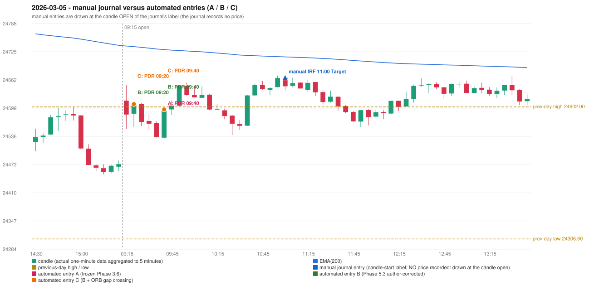

# 2026-03-05 (Thursday) - manual journal versus the automated configurations

> SYNTHETIC index-point P&L; no real option P&L; costs illustrative (Rs 70 per trade + slippage scenarios). Configurations A / B / C are never combined.

## Session

* Open 24615.9; previous official close 24480.5; gap +135.40; previous-day high / low 24602.0 / 24306.6
* First 5-minute candle (09:15-09:20): O24615.9 H24651.6 L24552.25 C24584.85, RED, body 31.3%; EMA(200) at the first candle 24738.20; previous session's last close 24473.95 vs its EMA 24739.75

## Manual journal

row 92: IRF labelled 11:00, outcome Target

## Configuration A

Candidate signals (confirmed): 09:45 PDR/PDR LONG [EXECUTED: trade 1: T1_THEN_BUFFER_STOP]; 09:55 PDR/PDR LONG [IGNORED: POSITION_ACTIVE (signal kept for diagnostics only; never reused)]; 10:40 PDR/PDR LONG [IGNORED: DAY_FINISHED]; 11:05 IRF/Method 1 SHORT [IGNORED: DAY_FINISHED]; 11:15 IRF/Method 1 SHORT [IGNORED: DAY_FINISHED]; 11:25 IRF/Method 1 SHORT [IGNORED: DAY_FINISHED]; 11:55 PDR/PDR LONG [IGNORED: DAY_FINISHED]; 12:15 PDR/PDR LONG [IGNORED: DAY_FINISHED]; 12:45 IRF/Method 1 SHORT [IGNORED: DAY_FINISHED]; 13:05 IRF/Method 1 SHORT [IGNORED: DAY_FINISHED]; 13:20 IRF/Method 2A SHORT [IGNORED: DAY_FINISHED]; 14:25 PDR/PDR LONG [IGNORED: DAY_FINISHED]; 14:40 PDR/PDR LONG [IGNORED: DAY_FINISHED]

Strategies with no confirmed signal: ORB: Method 2 INVALIDATED TREND:EMA_PREV_SESSION_CLOSE wrong side | PDS: no setup record (the strategy's trigger event never occurred) | RF: RF INVALIDATED TREND:EMA_PREV_SESSION_CLOSE wrong side

| trade | strategy / method | dir | signal -> fill | entry | stop / T1 / T2 | leg 1 | leg 2 | outcome | gross Rs | net Rs (70, 0) | net Rs (70, 1.0) |
|---|---|---|---|---|---|---|---|---|---|---|---|
| 1 | PDR/PDR | LONG | 09:45 -> 09:45 | 24596.3 | 24561.3 / 24623.3 / 24666.3 | 09:51 @ 24623.3 | 10:20 @ 24590.3 | T1_THEN_BUFFER_STOP | 4,095 | 4,025 | 3,245 |

Selection: This PDR signal was the earliest executable signal of the day: 0 confirmed signal(s) earlier, 0 other in the same minute. 12 later confirmed signal(s) (IRF x6, PDR x6) are logged as ignored or rejected. State of the other four engines at that moment: [IRF: no setup record before this time (a base condition was not met, or nothing triggered)] [ORB: Method 2 invalidated at 09:15: TREND:EMA_PREV_SESSION_CLOSE wrong side] [PDS: no setup record before this time (a base condition was not met, or nothing triggered)] [RF: RF invalidated at 09:40: TREND:EMA_PREV_SESSION_CLOSE wrong side]

* Journal row 92 (IRF 11:00): **UNMATCHED_MANUAL**; earliest cause DIFFERENT_STRATEGY_SELECTED (+ PORTFOLIO_CONTROLLER_CONSTRAINT): the controller took PDR PDR (signal 09:45) first; the IRF signal at 11:05 was IGNORED: DAY_FINISHED
* Automated PDR 09:40 has no strict / time-tolerant journal counterpart: DIFFERENT_STRATEGY_SELECTED - the journal traded IRF 11:00; the automated controller took PDR PDR (candle 09:40) as the first valid signal

## Configuration B

Candidate signals (confirmed): 09:25 PDR/PDR LONG [EXECUTED: trade 1: INITIAL_FULL_STOP]; 09:45 PDR/PDR LONG [EXECUTED: trade 2: T1_THEN_BUFFER_STOP]; 09:55 PDR/PDR LONG [IGNORED: POSITION_ACTIVE (signal kept for diagnostics only; never reused)]; 10:40 PDR/PDR LONG [IGNORED: DAY_FINISHED]; 11:05 IRF/Method 1 SHORT [IGNORED: DAY_FINISHED]; 11:15 IRF/Method 1 SHORT [IGNORED: DAY_FINISHED]; 11:25 IRF/Method 1 SHORT [IGNORED: DAY_FINISHED]; 11:55 PDR/PDR LONG [IGNORED: DAY_FINISHED]; 12:05 PDR/PDR LONG [IGNORED: DAY_FINISHED]; 12:15 PDR/PDR LONG [IGNORED: DAY_FINISHED]; 12:45 IRF/Method 1 SHORT [IGNORED: DAY_FINISHED]; 13:05 IRF/Method 1 SHORT [IGNORED: DAY_FINISHED]; 13:20 IRF/Method 2A SHORT [IGNORED: DAY_FINISHED]; 14:25 PDR/PDR LONG [IGNORED: DAY_FINISHED]; 14:40 PDR/PDR LONG [IGNORED: DAY_FINISHED]; 15:15 IRF/Method 2A SHORT [IGNORED: DAY_FINISHED]

Strategies with no confirmed signal: ORB: Method 2 INVALIDATED TREND:EMA_PREV_SESSION_CLOSE wrong side | PDS: no setup record (the strategy's trigger event never occurred) | RF: RF INVALIDATED TREND:EMA_PREV_SESSION_CLOSE wrong side

| trade | strategy / method | dir | signal -> fill | entry | stop / T1 / T2 | leg 1 | leg 2 | outcome | gross Rs | net Rs (70, 0) | net Rs (70, 1.0) |
|---|---|---|---|---|---|---|---|---|---|---|---|
| 1 | PDR/PDR | LONG | 09:25 -> 09:25 | 24608.3 | 24573.3 / 24635.3 / 24678.3 | 09:27 @ 24573.3 | 09:27 @ 24573.3 | INITIAL_FULL_STOP | -13,650 | -13,720 | -14,500 |
| 2 | PDR/PDR | LONG | 09:45 -> 09:45 | 24596.3 | 24561.3 / 24623.3 / 24666.3 | 09:51 @ 24623.3 | 10:20 @ 24590.3 | T1_THEN_BUFFER_STOP | 4,095 | 4,025 | 3,245 |

Selection: This PDR signal was the earliest executable signal of the day: 0 confirmed signal(s) earlier, 0 other in the same minute. 15 later confirmed signal(s) (IRF x7, PDR x8) are logged as ignored or rejected. State of the other four engines at that moment: [IRF: no setup record before this time (a base condition was not met, or nothing triggered)] [ORB: Method 2 invalidated at 09:15: TREND:EMA_PREV_SESSION_CLOSE wrong side] [PDS: no setup record before this time (a base condition was not met, or nothing triggered)] [RF: no setup record before this time (a base condition was not met, or nothing triggered)]

* Journal row 92 (IRF 11:00): **UNMATCHED_MANUAL**; earliest cause DIFFERENT_STRATEGY_SELECTED (+ PORTFOLIO_CONTROLLER_CONSTRAINT): the controller took PDR PDR (signal 09:25) first; the IRF signal at 11:05 was IGNORED: DAY_FINISHED
* Automated PDR 09:20 has no strict / time-tolerant journal counterpart: DIFFERENT_STRATEGY_SELECTED - the journal traded IRF 11:00; the automated controller took PDR PDR (candle 09:20) as the first valid signal
* Automated PDR 09:40 has no strict / time-tolerant journal counterpart: PORTFOLIO_CONTROLLER_CONSTRAINT - second trade of the day: the controller allows a PDR / PDS re-entry after the original full stop of trade 1 (PDR PDR, signal candle 09:20); the journal rows of the day not matched to another trade: IRF 11:00

## Configuration C

Candidate signals (confirmed): 09:25 PDR/PDR LONG [EXECUTED: trade 1: INITIAL_FULL_STOP]; 09:45 PDR/PDR LONG [EXECUTED: trade 2: T1_THEN_BUFFER_STOP]; 09:55 PDR/PDR LONG [IGNORED: POSITION_ACTIVE (signal kept for diagnostics only; never reused)]; 10:40 PDR/PDR LONG [IGNORED: DAY_FINISHED]; 11:05 IRF/Method 1 SHORT [IGNORED: DAY_FINISHED]; 11:15 IRF/Method 1 SHORT [IGNORED: DAY_FINISHED]; 11:25 IRF/Method 1 SHORT [IGNORED: DAY_FINISHED]; 11:55 PDR/PDR LONG [IGNORED: DAY_FINISHED]; 12:05 PDR/PDR LONG [IGNORED: DAY_FINISHED]; 12:15 PDR/PDR LONG [IGNORED: DAY_FINISHED]; 12:45 IRF/Method 1 SHORT [IGNORED: DAY_FINISHED]; 13:05 IRF/Method 1 SHORT [IGNORED: DAY_FINISHED]; 13:20 IRF/Method 2A SHORT [IGNORED: DAY_FINISHED]; 14:25 PDR/PDR LONG [IGNORED: DAY_FINISHED]; 14:40 PDR/PDR LONG [IGNORED: DAY_FINISHED]; 15:15 IRF/Method 2A SHORT [IGNORED: DAY_FINISHED]

Strategies with no confirmed signal: ORB: Gap/200DMA INVALIDATED CLOSE_NOT_BEYOND_MA; Method 2 INVALIDATED TREND:EMA_PREV_SESSION_CLOSE wrong side | PDS: no setup record (the strategy's trigger event never occurred) | RF: RF INVALIDATED TREND:EMA_PREV_SESSION_CLOSE wrong side

| trade | strategy / method | dir | signal -> fill | entry | stop / T1 / T2 | leg 1 | leg 2 | outcome | gross Rs | net Rs (70, 0) | net Rs (70, 1.0) |
|---|---|---|---|---|---|---|---|---|---|---|---|
| 1 | PDR/PDR | LONG | 09:25 -> 09:25 | 24608.3 | 24573.3 / 24635.3 / 24678.3 | 09:27 @ 24573.3 | 09:27 @ 24573.3 | INITIAL_FULL_STOP | -13,650 | -13,720 | -14,500 |
| 2 | PDR/PDR | LONG | 09:45 -> 09:45 | 24596.3 | 24561.3 / 24623.3 / 24666.3 | 09:51 @ 24623.3 | 10:20 @ 24590.3 | T1_THEN_BUFFER_STOP | 4,095 | 4,025 | 3,245 |

Selection: This PDR signal was the earliest executable signal of the day: 0 confirmed signal(s) earlier, 0 other in the same minute. 15 later confirmed signal(s) (IRF x7, PDR x8) are logged as ignored or rejected. State of the other four engines at that moment: [IRF: no setup record before this time (a base condition was not met, or nothing triggered)] [ORB: Method 2 invalidated at 09:15: TREND:EMA_PREV_SESSION_CLOSE wrong side; Gap/200DMA invalidated at 09:15: CLOSE_NOT_BEYOND_MA] [PDS: no setup record before this time (a base condition was not met, or nothing triggered)] [RF: no setup record before this time (a base condition was not met, or nothing triggered)]

* Journal row 92 (IRF 11:00): **UNMATCHED_MANUAL**; earliest cause DIFFERENT_STRATEGY_SELECTED (+ PORTFOLIO_CONTROLLER_CONSTRAINT): the controller took PDR PDR (signal 09:25) first; the IRF signal at 11:05 was IGNORED: DAY_FINISHED
* Automated PDR 09:20 has no strict / time-tolerant journal counterpart: DIFFERENT_STRATEGY_SELECTED - the journal traded IRF 11:00; the automated controller took PDR PDR (candle 09:20) as the first valid signal
* Automated PDR 09:40 has no strict / time-tolerant journal counterpart: PORTFOLIO_CONTROLLER_CONSTRAINT - second trade of the day: the controller allows a PDR / PDS re-entry after the original full stop of trade 1 (PDR PDR, signal candle 09:20); the journal rows of the day not matched to another trade: IRF 11:00

## Chart

