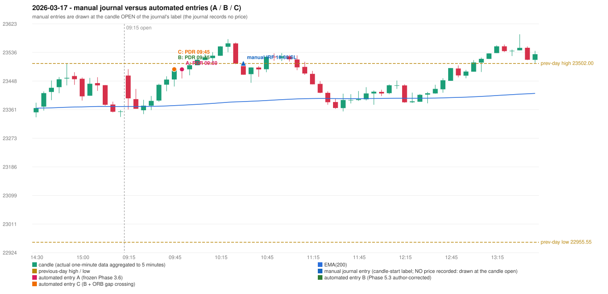

# 2026-03-17 (Tuesday) - manual journal versus the automated configurations

> SYNTHETIC index-point P&L; no real option P&L; costs illustrative (Rs 70 per trade + slippage scenarios). Configurations A / B / C are never combined.

## Session

* Open 23465.25; previous official close 23408.8; gap +56.45; previous-day high / low 23502.0 / 22955.55
* First 5-minute candle (09:15-09:20): O23465.25 H23484.8 L23361.35 C23395.55, RED, body 56.5%; EMA(200) at the first candle 23370.79; previous session's last close 23355.6 vs its EMA 23370.54

## Manual journal

row 97: IRF labelled 10:30, outcome SL

## Configuration A

Candidate signals (confirmed): 09:55 PDR/PDR LONG [EXECUTED: trade 1: TARGET]; 10:35 IRF/Method 1 SHORT [IGNORED: DAY_FINISHED]; 10:35 IRF/Method 2A SHORT [IGNORED: DAY_FINISHED]; 10:45 IRF/Method 1 SHORT [IGNORED: DAY_FINISHED]; 10:50 PDR/PDR LONG [IGNORED: DAY_FINISHED]; 11:15 IRF/Method 1 SHORT [IGNORED: DAY_FINISHED]; 12:50 PDR/PDR LONG [IGNORED: DAY_FINISHED]; 12:55 IRF/Method 1 SHORT [IGNORED: DAY_FINISHED]; 13:10 PDR/PDR LONG [IGNORED: DAY_FINISHED]; 13:40 IRF/Method 2A SHORT [IGNORED: DAY_FINISHED]; 13:40 IRF/Method 2B SHORT [IGNORED: DAY_FINISHED]; 14:20 IRF/Method 2B SHORT [IGNORED: DAY_FINISHED]; 15:05 IRF/Method 2B SHORT [IGNORED: DAY_FINISHED]

Strategies with no confirmed signal: ORB: no setup record (the strategy's trigger event never occurred) | PDS: no setup record (the strategy's trigger event never occurred) | RF: no setup record (the strategy's trigger event never occurred)

| trade | strategy / method | dir | signal -> fill | entry | stop / T1 / T2 | leg 1 | leg 2 | outcome | gross Rs | net Rs (70, 0) | net Rs (70, 1.0) |
|---|---|---|---|---|---|---|---|---|---|---|---|
| 1 | PDR/PDR | LONG | 09:55 -> 09:55 | 23484.2 | 23449.2 / 23511.2 / 23554.2 | 10:01 @ 23511.2 | 10:19 @ 23554.2 | TARGET | 18,915 | 18,845 | 18,065 |

Selection: This PDR signal was the earliest executable signal of the day: 0 confirmed signal(s) earlier, 0 other in the same minute. 12 later confirmed signal(s) (IRF x9, PDR x3) are logged as ignored or rejected. State of the other four engines at that moment: [IRF: no setup record before this time (a base condition was not met, or nothing triggered)] [ORB: no setup record before this time (a base condition was not met, or nothing triggered)] [PDS: no setup record before this time (a base condition was not met, or nothing triggered)] [RF: no setup record before this time (a base condition was not met, or nothing triggered)]

* Journal row 97 (IRF 10:30): **UNMATCHED_MANUAL**; earliest cause DIFFERENT_STRATEGY_SELECTED (+ PORTFOLIO_CONTROLLER_CONSTRAINT): the controller took PDR PDR (signal 09:55) first; the IRF signal at 10:35 was IGNORED: DAY_FINISHED
* Automated PDR 09:50 has no strict / time-tolerant journal counterpart: DIFFERENT_STRATEGY_SELECTED - the journal traded IRF 10:30; the automated controller took PDR PDR (candle 09:50) as the first valid signal

## Configuration B

Candidate signals (confirmed): 09:50 PDR/PDR LONG [EXECUTED: trade 1: TARGET]; 10:00 PDR/PDR LONG [IGNORED: POSITION_ACTIVE (signal kept for diagnostics only; never reused)]; 10:35 IRF/Method 1 SHORT [IGNORED: DAY_FINISHED]; 10:35 IRF/Method 2A SHORT [IGNORED: DAY_FINISHED]; 10:45 IRF/Method 1 SHORT [IGNORED: DAY_FINISHED]; 10:45 PDR/PDR LONG [IGNORED: DAY_FINISHED]; 11:10 IRF/Method 2A SHORT [IGNORED: DAY_FINISHED]; 11:15 IRF/Method 1 SHORT [IGNORED: DAY_FINISHED]; 12:50 PDR/PDR LONG [IGNORED: DAY_FINISHED]; 12:55 IRF/Method 1 SHORT [IGNORED: DAY_FINISHED]; 13:00 PDR/PDR LONG [IGNORED: DAY_FINISHED]; 13:40 IRF/Method 2A SHORT [IGNORED: DAY_FINISHED]; 13:40 IRF/Method 2B SHORT [IGNORED: DAY_FINISHED]; 14:00 IRF/Method 2A SHORT [IGNORED: DAY_FINISHED]; 14:25 IRF/Method 2A SHORT [IGNORED: DAY_FINISHED]; 15:05 IRF/Method 2B SHORT [IGNORED: DAY_FINISHED]

Strategies with no confirmed signal: ORB: no setup record (the strategy's trigger event never occurred) | PDS: no setup record (the strategy's trigger event never occurred) | RF: no setup record (the strategy's trigger event never occurred)

| trade | strategy / method | dir | signal -> fill | entry | stop / T1 / T2 | leg 1 | leg 2 | outcome | gross Rs | net Rs (70, 0) | net Rs (70, 1.0) |
|---|---|---|---|---|---|---|---|---|---|---|---|
| 1 | PDR/PDR | LONG | 09:50 -> 09:50 | 23484.4 | 23449.4 / 23511.4 / 23554.4 | 10:01 @ 23511.4 | 10:19 @ 23554.4 | TARGET | 18,915 | 18,845 | 18,065 |

Selection: This PDR signal was the earliest executable signal of the day: 0 confirmed signal(s) earlier, 0 other in the same minute. 15 later confirmed signal(s) (IRF x11, PDR x4) are logged as ignored or rejected. State of the other four engines at that moment: [IRF: no setup record before this time (a base condition was not met, or nothing triggered)] [ORB: no setup record before this time (a base condition was not met, or nothing triggered)] [PDS: no setup record before this time (a base condition was not met, or nothing triggered)] [RF: no setup record before this time (a base condition was not met, or nothing triggered)]

* Journal row 97 (IRF 10:30): **UNMATCHED_MANUAL**; earliest cause DIFFERENT_STRATEGY_SELECTED (+ PORTFOLIO_CONTROLLER_CONSTRAINT): the controller took PDR PDR (signal 09:50) first; the IRF signal at 10:35 was IGNORED: DAY_FINISHED
* Automated PDR 09:45 has no strict / time-tolerant journal counterpart: DIFFERENT_STRATEGY_SELECTED - the journal traded IRF 10:30; the automated controller took PDR PDR (candle 09:45) as the first valid signal

## Configuration C

Candidate signals (confirmed): 09:50 PDR/PDR LONG [EXECUTED: trade 1: TARGET]; 10:00 PDR/PDR LONG [IGNORED: POSITION_ACTIVE (signal kept for diagnostics only; never reused)]; 10:35 IRF/Method 1 SHORT [IGNORED: DAY_FINISHED]; 10:35 IRF/Method 2A SHORT [IGNORED: DAY_FINISHED]; 10:45 IRF/Method 1 SHORT [IGNORED: DAY_FINISHED]; 10:45 PDR/PDR LONG [IGNORED: DAY_FINISHED]; 11:10 IRF/Method 2A SHORT [IGNORED: DAY_FINISHED]; 11:15 IRF/Method 1 SHORT [IGNORED: DAY_FINISHED]; 12:50 PDR/PDR LONG [IGNORED: DAY_FINISHED]; 12:55 IRF/Method 1 SHORT [IGNORED: DAY_FINISHED]; 13:00 PDR/PDR LONG [IGNORED: DAY_FINISHED]; 13:40 IRF/Method 2A SHORT [IGNORED: DAY_FINISHED]; 13:40 IRF/Method 2B SHORT [IGNORED: DAY_FINISHED]; 14:00 IRF/Method 2A SHORT [IGNORED: DAY_FINISHED]; 14:25 IRF/Method 2A SHORT [IGNORED: DAY_FINISHED]; 15:05 IRF/Method 2B SHORT [IGNORED: DAY_FINISHED]

Strategies with no confirmed signal: ORB: no setup record (the strategy's trigger event never occurred) | PDS: no setup record (the strategy's trigger event never occurred) | RF: no setup record (the strategy's trigger event never occurred)

| trade | strategy / method | dir | signal -> fill | entry | stop / T1 / T2 | leg 1 | leg 2 | outcome | gross Rs | net Rs (70, 0) | net Rs (70, 1.0) |
|---|---|---|---|---|---|---|---|---|---|---|---|
| 1 | PDR/PDR | LONG | 09:50 -> 09:50 | 23484.4 | 23449.4 / 23511.4 / 23554.4 | 10:01 @ 23511.4 | 10:19 @ 23554.4 | TARGET | 18,915 | 18,845 | 18,065 |

Selection: This PDR signal was the earliest executable signal of the day: 0 confirmed signal(s) earlier, 0 other in the same minute. 15 later confirmed signal(s) (IRF x11, PDR x4) are logged as ignored or rejected. State of the other four engines at that moment: [IRF: no setup record before this time (a base condition was not met, or nothing triggered)] [ORB: no setup record before this time (a base condition was not met, or nothing triggered)] [PDS: no setup record before this time (a base condition was not met, or nothing triggered)] [RF: no setup record before this time (a base condition was not met, or nothing triggered)]

* Journal row 97 (IRF 10:30): **UNMATCHED_MANUAL**; earliest cause DIFFERENT_STRATEGY_SELECTED (+ PORTFOLIO_CONTROLLER_CONSTRAINT): the controller took PDR PDR (signal 09:50) first; the IRF signal at 10:35 was IGNORED: DAY_FINISHED
* Automated PDR 09:45 has no strict / time-tolerant journal counterpart: DIFFERENT_STRATEGY_SELECTED - the journal traded IRF 10:30; the automated controller took PDR PDR (candle 09:45) as the first valid signal

## Chart

