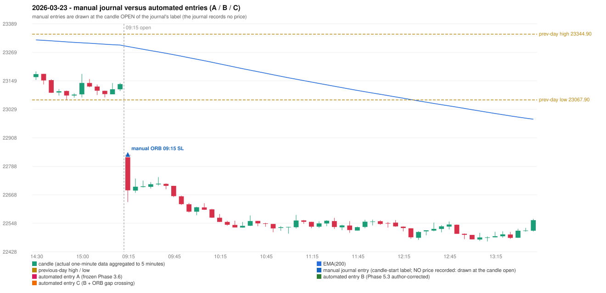

# 2026-03-23 (Monday) - manual journal versus the automated configurations

> SYNTHETIC index-point P&L; no real option P&L; costs illustrative (Rs 70 per trade + slippage scenarios). Configurations A / B / C are never combined.

## Session

* Open 22837.2; previous official close 23114.5; gap -277.30; previous-day high / low 23344.9 / 23067.9
* First 5-minute candle (09:15-09:20): O22837.2 H22838.35 L22637.8 C22687.45, RED, body 74.7%; EMA(200) at the first candle 23292.99; previous session's last close 23134.65 vs its EMA 23299.07

## Manual journal

row 100: ORB labelled 09:15, outcome SL

## Configuration A

Candidate signals (confirmed): none

Strategies with no confirmed signal: IRF: no setup record (the strategy's trigger event never occurred) | ORB: Method 1 INVALIDATED CANDLE_QUALITY(not a strong body / wick too large); Method 2 INVALIDATED CANDLE_QUALITY | PDR: no setup record (the strategy's trigger event never occurred) | PDS: no setup record (the strategy's trigger event never occurred) | RF: RF INVALIDATED TREND:EMA_PREV_SESSION_CLOSE wrong side

No trade: final day state READY_FOR_FIRST_TRADE. No strategy qualified.

* Journal row 100 (ORB 09:15): **UNMATCHED_MANUAL**; earliest cause CANDLE_STRENGTH_MISMATCH: first candle RED O22837.2 H22838.35 L22637.8 C22687.45 (body 74.7%); direction ASSUMED from the colour (the journal has no direction); TIE-BROKEN BY METHOD ORDER: 2 methods tie at 1 failing predicate(s) (Method 1: candle_quality; Method 2: candle_quality) - the evidence does not single out one cause, the secondary cause is the other tied one; closest method Method 1 (1 failing predicate(s)): first failing 'candle_quality' - body 74.7% opposite wick 24.8% close location 24.8%; all methods: Method 1: 1 fail (candle_quality); Method 2: 1 fail (candle_quality); Gap/200DMA: 2 fail (gap_crosses_200_average)

## Configuration B

Candidate signals (confirmed): none

Strategies with no confirmed signal: IRF: no setup record (the strategy's trigger event never occurred) | ORB: Method 1 INVALIDATED CANDLE_QUALITY(not a strong body / wick too large); Method 2 INVALIDATED CANDLE_QUALITY | PDR: no setup record (the strategy's trigger event never occurred) | PDS: no setup record (the strategy's trigger event never occurred) | RF: RF INVALIDATED TREND:EMA_PREV_SESSION_CLOSE wrong side

No trade: final day state READY_FOR_FIRST_TRADE. No strategy qualified.

* Journal row 100 (ORB 09:15): **UNMATCHED_MANUAL**; earliest cause CANDLE_STRENGTH_MISMATCH: first candle RED O22837.2 H22838.35 L22637.8 C22687.45 (body 74.7%); direction ASSUMED from the colour (the journal has no direction); TIE-BROKEN BY METHOD ORDER: 2 methods tie at 1 failing predicate(s) (Method 1: candle_quality; Method 2: candle_quality) - the evidence does not single out one cause, the secondary cause is the other tied one; closest method Method 1 (1 failing predicate(s)): first failing 'candle_quality' - body 74.7% opposite wick 24.8% close location 24.8%; all methods: Method 1: 1 fail (candle_quality); Method 2: 1 fail (candle_quality); Gap/200DMA: 2 fail (gap_crosses_200_average)

## Configuration C

Candidate signals (confirmed): none

Strategies with no confirmed signal: IRF: no setup record (the strategy's trigger event never occurred) | ORB: Method 1 INVALIDATED CANDLE_QUALITY(not a strong body / wick too large); Method 2 INVALIDATED CANDLE_QUALITY | PDR: no setup record (the strategy's trigger event never occurred) | PDS: no setup record (the strategy's trigger event never occurred) | RF: RF INVALIDATED TREND:EMA_PREV_SESSION_CLOSE wrong side

No trade: final day state READY_FOR_FIRST_TRADE. No strategy qualified.

* Journal row 100 (ORB 09:15): **UNMATCHED_MANUAL**; earliest cause CANDLE_STRENGTH_MISMATCH: first candle RED O22837.2 H22838.35 L22637.8 C22687.45 (body 74.7%); direction ASSUMED from the colour (the journal has no direction); TIE-BROKEN BY METHOD ORDER: 2 methods tie at 1 failing predicate(s) (Method 1: candle_quality; Method 2: candle_quality) - the evidence does not single out one cause, the secondary cause is the other tied one; closest method Method 1 (1 failing predicate(s)): first failing 'candle_quality' - body 74.7% opposite wick 24.8% close location 24.8%; all methods: Method 1: 1 fail (candle_quality); Method 2: 1 fail (candle_quality); Gap/200DMA: 2 fail (gap_crosses_200_average)

## Chart

