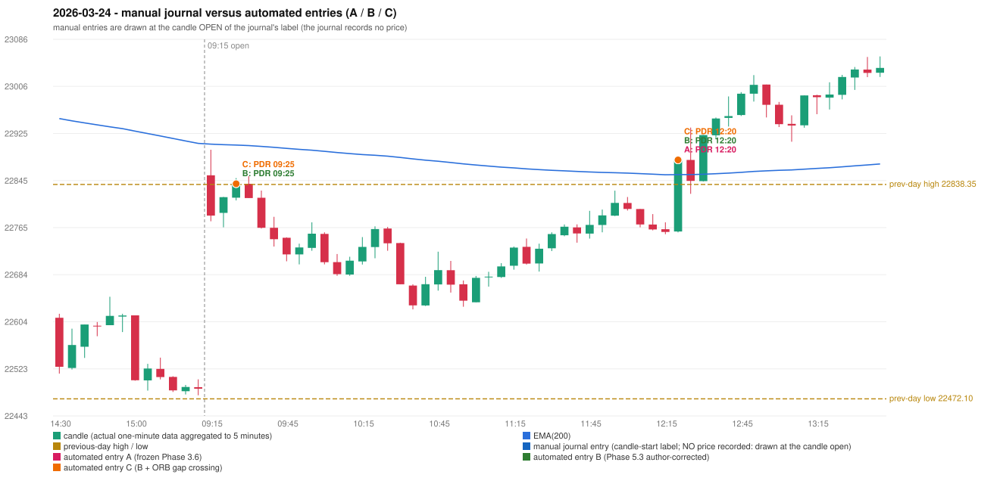

# 2026-03-24 (Tuesday) - manual journal versus the automated configurations

> SYNTHETIC index-point P&L; no real option P&L; costs illustrative (Rs 70 per trade + slippage scenarios). Configurations A / B / C are never combined.

## Session

* Open 22854.05; previous official close 22512.65; gap +341.40; previous-day high / low 22838.35 / 22472.1
* First 5-minute candle (09:15-09:20): O22854.05 H22897.65 L22775.4 C22785.15, RED, body 56.4%; EMA(200) at the first candle 22907.26; previous session's last close 22489.45 vs its EMA 22908.49

## Manual journal

no manual trade recorded

## Configuration A

Candidate signals (confirmed): 12:25 PDR/PDR LONG [EXECUTED: trade 1: T1_THEN_BUFFER_STOP]; 12:35 PDR/PDR LONG [IGNORED: DAY_FINISHED]; 13:50 IRF/Method 2B SHORT [IGNORED: DAY_FINISHED]; 14:20 IRF/Method 2B SHORT [IGNORED: DAY_FINISHED]; 14:40 IRF/Method 1 SHORT [IGNORED: DAY_FINISHED]; 14:55 IRF/Method 1 SHORT [IGNORED: DAY_FINISHED]

Strategies with no confirmed signal: ORB: Method 2 INVALIDATED TREND:EMA_PREV_SESSION_CLOSE wrong side | PDS: no setup record (the strategy's trigger event never occurred) | RF: RF INVALIDATED TREND:EMA_PREV_SESSION_CLOSE wrong side

| trade | strategy / method | dir | signal -> fill | entry | stop / T1 / T2 | leg 1 | leg 2 | outcome | gross Rs | net Rs (70, 0) | net Rs (70, 1.0) |
|---|---|---|---|---|---|---|---|---|---|---|---|
| 1 | PDR/PDR | LONG | 12:25 -> 12:25 | 22880.2 | 22845.2 / 22907.2 / 22950.2 | 12:25 @ 22907.2 | 12:28 @ 22874.2 | T1_THEN_BUFFER_STOP | 4,095 | 4,025 | 3,245 |

Selection: This PDR signal was the earliest executable signal of the day: 0 confirmed signal(s) earlier, 0 other in the same minute. 5 later confirmed signal(s) (IRF x4, PDR x1) are logged as ignored or rejected. State of the other four engines at that moment: [IRF: no setup record before this time (a base condition was not met, or nothing triggered)] [ORB: Method 2 invalidated at 09:15: TREND:EMA_PREV_SESSION_CLOSE wrong side] [PDS: no setup record before this time (a base condition was not met, or nothing triggered)] [RF: RF invalidated at 11:50: TREND:EMA_PREV_SESSION_CLOSE wrong side]

* Automated PDR 12:20 has no strict / time-tolerant journal counterpart: UNRESOLVED_DISCRETIONARY_SELECTION - the journal records no trade this day; the automated system took PDR PDR LONG (candle 12:20) mechanically

## Configuration B

Candidate signals (confirmed): 09:30 PDR/PDR LONG [EXECUTED: trade 1: INITIAL_FULL_STOP]; 12:25 PDR/PDR LONG [EXECUTED: trade 2: T1_THEN_BUFFER_STOP]; 12:35 PDR/PDR LONG [IGNORED: DAY_FINISHED]; 13:05 IRF/Method 2A SHORT [IGNORED: DAY_FINISHED]; 14:25 IRF/Method 2A SHORT [IGNORED: DAY_FINISHED]

Strategies with no confirmed signal: ORB: Method 2 INVALIDATED TREND:EMA_PREV_SESSION_CLOSE wrong side | PDS: no setup record (the strategy's trigger event never occurred) | RF: RF INVALIDATED TREND:EMA_PREV_SESSION_CLOSE wrong side

| trade | strategy / method | dir | signal -> fill | entry | stop / T1 / T2 | leg 1 | leg 2 | outcome | gross Rs | net Rs (70, 0) | net Rs (70, 1.0) |
|---|---|---|---|---|---|---|---|---|---|---|---|
| 1 | PDR/PDR | LONG | 09:30 -> 09:30 | 22839.6 | 22804.6 / 22866.6 / 22909.6 | 09:37 @ 22804.6 | 09:37 @ 22804.6 | INITIAL_FULL_STOP | -13,650 | -13,720 | -14,500 |
| 2 | PDR/PDR | LONG | 12:25 -> 12:25 | 22880.2 | 22845.2 / 22907.2 / 22950.2 | 12:25 @ 22907.2 | 12:28 @ 22874.2 | T1_THEN_BUFFER_STOP | 4,095 | 4,025 | 3,245 |

Selection: This PDR signal was the earliest executable signal of the day: 0 confirmed signal(s) earlier, 0 other in the same minute. 4 later confirmed signal(s) (IRF x2, PDR x2) are logged as ignored or rejected. State of the other four engines at that moment: [IRF: no setup record before this time (a base condition was not met, or nothing triggered)] [ORB: Method 2 invalidated at 09:15: TREND:EMA_PREV_SESSION_CLOSE wrong side] [PDS: no setup record before this time (a base condition was not met, or nothing triggered)] [RF: no setup record before this time (a base condition was not met, or nothing triggered)]

* Automated PDR 09:25 has no strict / time-tolerant journal counterpart: UNRESOLVED_DISCRETIONARY_SELECTION - the journal records no trade this day; the automated system took PDR PDR LONG (candle 09:25) mechanically
* Automated PDR 12:20 has no strict / time-tolerant journal counterpart: PORTFOLIO_CONTROLLER_CONSTRAINT - second trade of the day: the controller allows a PDR / PDS re-entry after the original full stop of trade 1 (PDR PDR, signal candle 09:25); the journal has no unmatched row that day

## Configuration C

Candidate signals (confirmed): 09:30 PDR/PDR LONG [EXECUTED: trade 1: INITIAL_FULL_STOP]; 12:25 PDR/PDR LONG [EXECUTED: trade 2: T1_THEN_BUFFER_STOP]; 12:35 PDR/PDR LONG [IGNORED: DAY_FINISHED]; 13:05 IRF/Method 2A SHORT [IGNORED: DAY_FINISHED]; 14:25 IRF/Method 2A SHORT [IGNORED: DAY_FINISHED]

Strategies with no confirmed signal: ORB: Gap/200DMA INVALIDATED CLOSE_NOT_BEYOND_MA; Method 2 INVALIDATED TREND:EMA_PREV_SESSION_CLOSE wrong side | PDS: no setup record (the strategy's trigger event never occurred) | RF: RF INVALIDATED TREND:EMA_PREV_SESSION_CLOSE wrong side

| trade | strategy / method | dir | signal -> fill | entry | stop / T1 / T2 | leg 1 | leg 2 | outcome | gross Rs | net Rs (70, 0) | net Rs (70, 1.0) |
|---|---|---|---|---|---|---|---|---|---|---|---|
| 1 | PDR/PDR | LONG | 09:30 -> 09:30 | 22839.6 | 22804.6 / 22866.6 / 22909.6 | 09:37 @ 22804.6 | 09:37 @ 22804.6 | INITIAL_FULL_STOP | -13,650 | -13,720 | -14,500 |
| 2 | PDR/PDR | LONG | 12:25 -> 12:25 | 22880.2 | 22845.2 / 22907.2 / 22950.2 | 12:25 @ 22907.2 | 12:28 @ 22874.2 | T1_THEN_BUFFER_STOP | 4,095 | 4,025 | 3,245 |

Selection: This PDR signal was the earliest executable signal of the day: 0 confirmed signal(s) earlier, 0 other in the same minute. 4 later confirmed signal(s) (IRF x2, PDR x2) are logged as ignored or rejected. State of the other four engines at that moment: [IRF: no setup record before this time (a base condition was not met, or nothing triggered)] [ORB: Method 2 invalidated at 09:15: TREND:EMA_PREV_SESSION_CLOSE wrong side; Gap/200DMA invalidated at 09:15: CLOSE_NOT_BEYOND_MA] [PDS: no setup record before this time (a base condition was not met, or nothing triggered)] [RF: no setup record before this time (a base condition was not met, or nothing triggered)]

* Automated PDR 09:25 has no strict / time-tolerant journal counterpart: UNRESOLVED_DISCRETIONARY_SELECTION - the journal records no trade this day; the automated system took PDR PDR LONG (candle 09:25) mechanically
* Automated PDR 12:20 has no strict / time-tolerant journal counterpart: PORTFOLIO_CONTROLLER_CONSTRAINT - second trade of the day: the controller allows a PDR / PDS re-entry after the original full stop of trade 1 (PDR PDR, signal candle 09:25); the journal has no unmatched row that day

## Chart

