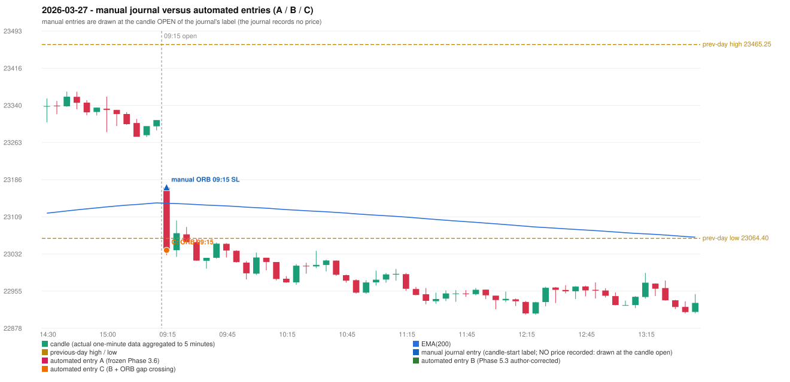

# 2026-03-27 (Friday) - manual journal versus the automated configurations

> SYNTHETIC index-point P&L; no real option P&L; costs illustrative (Rs 70 per trade + slippage scenarios). Configurations A / B / C are never combined.

## Session

* Open 23169.2; previous official close 23306.45; gap -137.25; previous-day high / low 23465.25 / 23064.4
* First 5-minute candle (09:15-09:20): O23169.2 H23169.2 L23029.85 C23041.8, RED, body 91.4%; EMA(200) at the first candle 23136.88; previous session's last close 23309.0 vs its EMA 23137.84

## Manual journal

row 102: ORB labelled 09:15, outcome SL

## Configuration A

Candidate signals (confirmed): none

Strategies with no confirmed signal: IRF: no setup record (the strategy's trigger event never occurred) | ORB: Method 1 INVALIDATED TREND:EMA_PREV_SESSION_CLOSE wrong side; Method 2 INVALIDATED TREND:EMA_PREV_SESSION_CLOSE wrong side | PDR: no setup record (the strategy's trigger event never occurred) | PDS: Method 1/2/3 INVALIDATED GAP_DOWN_OPEN_NOT_BELOW_ZONE | RF: RF INVALIDATED GAP_NOT_UP(DOWN)

No trade: final day state READY_FOR_FIRST_TRADE. No strategy qualified.

* Journal row 102 (ORB 09:15): **UNMATCHED_MANUAL**; earliest cause EMA_FILTER_MISMATCH (+ OPENING_GAP_MISMATCH): first candle RED O23169.2 H23169.2 L23029.85 C23041.8 (body 91.4%); direction ASSUMED from the colour (the journal has no direction); TIE-BROKEN BY METHOD ORDER: 3 methods tie at 1 failing predicate(s) (Method 1: trend; Method 2: trend; Gap/200DMA: gap_crosses_200_average) - the evidence does not single out one cause, the secondary cause is the other tied one; closest method Method 1 (1 failing predicate(s)): first failing 'trend' - EMA_PREV_SESSION_CLOSE wrong side; all methods: Method 1: 1 fail (trend); Method 2: 1 fail (trend); Gap/200DMA: 1 fail (gap_crosses_200_average)

## Configuration B

Candidate signals (confirmed): none

Strategies with no confirmed signal: IRF: no setup record (the strategy's trigger event never occurred) | ORB: Method 1 INVALIDATED TREND:EMA_PREV_SESSION_CLOSE wrong side; Method 2 INVALIDATED TREND:EMA_PREV_SESSION_CLOSE wrong side | PDR: no setup record (the strategy's trigger event never occurred) | PDS: Method 1/2/3 INVALIDATED GAP_DOWN_OPEN_NOT_BELOW_ZONE | RF: RF INVALIDATED GAP_NOT_UP(DOWN)

No trade: final day state READY_FOR_FIRST_TRADE. No strategy qualified.

* Journal row 102 (ORB 09:15): **UNMATCHED_MANUAL**; earliest cause EMA_FILTER_MISMATCH (+ OPENING_GAP_MISMATCH): first candle RED O23169.2 H23169.2 L23029.85 C23041.8 (body 91.4%); direction ASSUMED from the colour (the journal has no direction); TIE-BROKEN BY METHOD ORDER: 3 methods tie at 1 failing predicate(s) (Method 1: trend; Method 2: trend; Gap/200DMA: gap_crosses_200_average) - the evidence does not single out one cause, the secondary cause is the other tied one; closest method Method 1 (1 failing predicate(s)): first failing 'trend' - EMA_PREV_SESSION_CLOSE wrong side; all methods: Method 1: 1 fail (trend); Method 2: 1 fail (trend); Gap/200DMA: 1 fail (gap_crosses_200_average)

## Configuration C

Candidate signals (confirmed): 09:20 ORB/Gap/200DMA SHORT [EXECUTED: trade 1: INITIAL_FULL_STOP]

Strategies with no confirmed signal: IRF: no setup record (the strategy's trigger event never occurred) | PDR: no setup record (the strategy's trigger event never occurred) | PDS: Method 1/2/3 INVALIDATED GAP_DOWN_OPEN_NOT_BELOW_ZONE | RF: RF INVALIDATED GAP_NOT_UP(DOWN)

| trade | strategy / method | dir | signal -> fill | entry | stop / T1 / T2 | leg 1 | leg 2 | outcome | gross Rs | net Rs (70, 0) | net Rs (70, 1.0) |
|---|---|---|---|---|---|---|---|---|---|---|---|
| 1 | ORB/Gap/200DMA | SHORT | 09:20 -> 09:20 | 23039.95 | 23069.95 / 23012.95 / 22979.95 | 09:21 @ 23069.95 | 09:21 @ 23069.95 | INITIAL_FULL_STOP | -11,700 | -11,770 | -12,550 |

Selection: This ORB Gap/200DMA signal was the earliest executable signal of the day: 0 confirmed signal(s) earlier, 0 other in the same minute. No later signal was generated. State of the other four engines at that moment: [IRF: no setup record before this time (a base condition was not met, or nothing triggered)] [PDR: no setup record before this time (a base condition was not met, or nothing triggered)] [PDS: Method 1/2/3 invalidated at 09:15: GAP_DOWN_OPEN_NOT_BELOW_ZONE] [RF: no setup record before this time (a base condition was not met, or nothing triggered)]

* Journal row 102 (ORB 09:15): **STRICT** match with 20260327-1-ORB (delta +0 min); outcome SL vs automated INITIAL_FULL_STOP (same class)

## Chart

