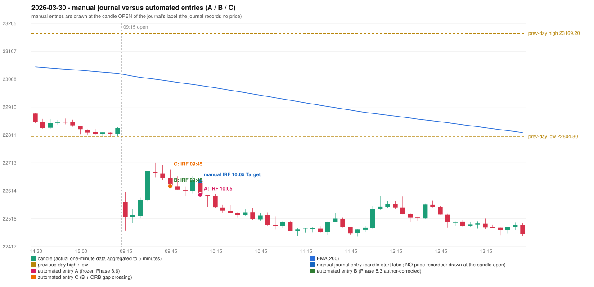

# 2026-03-30 (Monday) - manual journal versus the automated configurations

> SYNTHETIC index-point P&L; no real option P&L; costs illustrative (Rs 70 per trade + slippage scenarios). Configurations A / B / C are never combined.

## Session

* Open 22574.7; previous official close 22819.6; gap -244.90; previous-day high / low 23169.2 / 22804.8
* First 5-minute candle (09:15-09:20): O22574.7 H22609.8 L22472.95 C22522.45, RED, body 38.2%; EMA(200) at the first candle 23023.66; previous session's last close 22835.5 vs its EMA 23028.69

## Manual journal

row 103: IRF labelled 10:05, outcome Target

## Configuration A

Candidate signals (confirmed): 10:10 IRF/Method 1 SHORT [EXECUTED: trade 1: TARGET]; 10:15 IRF/Method 2A SHORT [IGNORED: POSITION_ACTIVE (signal kept for diagnostics only; never reused)]

Strategies with no confirmed signal: ORB: Method 1 INVALIDATED CANDLE_QUALITY(not a strong body / wick too large); Method 2 INVALIDATED CANDLE_QUALITY | PDR: no setup record (the strategy's trigger event never occurred) | PDS: no setup record (the strategy's trigger event never occurred) | RF: RF INVALIDATED TREND:EMA_PREV_SESSION_CLOSE wrong side

| trade | strategy / method | dir | signal -> fill | entry | stop / T1 / T2 | leg 1 | leg 2 | outcome | gross Rs | net Rs (70, 0) | net Rs (70, 1.0) |
|---|---|---|---|---|---|---|---|---|---|---|---|
| 1 | IRF/Method 1 | SHORT | 10:10 -> 10:10 | 22600.2 | 22635.2 / 22573.2 / 22540.2 | 10:11 @ 22573.2 | 10:23 @ 22540.2 | TARGET | 16,965 | 16,895 | 16,115 |

Selection: This IRF Method 1 signal was the earliest executable signal of the day: 0 confirmed signal(s) earlier, 0 other in the same minute. 1 later confirmed signal(s) (IRF x1) are logged as ignored or rejected. State of the other four engines at that moment: [ORB: Method 1 invalidated at 09:15: CANDLE_QUALITY(not a strong body / wick too large); Method 2 invalidated at 09:15: CANDLE_QUALITY] [PDR: no setup record before this time (a base condition was not met, or nothing triggered)] [PDS: no setup record before this time (a base condition was not met, or nothing triggered)] [RF: no setup record before this time (a base condition was not met, or nothing triggered)]

* Journal row 103 (IRF 10:05): **STRICT** match with 20260330-1-IRF (delta +0 min); outcome Target vs automated TARGET (same class)

## Configuration B

Candidate signals (confirmed): 09:50 IRF/Method 2A SHORT [EXECUTED: trade 1: INITIAL_FULL_STOP]; 10:10 IRF/Method 1 SHORT [REJECTED: SECOND_TRADE_RESTRICTED_TO_PDR_PDS]

Strategies with no confirmed signal: ORB: Method 1 INVALIDATED CANDLE_QUALITY(not a strong body / wick too large); Method 2 INVALIDATED CANDLE_QUALITY | PDR: no setup record (the strategy's trigger event never occurred) | PDS: no setup record (the strategy's trigger event never occurred) | RF: RF INVALIDATED TREND:EMA_PREV_SESSION_CLOSE wrong side

| trade | strategy / method | dir | signal -> fill | entry | stop / T1 / T2 | leg 1 | leg 2 | outcome | gross Rs | net Rs (70, 0) | net Rs (70, 1.0) |
|---|---|---|---|---|---|---|---|---|---|---|---|
| 1 | IRF/Method 2A | SHORT | 09:50 -> 09:50 | 22630.2 | 22665.2 / 22603.2 / 22570.2 | 09:51 @ 22665.2 | 09:51 @ 22665.2 | INITIAL_FULL_STOP | -13,650 | -13,720 | -14,500 |

Selection: This IRF Method 2A signal was the earliest executable signal of the day: 0 confirmed signal(s) earlier, 0 other in the same minute. 1 later confirmed signal(s) (IRF x1) are logged as ignored or rejected. State of the other four engines at that moment: [ORB: Method 1 invalidated at 09:15: CANDLE_QUALITY(not a strong body / wick too large); Method 2 invalidated at 09:15: CANDLE_QUALITY] [PDR: no setup record before this time (a base condition was not met, or nothing triggered)] [PDS: no setup record before this time (a base condition was not met, or nothing triggered)] [RF: no setup record before this time (a base condition was not met, or nothing triggered)]

* Journal row 103 (IRF 10:05): **DATE_STRATEGY_ONLY**; earliest cause EARLIER_SIGNAL (+ ENTRY_TIME_MISMATCH): the automated IRF trade has its signal candle at 09:45 versus the manual label 10:05 (-20 minutes; outside the 15-minute tolerance)
* Automated IRF 09:45 has no strict / time-tolerant journal counterpart: EARLIER_SIGNAL - the journal has IRF at 10:05; the automated trade's signal candle is 09:45

## Configuration C

Candidate signals (confirmed): 09:50 IRF/Method 2A SHORT [EXECUTED: trade 1: INITIAL_FULL_STOP]; 10:10 IRF/Method 1 SHORT [REJECTED: SECOND_TRADE_RESTRICTED_TO_PDR_PDS]

Strategies with no confirmed signal: ORB: Method 1 INVALIDATED CANDLE_QUALITY(not a strong body / wick too large); Method 2 INVALIDATED CANDLE_QUALITY | PDR: no setup record (the strategy's trigger event never occurred) | PDS: no setup record (the strategy's trigger event never occurred) | RF: RF INVALIDATED TREND:EMA_PREV_SESSION_CLOSE wrong side

| trade | strategy / method | dir | signal -> fill | entry | stop / T1 / T2 | leg 1 | leg 2 | outcome | gross Rs | net Rs (70, 0) | net Rs (70, 1.0) |
|---|---|---|---|---|---|---|---|---|---|---|---|
| 1 | IRF/Method 2A | SHORT | 09:50 -> 09:50 | 22630.2 | 22665.2 / 22603.2 / 22570.2 | 09:51 @ 22665.2 | 09:51 @ 22665.2 | INITIAL_FULL_STOP | -13,650 | -13,720 | -14,500 |

Selection: This IRF Method 2A signal was the earliest executable signal of the day: 0 confirmed signal(s) earlier, 0 other in the same minute. 1 later confirmed signal(s) (IRF x1) are logged as ignored or rejected. State of the other four engines at that moment: [ORB: Method 1 invalidated at 09:15: CANDLE_QUALITY(not a strong body / wick too large); Method 2 invalidated at 09:15: CANDLE_QUALITY] [PDR: no setup record before this time (a base condition was not met, or nothing triggered)] [PDS: no setup record before this time (a base condition was not met, or nothing triggered)] [RF: no setup record before this time (a base condition was not met, or nothing triggered)]

* Journal row 103 (IRF 10:05): **DATE_STRATEGY_ONLY**; earliest cause EARLIER_SIGNAL (+ ENTRY_TIME_MISMATCH): the automated IRF trade has its signal candle at 09:45 versus the manual label 10:05 (-20 minutes; outside the 15-minute tolerance)
* Automated IRF 09:45 has no strict / time-tolerant journal counterpart: EARLIER_SIGNAL - the journal has IRF at 10:05; the automated trade's signal candle is 09:45

## Chart

