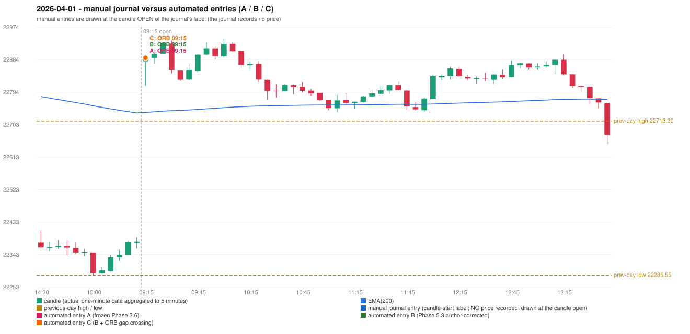

# 2026-04-01 (Wednesday) - manual journal versus the automated configurations

> SYNTHETIC index-point P&L; no real option P&L; costs illustrative (Rs 70 per trade + slippage scenarios). Configurations A / B / C are never combined.

## Session

* Open 22878.9; previous official close 22331.4; gap +547.50; previous-day high / low 22713.3 / 22285.55
* First 5-minute candle (09:15-09:20): O22878.9 H22894.7 L22811.4 C22887.0, GREEN, body 9.7%; EMA(200) at the first candle 22737.37; previous session's last close 22379.2 vs its EMA 22735.86

## Manual journal

no manual trade recorded

## Configuration A

Candidate signals (confirmed): 09:20 ORB/Gap/200DMA LONG [EXECUTED: trade 1: T1_THEN_BUFFER_STOP]; 09:35 IRF/Method 1 SHORT [IGNORED: DAY_FINISHED]; 10:00 IRF/Method 1 SHORT [IGNORED: DAY_FINISHED]; 10:10 IRF/Method 2B SHORT [IGNORED: DAY_FINISHED]; 10:15 IRF/Method 1 SHORT [IGNORED: DAY_FINISHED]; 14:10 PDR/PDR LONG [IGNORED: DAY_FINISHED]; 15:30 PDR/PDR LONG [IGNORED: DAY_FINISHED]

Strategies with no confirmed signal: PDS: no setup record (the strategy's trigger event never occurred) | RF: RF INVALIDATED TREND:EMA_PREV_SESSION_CLOSE wrong side

| trade | strategy / method | dir | signal -> fill | entry | stop / T1 / T2 | leg 1 | leg 2 | outcome | gross Rs | net Rs (70, 0) | net Rs (70, 1.0) |
|---|---|---|---|---|---|---|---|---|---|---|---|
| 1 | ORB/Gap/200DMA | LONG | 09:20 -> 09:20 | 22888.6 | 22858.6 / 22915.6 / 22948.6 | 09:28 @ 22915.6 | 09:32 @ 22882.6 | T1_THEN_BUFFER_STOP | 4,095 | 4,025 | 3,245 |

Selection: This ORB Gap/200DMA signal was the earliest executable signal of the day: 0 confirmed signal(s) earlier, 0 other in the same minute. 6 later confirmed signal(s) (IRF x4, PDR x2) are logged as ignored or rejected. State of the other four engines at that moment: [IRF: no setup record before this time (a base condition was not met, or nothing triggered)] [PDR: no setup record before this time (a base condition was not met, or nothing triggered)] [PDS: no setup record before this time (a base condition was not met, or nothing triggered)] [RF: no setup record before this time (a base condition was not met, or nothing triggered)]

* Automated ORB 09:15 has no strict / time-tolerant journal counterpart: UNRESOLVED_DISCRETIONARY_SELECTION - the journal records no trade this day; the automated system took ORB Gap/200DMA LONG (candle 09:15) mechanically

## Configuration B

Candidate signals (confirmed): 09:20 ORB/Gap/200DMA LONG [EXECUTED: trade 1: T1_THEN_BUFFER_STOP]; 09:35 IRF/Method 1 SHORT [IGNORED: DAY_FINISHED]; 09:40 IRF/Method 2A SHORT [IGNORED: DAY_FINISHED]; 10:00 IRF/Method 1 SHORT [IGNORED: DAY_FINISHED]; 10:10 IRF/Method 2B SHORT [IGNORED: DAY_FINISHED]; 10:15 IRF/Method 1 SHORT [IGNORED: DAY_FINISHED]; 13:50 PDR/PDR LONG [IGNORED: DAY_FINISHED]; 15:30 PDR/PDR LONG [IGNORED: DAY_FINISHED]

Strategies with no confirmed signal: PDS: no setup record (the strategy's trigger event never occurred) | RF: RF INVALIDATED TREND:EMA_PREV_SESSION_CLOSE wrong side

| trade | strategy / method | dir | signal -> fill | entry | stop / T1 / T2 | leg 1 | leg 2 | outcome | gross Rs | net Rs (70, 0) | net Rs (70, 1.0) |
|---|---|---|---|---|---|---|---|---|---|---|---|
| 1 | ORB/Gap/200DMA | LONG | 09:20 -> 09:20 | 22888.6 | 22858.6 / 22915.6 / 22948.6 | 09:28 @ 22915.6 | 09:32 @ 22882.6 | T1_THEN_BUFFER_STOP | 4,095 | 4,025 | 3,245 |

Selection: This ORB Gap/200DMA signal was the earliest executable signal of the day: 0 confirmed signal(s) earlier, 0 other in the same minute. 7 later confirmed signal(s) (IRF x5, PDR x2) are logged as ignored or rejected. State of the other four engines at that moment: [IRF: no setup record before this time (a base condition was not met, or nothing triggered)] [PDR: no setup record before this time (a base condition was not met, or nothing triggered)] [PDS: no setup record before this time (a base condition was not met, or nothing triggered)] [RF: no setup record before this time (a base condition was not met, or nothing triggered)]

* Automated ORB 09:15 has no strict / time-tolerant journal counterpart: UNRESOLVED_DISCRETIONARY_SELECTION - the journal records no trade this day; the automated system took ORB Gap/200DMA LONG (candle 09:15) mechanically

## Configuration C

Candidate signals (confirmed): 09:20 ORB/Gap/200DMA LONG [EXECUTED: trade 1: T1_THEN_BUFFER_STOP]; 09:35 IRF/Method 1 SHORT [IGNORED: DAY_FINISHED]; 09:40 IRF/Method 2A SHORT [IGNORED: DAY_FINISHED]; 10:00 IRF/Method 1 SHORT [IGNORED: DAY_FINISHED]; 10:10 IRF/Method 2B SHORT [IGNORED: DAY_FINISHED]; 10:15 IRF/Method 1 SHORT [IGNORED: DAY_FINISHED]; 13:50 PDR/PDR LONG [IGNORED: DAY_FINISHED]; 15:30 PDR/PDR LONG [IGNORED: DAY_FINISHED]

Strategies with no confirmed signal: PDS: no setup record (the strategy's trigger event never occurred) | RF: RF INVALIDATED TREND:EMA_PREV_SESSION_CLOSE wrong side

| trade | strategy / method | dir | signal -> fill | entry | stop / T1 / T2 | leg 1 | leg 2 | outcome | gross Rs | net Rs (70, 0) | net Rs (70, 1.0) |
|---|---|---|---|---|---|---|---|---|---|---|---|
| 1 | ORB/Gap/200DMA | LONG | 09:20 -> 09:20 | 22888.6 | 22858.6 / 22915.6 / 22948.6 | 09:28 @ 22915.6 | 09:32 @ 22882.6 | T1_THEN_BUFFER_STOP | 4,095 | 4,025 | 3,245 |

Selection: This ORB Gap/200DMA signal was the earliest executable signal of the day: 0 confirmed signal(s) earlier, 0 other in the same minute. 7 later confirmed signal(s) (IRF x5, PDR x2) are logged as ignored or rejected. State of the other four engines at that moment: [IRF: no setup record before this time (a base condition was not met, or nothing triggered)] [PDR: no setup record before this time (a base condition was not met, or nothing triggered)] [PDS: no setup record before this time (a base condition was not met, or nothing triggered)] [RF: no setup record before this time (a base condition was not met, or nothing triggered)]

* Automated ORB 09:15 has no strict / time-tolerant journal counterpart: UNRESOLVED_DISCRETIONARY_SELECTION - the journal records no trade this day; the automated system took ORB Gap/200DMA LONG (candle 09:15) mechanically

## Chart

