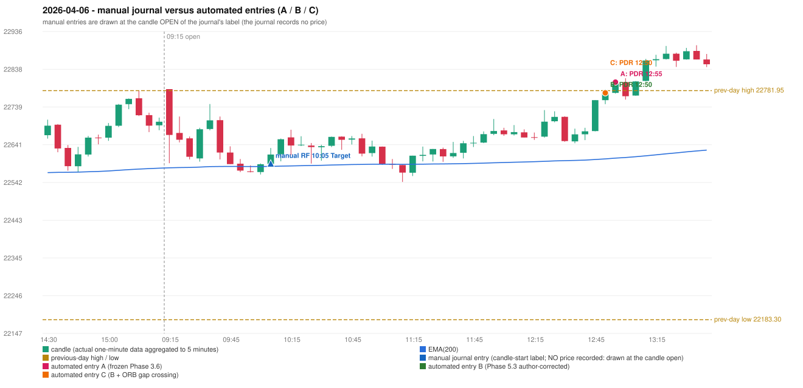

# 2026-04-06 (Monday) - manual journal versus the automated configurations

> SYNTHETIC index-point P&L; no real option P&L; costs illustrative (Rs 70 per trade + slippage scenarios). Configurations A / B / C are never combined.

## Session

* Open 22785.85; previous official close 22713.1; gap +72.75; previous-day high / low 22781.95 / 22183.3
* First 5-minute candle (09:15-09:20): O22785.85 H22785.85 L22592.3 C22666.05, RED, body 61.9%; EMA(200) at the first candle 22580.21; previous session's last close 22700.7 vs its EMA 22579.35

## Manual journal

row 105: RF labelled 10:05, outcome Target

## Configuration A

Candidate signals (confirmed): 13:00 PDR/PDR LONG [EXECUTED: trade 1: INITIAL_FULL_STOP]; 13:05 IRF/Method 1 SHORT [REJECTED: SECOND_TRADE_RESTRICTED_TO_PDR_PDS]; 13:10 PDR/PDR LONG [REJECTED: ENTRY_CUTOFF_EXCEEDED(fill 13:10 IST > 13:00)]; 13:40 IRF/Method 2B SHORT [REJECTED: SECOND_TRADE_RESTRICTED_TO_PDR_PDS]; 14:30 IRF/Method 2B SHORT [REJECTED: SECOND_TRADE_RESTRICTED_TO_PDR_PDS]

Strategies with no confirmed signal: ORB: no setup record (the strategy's trigger event never occurred) | PDS: no setup record (the strategy's trigger event never occurred) | RF: RF INVALIDATED GAP_UP_OUTSIDE_YESTERDAYS_RANGE

| trade | strategy / method | dir | signal -> fill | entry | stop / T1 / T2 | leg 1 | leg 2 | outcome | gross Rs | net Rs (70, 0) | net Rs (70, 1.0) |
|---|---|---|---|---|---|---|---|---|---|---|---|
| 1 | PDR/PDR | LONG | 13:00 -> 13:00 | 22804.1 | 22769.1 / 22831.1 / 22874.1 | 13:03 @ 22769.1 | 13:03 @ 22769.1 | INITIAL_FULL_STOP | -13,650 | -13,720 | -14,500 |

Selection: This PDR signal was the earliest executable signal of the day: 0 confirmed signal(s) earlier, 0 other in the same minute. 4 later confirmed signal(s) (IRF x3, PDR x1) are logged as ignored or rejected. State of the other four engines at that moment: [IRF: no setup record before this time (a base condition was not met, or nothing triggered)] [ORB: no setup record before this time (a base condition was not met, or nothing triggered)] [PDS: no setup record before this time (a base condition was not met, or nothing triggered)] [RF: RF invalidated at 10:05: GAP_UP_OUTSIDE_YESTERDAYS_RANGE]

* Journal row 105 (RF 10:05): **UNMATCHED_MANUAL**; earliest cause OPENING_GAP_MISMATCH: RF setup rejected by the opening-gap condition (RF-004) (GAP_UP_OUTSIDE_YESTERDAYS_RANGE)
* Automated PDR 12:55 has no strict / time-tolerant journal counterpart: DIFFERENT_STRATEGY_SELECTED - the journal traded RF 10:05; the automated controller took PDR PDR (candle 12:55) as the first valid signal

## Configuration B

Candidate signals (confirmed): 12:55 PDR/PDR LONG [EXECUTED: trade 1: T1_THEN_BUFFER_STOP]; 13:05 IRF/Method 1 SHORT [IGNORED: DAY_FINISHED]; 13:10 PDR/PDR LONG [IGNORED: DAY_FINISHED]; 13:40 IRF/Method 2B SHORT [IGNORED: DAY_FINISHED]; 14:30 IRF/Method 2A SHORT [IGNORED: DAY_FINISHED]; 14:30 IRF/Method 2B SHORT [IGNORED: DAY_FINISHED]

Strategies with no confirmed signal: ORB: no setup record (the strategy's trigger event never occurred) | PDS: no setup record (the strategy's trigger event never occurred) | RF: RF INVALIDATED GAP_UP_OUTSIDE_YESTERDAYS_RANGE

| trade | strategy / method | dir | signal -> fill | entry | stop / T1 / T2 | leg 1 | leg 2 | outcome | gross Rs | net Rs (70, 0) | net Rs (70, 1.0) |
|---|---|---|---|---|---|---|---|---|---|---|---|
| 1 | PDR/PDR | LONG | 12:55 -> 12:55 | 22776.15 | 22741.15 / 22803.15 / 22846.15 | 12:59 @ 22803.15 | 13:03 @ 22770.15 | T1_THEN_BUFFER_STOP | 4,095 | 4,025 | 3,245 |

Selection: This PDR signal was the earliest executable signal of the day: 0 confirmed signal(s) earlier, 0 other in the same minute. 5 later confirmed signal(s) (IRF x4, PDR x1) are logged as ignored or rejected. State of the other four engines at that moment: [IRF: no setup record before this time (a base condition was not met, or nothing triggered)] [ORB: no setup record before this time (a base condition was not met, or nothing triggered)] [PDS: no setup record before this time (a base condition was not met, or nothing triggered)] [RF: RF invalidated at 10:05: GAP_UP_OUTSIDE_YESTERDAYS_RANGE]

* Journal row 105 (RF 10:05): **UNMATCHED_MANUAL**; earliest cause OPENING_GAP_MISMATCH: RF setup rejected by the opening-gap condition (RF-004) (GAP_UP_OUTSIDE_YESTERDAYS_RANGE)
* Automated PDR 12:50 has no strict / time-tolerant journal counterpart: DIFFERENT_STRATEGY_SELECTED - the journal traded RF 10:05; the automated controller took PDR PDR (candle 12:50) as the first valid signal

## Configuration C

Candidate signals (confirmed): 12:55 PDR/PDR LONG [EXECUTED: trade 1: T1_THEN_BUFFER_STOP]; 13:05 IRF/Method 1 SHORT [IGNORED: DAY_FINISHED]; 13:10 PDR/PDR LONG [IGNORED: DAY_FINISHED]; 13:40 IRF/Method 2B SHORT [IGNORED: DAY_FINISHED]; 14:30 IRF/Method 2A SHORT [IGNORED: DAY_FINISHED]; 14:30 IRF/Method 2B SHORT [IGNORED: DAY_FINISHED]

Strategies with no confirmed signal: ORB: no setup record (the strategy's trigger event never occurred) | PDS: no setup record (the strategy's trigger event never occurred) | RF: RF INVALIDATED GAP_UP_OUTSIDE_YESTERDAYS_RANGE

| trade | strategy / method | dir | signal -> fill | entry | stop / T1 / T2 | leg 1 | leg 2 | outcome | gross Rs | net Rs (70, 0) | net Rs (70, 1.0) |
|---|---|---|---|---|---|---|---|---|---|---|---|
| 1 | PDR/PDR | LONG | 12:55 -> 12:55 | 22776.15 | 22741.15 / 22803.15 / 22846.15 | 12:59 @ 22803.15 | 13:03 @ 22770.15 | T1_THEN_BUFFER_STOP | 4,095 | 4,025 | 3,245 |

Selection: This PDR signal was the earliest executable signal of the day: 0 confirmed signal(s) earlier, 0 other in the same minute. 5 later confirmed signal(s) (IRF x4, PDR x1) are logged as ignored or rejected. State of the other four engines at that moment: [IRF: no setup record before this time (a base condition was not met, or nothing triggered)] [ORB: no setup record before this time (a base condition was not met, or nothing triggered)] [PDS: no setup record before this time (a base condition was not met, or nothing triggered)] [RF: RF invalidated at 10:05: GAP_UP_OUTSIDE_YESTERDAYS_RANGE]

* Journal row 105 (RF 10:05): **UNMATCHED_MANUAL**; earliest cause OPENING_GAP_MISMATCH: RF setup rejected by the opening-gap condition (RF-004) (GAP_UP_OUTSIDE_YESTERDAYS_RANGE)
* Automated PDR 12:50 has no strict / time-tolerant journal counterpart: DIFFERENT_STRATEGY_SELECTED - the journal traded RF 10:05; the automated controller took PDR PDR (candle 12:50) as the first valid signal

## Chart

