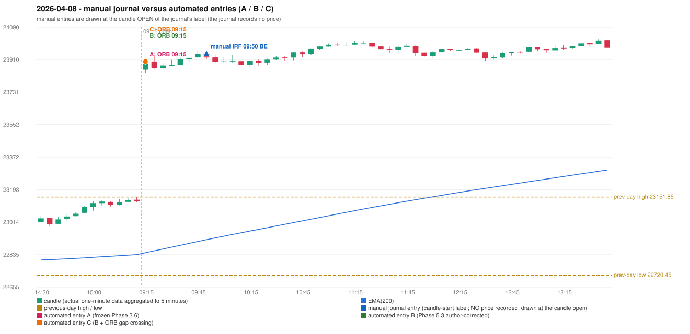

# 2026-04-08 (Wednesday) - manual journal versus the automated configurations

> SYNTHETIC index-point P&L; no real option P&L; costs illustrative (Rs 70 per trade + slippage scenarios). Configurations A / B / C are never combined.

## Session

* Open 23855.15; previous official close 23123.65; gap +731.50; previous-day high / low 23151.85 / 22720.45
* First 5-minute candle (09:15-09:20): O23855.15 H23909.45 L23836.9 C23900.0, GREEN, body 61.8%; EMA(200) at the first candle 22844.92; previous session's last close 23129.95 vs its EMA 22834.32

## Manual journal

row 107: IRF labelled 09:50, outcome BE

## Configuration A

Candidate signals (confirmed): 09:20 ORB/Method 1 LONG [EXECUTED: trade 1: T1_THEN_BUFFER_STOP]; 09:20 ORB/Method 2 LONG [MERGED_SAME_STRATEGY_METHOD: traded as another method of the same strategy/direction in the same minute]; 10:00 IRF/Method 1 SHORT [IGNORED: DAY_FINISHED]; 10:15 IRF/Method 2A SHORT [IGNORED: DAY_FINISHED]; 11:30 IRF/Method 2A SHORT [IGNORED: DAY_FINISHED]; 13:35 IRF/Method 2B SHORT [IGNORED: DAY_FINISHED]; 14:15 IRF/Method 2A SHORT [IGNORED: DAY_FINISHED]; 14:35 IRF/Method 2B SHORT [IGNORED: DAY_FINISHED]

Strategies with no confirmed signal: PDR: no setup record (the strategy's trigger event never occurred) | PDS: no setup record (the strategy's trigger event never occurred) | RF: no setup record (the strategy's trigger event never occurred)

| trade | strategy / method | dir | signal -> fill | entry | stop / T1 / T2 | leg 1 | leg 2 | outcome | gross Rs | net Rs (70, 0) | net Rs (70, 1.0) |
|---|---|---|---|---|---|---|---|---|---|---|---|
| 1 | ORB/Method 1 | LONG | 09:20 -> 09:20 | 23899.95 | 23869.95 / 23926.95 / 23959.95 | 09:21 @ 23926.95 | 09:22 @ 23893.95 | T1_THEN_BUFFER_STOP | 4,095 | 4,025 | 3,245 |

Selection: This ORB Method 1 signal was the earliest executable signal of the day: 0 confirmed signal(s) earlier, 1 other in the same minute. 6 later confirmed signal(s) (IRF x6) are logged as ignored or rejected. State of the other four engines at that moment: [IRF: no setup record before this time (a base condition was not met, or nothing triggered)] [PDR: no setup record before this time (a base condition was not met, or nothing triggered)] [PDS: no setup record before this time (a base condition was not met, or nothing triggered)] [RF: no setup record before this time (a base condition was not met, or nothing triggered)]

* Journal row 107 (IRF 09:50): **UNMATCHED_MANUAL**; earliest cause DIFFERENT_STRATEGY_SELECTED (+ PORTFOLIO_CONTROLLER_CONSTRAINT): the controller took ORB Method 1 (signal 09:20) first; the IRF signal at 10:00 was IGNORED: DAY_FINISHED
* Automated ORB 09:15 has no strict / time-tolerant journal counterpart: DIFFERENT_STRATEGY_SELECTED - the journal traded IRF 09:50; the automated controller took ORB Method 1 (candle 09:15) as the first valid signal

## Configuration B

Candidate signals (confirmed): 09:20 ORB/Method 1 LONG [EXECUTED: trade 1: T1_THEN_BUFFER_STOP]; 09:20 ORB/Method 2 LONG [MERGED_SAME_STRATEGY_METHOD: traded as another method of the same strategy/direction in the same minute]; 10:00 IRF/Method 1 SHORT [IGNORED: DAY_FINISHED]; 10:00 IRF/Method 2A SHORT [IGNORED: DAY_FINISHED]; 13:45 IRF/Method 2B SHORT [IGNORED: DAY_FINISHED]; 14:35 IRF/Method 2B SHORT [IGNORED: DAY_FINISHED]

Strategies with no confirmed signal: PDR: no setup record (the strategy's trigger event never occurred) | PDS: no setup record (the strategy's trigger event never occurred) | RF: no setup record (the strategy's trigger event never occurred)

| trade | strategy / method | dir | signal -> fill | entry | stop / T1 / T2 | leg 1 | leg 2 | outcome | gross Rs | net Rs (70, 0) | net Rs (70, 1.0) |
|---|---|---|---|---|---|---|---|---|---|---|---|
| 1 | ORB/Method 1 | LONG | 09:20 -> 09:20 | 23899.95 | 23869.95 / 23926.95 / 23959.95 | 09:21 @ 23926.95 | 09:22 @ 23893.95 | T1_THEN_BUFFER_STOP | 4,095 | 4,025 | 3,245 |

Selection: This ORB Method 1 signal was the earliest executable signal of the day: 0 confirmed signal(s) earlier, 1 other in the same minute. 4 later confirmed signal(s) (IRF x4) are logged as ignored or rejected. State of the other four engines at that moment: [IRF: no setup record before this time (a base condition was not met, or nothing triggered)] [PDR: no setup record before this time (a base condition was not met, or nothing triggered)] [PDS: no setup record before this time (a base condition was not met, or nothing triggered)] [RF: no setup record before this time (a base condition was not met, or nothing triggered)]

* Journal row 107 (IRF 09:50): **UNMATCHED_MANUAL**; earliest cause DIFFERENT_STRATEGY_SELECTED (+ PORTFOLIO_CONTROLLER_CONSTRAINT): the controller took ORB Method 1 (signal 09:20) first; the IRF signal at 10:00 was IGNORED: DAY_FINISHED
* Automated ORB 09:15 has no strict / time-tolerant journal counterpart: DIFFERENT_STRATEGY_SELECTED - the journal traded IRF 09:50; the automated controller took ORB Method 1 (candle 09:15) as the first valid signal

## Configuration C

Candidate signals (confirmed): 09:20 ORB/Method 1 LONG [EXECUTED: trade 1: T1_THEN_BUFFER_STOP]; 09:20 ORB/Method 2 LONG [MERGED_SAME_STRATEGY_METHOD: traded as another method of the same strategy/direction in the same minute]; 10:00 IRF/Method 1 SHORT [IGNORED: DAY_FINISHED]; 10:00 IRF/Method 2A SHORT [IGNORED: DAY_FINISHED]; 13:45 IRF/Method 2B SHORT [IGNORED: DAY_FINISHED]; 14:35 IRF/Method 2B SHORT [IGNORED: DAY_FINISHED]

Strategies with no confirmed signal: PDR: no setup record (the strategy's trigger event never occurred) | PDS: no setup record (the strategy's trigger event never occurred) | RF: no setup record (the strategy's trigger event never occurred)

| trade | strategy / method | dir | signal -> fill | entry | stop / T1 / T2 | leg 1 | leg 2 | outcome | gross Rs | net Rs (70, 0) | net Rs (70, 1.0) |
|---|---|---|---|---|---|---|---|---|---|---|---|
| 1 | ORB/Method 1 | LONG | 09:20 -> 09:20 | 23899.95 | 23869.95 / 23926.95 / 23959.95 | 09:21 @ 23926.95 | 09:22 @ 23893.95 | T1_THEN_BUFFER_STOP | 4,095 | 4,025 | 3,245 |

Selection: This ORB Method 1 signal was the earliest executable signal of the day: 0 confirmed signal(s) earlier, 1 other in the same minute. 4 later confirmed signal(s) (IRF x4) are logged as ignored or rejected. State of the other four engines at that moment: [IRF: no setup record before this time (a base condition was not met, or nothing triggered)] [PDR: no setup record before this time (a base condition was not met, or nothing triggered)] [PDS: no setup record before this time (a base condition was not met, or nothing triggered)] [RF: no setup record before this time (a base condition was not met, or nothing triggered)]

* Journal row 107 (IRF 09:50): **UNMATCHED_MANUAL**; earliest cause DIFFERENT_STRATEGY_SELECTED (+ PORTFOLIO_CONTROLLER_CONSTRAINT): the controller took ORB Method 1 (signal 09:20) first; the IRF signal at 10:00 was IGNORED: DAY_FINISHED
* Automated ORB 09:15 has no strict / time-tolerant journal counterpart: DIFFERENT_STRATEGY_SELECTED - the journal traded IRF 09:50; the automated controller took ORB Method 1 (candle 09:15) as the first valid signal

## Chart

