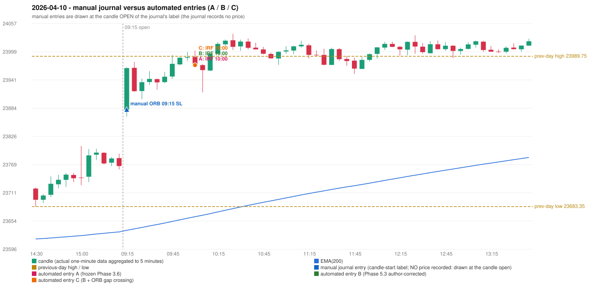

# 2026-04-10 (Friday) - manual journal versus the automated configurations

> SYNTHETIC index-point P&L; no real option P&L; costs illustrative (Rs 70 per trade + slippage scenarios). Configurations A / B / C are never combined.

## Session

* Open 23880.55; previous official close 23775.1; gap +105.45; previous-day high / low 23989.75 / 23683.35
* First 5-minute candle (09:15-09:20): O23880.55 H23967.4 L23867.2 C23965.7, GREEN, body 85.0%; EMA(200) at the first candle 23635.00; previous session's last close 23766.05 vs its EMA 23631.67

## Manual journal

row 108: ORB labelled 09:15, outcome SL

## Configuration A

Candidate signals (confirmed): 10:05 IRF/Method 2B SHORT [EXECUTED: trade 1: T1_THEN_BUFFER_STOP]; 10:10 IRF/Method 1 SHORT [IGNORED: POSITION_ACTIVE (signal kept for diagnostics only; never reused)]; 10:50 IRF/Method 2A SHORT [IGNORED: DAY_FINISHED]; 11:25 IRF/Method 2A SHORT [IGNORED: DAY_FINISHED]; 11:50 IRF/Method 1 SHORT [IGNORED: DAY_FINISHED]; 11:50 IRF/Method 2A SHORT [IGNORED: DAY_FINISHED]; 12:30 IRF/Method 2B SHORT [IGNORED: DAY_FINISHED]; 14:05 IRF/Method 2B SHORT [IGNORED: DAY_FINISHED]; 14:25 IRF/Method 1 SHORT [IGNORED: DAY_FINISHED]

Strategies with no confirmed signal: ORB: Method 2 INVALIDATED TRENDLINE_NOT_SUPPORTIVE | PDR: PDR INVALIDATED OPEN_NOT_STRICTLY_ABOVE_ZONE | PDS: no setup record (the strategy's trigger event never occurred) | RF: no setup record (the strategy's trigger event never occurred)

| trade | strategy / method | dir | signal -> fill | entry | stop / T1 / T2 | leg 1 | leg 2 | outcome | gross Rs | net Rs (70, 0) | net Rs (70, 1.0) |
|---|---|---|---|---|---|---|---|---|---|---|---|
| 1 | IRF/Method 2B | SHORT | 10:05 -> 10:05 | 23971.85 | 24006.85 / 23944.85 / 23911.85 | 10:05 @ 23944.85 | 10:11 @ 23977.85 | T1_THEN_BUFFER_STOP | 4,095 | 4,025 | 3,245 |

Selection: This IRF Method 2B signal was the earliest executable signal of the day: 0 confirmed signal(s) earlier, 0 other in the same minute. 8 later confirmed signal(s) (IRF x8) are logged as ignored or rejected. State of the other four engines at that moment: [ORB: Method 2 invalidated at 09:15: TRENDLINE_NOT_SUPPORTIVE] [PDR: PDR invalidated at 09:15: OPEN_NOT_STRICTLY_ABOVE_ZONE] [PDS: no setup record before this time (a base condition was not met, or nothing triggered)] [RF: no setup record before this time (a base condition was not met, or nothing triggered)]

* Journal row 108 (ORB 09:15): **UNMATCHED_MANUAL**; earliest cause LEVEL_CONSTRUCTION_MISMATCH (+ TRENDLINE_MISMATCH): first candle GREEN O23880.55 H23967.4 L23867.2 C23965.7 (body 85.0%); direction ASSUMED from the colour (the journal has no direction); TIE-BROKEN BY METHOD ORDER: 3 methods tie at 1 failing predicate(s) (Method 1: level_broken; Method 2: trendline; Gap/200DMA: gap_crosses_200_average) - the evidence does not single out one cause, the secondary cause is the other tied one; closest method Method 1 (1 failing predicate(s)): first failing 'level_broken' - previous-day high 23989.75; candle high/low 23967.4, close 23965.7; all methods: Method 1: 1 fail (level_broken); Method 2: 1 fail (trendline); Gap/200DMA: 1 fail (gap_crosses_200_average)
* Automated IRF 10:00 has no strict / time-tolerant journal counterpart: DIFFERENT_STRATEGY_SELECTED - the journal traded ORB 09:15; the automated controller took IRF Method 2B (candle 10:00) as the first valid signal

## Configuration B

Candidate signals (confirmed): 10:05 IRF/Method 2B SHORT [EXECUTED: trade 1: T1_THEN_BUFFER_STOP]; 10:10 IRF/Method 1 SHORT [IGNORED: POSITION_ACTIVE (signal kept for diagnostics only; never reused)]; 10:50 IRF/Method 2A SHORT [IGNORED: DAY_FINISHED]; 11:30 IRF/Method 2A SHORT [IGNORED: DAY_FINISHED]; 11:50 IRF/Method 1 SHORT [IGNORED: DAY_FINISHED]; 11:50 IRF/Method 2A SHORT [IGNORED: DAY_FINISHED]; 12:20 IRF/Method 2A SHORT [IGNORED: DAY_FINISHED]; 14:05 IRF/Method 2B SHORT [IGNORED: DAY_FINISHED]; 14:25 IRF/Method 1 SHORT [IGNORED: DAY_FINISHED]; 15:20 IRF/Method 2A SHORT [IGNORED: DAY_FINISHED]

Strategies with no confirmed signal: ORB: Method 2 INVALIDATED TRENDLINE_NOT_SUPPORTIVE | PDR: PDR INVALIDATED OPEN_NOT_STRICTLY_ABOVE_ZONE | PDS: no setup record (the strategy's trigger event never occurred) | RF: no setup record (the strategy's trigger event never occurred)

| trade | strategy / method | dir | signal -> fill | entry | stop / T1 / T2 | leg 1 | leg 2 | outcome | gross Rs | net Rs (70, 0) | net Rs (70, 1.0) |
|---|---|---|---|---|---|---|---|---|---|---|---|
| 1 | IRF/Method 2B | SHORT | 10:05 -> 10:05 | 23971.85 | 24006.85 / 23944.85 / 23911.85 | 10:05 @ 23944.85 | 10:11 @ 23977.85 | T1_THEN_BUFFER_STOP | 4,095 | 4,025 | 3,245 |

Selection: This IRF Method 2B signal was the earliest executable signal of the day: 0 confirmed signal(s) earlier, 0 other in the same minute. 9 later confirmed signal(s) (IRF x9) are logged as ignored or rejected. State of the other four engines at that moment: [ORB: Method 2 invalidated at 09:15: TRENDLINE_NOT_SUPPORTIVE] [PDR: PDR invalidated at 09:15: OPEN_NOT_STRICTLY_ABOVE_ZONE] [PDS: no setup record before this time (a base condition was not met, or nothing triggered)] [RF: no setup record before this time (a base condition was not met, or nothing triggered)]

* Journal row 108 (ORB 09:15): **UNMATCHED_MANUAL**; earliest cause LEVEL_CONSTRUCTION_MISMATCH (+ TRENDLINE_MISMATCH): first candle GREEN O23880.55 H23967.4 L23867.2 C23965.7 (body 85.0%); direction ASSUMED from the colour (the journal has no direction); TIE-BROKEN BY METHOD ORDER: 3 methods tie at 1 failing predicate(s) (Method 1: level_broken; Method 2: trendline; Gap/200DMA: gap_crosses_200_average) - the evidence does not single out one cause, the secondary cause is the other tied one; closest method Method 1 (1 failing predicate(s)): first failing 'level_broken' - previous-day high 23989.75; candle high/low 23967.4, close 23965.7; all methods: Method 1: 1 fail (level_broken); Method 2: 1 fail (trendline); Gap/200DMA: 1 fail (gap_crosses_200_average)
* Automated IRF 10:00 has no strict / time-tolerant journal counterpart: DIFFERENT_STRATEGY_SELECTED - the journal traded ORB 09:15; the automated controller took IRF Method 2B (candle 10:00) as the first valid signal

## Configuration C

Candidate signals (confirmed): 10:05 IRF/Method 2B SHORT [EXECUTED: trade 1: T1_THEN_BUFFER_STOP]; 10:10 IRF/Method 1 SHORT [IGNORED: POSITION_ACTIVE (signal kept for diagnostics only; never reused)]; 10:50 IRF/Method 2A SHORT [IGNORED: DAY_FINISHED]; 11:30 IRF/Method 2A SHORT [IGNORED: DAY_FINISHED]; 11:50 IRF/Method 1 SHORT [IGNORED: DAY_FINISHED]; 11:50 IRF/Method 2A SHORT [IGNORED: DAY_FINISHED]; 12:20 IRF/Method 2A SHORT [IGNORED: DAY_FINISHED]; 14:05 IRF/Method 2B SHORT [IGNORED: DAY_FINISHED]; 14:25 IRF/Method 1 SHORT [IGNORED: DAY_FINISHED]; 15:20 IRF/Method 2A SHORT [IGNORED: DAY_FINISHED]

Strategies with no confirmed signal: ORB: Method 2 INVALIDATED TRENDLINE_NOT_SUPPORTIVE | PDR: PDR INVALIDATED OPEN_NOT_STRICTLY_ABOVE_ZONE | PDS: no setup record (the strategy's trigger event never occurred) | RF: no setup record (the strategy's trigger event never occurred)

| trade | strategy / method | dir | signal -> fill | entry | stop / T1 / T2 | leg 1 | leg 2 | outcome | gross Rs | net Rs (70, 0) | net Rs (70, 1.0) |
|---|---|---|---|---|---|---|---|---|---|---|---|
| 1 | IRF/Method 2B | SHORT | 10:05 -> 10:05 | 23971.85 | 24006.85 / 23944.85 / 23911.85 | 10:05 @ 23944.85 | 10:11 @ 23977.85 | T1_THEN_BUFFER_STOP | 4,095 | 4,025 | 3,245 |

Selection: This IRF Method 2B signal was the earliest executable signal of the day: 0 confirmed signal(s) earlier, 0 other in the same minute. 9 later confirmed signal(s) (IRF x9) are logged as ignored or rejected. State of the other four engines at that moment: [ORB: Method 2 invalidated at 09:15: TRENDLINE_NOT_SUPPORTIVE] [PDR: PDR invalidated at 09:15: OPEN_NOT_STRICTLY_ABOVE_ZONE] [PDS: no setup record before this time (a base condition was not met, or nothing triggered)] [RF: no setup record before this time (a base condition was not met, or nothing triggered)]

* Journal row 108 (ORB 09:15): **UNMATCHED_MANUAL**; earliest cause LEVEL_CONSTRUCTION_MISMATCH (+ TRENDLINE_MISMATCH): first candle GREEN O23880.55 H23967.4 L23867.2 C23965.7 (body 85.0%); direction ASSUMED from the colour (the journal has no direction); TIE-BROKEN BY METHOD ORDER: 3 methods tie at 1 failing predicate(s) (Method 1: level_broken; Method 2: trendline; Gap/200DMA: gap_crosses_200_average) - the evidence does not single out one cause, the secondary cause is the other tied one; closest method Method 1 (1 failing predicate(s)): first failing 'level_broken' - previous-day high 23989.75; candle high/low 23967.4, close 23965.7; all methods: Method 1: 1 fail (level_broken); Method 2: 1 fail (trendline); Gap/200DMA: 1 fail (gap_crosses_200_average)
* Automated IRF 10:00 has no strict / time-tolerant journal counterpart: DIFFERENT_STRATEGY_SELECTED - the journal traded ORB 09:15; the automated controller took IRF Method 2B (candle 10:00) as the first valid signal

## Chart

