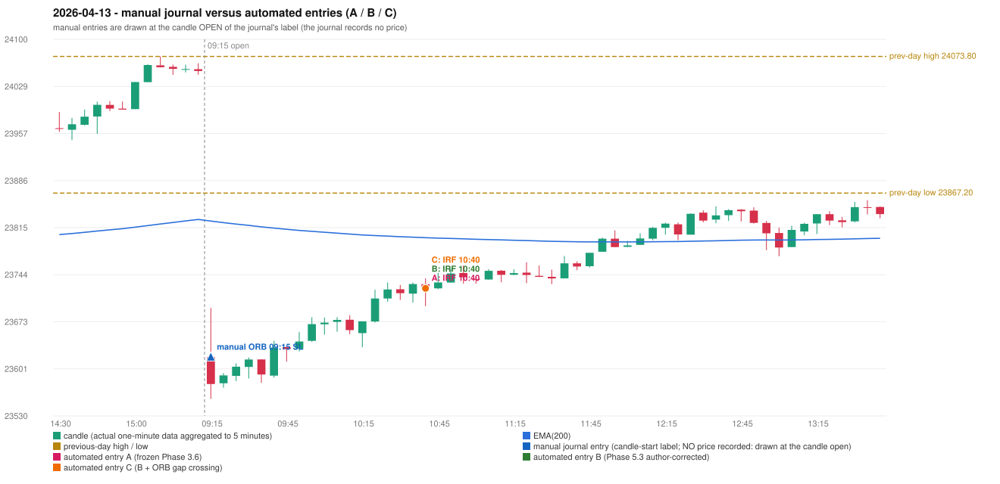

# 2026-04-13 (Monday) - manual journal versus the automated configurations

> SYNTHETIC index-point P&L; no real option P&L; costs illustrative (Rs 70 per trade + slippage scenarios). Configurations A / B / C are never combined.

## Session

* Open 23619.05; previous official close 24050.6; gap -431.55; previous-day high / low 24073.8 / 23867.2
* First 5-minute candle (09:15-09:20): O23619.05 H23693.7 L23556.15 C23578.55, RED, body 29.4%; EMA(200) at the first candle 23824.88; previous session's last close 24051.8 vs its EMA 23827.36

## Manual journal

row 109: ORB labelled 09:15, outcome SL

## Configuration A

Candidate signals (confirmed): 10:45 IRF/Method 2B SHORT [EXECUTED: trade 1: INITIAL_FULL_STOP]; 11:25 IRF/Method 2B SHORT [REJECTED: SECOND_TRADE_RESTRICTED_TO_PDR_PDS]; 11:45 IRF/Method 2B SHORT [REJECTED: SECOND_TRADE_RESTRICTED_TO_PDR_PDS]; 12:25 IRF/Method 2B SHORT [REJECTED: SECOND_TRADE_RESTRICTED_TO_PDR_PDS]; 13:00 IRF/Method 2A SHORT [REJECTED: SECOND_TRADE_RESTRICTED_TO_PDR_PDS]; 13:45 IRF/Method 2B SHORT [REJECTED: SECOND_TRADE_RESTRICTED_TO_PDR_PDS]; 15:05 IRF/Method 2A SHORT [REJECTED: SECOND_TRADE_RESTRICTED_TO_PDR_PDS]; 15:05 PDS/Method 3 SHORT [REJECTED: ENTRY_CUTOFF_EXCEEDED(fill 15:05 IST > 13:00)]

Strategies with no confirmed signal: ORB: Gap/200DMA INVALIDATED CANDLE_QUALITY_OR_REJECTION_WICK; Method 1 INVALIDATED TREND:EMA_PREV_SESSION_CLOSE wrong side; Method 2 INVALIDATED TREND:EMA_PREV_SESSI | PDR: no setup record (the strategy's trigger event never occurred) | RF: no setup record (the strategy's trigger event never occurred)

| trade | strategy / method | dir | signal -> fill | entry | stop / T1 / T2 | leg 1 | leg 2 | outcome | gross Rs | net Rs (70, 0) | net Rs (70, 1.0) |
|---|---|---|---|---|---|---|---|---|---|---|---|
| 1 | IRF/Method 2B | SHORT | 10:45 -> 10:45 | 23723.2 | 23758.2 / 23696.2 / 23663.2 | 11:23 @ 23758.2 | 11:23 @ 23758.2 | INITIAL_FULL_STOP | -13,650 | -13,720 | -14,500 |

Selection: This IRF Method 2B signal was the earliest executable signal of the day: 0 confirmed signal(s) earlier, 0 other in the same minute. 7 later confirmed signal(s) (IRF x6, PDS x1) are logged as ignored or rejected. State of the other four engines at that moment: [ORB: Method 1 invalidated at 09:15: TREND:EMA_PREV_SESSION_CLOSE wrong side; Method 2 invalidated at 09:15: TREND:EMA_PREV_SESSION_CLOSE wrong side] [PDR: no setup record before this time (a base condition was not met, or nothing triggered)] [PDS: no setup record before this time (a base condition was not met, or nothing triggered)] [RF: no setup record before this time (a base condition was not met, or nothing triggered)]

* Journal row 109 (ORB 09:15): **UNMATCHED_MANUAL**; earliest cause CANDLE_STRENGTH_MISMATCH: first candle RED O23619.05 H23693.7 L23556.15 C23578.55 (body 29.4%); direction ASSUMED from the colour (the journal has no direction); closest method Gap/200DMA (1 failing predicate(s)): first failing 'candle_shape' - body 29.4% opposite wick 16.3% close location 16.3%; rejection wick flag False; all methods: Method 1: 2 fail (trend); Method 2: 3 fail (trend); Gap/200DMA: 1 fail (candle_shape)
* Automated IRF 10:40 has no strict / time-tolerant journal counterpart: DIFFERENT_STRATEGY_SELECTED - the journal traded ORB 09:15; the automated controller took IRF Method 2B (candle 10:40) as the first valid signal

## Configuration B

Candidate signals (confirmed): 10:45 IRF/Method 2B SHORT [EXECUTED: trade 1: INITIAL_FULL_STOP]; 11:25 IRF/Method 2B SHORT [REJECTED: SECOND_TRADE_RESTRICTED_TO_PDR_PDS]; 11:45 IRF/Method 2B SHORT [REJECTED: SECOND_TRADE_RESTRICTED_TO_PDR_PDS]; 14:05 PDS/Method 1 SHORT [REJECTED: ENTRY_CUTOFF_EXCEEDED(fill 14:05 IST > 13:00)]; 14:10 PDS/Method 1 SHORT [REJECTED: ENTRY_CUTOFF_EXCEEDED(fill 14:10 IST > 13:00)]; 14:40 PDS/Method 2 SHORT [REJECTED: ENTRY_CUTOFF_EXCEEDED(fill 14:40 IST > 13:00)]; 15:05 PDS/Method 3 SHORT [REJECTED: ENTRY_CUTOFF_EXCEEDED(fill 15:05 IST > 13:00)]

Strategies with no confirmed signal: ORB: Gap/200DMA INVALIDATED CANDLE_QUALITY_OR_REJECTION_WICK; Method 1 INVALIDATED TREND:EMA_PREV_SESSION_CLOSE wrong side; Method 2 INVALIDATED TREND:EMA_PREV_SESSI | PDR: no setup record (the strategy's trigger event never occurred) | RF: no setup record (the strategy's trigger event never occurred)

| trade | strategy / method | dir | signal -> fill | entry | stop / T1 / T2 | leg 1 | leg 2 | outcome | gross Rs | net Rs (70, 0) | net Rs (70, 1.0) |
|---|---|---|---|---|---|---|---|---|---|---|---|
| 1 | IRF/Method 2B | SHORT | 10:45 -> 10:45 | 23723.2 | 23758.2 / 23696.2 / 23663.2 | 11:23 @ 23758.2 | 11:23 @ 23758.2 | INITIAL_FULL_STOP | -13,650 | -13,720 | -14,500 |

Selection: This IRF Method 2B signal was the earliest executable signal of the day: 0 confirmed signal(s) earlier, 0 other in the same minute. 6 later confirmed signal(s) (IRF x2, PDS x4) are logged as ignored or rejected. State of the other four engines at that moment: [ORB: Method 1 invalidated at 09:15: TREND:EMA_PREV_SESSION_CLOSE wrong side; Method 2 invalidated at 09:15: TREND:EMA_PREV_SESSION_CLOSE wrong side] [PDR: no setup record before this time (a base condition was not met, or nothing triggered)] [PDS: no setup record before this time (a base condition was not met, or nothing triggered)] [RF: no setup record before this time (a base condition was not met, or nothing triggered)]

* Journal row 109 (ORB 09:15): **UNMATCHED_MANUAL**; earliest cause CANDLE_STRENGTH_MISMATCH: first candle RED O23619.05 H23693.7 L23556.15 C23578.55 (body 29.4%); direction ASSUMED from the colour (the journal has no direction); closest method Gap/200DMA (1 failing predicate(s)): first failing 'candle_shape' - body 29.4% opposite wick 16.3% close location 16.3%; rejection wick flag False; all methods: Method 1: 2 fail (trend); Method 2: 3 fail (trend); Gap/200DMA: 1 fail (candle_shape)
* Automated IRF 10:40 has no strict / time-tolerant journal counterpart: DIFFERENT_STRATEGY_SELECTED - the journal traded ORB 09:15; the automated controller took IRF Method 2B (candle 10:40) as the first valid signal

## Configuration C

Candidate signals (confirmed): 10:45 IRF/Method 2B SHORT [EXECUTED: trade 1: INITIAL_FULL_STOP]; 11:25 IRF/Method 2B SHORT [REJECTED: SECOND_TRADE_RESTRICTED_TO_PDR_PDS]; 11:45 IRF/Method 2B SHORT [REJECTED: SECOND_TRADE_RESTRICTED_TO_PDR_PDS]; 14:05 PDS/Method 1 SHORT [REJECTED: ENTRY_CUTOFF_EXCEEDED(fill 14:05 IST > 13:00)]; 14:10 PDS/Method 1 SHORT [REJECTED: ENTRY_CUTOFF_EXCEEDED(fill 14:10 IST > 13:00)]; 14:40 PDS/Method 2 SHORT [REJECTED: ENTRY_CUTOFF_EXCEEDED(fill 14:40 IST > 13:00)]; 15:05 PDS/Method 3 SHORT [REJECTED: ENTRY_CUTOFF_EXCEEDED(fill 15:05 IST > 13:00)]

Strategies with no confirmed signal: ORB: Gap/200DMA INVALIDATED CANDLE_QUALITY_OR_REJECTION_WICK; Method 1 INVALIDATED TREND:EMA_PREV_SESSION_CLOSE wrong side; Method 2 INVALIDATED TREND:EMA_PREV_SESSI | PDR: no setup record (the strategy's trigger event never occurred) | RF: no setup record (the strategy's trigger event never occurred)

| trade | strategy / method | dir | signal -> fill | entry | stop / T1 / T2 | leg 1 | leg 2 | outcome | gross Rs | net Rs (70, 0) | net Rs (70, 1.0) |
|---|---|---|---|---|---|---|---|---|---|---|---|
| 1 | IRF/Method 2B | SHORT | 10:45 -> 10:45 | 23723.2 | 23758.2 / 23696.2 / 23663.2 | 11:23 @ 23758.2 | 11:23 @ 23758.2 | INITIAL_FULL_STOP | -13,650 | -13,720 | -14,500 |

Selection: This IRF Method 2B signal was the earliest executable signal of the day: 0 confirmed signal(s) earlier, 0 other in the same minute. 6 later confirmed signal(s) (IRF x2, PDS x4) are logged as ignored or rejected. State of the other four engines at that moment: [ORB: Method 1 invalidated at 09:15: TREND:EMA_PREV_SESSION_CLOSE wrong side; Method 2 invalidated at 09:15: TREND:EMA_PREV_SESSION_CLOSE wrong side] [PDR: no setup record before this time (a base condition was not met, or nothing triggered)] [PDS: no setup record before this time (a base condition was not met, or nothing triggered)] [RF: no setup record before this time (a base condition was not met, or nothing triggered)]

* Journal row 109 (ORB 09:15): **UNMATCHED_MANUAL**; earliest cause CANDLE_STRENGTH_MISMATCH: first candle RED O23619.05 H23693.7 L23556.15 C23578.55 (body 29.4%); direction ASSUMED from the colour (the journal has no direction); closest method Gap/200DMA (1 failing predicate(s)): first failing 'candle_shape' - body 29.4% opposite wick 16.3% close location 16.3%; rejection wick flag False; all methods: Method 1: 2 fail (trend); Method 2: 3 fail (trend); Gap/200DMA: 1 fail (candle_shape)
* Automated IRF 10:40 has no strict / time-tolerant journal counterpart: DIFFERENT_STRATEGY_SELECTED - the journal traded ORB 09:15; the automated controller took IRF Method 2B (candle 10:40) as the first valid signal

## Chart

