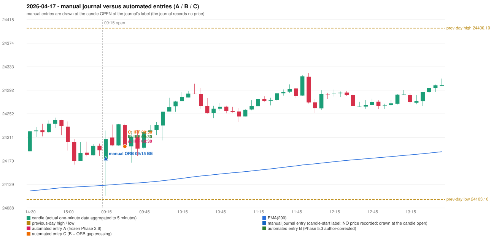

# 2026-04-17 (Friday) - manual journal versus the automated configurations

> SYNTHETIC index-point P&L; no real option P&L; costs illustrative (Rs 70 per trade + slippage scenarios). Configurations A / B / C are never combined.

## Session

* Open 24173.6; previous official close 24196.75; gap -23.15; previous-day high / low 24400.1 / 24103.1
* First 5-minute candle (09:15-09:20): O24173.6 H24222.6 L24109.45 C24207.55, GREEN, body 30.0%; EMA(200) at the first candle 24127.80; previous session's last close 24188.4 vs its EMA 24127.00

## Manual journal

row 111: ORB labelled 09:15, outcome BE

## Configuration A

Candidate signals (confirmed): 09:35 IRF/Method 1 SHORT [EXECUTED: trade 1: T1_THEN_BUFFER_STOP]; 10:35 IRF/Method 2B SHORT [IGNORED: DAY_FINISHED]; 12:00 IRF/Method 2A SHORT [IGNORED: DAY_FINISHED]; 14:30 IRF/Method 2B SHORT [IGNORED: DAY_FINISHED]

Strategies with no confirmed signal: ORB: no setup record (the strategy's trigger event never occurred) | PDR: no setup record (the strategy's trigger event never occurred) | PDS: Method 1/2/3 INVALIDATED GAP_DOWN_OPEN_NOT_BELOW_ZONE | RF: no setup record (the strategy's trigger event never occurred)

| trade | strategy / method | dir | signal -> fill | entry | stop / T1 / T2 | leg 1 | leg 2 | outcome | gross Rs | net Rs (70, 0) | net Rs (70, 1.0) |
|---|---|---|---|---|---|---|---|---|---|---|---|
| 1 | IRF/Method 1 | SHORT | 09:35 -> 09:35 | 24195.05 | 24230.05 / 24168.05 / 24135.05 | 09:37 @ 24168.05 | 09:38 @ 24201.05 | T1_THEN_BUFFER_STOP | 4,095 | 4,025 | 3,245 |

Selection: This IRF Method 1 signal was the earliest executable signal of the day: 0 confirmed signal(s) earlier, 0 other in the same minute. 3 later confirmed signal(s) (IRF x3) are logged as ignored or rejected. State of the other four engines at that moment: [ORB: no setup record before this time (a base condition was not met, or nothing triggered)] [PDR: no setup record before this time (a base condition was not met, or nothing triggered)] [PDS: Method 1/2/3 invalidated at 09:15: GAP_DOWN_OPEN_NOT_BELOW_ZONE] [RF: no setup record before this time (a base condition was not met, or nothing triggered)]

* Journal row 111 (ORB 09:15): **UNMATCHED_MANUAL**; earliest cause LEVEL_CONSTRUCTION_MISMATCH: first candle GREEN O24173.6 H24222.6 L24109.45 C24207.55 (body 30.0%); direction ASSUMED from the colour (the journal has no direction); TIE-BROKEN BY METHOD ORDER: 2 methods tie at 2 failing predicate(s) (Method 1: level_broken; Method 2: inner_level_broken) - the evidence does not single out one cause, the secondary cause is the other tied one; closest method Method 1 (2 failing predicate(s)): first failing 'level_broken' - previous-day high 24400.1; candle high/low 24222.6, close 24207.55; all methods: Method 1: 2 fail (level_broken); Method 2: 2 fail (inner_level_broken); Gap/200DMA: 3 fail (gap_in_direction)
* Automated IRF 09:30 has no strict / time-tolerant journal counterpart: DIFFERENT_STRATEGY_SELECTED - the journal traded ORB 09:15; the automated controller took IRF Method 1 (candle 09:30) as the first valid signal

## Configuration B

Candidate signals (confirmed): 09:35 IRF/Method 1 SHORT [EXECUTED: trade 1: T1_THEN_BUFFER_STOP]; 10:35 IRF/Method 2A SHORT [IGNORED: DAY_FINISHED]; 10:35 IRF/Method 2B SHORT [IGNORED: DAY_FINISHED]; 12:00 IRF/Method 2A SHORT [IGNORED: DAY_FINISHED]; 14:30 IRF/Method 2B SHORT [IGNORED: DAY_FINISHED]

Strategies with no confirmed signal: ORB: no setup record (the strategy's trigger event never occurred) | PDR: no setup record (the strategy's trigger event never occurred) | PDS: Method 1/2/3 INVALIDATED GAP_DOWN_OPEN_NOT_BELOW_ZONE | RF: no setup record (the strategy's trigger event never occurred)

| trade | strategy / method | dir | signal -> fill | entry | stop / T1 / T2 | leg 1 | leg 2 | outcome | gross Rs | net Rs (70, 0) | net Rs (70, 1.0) |
|---|---|---|---|---|---|---|---|---|---|---|---|
| 1 | IRF/Method 1 | SHORT | 09:35 -> 09:35 | 24195.05 | 24230.05 / 24168.05 / 24135.05 | 09:37 @ 24168.05 | 09:38 @ 24201.05 | T1_THEN_BUFFER_STOP | 4,095 | 4,025 | 3,245 |

Selection: This IRF Method 1 signal was the earliest executable signal of the day: 0 confirmed signal(s) earlier, 0 other in the same minute. 4 later confirmed signal(s) (IRF x4) are logged as ignored or rejected. State of the other four engines at that moment: [ORB: no setup record before this time (a base condition was not met, or nothing triggered)] [PDR: no setup record before this time (a base condition was not met, or nothing triggered)] [PDS: Method 1/2/3 invalidated at 09:15: GAP_DOWN_OPEN_NOT_BELOW_ZONE] [RF: no setup record before this time (a base condition was not met, or nothing triggered)]

* Journal row 111 (ORB 09:15): **UNMATCHED_MANUAL**; earliest cause LEVEL_CONSTRUCTION_MISMATCH: first candle GREEN O24173.6 H24222.6 L24109.45 C24207.55 (body 30.0%); direction ASSUMED from the colour (the journal has no direction); TIE-BROKEN BY METHOD ORDER: 2 methods tie at 2 failing predicate(s) (Method 1: level_broken; Method 2: inner_level_broken) - the evidence does not single out one cause, the secondary cause is the other tied one; closest method Method 1 (2 failing predicate(s)): first failing 'level_broken' - previous-day high 24400.1; candle high/low 24222.6, close 24207.55; all methods: Method 1: 2 fail (level_broken); Method 2: 2 fail (inner_level_broken); Gap/200DMA: 3 fail (gap_in_direction)
* Automated IRF 09:30 has no strict / time-tolerant journal counterpart: DIFFERENT_STRATEGY_SELECTED - the journal traded ORB 09:15; the automated controller took IRF Method 1 (candle 09:30) as the first valid signal

## Configuration C

Candidate signals (confirmed): 09:35 IRF/Method 1 SHORT [EXECUTED: trade 1: T1_THEN_BUFFER_STOP]; 10:35 IRF/Method 2A SHORT [IGNORED: DAY_FINISHED]; 10:35 IRF/Method 2B SHORT [IGNORED: DAY_FINISHED]; 12:00 IRF/Method 2A SHORT [IGNORED: DAY_FINISHED]; 14:30 IRF/Method 2B SHORT [IGNORED: DAY_FINISHED]

Strategies with no confirmed signal: ORB: Gap/200DMA INVALIDATED CLOSE_NOT_BEYOND_MA | PDR: no setup record (the strategy's trigger event never occurred) | PDS: Method 1/2/3 INVALIDATED GAP_DOWN_OPEN_NOT_BELOW_ZONE | RF: no setup record (the strategy's trigger event never occurred)

| trade | strategy / method | dir | signal -> fill | entry | stop / T1 / T2 | leg 1 | leg 2 | outcome | gross Rs | net Rs (70, 0) | net Rs (70, 1.0) |
|---|---|---|---|---|---|---|---|---|---|---|---|
| 1 | IRF/Method 1 | SHORT | 09:35 -> 09:35 | 24195.05 | 24230.05 / 24168.05 / 24135.05 | 09:37 @ 24168.05 | 09:38 @ 24201.05 | T1_THEN_BUFFER_STOP | 4,095 | 4,025 | 3,245 |

Selection: This IRF Method 1 signal was the earliest executable signal of the day: 0 confirmed signal(s) earlier, 0 other in the same minute. 4 later confirmed signal(s) (IRF x4) are logged as ignored or rejected. State of the other four engines at that moment: [ORB: Gap/200DMA invalidated at 09:15: CLOSE_NOT_BEYOND_MA] [PDR: no setup record before this time (a base condition was not met, or nothing triggered)] [PDS: Method 1/2/3 invalidated at 09:15: GAP_DOWN_OPEN_NOT_BELOW_ZONE] [RF: no setup record before this time (a base condition was not met, or nothing triggered)]

* Journal row 111 (ORB 09:15): **UNMATCHED_MANUAL**; earliest cause LEVEL_CONSTRUCTION_MISMATCH: first candle GREEN O24173.6 H24222.6 L24109.45 C24207.55 (body 30.0%); direction ASSUMED from the colour (the journal has no direction); TIE-BROKEN BY METHOD ORDER: 2 methods tie at 2 failing predicate(s) (Method 1: level_broken; Method 2: inner_level_broken) - the evidence does not single out one cause, the secondary cause is the other tied one; closest method Method 1 (2 failing predicate(s)): first failing 'level_broken' - previous-day high 24400.1; candle high/low 24222.6, close 24207.55; all methods: Method 1: 2 fail (level_broken); Method 2: 2 fail (inner_level_broken); Gap/200DMA: 3 fail (gap_in_direction)
* Automated IRF 09:30 has no strict / time-tolerant journal counterpart: DIFFERENT_STRATEGY_SELECTED - the journal traded ORB 09:15; the automated controller took IRF Method 1 (candle 09:30) as the first valid signal

## Chart

