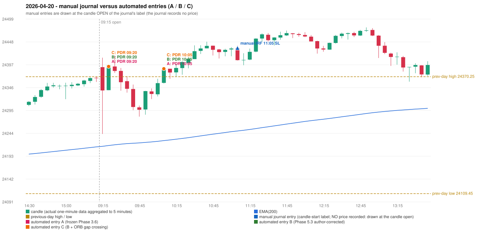

# 2026-04-20 (Monday) - manual journal versus the automated configurations

> SYNTHETIC index-point P&L; no real option P&L; costs illustrative (Rs 70 per trade + slippage scenarios). Configurations A / B / C are never combined.

## Session

* Open 24391.5; previous official close 24353.55; gap +37.95; previous-day high / low 24370.25 / 24109.45
* First 5-minute candle (09:15-09:20): O24391.5 H24412.75 L24242.6 C24339.55, RED, body 30.5%; EMA(200) at the first candle 24214.98; previous session's last close 24366.9 vs its EMA 24213.73

## Manual journal

row 112: IRF labelled 11:05, outcome SL

## Configuration A

Candidate signals (confirmed): 09:25 PDR/PDR LONG [EXECUTED: trade 1: INITIAL_FULL_STOP]; 10:10 PDR/PDR LONG [EXECUTED: trade 2: TARGET]; 10:55 PDR/PDR LONG [IGNORED: POSITION_ACTIVE (signal kept for diagnostics only; never reused)]; 11:10 IRF/Method 1 SHORT [IGNORED: POSITION_ACTIVE (signal kept for diagnostics only; never reused)]; 11:10 IRF/Method 2A SHORT [IGNORED: POSITION_ACTIVE (signal kept for diagnostics only; never reused)]; 11:55 IRF/Method 2B SHORT [IGNORED: DAY_FINISHED]; 12:45 IRF/Method 2B SHORT [IGNORED: DAY_FINISHED]; 13:25 IRF/Method 1 SHORT [IGNORED: DAY_FINISHED]; 13:25 IRF/Method 2A SHORT [IGNORED: DAY_FINISHED]; 14:00 PDR/PDR LONG [IGNORED: DAY_FINISHED]; 14:40 IRF/Method 1 SHORT [IGNORED: DAY_FINISHED]; 15:20 IRF/Method 2A SHORT [IGNORED: DAY_FINISHED]

Strategies with no confirmed signal: ORB: Method 2 INVALIDATED CANDLE_QUALITY | PDS: no setup record (the strategy's trigger event never occurred) | RF: no setup record (the strategy's trigger event never occurred)

| trade | strategy / method | dir | signal -> fill | entry | stop / T1 / T2 | leg 1 | leg 2 | outcome | gross Rs | net Rs (70, 0) | net Rs (70, 1.0) |
|---|---|---|---|---|---|---|---|---|---|---|---|
| 1 | PDR/PDR | LONG | 09:25 -> 09:25 | 24393.0 | 24358.0 / 24420.0 / 24463.0 | 09:32 @ 24358.0 | 09:32 @ 24358.0 | INITIAL_FULL_STOP | -13,650 | -13,720 | -14,500 |
| 2 | PDR/PDR | LONG | 10:10 -> 10:10 | 24388.05 | 24353.05 / 24415.05 / 24458.05 | 10:30 @ 24415.05 | 11:25 @ 24458.05 | TARGET | 18,915 | 18,845 | 18,065 |

Selection: This PDR signal was the earliest executable signal of the day: 0 confirmed signal(s) earlier, 0 other in the same minute. 11 later confirmed signal(s) (IRF x8, PDR x3) are logged as ignored or rejected. State of the other four engines at that moment: [IRF: no setup record before this time (a base condition was not met, or nothing triggered)] [ORB: Method 2 invalidated at 09:15: CANDLE_QUALITY] [PDS: no setup record before this time (a base condition was not met, or nothing triggered)] [RF: no setup record before this time (a base condition was not met, or nothing triggered)]

* Journal row 112 (IRF 11:05): **UNMATCHED_MANUAL**; earliest cause DIFFERENT_STRATEGY_SELECTED (+ PORTFOLIO_CONTROLLER_CONSTRAINT): the controller took PDR PDR (signal 09:25) first; the IRF signal at 11:10 was IGNORED: POSITION_ACTIVE (signal kept for diagnostics only; never reused)
* Automated PDR 09:20 has no strict / time-tolerant journal counterpart: DIFFERENT_STRATEGY_SELECTED - the journal traded IRF 11:05; the automated controller took PDR PDR (candle 09:20) as the first valid signal
* Automated PDR 10:05 has no strict / time-tolerant journal counterpart: PORTFOLIO_CONTROLLER_CONSTRAINT - second trade of the day: the controller allows a PDR / PDS re-entry after the original full stop of trade 1 (PDR PDR, signal candle 09:20); the journal rows of the day not matched to another trade: IRF 11:05

## Configuration B

Candidate signals (confirmed): 09:25 PDR/PDR LONG [EXECUTED: trade 1: INITIAL_FULL_STOP]; 10:10 PDR/PDR LONG [EXECUTED: trade 2: TARGET]; 10:20 PDR/PDR LONG [IGNORED: POSITION_ACTIVE (signal kept for diagnostics only; never reused)]; 11:10 IRF/Method 1 SHORT [IGNORED: POSITION_ACTIVE (signal kept for diagnostics only; never reused)]; 11:10 IRF/Method 2A SHORT [IGNORED: POSITION_ACTIVE (signal kept for diagnostics only; never reused)]; 11:55 IRF/Method 2B SHORT [IGNORED: DAY_FINISHED]; 12:10 IRF/Method 2A SHORT [IGNORED: DAY_FINISHED]; 12:45 IRF/Method 2B SHORT [IGNORED: DAY_FINISHED]; 13:05 IRF/Method 2A SHORT [IGNORED: DAY_FINISHED]; 13:25 IRF/Method 1 SHORT [IGNORED: DAY_FINISHED]; 13:35 PDR/PDR LONG [IGNORED: DAY_FINISHED]; 14:35 IRF/Method 2B SHORT [IGNORED: DAY_FINISHED]; 14:40 IRF/Method 1 SHORT [IGNORED: DAY_FINISHED]

Strategies with no confirmed signal: ORB: Method 2 INVALIDATED CANDLE_QUALITY | PDS: no setup record (the strategy's trigger event never occurred) | RF: no setup record (the strategy's trigger event never occurred)

| trade | strategy / method | dir | signal -> fill | entry | stop / T1 / T2 | leg 1 | leg 2 | outcome | gross Rs | net Rs (70, 0) | net Rs (70, 1.0) |
|---|---|---|---|---|---|---|---|---|---|---|---|
| 1 | PDR/PDR | LONG | 09:25 -> 09:25 | 24393.0 | 24358.0 / 24420.0 / 24463.0 | 09:32 @ 24358.0 | 09:32 @ 24358.0 | INITIAL_FULL_STOP | -13,650 | -13,720 | -14,500 |
| 2 | PDR/PDR | LONG | 10:10 -> 10:10 | 24388.05 | 24353.05 / 24415.05 / 24458.05 | 10:30 @ 24415.05 | 11:25 @ 24458.05 | TARGET | 18,915 | 18,845 | 18,065 |

Selection: This PDR signal was the earliest executable signal of the day: 0 confirmed signal(s) earlier, 0 other in the same minute. 12 later confirmed signal(s) (IRF x9, PDR x3) are logged as ignored or rejected. State of the other four engines at that moment: [IRF: no setup record before this time (a base condition was not met, or nothing triggered)] [ORB: Method 2 invalidated at 09:15: CANDLE_QUALITY] [PDS: no setup record before this time (a base condition was not met, or nothing triggered)] [RF: no setup record before this time (a base condition was not met, or nothing triggered)]

* Journal row 112 (IRF 11:05): **UNMATCHED_MANUAL**; earliest cause DIFFERENT_STRATEGY_SELECTED (+ PORTFOLIO_CONTROLLER_CONSTRAINT): the controller took PDR PDR (signal 09:25) first; the IRF signal at 11:10 was IGNORED: POSITION_ACTIVE (signal kept for diagnostics only; never reused)
* Automated PDR 09:20 has no strict / time-tolerant journal counterpart: DIFFERENT_STRATEGY_SELECTED - the journal traded IRF 11:05; the automated controller took PDR PDR (candle 09:20) as the first valid signal
* Automated PDR 10:05 has no strict / time-tolerant journal counterpart: PORTFOLIO_CONTROLLER_CONSTRAINT - second trade of the day: the controller allows a PDR / PDS re-entry after the original full stop of trade 1 (PDR PDR, signal candle 09:20); the journal rows of the day not matched to another trade: IRF 11:05

## Configuration C

Candidate signals (confirmed): 09:25 PDR/PDR LONG [EXECUTED: trade 1: INITIAL_FULL_STOP]; 10:10 PDR/PDR LONG [EXECUTED: trade 2: TARGET]; 10:20 PDR/PDR LONG [IGNORED: POSITION_ACTIVE (signal kept for diagnostics only; never reused)]; 11:10 IRF/Method 1 SHORT [IGNORED: POSITION_ACTIVE (signal kept for diagnostics only; never reused)]; 11:10 IRF/Method 2A SHORT [IGNORED: POSITION_ACTIVE (signal kept for diagnostics only; never reused)]; 11:55 IRF/Method 2B SHORT [IGNORED: DAY_FINISHED]; 12:10 IRF/Method 2A SHORT [IGNORED: DAY_FINISHED]; 12:45 IRF/Method 2B SHORT [IGNORED: DAY_FINISHED]; 13:05 IRF/Method 2A SHORT [IGNORED: DAY_FINISHED]; 13:25 IRF/Method 1 SHORT [IGNORED: DAY_FINISHED]; 13:35 PDR/PDR LONG [IGNORED: DAY_FINISHED]; 14:35 IRF/Method 2B SHORT [IGNORED: DAY_FINISHED]; 14:40 IRF/Method 1 SHORT [IGNORED: DAY_FINISHED]

Strategies with no confirmed signal: ORB: Method 2 INVALIDATED CANDLE_QUALITY | PDS: no setup record (the strategy's trigger event never occurred) | RF: no setup record (the strategy's trigger event never occurred)

| trade | strategy / method | dir | signal -> fill | entry | stop / T1 / T2 | leg 1 | leg 2 | outcome | gross Rs | net Rs (70, 0) | net Rs (70, 1.0) |
|---|---|---|---|---|---|---|---|---|---|---|---|
| 1 | PDR/PDR | LONG | 09:25 -> 09:25 | 24393.0 | 24358.0 / 24420.0 / 24463.0 | 09:32 @ 24358.0 | 09:32 @ 24358.0 | INITIAL_FULL_STOP | -13,650 | -13,720 | -14,500 |
| 2 | PDR/PDR | LONG | 10:10 -> 10:10 | 24388.05 | 24353.05 / 24415.05 / 24458.05 | 10:30 @ 24415.05 | 11:25 @ 24458.05 | TARGET | 18,915 | 18,845 | 18,065 |

Selection: This PDR signal was the earliest executable signal of the day: 0 confirmed signal(s) earlier, 0 other in the same minute. 12 later confirmed signal(s) (IRF x9, PDR x3) are logged as ignored or rejected. State of the other four engines at that moment: [IRF: no setup record before this time (a base condition was not met, or nothing triggered)] [ORB: Method 2 invalidated at 09:15: CANDLE_QUALITY] [PDS: no setup record before this time (a base condition was not met, or nothing triggered)] [RF: no setup record before this time (a base condition was not met, or nothing triggered)]

* Journal row 112 (IRF 11:05): **UNMATCHED_MANUAL**; earliest cause DIFFERENT_STRATEGY_SELECTED (+ PORTFOLIO_CONTROLLER_CONSTRAINT): the controller took PDR PDR (signal 09:25) first; the IRF signal at 11:10 was IGNORED: POSITION_ACTIVE (signal kept for diagnostics only; never reused)
* Automated PDR 09:20 has no strict / time-tolerant journal counterpart: DIFFERENT_STRATEGY_SELECTED - the journal traded IRF 11:05; the automated controller took PDR PDR (candle 09:20) as the first valid signal
* Automated PDR 10:05 has no strict / time-tolerant journal counterpart: PORTFOLIO_CONTROLLER_CONSTRAINT - second trade of the day: the controller allows a PDR / PDS re-entry after the original full stop of trade 1 (PDR PDR, signal candle 09:20); the journal rows of the day not matched to another trade: IRF 11:05

## Chart

