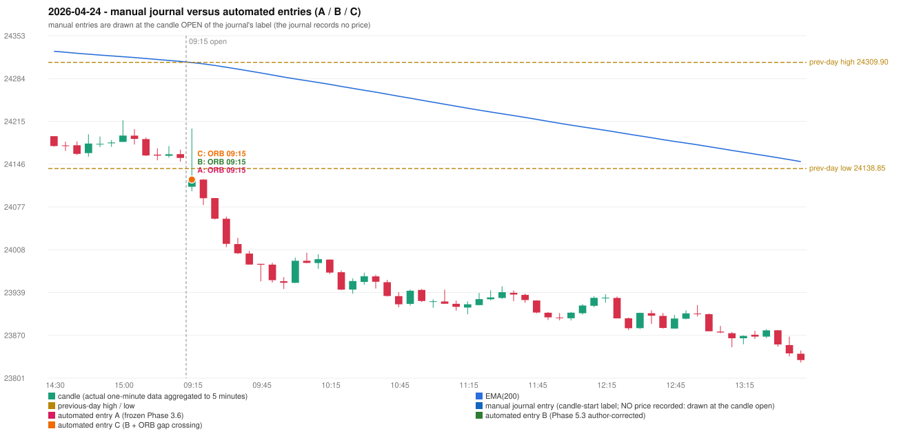

# 2026-04-24 (Friday) - manual journal versus the automated configurations

> SYNTHETIC index-point P&L; no real option P&L; costs illustrative (Rs 70 per trade + slippage scenarios). Configurations A / B / C are never combined.

## Session

* Open 24109.55; previous official close 24173.05; gap -63.50; previous-day high / low 24309.9 / 24138.85
* First 5-minute candle (09:15-09:20): O24109.55 H24203.35 L24102.25 C24124.2, GREEN, body 14.5%; EMA(200) at the first candle 24309.62; previous session's last close 24156.05 vs its EMA 24311.48

## Manual journal

no manual trade recorded

## Configuration A

Candidate signals (confirmed): 09:20 ORB/Method 1 SHORT [EXECUTED: trade 1: TARGET]

Strategies with no confirmed signal: IRF: no setup record (the strategy's trigger event never occurred) | PDR: no setup record (the strategy's trigger event never occurred) | PDS: Method 1/2/3 INCOMPLETE_AT_EOD NO_QUALIFYING_ENTRY_BEFORE_SESSION_END | RF: RF INCOMPLETE_AT_EOD NO_RETURN_INSIDE_BEFORE_SESSION_END

| trade | strategy / method | dir | signal -> fill | entry | stop / T1 / T2 | leg 1 | leg 2 | outcome | gross Rs | net Rs (70, 0) | net Rs (70, 1.0) |
|---|---|---|---|---|---|---|---|---|---|---|---|
| 1 | ORB/Method 1 | SHORT | 09:20 -> 09:20 | 24121.15 | 24151.15 / 24094.15 / 24061.15 | 09:20 @ 24094.15 | 09:29 @ 24061.15 | TARGET | 16,965 | 16,895 | 16,115 |

Selection: This ORB Method 1 signal was the earliest executable signal of the day: 0 confirmed signal(s) earlier, 0 other in the same minute. No later signal was generated. State of the other four engines at that moment: [IRF: no setup record before this time (a base condition was not met, or nothing triggered)] [PDR: no setup record before this time (a base condition was not met, or nothing triggered)] [PDS: no setup record before this time (a base condition was not met, or nothing triggered)] [RF: no setup record before this time (a base condition was not met, or nothing triggered)]

* Automated ORB 09:15 has no strict / time-tolerant journal counterpart: UNRESOLVED_DISCRETIONARY_SELECTION - the journal records no trade this day; the automated system took ORB Method 1 SHORT (candle 09:15) mechanically

## Configuration B

Candidate signals (confirmed): 09:20 ORB/Method 1 SHORT [EXECUTED: trade 1: TARGET]

Strategies with no confirmed signal: IRF: no setup record (the strategy's trigger event never occurred) | PDR: no setup record (the strategy's trigger event never occurred) | PDS: Method 1/2/3 INCOMPLETE_AT_EOD NO_QUALIFYING_ENTRY_BEFORE_SESSION_END | RF: RF INCOMPLETE_AT_EOD NO_RETURN_INSIDE_BEFORE_SESSION_END

| trade | strategy / method | dir | signal -> fill | entry | stop / T1 / T2 | leg 1 | leg 2 | outcome | gross Rs | net Rs (70, 0) | net Rs (70, 1.0) |
|---|---|---|---|---|---|---|---|---|---|---|---|
| 1 | ORB/Method 1 | SHORT | 09:20 -> 09:20 | 24121.15 | 24151.15 / 24094.15 / 24061.15 | 09:20 @ 24094.15 | 09:29 @ 24061.15 | TARGET | 16,965 | 16,895 | 16,115 |

Selection: This ORB Method 1 signal was the earliest executable signal of the day: 0 confirmed signal(s) earlier, 0 other in the same minute. No later signal was generated. State of the other four engines at that moment: [IRF: no setup record before this time (a base condition was not met, or nothing triggered)] [PDR: no setup record before this time (a base condition was not met, or nothing triggered)] [PDS: no setup record before this time (a base condition was not met, or nothing triggered)] [RF: no setup record before this time (a base condition was not met, or nothing triggered)]

* Automated ORB 09:15 has no strict / time-tolerant journal counterpart: UNRESOLVED_DISCRETIONARY_SELECTION - the journal records no trade this day; the automated system took ORB Method 1 SHORT (candle 09:15) mechanically

## Configuration C

Candidate signals (confirmed): 09:20 ORB/Method 1 SHORT [EXECUTED: trade 1: TARGET]

Strategies with no confirmed signal: IRF: no setup record (the strategy's trigger event never occurred) | PDR: no setup record (the strategy's trigger event never occurred) | PDS: Method 1/2/3 INCOMPLETE_AT_EOD NO_QUALIFYING_ENTRY_BEFORE_SESSION_END | RF: RF INCOMPLETE_AT_EOD NO_RETURN_INSIDE_BEFORE_SESSION_END

| trade | strategy / method | dir | signal -> fill | entry | stop / T1 / T2 | leg 1 | leg 2 | outcome | gross Rs | net Rs (70, 0) | net Rs (70, 1.0) |
|---|---|---|---|---|---|---|---|---|---|---|---|
| 1 | ORB/Method 1 | SHORT | 09:20 -> 09:20 | 24121.15 | 24151.15 / 24094.15 / 24061.15 | 09:20 @ 24094.15 | 09:29 @ 24061.15 | TARGET | 16,965 | 16,895 | 16,115 |

Selection: This ORB Method 1 signal was the earliest executable signal of the day: 0 confirmed signal(s) earlier, 0 other in the same minute. No later signal was generated. State of the other four engines at that moment: [IRF: no setup record before this time (a base condition was not met, or nothing triggered)] [PDR: no setup record before this time (a base condition was not met, or nothing triggered)] [PDS: no setup record before this time (a base condition was not met, or nothing triggered)] [RF: no setup record before this time (a base condition was not met, or nothing triggered)]

* Automated ORB 09:15 has no strict / time-tolerant journal counterpart: UNRESOLVED_DISCRETIONARY_SELECTION - the journal records no trade this day; the automated system took ORB Method 1 SHORT (candle 09:15) mechanically

## Chart

